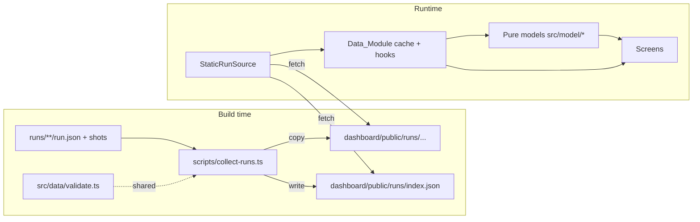

# Design Document: Haunt Dashboard

## Overview

The Haunt dashboard is a static single-page app in `dashboard/` that replays and explains ghost runs. It never runs ghosts. A build-time Collect_Step copies every `run.json` (and its screenshots) from `runs/` into `dashboard/public/runs/` and writes an index. At runtime, one Data_Module loads and validates those files. All screens are pure views over validated `Run` objects and a set of pure model functions.

**Key technologies** (versions aligned with `demo-site/package.json`):

- React 18, TypeScript (strict), Vite, served on port 3001 with `strictPort: true`
- `react-router-dom` with `createHashRouter` for deep links on any static host
- CSS Modules plus one global token file
- `@fontsource/im-fell-english` (headings) and `@fontsource/atkinson-hyperlegible` (body), both SIL Open Font License, bundled by Vite so no font is fetched from a CDN
- `tsx` to run the TypeScript Collect_Step script
- Tests: Vitest, Testing Library, `fast-check` (property tests), `axe-core` (component a11y checks), Playwright (end-to-end keyboard, contrast and network checks against `vite preview`)

**Design principles**

1. **One door for data.** Only `src/data/` touches the network. Screens call hooks; hooks call the selected `RunSource`.
2. **Pure models.** Haunts, rooms, cold spots, séance answers, exorcise results and coverage are pure functions of `Run[]`, so they are easy to test with properties.
3. **Fail per file, not per app.** A bad run file becomes an `InvalidRun` with readable errors; everything else keeps working.
4. **Every spooky element has a job.** Decoration always encodes information (see "Spooky element jobs").
5. **The URL is the state.** Screen, run, step, question, filters and comparison pairs live in the URL.

### Amendment: requirement changes (Req 1.8–1.11, 5.6–5.11, 7.2, 7.10–7.19, 10.4–10.5, 10.15–10.27, 16.7–16.10)

This amendment was written after reading the current code in `dashboard/`. Each change below names what the code does today and what changes. The details are in the sections marked "Amendment" further down.

| Area | Today | Change | Section |
|---|---|---|---|
| `npm run test:properties` | `vitest --run -t "Feature: haunt-dashboard, Property"`. It skips the two `Feature: exorcise-different-ghost-fix, Property N` tests in `models.properties.test.ts` and reports success when nothing matches | A wrapper script with a pattern that matches every spec name, which fails when zero Property_Tests ran | Property test runner |
| Reproduce_Command | `.code` uses `white-space: pre-wrap; word-break: break-all`, so flags and URLs split mid-word. The `dd` grid column is `1fr`, so an unbreakable line would widen the page | `white-space: pre`, horizontal scroll inside the box, `minmax(0, 1fr)` column, focusable only when it overflows | Provenance_Panel |
| Home hero | `ScreenHeading` renders a visible "Haunt" h1 as plain text. Card titles are h3 under a hidden "Haunted sites" h2. The ghost row shows `resultSentence` ("The Listener gave up") | The h1 becomes the logo (mark plus wordmark). Card titles become h2. The ghost row shows the Outcome_Line from `src/model/outcome.ts` | Home |
| Home at 1280 px and wider | `.cards` uses `repeat(auto-fill, minmax(24rem, 1fr))`. With one haunt this leaves an empty track as wide as the card | Two-column layout: haunt cards on the left (`auto-fit`), a "Recent ghost walks" side panel on the right | Home |
| Ghost Cam panel | Shows only the current step's text | A Transcript of steps 1 to current, built by `src/model/transcript.ts`, with fade levels and internal scrolling | Transcript |
| Ghost Cam layout | Vertical stack: header, stage, step info, callouts, controls, voice, timeline, warnings, provenance. Too tall for 1080 px | A grid that fits 1920×1080; Provenance_Panel stays below the timeline | Ghost Cam layout |
| Nav_Fog | `.layer` is `width: 200%`, but the global rule `img, svg { max-width: 100% }` clamps it to 100%. The drift moves it `translateX(-50%)`, so the right half of the header loses its fog during the animation | `.layer { max-width: none; }` and a layer width test | Nav_Fog |

## Architecture



### Folder layout

```
dashboard/
├── index.html                    # CSP meta added in production build
├── package.json
├── vite.config.ts                # port 3001, strictPort, base './', CSP plugin
├── playwright.config.ts
├── tsconfig.json
├── .gitignore                    # public/runs/ (generated)
├── scripts/
│   ├── collect-runs.ts           # Collect_Step
│   ├── propertyTestPattern.ts    # (amendment) the Property_Test name pattern, shared with tests
│   └── test-properties.ts        # (amendment) runs every Property_Test once, fails on zero
├── public/
│   └── runs/                     # generated, never committed
├── src/
│   ├── main.tsx
│   ├── App.tsx                   # router + layout
│   ├── routes.ts                 # URL builders and parsers (single source)
│   ├── data/
│   │   ├── types.ts              # contract types, Run, InvalidRun, RunIndex
│   │   ├── validate.ts           # validateRun(json, path) – shared with Collect_Step
│   │   ├── source.ts             # RunSource interface + selectRunSource()
│   │   ├── staticSource.ts       # reads public/runs
│   │   ├── screenshots.ts        # safe path check + URL resolution
│   │   └── hooks.ts              # useRunIndex, useRun, useAllRuns
│   ├── model/
│   │   ├── ghosts.ts             # ghost metadata (name, color token, icon, copy)
│   │   ├── findingLabels.ts      # type → plain words
│   │   ├── haunts.ts             # group by site, Start here target
│   │   ├── coldSpots.ts          # rooms, cold spots, size scale
│   │   ├── graveyard.ts          # tombstones + filters
│   │   ├── seance.ts             # question answers with citations
│   │   ├── exorcise.ts           # finding comparison
│   │   ├── coverage.ts           # mission coverage
│   │   ├── reproduce.ts          # Reproduce_Command
│   │   ├── outcome.ts            # (amendment) Outcome_Line for Home
│   │   ├── transcript.ts         # (amendment) Transcript lines and fade levels
│   │   └── waveform.ts           # deterministic bars from text
│   ├── components/
│   │   ├── layout/               # Header, Nav, SkipLink, Footer, Fog, LiveRegion
│   │   ├── ghosts/               # ListenerGhost, PhantomGhost, BebeGhost, GhostBadge
│   │   ├── ProvenancePanel.tsx   # startedAt, commit, url, reproduce + copy
│   │   ├── ResultBadge.tsx
│   │   ├── Screenshot.tsx        # image + Placeholder + FocusGlow
│   │   ├── RunErrorPanel.tsx
│   │   ├── CandleButton.tsx
│   │   └── Tombstone.tsx
│   ├── screens/
│   │   ├── HomeScreen.tsx
│   │   ├── HauntedMapScreen.tsx
│   │   ├── GraveyardScreen.tsx
│   │   ├── GhostCamScreen.tsx    # + SpokenPanel, ThoughtPanel, Transcript, Timeline, Controls, VoiceToggle
│   │   ├── SeanceScreen.tsx
│   │   ├── ExorciseScreen.tsx
│   │   ├── CoverageScreen.tsx
│   │   └── NotFoundScreen.tsx
│   ├── styles/
│   │   ├── tokens.css            # all colors, spacing, fonts
│   │   ├── tokens.ts             # same colors exported for contrast tests
│   │   └── motion.css            # keyframes, all inside prefers-reduced-motion: no-preference
│   └── __tests__/
│       ├── fixtures/             # derived fixtures (see Testing)
│       └── ...
└── e2e/                          # Playwright specs
```

## Components and Interfaces

### Collect_Step (`scripts/collect-runs.ts`)

Runs as `predev` and `prebuild`. Steps:

1. Delete `dashboard/public/runs/`.
2. Walk `../runs/` recursively; collect paths of files named `run.json`, sorted by path for deterministic order.
3. For each: copy its folder to `public/runs/<relative folder>/`; read and `JSON.parse`; call the shared `validateRun`.
4. Compute `key`: `runId` if it is a non-empty string, else folder path with `/` → `--`. On duplicate key, mark later entries invalid with `duplicate runId`.
5. Write `public/runs/index.json`. Print one warning line per invalid file. Exit 0 unless `runs/` itself is unreadable.

It only reads from `runs/`. It never writes there.

### Property test runner (amendment, Req 1.8–1.11)

**Problem in the current code.** `test:properties` is `vitest --run -t "Feature: haunt-dashboard, Property"`. That filter is hard-coded to one spec name, so the `Feature: exorcise-different-ghost-fix, Property 1` and `Property 2` describes in `src/__tests__/models.properties.test.ts` never run. When the filter matches nothing, Vitest marks every test as skipped and can still exit 0, which breaks Req 1.11.

**Pattern.** One exported constant, used by the script and by Property 12:

```ts
// scripts/propertyTestPattern.ts
/** Matches a full test name that starts with "Feature: <spec name>, Property". */
export const PROPERTY_TEST_PATTERN = '^Feature: [a-z0-9]+(-[a-z0-9]+)*, Property';
export function isPropertyTestName(fullName: string): boolean {
  return new RegExp(PROPERTY_TEST_PATTERN).test(fullName);
}
```

Spec folders in `.kiro/specs/` are kebab-case, so `[a-z0-9]+(-[a-z0-9]+)*` covers every current and future spec name without editing the command. Vitest's `-t` matches against the full test name, which is the describe names and the test name joined by spaces. The full name of a test inside a top-level `describe('Feature: x, Property N: …')` therefore starts with the describe name. One rule follows: **a Property_Test describe must be top level.** If it is nested inside another describe, its full name starts with the outer name and the pattern does not match it. All existing Property_Tests (`validate.properties.test.ts`, `models.properties.test.ts`, `routes.test.ts`) are already top level.

**Script.** `package.json`: `"test:properties": "tsx scripts/test-properties.ts"`. The script:

1. Spawns `npx vitest run -t "<PROPERTY_TEST_PATTERN>" --reporter=default --reporter=json --outputFile.json=<os tmpdir>/haunt-properties.json` with inherited stdio. `vitest run` never enters watch mode. The default reporter prints each failing test by its full name (Req 1.10).
2. Reads the JSON report. A pure helper `decideExit(report, vitestExitCode)` returns the exit code and an optional message:
   - `numPassedTests + numFailedTests === 0`: exit 1 with "No Property_Tests ran. Property_Test describe names must start with 'Feature: <spec name>, Property' and be top level." (Req 1.11)
   - `numFailedTests > 0` or a non-zero Vitest exit: exit 1 (Req 1.10)
   - otherwise: exit 0
3. If the report file is missing (Vitest crashed before writing it), exit 1 with "Vitest did not produce a report."

**Scope (Req 1.8, 1.9).** The Vitest `include` in `vite.config.ts` widens from `src/**` and `scripts/**` to `**/*.{test,spec}.{ts,tsx}`, with `exclude: ['node_modules/**', 'dist/**', 'e2e/**', 'test-results/**']`. A Property_Test in any test file under `dashboard/` is then found. `e2e/haunt.spec.ts` stays out, so Playwright never runs. Vitest's root is `dashboard/`, so `demo-site/` is never scanned. `npm test` uses the same config, so it also picks up tests in new folders. That is the intended behaviour.

Tests skipped by `-t` are not executed: Vitest only collects them and reports them as skipped. Collection still imports each test file, so module-level code in test files must not have side effects. The current files only define fixtures and arbitraries at module level.

```ts
// src/data/types.ts
export interface RunIndex {
  formatVersion: 1;
  generatedAt: string;               // ISO
  entries: RunIndexEntry[];
}
export interface RunIndexEntry {
  key: string;                       // Run_Key
  folder: string;                    // e.g. "samples/listener-gave-up"
  origin: 'samples' | 'runs';
  errors: ValidationIssue[];         // empty when valid at collect time
}
```

### Contract types and validation (`src/data/types.ts`, `validate.ts`)

```ts
export type GhostId = 'listener' | 'phantom' | 'bebe';       // exactly the contract values
export type RunResult = 'succeeded' | 'gave_up' | 'error';   // exactly the contract values
export type FindingType =                                    // exactly the contract values
  | 'unlabeled_button' | 'focus_trap' | 'unannounced_error' | 'slow_wait'
  | 'misclick' | 'cut_off_text' | 'untranslated' | 'dark_pattern';

export interface FocusBox { x: number; y: number; w: number; h: number }
export interface Step {
  n: number; page: string; action: string; spoken: string; thought: string;
  screenshot: string | null;         // null when missing or unsafe
  focusBox: FocusBox | null;         // null when absent or w/h <= 0
  waitMs: number;
}
export interface Finding {
  type: FindingType; step: number; title: string; evidence: string;
  screenshot: string | null;
}
export interface Run {
  key: string; folder: string; origin: 'samples' | 'runs';
  formatVersion: 1; runId: string;
  ghost: GhostId;                    // exactly the contract values
  mission: { id: string; goal: string; requirement: string; successCheck: string };
  site: { name: string; url: string; commit: string };
  startedAt: string;                 // validated as parseable ISO 8601
  result: RunResult;
  steps: Step[];                     // sorted by n
  findings: Finding[];
  warnings: ValidationIssue[];
}
export interface ValidationIssue { path: string; message: string }  // path like "steps[3].waitMs"
export type LoadedRun =
  | { ok: true; run: Run }
  | { ok: false; key: string; folder: string; errors: ValidationIssue[] };

export function validateRun(input: unknown, meta: { key: string; folder: string; origin: 'samples' | 'runs' }): LoadedRun;
```

A small hand-written validator is used instead of a schema library: the contract is small, and hand-written checks produce the exact plain-words messages the UI shows (for example `steps[3].waitMs: expected a number, got "fast"`). Validation rules follow Requirement 4:

| Condition | Outcome |
|---|---|
| Not JSON, wrong `formatVersion`, missing/wrong-typed required field, unparseable `startedAt`, duplicate step `n` | Error (invalid) |
| `result` not one of `succeeded`, `gave_up`, `error` | Error naming the allowed values. No aliases |
| Finding `type` not one of the eight contract types | Error naming the allowed values. No aliases |
| `focusBox` absent or `w <= 0` or `h <= 0` | `focusBox: null` (no warning when absent; warning when zero-sized) |
| Finding `step` not in steps | Warning |
| Screenshot absolute, contains `..`, `\`, or a scheme (`:`) | `screenshot: null` + warning |
| `ghost` not one of `listener`, `phantom`, `bebe` | Error naming the allowed values. No aliases |

`validateRun` never throws; a property test enforces this.

### Data_Module (`src/data/source.ts`, `staticSource.ts`, `hooks.ts`)

```ts
export interface RunSource {
  listRuns(): Promise<RunIndex>;
  loadRun(entry: RunIndexEntry): Promise<LoadedRun>;
  screenshotUrl(run: Run, path: string): string;
}
export function selectRunSource(): RunSource;   // the only place a source is chosen
```

`StaticRunSource` fetches `./runs/index.json` and `./runs/<folder>/run.json` relative to `import.meta.env.BASE_URL`. A module-level `Map<key, Promise<LoadedRun>>` caches each file once. Fetch or parse failures become `LoadedRun { ok: false }` with a message such as "Could not read run.json (HTTP 404)".

Hooks: `useRunIndex()`, `useAllRuns()` (loads every entry, returns `{ runs: Run[]; invalid: InvalidRun[]; status }`), `useRun(key)`. A later `LiveRunSource` implements the same interface; no screen changes.

### Routes (`src/routes.ts`)

All URLs are built and parsed here so links in screens, the README and tests agree.

| Screen | Path | Notes |
|---|---|---|
| Home | `#/` | |
| Haunted Map | `#/haunt/:siteKey/map?ghost=` | `siteKey` = slug of `site.name` (lowercase, non-alphanumerics → `-`) |
| Graveyard | `#/graveyard?site=&ghost=` | |
| Ghost Cam | `#/run/:runKey/step/:n` | `#/run/:runKey` redirects to step 1 |
| Séance | `#/seance`, `#/seance/:runKey/:questionId` | `questionId` ∈ `why-give-up`, `where-stuck`, `what-heard`, `what-helped` |
| Exorcise | `#/exorcise`, `#/exorcise/:beforeKey/:afterKey` | |
| Coverage | `#/coverage` | |
| Invalid run | `#/restless/:runKey` | Shows `RunErrorPanel` |

Example deep link for the README: `http://localhost:3001/#/run/2026-11-03-listener-pay-bill/step/9`.

Step changes use `navigate(url, { replace: true })`, so playback does not fill browser history. A `RouteAnnouncer` sets `document.title` (for example "Step 9 of 9 · The Listener · Ghost Cam · Haunt") and focuses the screen's `h1` (with `tabIndex={-1}`) on route changes, but not on step-only changes inside the Ghost Cam, where focus stays on the control the user pressed.

### Model functions (`src/model/`)

All are pure and synchronous.

```ts
// haunts.ts
interface Haunt { siteKey: string; siteName: string; runs: Run[]; ghosts: GhostSummary[];
                  findingCount: number; latestStartedAt: string }
function groupHaunts(runs: Run[]): Haunt[];                   // sorted by latestStartedAt desc
function startHereTarget(runs: Run[]): { runKey: string; step: number } | null;
//  1) most recent listener run with a focus_trap finding → that finding's step
//  2) else most recent listener run with any finding → its first finding's step
//  3) else null (button unavailable, reason shown)

// coldSpots.ts
interface Room { page: string; ghosts: GhostId[]; coldSpots: ColdSpot[] }
interface ColdSpot { runKey: string; ghost: GhostId; step: number; waitMs: number;
                     reason: 'finding' | 'gave_up' | 'error' }
function buildRooms(runs: Run[]): Room[];
function coldSpotSize(waitMs: number): number;   // px, monotonic
//  size = clamp(24 + 16 * log2(1 + waitMs / 100), 24, 96)

// findingLabels.ts
const FINDING_LABELS: Record<FindingType, { label: string; helped: string }>;  // the only table
function plainFindingType(type: FindingType): string;

// FindingType          label                      "What would have helped?" (first person)
// unlabeled_button     Button with no name        "If the button had a name, like 'Pay bill', I'd have known what it does."
// focus_trap           Keyboard trap              "A way out with the keyboard, like Escape or a Close button I could reach."
// unannounced_error    Error nobody announced     "If the error had been read out, I'd have known what to fix."
// slow_wait            Too long a wait            "A faster page, or a sign that it was still working."
// misclick             Clicked the wrong thing    "A page that stayed still while I was about to click."
// cut_off_text         Text cut off               "Text that wrapped instead of being cut off when I zoomed in."
// untranslated         Text not translated        "This text in my language."
// dark_pattern         Tricky choice              "A plain choice, with nothing extra ticked for me."

// graveyard.ts
interface TombstoneData { run: Run; finding: Finding; label: string }
function buildGraveyard(runs: Run[], filter: { site?: string; ghost?: string }): TombstoneData[];

// seance.ts
type QuestionId = 'why-give-up' | 'where-stuck' | 'what-heard' | 'what-helped';
interface Answer { paragraphs: AnswerPart[][] }       // text pieces + StepCitation pieces
type AnswerPart = { kind: 'text'; text: string } | { kind: 'cite'; step: number };
function answer(run: Run, q: QuestionId): Answer;

// exorcise.ts
type ExorciseStatus = 'exorcised' | 'not_reached' | 'still_haunting' | 'new_haunting';
interface ExorciseRow { status: ExorciseStatus; before?: Finding; after?: Finding; key: string }
function compareRuns(before: Run, after: Run): { rows: ExorciseRow[]; differentGhosts: boolean }
          | { error: 'different_missions' };

// coverage.ts
interface MissionCoverage { missionId: string; goal: string; requirement: string;
  requirementChanged: boolean;
  perGhost: Record<GhostId, { latest: Run | null; runs: Run[] }> }
function buildCoverage(runs: Run[]): MissionCoverage[];

// reproduce.ts – the only place the command template lives
function reproduceCommand(run: Run): string;
// "git checkout <commit> && npx haunt run --ghost <ghost> --mission <mission.id> --url <site.url>"
// Values are shell-quoted with single quotes when they contain anything outside [A-Za-z0-9._:/-].

// waveform.ts
function waveformBars(text: string, count = 32): number[];  // 0..1, deterministic per text

// outcome.ts (amendment, Req 7.14–7.19)
function outcomeLine(run: Run): string;

// transcript.ts (amendment, Req 10.4, 10.5, 10.16–10.19, 10.22, 10.27)
type FadeLevel = 0 | 1 | 2 | 3;               // 0 = Current_Line
interface TranscriptLine { n: number; text: string; empty: boolean; fade: FadeLevel; current: boolean }
function buildTranscript(run: Run, currentN: number): TranscriptLine[];
function fadeLevel(distance: number): FadeLevel; // min(3, distance), distance = steps before the current one
```

**Outcome_Line (amendment).** `outcomeLine` is the only place the sentence is built. It uses `FINDING_LABELS` from `findingLabels.ts` (the single label table, Req 9.4) and `plural` from `format.ts`. "Last step" means the step with the highest `n`. `Run.steps` is already sorted by `n`, so that is the last element.

| Condition (checked in this order) | Text | Sample |
|---|---|---|
| `steps` is empty | "No steps were recorded" | |
| `succeeded` | "Made it through in N steps" with N = `steps.length` and "step" when N is 1 | Bebe: "Made it through in 6 steps" |
| `error` | "Stopped by a technical error at step N", N = last `n` | |
| `gave_up` and the first finding (array order) with `step === last n` is `focus_trap` | "Trapped by a " + label with its first letter lowercased + " at step N" | Listener: "Trapped by a keyboard trap at step 9" |
| `gave_up` and that first finding is another type | "Stuck at step N: " + label as written | |
| `gave_up` with no finding at the last step | "Gave up at step N" | |

Every non-empty case contains a digit, and no badge label (`Completed`, `Gave up`, `Errored`) is a whole Outcome_Line, so Req 7.18 holds by construction. Property 11 checks it.

**Transcript model (amendment).** `buildTranscript(run, currentN)` finds the index of the step with `n === currentN` and returns one line for every step from index 0 to that index, in array order (ascending `n`). It returns `[]` when `currentN` is not in the run, but the screen never calls it then because `StepOutOfRange` renders first. For each line:

- `text` is `step.spoken` for The Listener and `step.thought` for the other ghosts.
- When that text is missing, empty or whitespace only, `empty` is `true` and `text` is "Nothing was spoken at this step." (Listener) or "Nothing was thought at this step." (others) (Req 10.27). Today `validateRun` requires `spoken` and `thought` to be strings (Req 4.1), so "missing" can only reach the model if validation is relaxed later. The model still handles `undefined`.
- `current` is `true` only for the last line.
- `fade = fadeLevel(lastIndex - i)`, so the Current_Line is level 0 and earlier lines step down to level 3, which is the floor. Lines further back than three steps stay at level 3. Contrast therefore never increases toward the top, which satisfies "no line has higher contrast than any line after it" (Req 10.19).

Repeated texts (for example several "Button" lines) are separate lines, because there is one line per step and the React key is the step `n`.

**Séance answer templates** (first person, built only from run fields):

| Question | Template |
|---|---|
| Why did you give up? | `gave_up`: "I gave up at step {last} on {page}." + one sentence per finding at or before last ("At step {n}, {title}.") · `succeeded`: "I didn't give up. I finished at step {last}: {spoken}." · `error`: "Something broke on the technical side at step {last}, so I had to stop." |
| Where did you get stuck? | One line per Cold_Spot: "On {page} at step {n}, I waited {s} s." Or "I never got stuck." |
| What did you hear? | One line per step: "Step {n}: '{spoken}'." |
| What would have helped? | One line per finding: "At step {n}: {helped}", where {helped} comes from `FINDING_LABELS` |

**Exorcise matching.** Findings match by `type + page`, where `page` is the page of the finding's step (or `?` if the step is missing). Matching is a multiset: two `unlabeled_button` findings on `/bill` before and one after give one "Still haunting" and one "Exorcised". "Not reached" applies when the after run has no step on that page.

### Screens

**Home.** A candlelit title band ("Haunt"), then the two candle buttons: "Start here" (amber, flickering flame) and "Summon a live ghost" (`aria-disabled="true"`, dimmed, unlit candle, visible "Coming soon: live ghosts are not connected yet"; its click handler is a no-op). Haunt cards follow: site name (h2), most recent date, finding count ("3 findings"), and one row per ghost: character, name, result in words with a ResultBadge, link to its Ghost Cam. Each card links to the Haunted Map. A "Restless files" section lists Invalid_Runs.

**Home (amendment, Req 7.2, 7.10–7.19).**

- *Logo is the h1.* The hero's `ScreenHeading` renders `<h1 class="logo">` holding an inline `HauntLogo` SVG mark (a small lit candle, `aria-hidden="true"`) followed by the wordmark text "Haunt" in IM Fell English italic amber. The accessible name is "Haunt". The hero has no other element with the text "Haunt". The header brand link stays: it is a link inside the banner landmark, not a heading, and it is outside the hero (Req 7.10, 7.11).
- *Card headings are h2.* `HauntCard` changes its title from `h3` to `h2`. The visually hidden "Haunted sites" `h2` is removed and the section gets `aria-label="Haunted sites"`, so the heading order stays h1 → h2 (Req 7.11, 18.7).
- *Outcome_Line.* In each ghost row, `resultSentence(...)` is replaced by `<p class="outcome">{outcomeLine(summary.latest)}</p>`, next to the `ResultBadge` of the same `summary.latest` run (Req 7.2). The "earlier runs" list keeps `resultSentence`.
- *Wide layout (≥ 1280 px).* The haunt-card section and a new side panel sit in one wrapper:

  ```css
  .body { display: grid; gap: var(--space-5); }
  @media (min-width: 1280px) {
    .body { grid-template-columns: minmax(0, 2fr) minmax(18rem, 1fr); align-items: start; }
  }
  .cards { grid-template-columns: repeat(auto-fit, minmax(min(100%, 24rem), 1fr)); }
  ```

  The side panel is `<aside aria-labelledby="recent-heading">` with the h2 "Recent ghost walks". It lists the six most recent runs from `recentRuns(runs, 6)` in `haunts.ts`, newest first: ghost icon and name, site name, local date, Outcome_Line, and a link "Watch {ghost} in the Ghost Cam". Below the list it shows run counts per ghost ("The Listener: 1 run"), in ghost order.

  *Why a side panel and not only more card columns.* With the sample data there is one haunt. `auto-fill` leaves an empty track as wide as the card, which is the current bug. `auto-fit` alone would stretch the single card to about 1240 px, with lines too long to read comfortably. The side panel puts run information into that space whatever the number of haunts. When there are several haunts, `auto-fit` inside the left column (about 810 px at 1280, about 1150 px at 1920 with the 72 rem content width) still gives one or two card columns. The rule "no empty column wider than one haunt card" (Req 7.12) holds at every count.
- *Narrow layout (< 1280 px).* `.body` is one column: hero, haunt cards, then the side panel, then Restless files. This is also the DOM order, so reading order and tab order match (Req 7.13, 18.1).

**Haunted Map.** A floor plan grid of rooms (CSS grid, `<ul>` of `<li>` rooms, each with an `h2` of the page path). Each room shows ghost badges for who entered and cold spots as round frosty buttons sized by `coldSpotSize`. Each button has visible text "{s} s" and the accessible name "Bebe waited 1.2 s at step 2 — open in Ghost Cam". A ghost filter (radio group) adds fog over rooms that ghost never entered, plus the text "Not visited by Bebe".

**Graveyard.** A wrapping grid of bone tombstones (`<article>` with `h2` = plain-words type). Contents: ghost badge, title, evidence, "Step 9 · Lantern Bills demo", and a link "Watch The Listener at step 9". Filters: site select and ghost radio group, written to the URL query.

**Ghost Cam.** Layout: provenance and mission header, then a two-column grid (stacked under 900 px):

- *Left*: `Screenshot` renders the image at its natural aspect ratio. `FocusGlow` is an absolutely positioned outline scaled by `renderedWidth / naturalWidth` (measured with `ResizeObserver`). For missing images it renders the Placeholder (16:10 grey `#55504a`, text "No screenshot for step 9") and scales against 1280×800. The glow uses a spectral-white 3 px border and a soft box-shadow halo. With reduced motion the halo is static; otherwise it pulses slowly (2.5 s, opacity 0.7–1.0).
- *Right*: `SpokenPanel` (Listener): black panel, large spectral text in quotes, waveform below as an SVG of 32 bars from `waveformBars(spoken)`, `aria-hidden`. The bars animate only while playing and without reduced motion. `ThoughtPanel` (others): surface panel with a thought-bubble shape and the `thought` text.
- *Below*: Controls (`Step back`, `Play`/`Pause` as one toggle button with `aria-pressed`, `Step forward`), step info ("Step 9 of 9 · /bill · Tab · waited 0.5 s"), the voice toggle for the Listener, and the Timeline: an ordered list of step buttons, each named "Step n" (plus ", finding: Keyboard trap" where relevant), finding steps drawn as small tombstones, the current one with `aria-current="step"`.
- *Finding callout*: when the step has a finding, a callout with ghost-specific copy: Listener + trap: "The Listener got trapped here."; others: "{Ghost} hit a problem here." Last step of a `gave_up` run: "{Ghost} gave up here." (red fill, white text, light border).
- A visually hidden polite live region announces "Step 9: Button, Confirm".

Keyboard shortcuts are not added beyond normal buttons. That avoids conflicts with screen reader keys.

Playback is a `useEffect` interval of 1500 ms that calls `navigate(stepUrl(n+1), { replace: true })` and stops at the last step. It also stops when the tab is hidden.

**Transcript (amendment, Req 10.4, 10.5, 10.16–10.23, 10.27).** `SpokenPanel` and `ThoughtPanel` both render a `Transcript` component, fed by `buildTranscript(run, step.n)`, in place of the single current-step paragraph. The thought-bubble shape stays around the Thought_Panel's transcript. The waveform stays below the Spoken_Panel's transcript and uses the Current_Line's text (`step.spoken`).

```tsx
<div
  ref={scroller}
  className={styles.transcript}
  role="region"
  aria-label={listener ? 'Spoken transcript' : 'Thought transcript'}
  tabIndex={overflowing ? 0 : undefined}
  onKeyDown={scrollKeys('y')}
>
  <ol className={styles.lines}>
    {lines.map((line) => (
      <li key={line.n} className={styles[`fade${line.fade}`]} aria-current={line.current ? 'step' : undefined}
          data-current={line.current || undefined}>
        <span className={styles.lineStep}>Step {line.n}</span>
        <span className={line.empty ? styles.emptyText : undefined}>{line.text}</span>
      </li>
    ))}
  </ol>
</div>
```

- *Step number in text* in front of each line (Req 10.17).
- *Current_Line marker that does not rely on color* (Req 10.18): a 4 px solid left border in `--spectral`, a `▸` glyph in a `::before` pseudo-element (not read out), and weight 700. Earlier lines have a transparent 4 px left border, so text does not shift when the marker moves. Assistive technology gets `aria-current="step"`. The timeline also uses `aria-current="step"`, in a separate list, which is allowed.
- *Fade levels* (Req 10.19). Each level is a token color, so contrast is exact and testable. Opacity is not used, because blended colors depend on what is behind them. The colors are new tokens in `tokens.css` and `tokens.ts` with new `COLOR_PAIRS` entries:

  | Panel background | Level 0 (current) | Level 1 | Level 2 | Level 3 (floor) |
  |---|---|---|---|---|
  | `--spoken-bg` `#000000` | `--spoken-text` `#f4f8ff` (19.72) | `--spoken-fade-1` `#c8ccd4` (≈13.0) | `--spoken-fade-2` `#a0a4ab` (≈8.4) | `--spoken-fade-3` `#85898f` (≈6.0) |
  | `--surface` `#2a2522` (thought bubble) | `--text` `#ece6dc` (12.21) | `--thought-fade-1` `#cbc5bc` (≈8.8) | `--text-muted` `#b8ae9f` (6.92) | `--thought-fade-3` `#aca69d` (≈6.3) |

  The ratios were computed with the WCAG formula in `tokens.ts`. The contrast test recomputes them and requires each level to be lower than the one before it and at least 4.5:1. Floors of about 6:1 leave a margin above 4.5:1. The steering file's rule "any new color pair must be added to the contrast test" applies. The steering colour table should also get these five tokens. That is a steering-file edit for the House Builder and is outside this spec.
- *Empty text* (Req 10.27) uses the same fade color as its level, in italic, so it is visibly a note and still a full line.
- *Scrolling inside the panel* (Req 10.20). The scroller has `overflow-y: auto; overscroll-behavior: contain` and a height set by the layout (below). A `useLayoutEffect` keyed on `step.n` runs `el.scrollTop = el.scrollHeight - el.clientHeight`. It does not use `scrollIntoView`, because that can scroll the page and other ancestors. Setting `scrollTop` touches only the container and never moves focus. The Current_Line is always the last `li`, so scrolling to the bottom shows it fully at the bottom edge. The `ol` has `padding-bottom: var(--space-2)` so the focus ring and marker are not clipped.
- *Focusable only when overflowing* (Req 10.21). The shared hook `useScrollOverflow(ref, axis)` in `src/hooks/useScrollOverflow.ts` returns `overflowing = scrollHeight > clientHeight + 1` (or the width version for `axis: 'x'`). It measures in a `useLayoutEffect` after every render and in a `ResizeObserver` callback on the element. Zoom changes fire the observer because the element's CSS size changes. `scrollKeys('y')` handles ArrowUp and ArrowDown with `el.scrollBy({ top: ∓40 })` and `preventDefault()`, so the page does not scroll as well. It handles ArrowLeft and ArrowRight the same way for `'x'`. The focus ring is the global `:focus-visible` ring. On the black panel the ring is `--spectral` on `#000000` (17.37:1, already in `COLOR_PAIRS`).
- *Live region unchanged* (Req 10.14, 10.23). The announcement effect still sends only `Step {n}: {text}` for the new step. The Transcript `ol` is not a live region, and the scroller has no `aria-live`, so earlier lines are never announced again.

**Ghost Cam layout (amendment, Req 10.1, 10.15, 10.24–10.26).**

The DOM order is the reading order at every size: Run_Summary, screenshot, panel (transcript plus finding callouts), step info, Controls and voice toggle, Timeline, run-file notes (warnings), Provenance_Panel. Compared with today, the finding callouts move from between step info and controls into the right-hand column after the panel. The voice toggle stays directly after the Controls. Provenance is already after the Timeline in `GhostCamScreen.tsx` and stays there (Req 10.25).

*Fit mode* applies under `@media (min-width: 1280px) and (min-height: 900px)`. At 1920×1080 and 100% zoom it fits the Run_Summary, screenshot, panel, controls and timeline inside the viewport (Req 10.24):

```css
.cam {
  display: grid;
  grid-template-columns: minmax(0, 1fr) minmax(22rem, 26rem);
  grid-template-areas:
    "summary  summary"
    "shot     panel"
    "controls panel"
    "timeline timeline"
    "rest     rest";        /* warnings, Provenance_Panel */
  gap: var(--space-4) var(--space-5);
  --cam-shot-max: calc(100vh - 40rem);
}
.right { grid-area: panel; position: relative; }      /* adds no height to its rows */
.rightInner { position: absolute; inset: 0; display: flex; flex-direction: column; gap: var(--space-3); }
.transcript { flex: 1 1 0; min-height: 6rem; }
.callouts, .waveform { flex: none; }
```

- The right column is absolutely filled, so its height equals the screenshot row plus the controls row. The transcript takes the rest and scrolls internally. A long transcript can never make the page taller.
- The screenshot is capped by height: the image gets `max-height: var(--cam-shot-max); width: auto`, and the Placeholder gets `width: min(100%, calc(var(--cam-shot-max) * 1.6))` to keep 16:10. `FocusGlow` already scales by rendered width over natural width (or 1280), so the cap does not change the glow math.
- *Height budget at 1080 px* (18 px root): site header ≈ 78 px, main top padding 36 px, compact Run_Summary ≤ 150 px, three row gaps 54 px, step info + controls + voice note ≈ 120 px, timeline ≈ 105 px. That is about 543 px. The first value, `32rem` (576 px), was too small: measured in the browser, the Run_Summary is about 194 px and the Listener's controls row (with the voice toggle and note) is about 221 px, so the Listener's timeline ended at 1176 px. `40rem` (720 px) leaves 360 px for the screenshot, which gives a placeholder about 576 × 360 px and puts both timelines inside 1080 px. The Playwright fit test checks the real numbers for both samples.
- *Compact Run_Summary* in fit mode: a 64 px ghost character, the h1 and the one-line ghost description in the first column, and the `dl` (Mission, Requirement, Site, Result) as a two-column grid in the second column. The summary keeps the same elements in the same order, only arranged differently.
- The timeline heading uses `margin-top: 0` in fit mode, and the marks stay on one row for up to about 20 steps at 1296 px. Longer runs wrap, and the page may then scroll. Req 10.24 only names the two samples (9 and 6 steps).

*Stacked mode* (narrower than 1280 px or shorter than 900 px, which includes 200% zoom on a 1920×1080 screen, a 960×540 CSS viewport). Between 900 and 1279 px wide, the current two-column stage stays (screenshot `3fr`, panel `2fr`) and the page scrolls vertically. Below 900 px everything is one column in DOM order. The transcript scroller gets `max-height: 50vh` (stacked) so it never fills the page. The screenshot area keeps its own `overflow-x: auto` and is the only element allowed to scroll sideways (Req 10.26, 18.8).

**Approximate voice.** `useApproximateVoice()` checks `window.speechSynthesis`, waits for `voiceschanged`, and keeps only `voices.filter(v => v.localService)`. It prefers a local voice whose `lang` starts with the document language. It speaks `spoken` on step change while enabled and calls `cancel()` before each utterance, on toggle off and on unmount. When unavailable, the toggle is `aria-disabled` with the reason "Your browser has no built-in offline voice."

**Séance.** A round table of candles. A run picker (select grouped by site) and four question buttons in a radio-like group. The answer appears in a "spirit board" panel (`<section aria-live="polite">`). Citations render as links "step 9" to the Ghost Cam.

**Exorcise.** Two selects (before, after; the after list is filtered to the same `mission.id`, defaulting to the most recent other run of the same mission and ghost if one exists). Two columns show run summary and provenance. Below is a table with columns Finding, Page, Status. Statuses use icon + text: Exorcised (a ghost fading out, spectral), Still haunting (a solid ghost, amber outline), New haunting (a ghost with a "+" mark, red fill + light border), Not reached (fog icon, muted). A warning banner appears when the ghosts differ.

**Coverage.** A table: rows are missions (requirement text in a `th scope="row"`, goal below), columns are the three ghosts, always in the order The Listener, The Phantom, Bebe. Cells hold an icon + "Completed" / "Gave up" / "Errored" / "Not yet haunted", linking to the runs.

### Provenance_Panel (amendment, Req 5.6–5.11)

**Problems in the current code** (`ProvenancePanel.tsx` and `.module.css`):

- `.code { white-space: pre-wrap; word-break: break-all }` splits flags, quoted values and the URL at any character. `body { overflow-wrap: break-word }` is inherited as well.
- `.list > div { grid-template-columns: minmax(7rem, max-content) 1fr }`. A `1fr` track has an automatic minimum of its content width. Once the command stops wrapping, that minimum would widen the page.

**Changes.**

```tsx
<div
  ref={box}
  className={styles.commandBox}
  role="region"
  aria-label="Reproduce command"
  tabIndex={overflowing ? 0 : undefined}
  onKeyDown={scrollKeys('x')}
>
  <code ref={commandRef} className={styles.code}>{command}</code>
</div>
<button type="button" className="button" onClick={() => void copy()}>Copy command</button>
```

```css
.list > div { grid-template-columns: minmax(7rem, max-content) minmax(0, 1fr); }
.commandBox {
  flex: 1 1 auto; min-width: 0; max-width: 100%;   /* basis = command width; the copy button wraps below when both don't fit */
  overflow-x: auto; overflow-y: hidden;
  background: var(--bg); border-radius: var(--radius);
  padding: var(--space-2) var(--space-3);
}
.code { display: block; width: max-content; white-space: pre; word-break: normal; overflow-wrap: normal; }
```

- `white-space: pre` breaks lines only at `\n` in the command text (Req 5.6). The current template has no newline, so the command is one line.
- The box scrolls horizontally and the page does not (Req 5.7), because every ancestor track uses `minmax(0, …)` or `min-width: 0`.
- `useScrollOverflow(box, 'x')` sets `tabIndex={0}` only while `scrollWidth > clientWidth + 1`. It re-measures through `ResizeObserver` on viewport and zoom changes (Req 5.8, 5.11). The name comes from `aria-label`. The global `:focus-visible` ring (3 px `--spectral` on `--surface`, 12.53:1) shows on the box. ArrowLeft and ArrowRight scroll by 40 px, and Home and End jump to the start and end, so the first and last characters can always be reached.
- *Copy* calls `navigator.clipboard.writeText(command)`. `command` is the value returned by `reproduceCommand(run)` in the same render, never the DOM text, so layout cannot add or remove characters (Req 5.9).
- *Clipboard failure* (Req 5.10): the existing `catch` stays. It selects the command text and announces "Couldn't copy. Select the command and copy it yourself." through the polite live region. "Command copied" is announced only after `writeText` resolves. The button is never disabled.

### Visual design rules

The design rules live in one place: `.kiro/steering/dashboard-design.md`. That file loads automatically for any file in `dashboard/`. It defines:

- **Colors**: the token table with every contrast ratio, the red-as-fill-only rule and the focus ring rules
- **Fonts**: IM Fell English and Atkinson Hyperlegible, bundled through npm
- **Ghost characters**: silhouettes, icons, accent colors and UI descriptions for The Listener, The Phantom and Bebe
- **What each spooky element means**
- **Motion limits**

This design document does not repeat those values, so the two cannot drift apart. Implementation notes:

- Tokens go in `src/styles/tokens.css`, mirrored in `src/styles/tokens.ts` so the contrast test can recompute every pair.
- Keyframes go in `src/styles/motion.css`, and the `useReducedMotion()` hook is in `src/hooks/`.
- Ghost SVG components go in `src/components/ghosts/`. `GhostBadge` always renders the icon plus the name.

### Nav_Fog (amendment, Req 16.7–16.10)

**Root cause.** The header itself is full width: `.header` is a block element with no `max-width`, and only `.headerInner` is limited to `--content-width`. `Fog` is `position: absolute; inset: 0` inside the header, so the fog container already spans the viewport. The gap comes from the layers. `Fog.module.css` gives `.layer` `width: 200%`, but `global.css` has `img, svg { max-width: 100% }`, which clamps each SVG layer to 100% of the header. `haunt-fog-drift` then animates `translateX(0)` to `translateX(-50%)`, and the second layer runs in reverse from `-50%`. For most of the 90 s cycle, part of the right side of the header has no fog, up to half the width. The bug only shows while motion is allowed, which is why it is easy to miss.

**Fix.**

```css
/* Fog.module.css */
.layer { max-width: none; width: 200%; }
```

- Do not use `100vw` anywhere for the fog. `100vw` includes the vertical scrollbar and would cause horizontal scrolling (Req 16.8). The fog's width comes from `inset: 0` on the full-width header, so it equals `document.documentElement.clientWidth`, which excludes the scrollbar.
- `.header { overflow: hidden }` stays. It clips the 200% layers, so the scrollable page width never grows (Req 16.8).
- The fog has no fixed size, so it follows viewport and zoom changes without a reload (Req 16.9).
- `pointer-events: none` and `aria-hidden="true"` on `.fog` stay. `.headerInner` is `position: relative` and comes after the fog in the DOM, so nav items paint above it and receive every click (Req 16.10).
- *Nav text contrast against the fog* (Req 16.10). The fog container's opacity is 0.18, and 0.25 for `dense`, which the header does not use. The layers are composited first and the container opacity is applied once, so the brightest point behind the nav is `--spectral` blended over `--bg` at 0.18 (about `#3d3e40`). Against that, `--text` is about 8.6:1 and `--spectral` (links, focus ring) about 8.9:1. At the 0.25 ceiling, `--text` is still about 6.9:1. The contrast test gets a helper `blend(fg, bg, alpha)` and checks `--text` and `--spectral` against `blend(spectral, bg, 0.25)` at 4.5:1 or more. This guards against a later opacity change.

### Security and privacy

- **CSP**: a Vite plugin injects `<meta http-equiv="Content-Security-Policy" content="default-src 'self'; script-src 'self'; style-src 'self'; img-src 'self' data:; font-src 'self'; connect-src 'self'; object-src 'none'; base-uri 'self'">` only in production builds, because Vite's dev server needs inline scripts for hot reloading. React sets dynamic styles through the DOM style API, which this CSP allows.
- Screenshot paths are checked by `screenshots.ts`, so a run file cannot point the dashboard at an outside URL or outside its folder.
- All run text is rendered through React text nodes. `dangerouslySetInnerHTML` is not used.
- Clipboard access only happens when the user activates the copy button.
- `speechSynthesis` is restricted to `localService` voices.

## Data Models

The contract types are in "Contract types and validation" above. The sample data maps as follows:

| Sample | Key | Ghost | Result | Steps | Findings | Notes |
|---|---|---|---|---|---|---|
| `samples/listener-gave-up` | `2026-11-03-listener-pay-bill` | listener | gave_up | 9 (`/`, `/bill`) | unlabeled_button @7, focus_trap @9 | Start here → step 9 |
| `samples/bebe-succeeded` | `2026-11-03-bebe-pay-bill` | bebe | succeeded | 6 (`/`, `/bill`) | untranslated @3 | step 2 has a zero-sized focusBox → none |

Neither sample has screenshots on disk, so every step shows the Placeholder. That exercises Requirement 4 directly.

With the samples: Home shows one Haunt ("Lantern Bills demo", two ghosts, 3 findings, 3 Nov 2026). The map shows rooms `/` and `/bill`. Cold spots are Listener step 7 (180 ms), Listener step 9 (500 ms, finding and gave_up merged into one spot), and Bebe step 3 (150 ms). The Graveyard shows 3 tombstones. Coverage shows the `pay-bill` mission with Listener "Gave up", Bebe "Completed", and Phantom "Not yet haunted".

**Amendment: expected values for the new models with the samples.**

| Model | Listener sample | Bebe sample |
|---|---|---|
| `outcomeLine` | "Trapped by a keyboard trap at step 9" (badge "Gave up") | "Made it through in 6 steps" (badge "Completed") |
| `buildTranscript(run, 1)` | 1 line, step 1, `current`, fade 0 | 1 line, step 1, `current`, fade 0 |
| `buildTranscript(run, last)` | 9 lines; fades top to bottom `3,3,3,3,3,3,2,1,0`; spoken text | 6 lines; fades `3,3,3,2,1,0`; thought text |
| `recentRuns(runs, 6)` | Both runs, newest first by `startedAt` | |

The Listener sample's spoken lines include repeated short texts, and each stays a separate line (Req 10.16).

## Correctness Properties

*A property is a characteristic or behavior that should hold true across all valid executions of a system-essentially, a formal statement about what the system should do. Properties serve as the bridge between human-readable specifications and machine-verifiable correctness guarantees.*

Properties 1–8 are the existing properties, already implemented in `validate.properties.test.ts`, `models.properties.test.ts` and `routes.test.ts`. Their numbers stay the same. Properties 9–12 cover the amendment.

### Property 1: validateRun never throws

*For any* JSON value, `validateRun` returns without throwing, and the result is either `ok: true` or `ok: false` with at least one error.

**Validates: Requirements 3.4, 4.1, 4.9**

### Property 2: Contract-shaped runs validate

*For any* run generated from the contract-shaped arbitrary, `validateRun` returns `ok: true`.

**Validates: Requirements 3.4, 4.2, 4.3**

### Property 3: coldSpotSize is monotonic and bounded

*For any* two wait times `a ≤ b`, `coldSpotSize(a) ≤ coldSpotSize(b)`, and every size is within [24, 96].

**Validates: Requirements 8.4**

### Property 4: Séance answers cite only real steps

*For any* run and any Séance_Question, every citation names a step in the run's steps or findings, and every claim about a step has a citation.

**Validates: Requirements 12.3, 12.9**

### Property 5: Exorcise rows partition the findings

*For any* two runs of the same mission, every before finding appears exactly once as exorcised, not reached or still haunting, and every after finding appears exactly once as still haunting or new haunting.

**Validates: Requirements 13.3, 13.4, 13.5, 13.6, 13.7**

### Property 6: Route round trip for step URLs

*For any* run key and positive integer `n`, `parseRoute(stepPath(key, n))` returns `{ key, n }`.

**Validates: Requirements 6.2, 6.5**

### Property 7: Only exact contract values are accepted

*For any* string, `validateRun` accepts it as `ghost`, `result` or finding `type` exactly when it is one of the contract values. Every `FindingType` has a non-empty label and "helped" text in `FINDING_LABELS`.

**Validates: Requirements 4.2, 4.3, 4.4, 4.8, 9.4, 12.7**

### Property 8: reproduceCommand keeps values inside their quotes

*For any* run, `reproduceCommand` contains the run's commit, ghost, mission id and URL as whole shell words, and quoted values never break out of their quotes.

**Validates: Requirements 5.3, 5.4**

### Property 9: Transcript has exactly one line per step up to the current step

*For any* valid run and any step `n` in it, `buildTranscript(run, n)` returns one line per step whose index is at most the index of `n`, in ascending step order and with no repeats dropped. Each line's `n` equals its step's `n`. Exactly one line is `current`, and it is the last line, for step `n`. Each line's text is the step's `spoken` text (Listener) or `thought` text (others). When that text is empty or whitespace only, the line is still present, with `empty: true` and the matching "Nothing was spoken/thought at this step." text. The generator includes empty, whitespace-only and repeated texts.

**Validates: Requirements 10.4, 10.5, 10.16, 10.17, 10.18, 10.22, 10.27**

### Property 10: Transcript fading is monotonic and stays readable

*For any* valid run, any step `n` in it, and each panel type (spoken on `--spoken-bg`, thought on `--surface`), map each line's `fade` to its token color and compute contrast against the panel background with `contrastRatio` from `tokens.ts`. Then contrast is non-decreasing from the first line to the last, the Current_Line's contrast is higher than every Earlier_Line's, and every line is at least 4.5:1.

**Validates: Requirements 10.19, 18.5**

### Property 11: Outcome_Line follows the rules for every run

*For any* valid run, including runs with empty steps, runs with several findings at the last step and every finding type, `outcomeLine(run)` equals the text given by Req 7.14–7.19, computed by an independent oracle in the test. The text is never equal to the run's badge label (`RESULT_LABELS[result]`). When steps are non-empty, it contains the step count (`succeeded`) or the last step's `n` (other results).

**Validates: Requirements 7.14, 7.15, 7.16, 7.17, 7.18, 7.19**

### Property 12: Property_Test name filter matches exactly the Property_Tests

*For any* kebab-case spec name and any suffix, `isPropertyTestName('Feature: ' + name + ', Property' + suffix)` is true. *For any* string that does not start with `Feature: <kebab-case name>, Property`, it is false. The generator includes near misses: lowercase `feature:`, a missing comma, `Property` later in the name, leading spaces, and a property name behind an outer describe name.

**Validates: Requirements 1.8, 1.9**

## Error Handling

| Situation | Behavior |
|---|---|
| `index.json` missing or unreadable | Full-page error: "No runs were collected. Run `npm run dev` or `npm run build` in dashboard/." |
| One run file invalid | Listed under "Restless files" on Home; `#/restless/:key` shows path and each `path: message`; other screens ignore it |
| Run warnings | Collapsible "Notes about this run file" on the Ghost Cam |
| Unknown run key in URL | "No ghost by that name has walked here" + Home link |
| Step out of range | "This run has steps 1 to 9" + link to step 1 |
| Exorcise across missions | "These runs are different missions, so there is nothing to compare." |
| Image load error | `onError` switches to the Placeholder |
| Clipboard denied | Live region: "Couldn't copy. Select the command and copy it yourself." |
| Unexpected render error | A top-level error boundary shows a calm error panel with a Home link. It does not lose the URL |
| (amendment) `npm run test:properties` finds no Property_Tests | Exit 1: "No Property_Tests ran. Property_Test describe names must start with 'Feature: <spec name>, Property' and be top level." |
| (amendment) A Property_Test fails | Vitest's default reporter names it; the script exits 1 |
| (amendment) Vitest crashes before writing its JSON report | Exit 1: "Vitest did not produce a report." |
| (amendment) Clipboard write rejected or unavailable | Same as "Clipboard denied" above. "Command copied" is not announced, and the button stays enabled |
| (amendment) `ResizeObserver` missing (old browser, jsdom) | `useScrollOverflow` measures once per render. Content still scrolls; only the re-check on resize is lost. Tests install a small `ResizeObserver` stub in `setupTests.ts` |
| (amendment) Empty `spoken` or `thought` text | A Transcript line "Nothing was spoken at this step." or "Nothing was thought at this step."; the live region says "Step n: nothing was spoken" |

## Testing Strategy

The fixtures are the two sample runs, imported directly from `../runs/samples/*/run.json`. Some cases have no sample: an after run for Exorcise, an invalid file, a Phantom run, a ghost value outside the contract (which must be rejected), unsafe screenshot paths. For those, small fixtures in `src/__tests__/fixtures/` are derived from the samples by targeted edits. `runs/samples/` is not changed.

**Unit tests (Vitest + Testing Library)**

- `validateRun`: each row of the validation table, including both samples (Listener valid with no warnings; Bebe valid, with only the zero-sized focusBox warning). Invalid fixtures cover `success` (no longer accepted), an old type such as `keyboard_trap`, and each other error row.
- Models: expected outputs for the samples, as listed in Data Models.
- Screens: render with the samples. Check headings, links, the Start here target (`#/run/2026-11-03-listener-pay-bill/step/9`), the Summon button's `aria-disabled` and no-op behavior, the Placeholder text, the Spoken vs Thought panel by ghost, playback with fake timers, and the timeline's `aria-current`.
- Voice: mocked `speechSynthesis` with local and remote voices. Only local voices are used, cancel is called on step change and unmount, and the toggle is unavailable without local voices.
- axe-core on each rendered screen: zero violations.
- Contrast: recompute every documented pair from `tokens.ts` against the AA thresholds.

**Property tests (fast-check, tagged `Feature: haunt-dashboard, Property N`)**

1. `validateRun` never throws for any JSON value and always returns `ok: true` or `ok: false` with at least one error.
2. Every run generated from a contract-shaped arbitrary validates with `ok: true`.
3. `coldSpotSize` is non-decreasing in `waitMs` and stays within [24, 96].
4. Every Séance answer cites only step numbers present in the run's steps or findings, and every claim about a step has a citation.
5. Exorcise rows partition findings: every before finding appears exactly once as exorcised, not reached or still haunting, and every after finding exactly once as still haunting or new haunting.
6. Route round trip: `parseRoute(buildStepUrl(key, n))` returns `{ key, n }` for any key and positive integer.
7. `validateRun` accepts a `ghost`, `result` or finding `type` exactly when it is one of the contract values. Any other string, including `success` and `keyboard_trap`, makes the run invalid. Every `FindingType` has a non-empty label and "helped" text in `FINDING_LABELS`.
8. `reproduceCommand` output always contains the run's commit, ghost, mission id and URL, and quoted values never break out of their quotes.

**Amendment: verification rhythm.** After each change, the House Builder runs `npm run build` and `npm test` in `dashboard/`. `npm test` includes the property tests. `npm run test:properties` runs only the Property_Tests and is the quick check that every spec's properties still pass. Playwright (`npm run test:e2e`) runs once at the end of a batch of changes, because it needs `npm run build` and `npm run preview`. Tests are never weakened or deleted to make them pass.

**Amendment: new property tests** (fast-check, at least 100 runs each via `{ numRuns: 100 }` or more, one test per property, top-level `describe('Feature: haunt-dashboard, Property N: …')`):

9. Transcript lines (`src/__tests__/transcript.properties.test.ts`). It reuses `contractRunArb` through `validateRun`, with text arbitraries widened to include `''`, `'   '` and repeated values, and picks `n` from the run's steps.
10. Transcript fading and contrast (same file). It uses `COLORS` and `contrastRatio` from `tokens.ts`.
11. Outcome_Line (`src/__tests__/outcome.properties.test.ts`). It uses an oracle written from the requirement text and a step-count arbitrary that includes 0 and 1.
12. Property_Test name filter (`scripts/__tests__/propertyTestPattern.properties.test.ts`). It is also found by the widened include.

**Amendment: new unit tests (Vitest + Testing Library)**

- `decideExit`: a report with 0 tests gives exit 1 and the message; a report with failures gives exit 1; a report with passes only gives exit 0; a missing report gives exit 1.
- Vitest config: `exclude` contains `e2e/**`, so no Playwright file is collected.
- `outcomeLine` with the two samples (values in Data Models), plus one example for each row of the Outcome_Line table.
- Home: exactly one `h1` with accessible name "Haunt"; the hero contains the text "Haunt" once; haunt card titles are `h2`; each ghost row shows the Outcome_Line next to a badge whose text differs; the side panel heading "Recent ghost walks" exists; axe passes.
- Transcript component: `aria-current="step"` on the last `li` only; the marker element is present; after Step back, only lines 1..n are rendered; `scrollTop` equals `scrollHeight - clientHeight` after a step change (with stubbed sizes); `document.activeElement` is unchanged after playback advances; the live region text contains only the new step; `tabIndex` is 0 only when the stubbed `scrollHeight` is larger than `clientHeight`; ArrowUp and ArrowDown change `scrollTop`.
- Provenance_Panel: `writeText` receives exactly `reproduceCommand(run)`; on a rejected `writeText`, the live region has the failure text, not "Command copied", and the button is not disabled; the command box has `role="region"`, the name "Reproduce command", and `tabIndex` 0 only while overflowing, re-checked when the `ResizeObserver` stub fires.
- Contrast: the eight transcript fade pairs and the fog blend pairs (`--text` and `--spectral` on `blend(spectral, bg, 0.25)`) are added to the contrast test.
- Ghost Cam DOM order: Run_Summary, screenshot, panel, controls, timeline, Provenance_Panel, checked with `compareDocumentPosition`.

**Amendment: new end-to-end checks (Playwright, run once at the end)**

- *Ghost Cam fits 1920×1080* for both samples at 100% zoom: the bounding boxes of the Run_Summary, screenshot (or Placeholder), panel, controls and timeline all have `bottom ≤ innerHeight` with `window.scrollY` at 0. The Provenance_Panel's top is below the timeline's bottom.
- *Ghost Cam stacked* at 320 px, at 899 px and at 200% zoom (960×540 viewport): the vertical order of the boxes matches Req 10.26, and `documentElement.scrollWidth ≤ clientWidth`.
- *Transcript highlight:* at step 9 of the Listener sample, the last line has `aria-current="step"`, a visible left border, and the highest computed contrast. Its box is inside the scroller's visible box. `window.scrollY` did not change while stepping.
- *Nav_Fog width* at 320, 768, 1280, 1920 and 2560 px wide and at 200% zoom: the `.fog` box has `left` within 1 px of 0 and `right` within 1 px of `documentElement.clientWidth`. Each fog layer's width is at least twice the fog's width, which catches the `max-width` clamp. The check repeats after `page.setViewportSize` without reload. `scrollWidth ≤ clientWidth` throughout. Each nav link is clickable (`elementFromPoint` at its centre returns the link).
- *Reproduce_Command does not wrap mid-word* at 320, 1280 and 2560 px and at 100%, 200% and 400% zoom: the `code` element's height equals one line box (the command has no `\n`), so the line count is newline count + 1. The page does not scroll sideways. At 320 px the box has `tabindex="0"`, and pressing End or ArrowRight repeatedly brings `scrollLeft` to `scrollWidth - clientWidth`. At 2560 px with no overflow, the box has no `tabindex`.
- *Home at 1280 and 1920 px:* the side panel is to the right of the cards, and no empty grid track is wider than a card.

**End-to-end (Playwright against `npm run preview` on port 3001)**

- Keyboard-only walk through all seven screens: the skip link is first, every control can be reached, there are no traps, and the focus ring is visible.
- Deep link `#/run/2026-11-03-listener-pay-bill/step/9` opens step 9 paused.
- Network guard: fail the test on any request whose origin is not `http://localhost:3001`.
- `emulateMedia({ reducedMotion: 'reduce' })`: no running CSS animations (`document.getAnimations()` is empty).
- 320 px viewport and 200% zoom: no horizontal page scroll.
- axe-core scan of each screen in a real browser, including computed color contrast.

## Assumptions and open points

- **Allowed values.** `ghost`, `result` and finding `type` use exactly the values in `contract/run-format.md`: ghosts `listener`, `phantom`, `bebe`; results `succeeded`, `gave_up`, `error`; and eight finding types. There are no aliases. Both samples use only these values.
- **Reproduce command.** The contract has no command field, and the engine has no CLI yet, so the command is generated from a template in `reproduce.ts`. Adding a field to the contract would be cleaner.
- **"Without a server"** means no backend. The built site needs a static file host (`npm run preview`, GitHub Pages and similar). Opening `dist/index.html` from `file://` will not work, because browsers block module scripts and `fetch` on `file://`.
- **Haunts are grouped by `site.name`.**
- **Visual rules** live in `.kiro/steering/dashboard-design.md`, which takes precedence over this document.
- **(Amendment) New color tokens.** The five transcript fade tokens (`--spoken-fade-1..3`, `--thought-fade-1`, `--thought-fade-3`) are new. The steering file's colour table should list them with their ratios. Until it does, `tokens.css`, `tokens.ts` and the contrast test are the record.
- **(Amendment) Missing `spoken` or `thought`.** Req 10.27 talks about missing text, but `validateRun` treats a missing `spoken` or `thought` as invalid under Req 4.1. This design keeps that rule. The Transcript model handles `undefined` anyway, so relaxing validation later needs no model change.
- **(Amendment) Fit-mode height budget.** `--cam-shot-max` started as `calc(100vh - 32rem)`, an estimate from the font sizes. The Playwright fit test failed for the Listener, so it is now `calc(100vh - 40rem)`. If the fit test fails again, tune this value rather than shrinking text.
