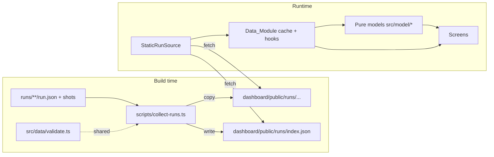

# Design Document: Haunt Dashboard

## Overview

The Haunt dashboard is a static single-page app in `dashboard/` that replays and explains ghost runs. It never runs ghosts. A build-time Collect_Step copies every `run.json` (and its screenshots) from `runs/` into `dashboard/public/runs/` and writes an index. At runtime, one Data_Module loads and validates those files. All screens are pure views over validated `Run` objects and a set of pure model functions.

**Key technologies** (versions aligned with `demo-site/package.json`):

- React 18, TypeScript (strict), Vite, served on port 3001 with `strictPort: true`
- `react-router-dom` with `createHashRouter` for deep links on any static host
- CSS Modules plus one global token file
- `@fontsource/im-fell-english` (headings) and `@fontsource/atkinson-hyperlegible` (body), both SIL Open Font License, bundled by Vite so no font is fetched from a CDN
- `tsx` to run the TypeScript Collect_Step script
- Tests: Vitest, Testing Library, `fast-check` (property tests), `axe-core` (component a11y checks), Playwright (end-to-end keyboard, contrast and network checks against `vite preview`)

**Design principles**

1. **One door for data.** Only `src/data/` touches the network. Screens call hooks; hooks call the selected `RunSource`.
2. **Pure models.** Haunts, rooms, cold spots, séance answers, exorcise results and coverage are pure functions of `Run[]`, so they are easy to test with properties.
3. **Fail per file, not per app.** A bad run file becomes an `InvalidRun` with readable errors; everything else keeps working.
4. **Every spooky element has a job.** Decoration always encodes information (see "Spooky element jobs").
5. **The URL is the state.** Screen, run, step, question, filters and comparison pairs live in the URL.

## Architecture



### Folder layout

```
dashboard/
├── index.html                    # CSP meta added in production build
├── package.json
├── vite.config.ts                # port 3001, strictPort, base './', CSP plugin
├── playwright.config.ts
├── tsconfig.json
├── .gitignore                    # public/runs/ (generated)
├── scripts/
│   └── collect-runs.ts           # Collect_Step
├── public/
│   └── runs/                     # generated, never committed
├── src/
│   ├── main.tsx
│   ├── App.tsx                   # router + layout
│   ├── routes.ts                 # URL builders and parsers (single source)
│   ├── data/
│   │   ├── types.ts              # contract types, Run, InvalidRun, RunIndex
│   │   ├── validate.ts           # validateRun(json, path) – shared with Collect_Step
│   │   ├── source.ts             # RunSource interface + selectRunSource()
│   │   ├── staticSource.ts       # reads public/runs
│   │   ├── screenshots.ts        # safe path check + URL resolution
│   │   └── hooks.ts              # useRunIndex, useRun, useAllRuns
│   ├── model/
│   │   ├── ghosts.ts             # ghost metadata (name, color token, icon, copy)
│   │   ├── findingLabels.ts      # type → plain words
│   │   ├── haunts.ts             # group by site, Start here target
│   │   ├── coldSpots.ts          # rooms, cold spots, size scale
│   │   ├── graveyard.ts          # tombstones + filters
│   │   ├── seance.ts             # question answers with citations
│   │   ├── exorcise.ts           # finding comparison
│   │   ├── coverage.ts           # mission coverage
│   │   ├── reproduce.ts          # Reproduce_Command
│   │   └── waveform.ts           # deterministic bars from text
│   ├── components/
│   │   ├── layout/               # Header, Nav, SkipLink, Footer, Fog, LiveRegion
│   │   ├── ghosts/               # ListenerGhost, PhantomGhost, BebeGhost, GhostBadge
│   │   ├── ProvenancePanel.tsx   # startedAt, commit, url, reproduce + copy
│   │   ├── ResultBadge.tsx
│   │   ├── Screenshot.tsx        # image + Placeholder + FocusGlow
│   │   ├── RunErrorPanel.tsx
│   │   ├── CandleButton.tsx
│   │   └── Tombstone.tsx
│   ├── screens/
│   │   ├── HomeScreen.tsx
│   │   ├── HauntedMapScreen.tsx
│   │   ├── GraveyardScreen.tsx
│   │   ├── GhostCamScreen.tsx    # + SpokenPanel, ThoughtPanel, Timeline, Controls, VoiceToggle
│   │   ├── SeanceScreen.tsx
│   │   ├── ExorciseScreen.tsx
│   │   ├── CoverageScreen.tsx
│   │   └── NotFoundScreen.tsx
│   ├── styles/
│   │   ├── tokens.css            # all colors, spacing, fonts
│   │   ├── tokens.ts             # same colors exported for contrast tests
│   │   └── motion.css            # keyframes, all inside prefers-reduced-motion: no-preference
│   └── __tests__/
│       ├── fixtures/             # derived fixtures (see Testing)
│       └── ...
└── e2e/                          # Playwright specs
```

## Components and Interfaces

### Collect_Step (`scripts/collect-runs.ts`)

Runs as `predev` and `prebuild`. Steps:

1. Delete `dashboard/public/runs/`.
2. Walk `../runs/` recursively; collect paths of files named `run.json`, sorted by path for deterministic order.
3. For each: copy its folder to `public/runs/<relative folder>/`; read and `JSON.parse`; call the shared `validateRun`.
4. Compute `key`: `runId` if it is a non-empty string, else folder path with `/` → `--`. On duplicate key, mark later entries invalid with `duplicate runId`.
5. Write `public/runs/index.json`. Print one warning line per invalid file. Exit 0 unless `runs/` itself is unreadable.

It only reads from `runs/`. It never writes there.

```ts
// src/data/types.ts
export interface RunIndex {
  formatVersion: 1;
  generatedAt: string;               // ISO
  entries: RunIndexEntry[];
}
export interface RunIndexEntry {
  key: string;                       // Run_Key
  folder: string;                    // e.g. "samples/listener-gave-up"
  origin: 'samples' | 'runs';
  errors: ValidationIssue[];         // empty when valid at collect time
}
```

### Contract types and validation (`src/data/types.ts`, `validate.ts`)

```ts
export type GhostId = 'listener' | 'phantom' | 'bebe';       // exactly the contract values
export type RunResult = 'succeeded' | 'gave_up' | 'error';   // exactly the contract values
export type FindingType =                                    // exactly the contract values
  | 'unlabeled_button' | 'focus_trap' | 'unannounced_error' | 'slow_wait'
  | 'misclick' | 'cut_off_text' | 'untranslated' | 'dark_pattern';

export interface FocusBox { x: number; y: number; w: number; h: number }
export interface Step {
  n: number; page: string; action: string; spoken: string; thought: string;
  screenshot: string | null;         // null when missing or unsafe
  focusBox: FocusBox | null;         // null when absent or w/h <= 0
  waitMs: number;
}
export interface Finding {
  type: FindingType; step: number; title: string; evidence: string;
  screenshot: string | null;
}
export interface Run {
  key: string; folder: string; origin: 'samples' | 'runs';
  formatVersion: 1; runId: string;
  ghost: GhostId;                    // exactly the contract values
  mission: { id: string; goal: string; requirement: string; successCheck: string };
  site: { name: string; url: string; commit: string };
  startedAt: string;                 // validated as parseable ISO 8601
  result: RunResult;
  steps: Step[];                     // sorted by n
  findings: Finding[];
  warnings: ValidationIssue[];
}
export interface ValidationIssue { path: string; message: string }  // path like "steps[3].waitMs"
export type LoadedRun =
  | { ok: true; run: Run }
  | { ok: false; key: string; folder: string; errors: ValidationIssue[] };

export function validateRun(input: unknown, meta: { key: string; folder: string; origin: 'samples' | 'runs' }): LoadedRun;
```

A small hand-written validator is used instead of a schema library: the contract is small, and hand-written checks produce the exact plain-words messages the UI shows (for example `steps[3].waitMs: expected a number, got "fast"`). Validation rules follow Requirement 4:

| Condition | Outcome |
|---|---|
| Not JSON, wrong `formatVersion`, missing/wrong-typed required field, unparseable `startedAt`, duplicate step `n` | Error (invalid) |
| `result` not one of `succeeded`, `gave_up`, `error` | Error naming the allowed values. No aliases |
| Finding `type` not one of the eight contract types | Error naming the allowed values. No aliases |
| `focusBox` absent or `w <= 0` or `h <= 0` | `focusBox: null` (no warning when absent; warning when zero-sized) |
| Finding `step` not in steps | Warning |
| Screenshot absolute, contains `..`, `\`, or a scheme (`:`) | `screenshot: null` + warning |
| `ghost` not one of `listener`, `phantom`, `bebe` | Error naming the allowed values. No aliases |

`validateRun` never throws; a property test enforces this.

### Data_Module (`src/data/source.ts`, `staticSource.ts`, `hooks.ts`)

```ts
export interface RunSource {
  listRuns(): Promise<RunIndex>;
  loadRun(entry: RunIndexEntry): Promise<LoadedRun>;
  screenshotUrl(run: Run, path: string): string;
}
export function selectRunSource(): RunSource;   // the only place a source is chosen
```

`StaticRunSource` fetches `./runs/index.json` and `./runs/<folder>/run.json` relative to `import.meta.env.BASE_URL`. A module-level `Map<key, Promise<LoadedRun>>` caches each file once. Fetch or parse failures become `LoadedRun { ok: false }` with a message such as "Could not read run.json (HTTP 404)".

Hooks: `useRunIndex()`, `useAllRuns()` (loads every entry, returns `{ runs: Run[]; invalid: InvalidRun[]; status }`), `useRun(key)`. A later `LiveRunSource` implements the same interface; no screen changes.

### Routes (`src/routes.ts`)

All URLs are built and parsed here so links in screens, the README and tests agree.

| Screen | Path | Notes |
|---|---|---|
| Home | `#/` | |
| Haunted Map | `#/haunt/:siteKey/map?ghost=` | `siteKey` = slug of `site.name` (lowercase, non-alphanumerics → `-`) |
| Graveyard | `#/graveyard?site=&ghost=` | |
| Ghost Cam | `#/run/:runKey/step/:n` | `#/run/:runKey` redirects to step 1 |
| Séance | `#/seance`, `#/seance/:runKey/:questionId` | `questionId` ∈ `why-give-up`, `where-stuck`, `what-heard`, `what-helped` |
| Exorcise | `#/exorcise`, `#/exorcise/:beforeKey/:afterKey` | |
| Coverage | `#/coverage` | |
| Invalid run | `#/restless/:runKey` | Shows `RunErrorPanel` |

Example deep link for the README: `http://localhost:3001/#/run/2026-11-03-listener-pay-bill/step/9`.

Step changes use `navigate(url, { replace: true })`, so playback does not fill browser history. A `RouteAnnouncer` sets `document.title` (for example "Step 9 of 9 · The Listener · Ghost Cam · Haunt") and focuses the screen's `h1` (with `tabIndex={-1}`) on route changes, but not on step-only changes inside the Ghost Cam, where focus stays on the control the user pressed.

### Model functions (`src/model/`)

All are pure and synchronous.

```ts
// haunts.ts
interface Haunt { siteKey: string; siteName: string; runs: Run[]; ghosts: GhostSummary[];
                  findingCount: number; latestStartedAt: string }
function groupHaunts(runs: Run[]): Haunt[];                   // sorted by latestStartedAt desc
function startHereTarget(runs: Run[]): { runKey: string; step: number } | null;
//  1) most recent listener run with a focus_trap finding → that finding's step
//  2) else most recent listener run with any finding → its first finding's step
//  3) else null (button unavailable, reason shown)

// coldSpots.ts
interface Room { page: string; ghosts: GhostId[]; coldSpots: ColdSpot[] }
interface ColdSpot { runKey: string; ghost: GhostId; step: number; waitMs: number;
                     reason: 'finding' | 'gave_up' | 'error' }
function buildRooms(runs: Run[]): Room[];
function coldSpotSize(waitMs: number): number;   // px, monotonic
//  size = clamp(24 + 16 * log2(1 + waitMs / 100), 24, 96)

// findingLabels.ts
const FINDING_LABELS: Record<FindingType, { label: string; helped: string }>;  // the only table
function plainFindingType(type: FindingType): string;

// FindingType          label                      "What would have helped?" (first person)
// unlabeled_button     Button with no name        "If the button had a name, like 'Pay bill', I'd have known what it does."
// focus_trap           Keyboard trap              "A way out with the keyboard, like Escape or a Close button I could reach."
// unannounced_error    Error nobody announced     "If the error had been read out, I'd have known what to fix."
// slow_wait            Too long a wait            "A faster page, or a sign that it was still working."
// misclick             Clicked the wrong thing    "A page that stayed still while I was about to click."
// cut_off_text         Text cut off               "Text that wrapped instead of being cut off when I zoomed in."
// untranslated         Text not translated        "This text in my language."
// dark_pattern         Tricky choice              "A plain choice, with nothing extra ticked for me."

// graveyard.ts
interface TombstoneData { run: Run; finding: Finding; label: string }
function buildGraveyard(runs: Run[], filter: { site?: string; ghost?: string }): TombstoneData[];

// seance.ts
type QuestionId = 'why-give-up' | 'where-stuck' | 'what-heard' | 'what-helped';
interface Answer { paragraphs: AnswerPart[][] }       // text pieces + StepCitation pieces
type AnswerPart = { kind: 'text'; text: string } | { kind: 'cite'; step: number };
function answer(run: Run, q: QuestionId): Answer;

// exorcise.ts
type ExorciseStatus = 'exorcised' | 'not_reached' | 'still_haunting' | 'new_haunting';
interface ExorciseRow { status: ExorciseStatus; before?: Finding; after?: Finding; key: string }
function compareRuns(before: Run, after: Run): { rows: ExorciseRow[]; differentGhosts: boolean }
          | { error: 'different_missions' };

// coverage.ts
interface MissionCoverage { missionId: string; goal: string; requirement: string;
  requirementChanged: boolean;
  perGhost: Record<GhostId, { latest: Run | null; runs: Run[] }> }
function buildCoverage(runs: Run[]): MissionCoverage[];

// reproduce.ts – the only place the command template lives
function reproduceCommand(run: Run): string;
// "git checkout <commit> && npx haunt run --ghost <ghost> --mission <mission.id> --url <site.url>"
// Values are shell-quoted with single quotes when they contain anything outside [A-Za-z0-9._:/-].

// waveform.ts
function waveformBars(text: string, count = 32): number[];  // 0..1, deterministic per text
```

**Séance answer templates** (first person, built only from run fields):

| Question | Template |
|---|---|
| Why did you give up? | `gave_up`: "I gave up at step {last} on {page}." + one sentence per finding at or before last ("At step {n}, {title}.") · `succeeded`: "I didn't give up. I finished at step {last}: {spoken}." · `error`: "Something broke on the technical side at step {last}, so I had to stop." |
| Where did you get stuck? | One line per Cold_Spot: "On {page} at step {n}, I waited {s} s." Or "I never got stuck." |
| What did you hear? | One line per step: "Step {n}: '{spoken}'." |
| What would have helped? | One line per finding: "At step {n}: {helped}", where {helped} comes from `FINDING_LABELS` |

**Exorcise matching.** Findings match by `type + page`, where `page` is the page of the finding's step (or `?` if the step is missing). Matching is a multiset: two `unlabeled_button` findings on `/bill` before and one after give one "Still haunting" and one "Exorcised". "Not reached" applies when the after run has no step on that page.

### Screens

**Home.** A candlelit title band ("Haunt"), then the two candle buttons: "Start here" (amber, flickering flame) and "Summon a live ghost" (`aria-disabled="true"`, dimmed, unlit candle, visible "Coming soon: live ghosts are not connected yet"; its click handler is a no-op). Haunt cards follow: site name (h2), most recent date, finding count ("3 findings"), and one row per ghost: character, name, result in words with a ResultBadge, link to its Ghost Cam. Each card links to the Haunted Map. A "Restless files" section lists Invalid_Runs.

**Haunted Map.** A floor plan grid of rooms (CSS grid, `<ul>` of `<li>` rooms, each with an `h2` of the page path). Each room shows ghost badges for who entered and cold spots as round frosty buttons sized by `coldSpotSize`. Each button has visible text "{s} s" and the accessible name "Bebe waited 1.2 s at step 2 — open in Ghost Cam". A ghost filter (radio group) adds fog over rooms that ghost never entered, plus the text "Not visited by Bebe".

**Graveyard.** A wrapping grid of bone tombstones (`<article>` with `h2` = plain-words type). Contents: ghost badge, title, evidence, "Step 9 · Lantern Bills demo", and a link "Watch The Listener at step 9". Filters: site select and ghost radio group, written to the URL query.

**Ghost Cam.** Layout: provenance and mission header, then a two-column grid (stacked under 900 px):

- *Left*: `Screenshot` renders the image at its natural aspect ratio. `FocusGlow` is an absolutely positioned outline scaled by `renderedWidth / naturalWidth` (measured with `ResizeObserver`). For missing images it renders the Placeholder (16:10 grey `#55504a`, text "No screenshot for step 9") and scales against 1280×800. The glow uses a spectral-white 3 px border and a soft box-shadow halo. With reduced motion the halo is static; otherwise it pulses slowly (2.5 s, opacity 0.7–1.0).
- *Right*: `SpokenPanel` (Listener): black panel, large spectral text in quotes, waveform below as an SVG of 32 bars from `waveformBars(spoken)`, `aria-hidden`. The bars animate only while playing and without reduced motion. `ThoughtPanel` (others): surface panel with a thought-bubble shape and the `thought` text.
- *Below*: Controls (`Step back`, `Play`/`Pause` as one toggle button with `aria-pressed`, `Step forward`), step info ("Step 9 of 9 · /bill · Tab · waited 0.5 s"), the voice toggle for the Listener, and the Timeline: an ordered list of step buttons, each named "Step n" (plus ", finding: Keyboard trap" where relevant), finding steps drawn as small tombstones, the current one with `aria-current="step"`.
- *Finding callout*: when the step has a finding, a callout with ghost-specific copy: Listener + trap: "The Listener got trapped here."; others: "{Ghost} hit a problem here." Last step of a `gave_up` run: "{Ghost} gave up here." (red fill, white text, light border).
- A visually hidden polite live region announces "Step 9: Button, Confirm".

Keyboard shortcuts are not added beyond normal buttons. That avoids conflicts with screen reader keys.

Playback is a `useEffect` interval of 1500 ms that calls `navigate(stepUrl(n+1), { replace: true })` and stops at the last step. It also stops when the tab is hidden.

**Approximate voice.** `useApproximateVoice()` checks `window.speechSynthesis`, waits for `voiceschanged`, and keeps only `voices.filter(v => v.localService)`. It prefers a local voice whose `lang` starts with the document language. It speaks `spoken` on step change while enabled and calls `cancel()` before each utterance, on toggle off and on unmount. When unavailable, the toggle is `aria-disabled` with the reason "Your browser has no built-in offline voice."

**Séance.** A round table of candles. A run picker (select grouped by site) and four question buttons in a radio-like group. The answer appears in a "spirit board" panel (`<section aria-live="polite">`). Citations render as links "step 9" to the Ghost Cam.

**Exorcise.** Two selects (before, after; the after list is filtered to the same `mission.id`, defaulting to the most recent other run of the same mission and ghost if one exists). Two columns show run summary and provenance. Below is a table with columns Finding, Page, Status. Statuses use icon + text: Exorcised (a ghost fading out, spectral), Still haunting (a solid ghost, amber outline), New haunting (a ghost with a "+" mark, red fill + light border), Not reached (fog icon, muted). A warning banner appears when the ghosts differ.

**Coverage.** A table: rows are missions (requirement text in a `th scope="row"`, goal below), columns are the three ghosts, always in the order The Listener, The Phantom, Bebe. Cells hold an icon + "Completed" / "Gave up" / "Errored" / "Not yet haunted", linking to the runs.

### Visual design rules

The design rules live in one place: `.kiro/steering/dashboard-design.md`. That file loads automatically for any file in `dashboard/`. It defines:

- **Colors**: the token table with every contrast ratio, the red-as-fill-only rule and the focus ring rules
- **Fonts**: IM Fell English and Atkinson Hyperlegible, bundled through npm
- **Ghost characters**: silhouettes, icons, accent colors and UI descriptions for The Listener, The Phantom and Bebe
- **What each spooky element means**
- **Motion limits**

This design document does not repeat those values, so the two cannot drift apart. Implementation notes:

- Tokens go in `src/styles/tokens.css`, mirrored in `src/styles/tokens.ts` so the contrast test can recompute every pair.
- Keyframes go in `src/styles/motion.css`, and the `useReducedMotion()` hook is in `src/hooks/`.
- Ghost SVG components go in `src/components/ghosts/`. `GhostBadge` always renders the icon plus the name.

### Security and privacy

- **CSP**: a Vite plugin injects `<meta http-equiv="Content-Security-Policy" content="default-src 'self'; script-src 'self'; style-src 'self'; img-src 'self' data:; font-src 'self'; connect-src 'self'; object-src 'none'; base-uri 'self'">` only in production builds, because Vite's dev server needs inline scripts for hot reloading. React sets dynamic styles through the DOM style API, which this CSP allows.
- Screenshot paths are checked by `screenshots.ts`, so a run file cannot point the dashboard at an outside URL or outside its folder.
- All run text is rendered through React text nodes. `dangerouslySetInnerHTML` is not used.
- Clipboard access only happens when the user activates the copy button.
- `speechSynthesis` is restricted to `localService` voices.

## Data Models

The contract types are in "Contract types and validation" above. The sample data maps as follows:

| Sample | Key | Ghost | Result | Steps | Findings | Notes |
|---|---|---|---|---|---|---|
| `samples/listener-gave-up` | `2026-11-03-listener-pay-bill` | listener | gave_up | 9 (`/`, `/bill`) | unlabeled_button @7, focus_trap @9 | Start here → step 9 |
| `samples/bebe-succeeded` | `2026-11-03-bebe-pay-bill` | bebe | succeeded | 6 (`/`, `/bill`) | untranslated @3 | step 2 has a zero-sized focusBox → none |

Neither sample has screenshots on disk, so every step shows the Placeholder. That exercises Requirement 4 directly.

With the samples: Home shows one Haunt ("Lantern Bills demo", two ghosts, 3 findings, 3 Nov 2026). The map shows rooms `/` and `/bill`. Cold spots are Listener step 7 (180 ms), Listener step 9 (500 ms, finding and gave_up merged into one spot), and Bebe step 3 (150 ms). The Graveyard shows 3 tombstones. Coverage shows the `pay-bill` mission with Listener "Gave up", Bebe "Completed", and Phantom "Not yet haunted".

## Error Handling

| Situation | Behavior |
|---|---|
| `index.json` missing or unreadable | Full-page error: "No runs were collected. Run `npm run dev` or `npm run build` in dashboard/." |
| One run file invalid | Listed under "Restless files" on Home; `#/restless/:key` shows path and each `path: message`; other screens ignore it |
| Run warnings | Collapsible "Notes about this run file" on the Ghost Cam |
| Unknown run key in URL | "No ghost by that name has walked here" + Home link |
| Step out of range | "This run has steps 1 to 9" + link to step 1 |
| Exorcise across missions | "These runs are different missions, so there is nothing to compare." |
| Image load error | `onError` switches to the Placeholder |
| Clipboard denied | Live region: "Couldn't copy. Select the command and copy it yourself." |
| Unexpected render error | A top-level error boundary shows a calm error panel with a Home link. It does not lose the URL |

## Testing Strategy

The fixtures are the two sample runs, imported directly from `../runs/samples/*/run.json`. Some cases have no sample: an after run for Exorcise, an invalid file, a Phantom run, a ghost value outside the contract (which must be rejected), unsafe screenshot paths. For those, small fixtures in `src/__tests__/fixtures/` are derived from the samples by targeted edits. `runs/samples/` is not changed.

**Unit tests (Vitest + Testing Library)**

- `validateRun`: each row of the validation table, including both samples (Listener valid with no warnings; Bebe valid, with only the zero-sized focusBox warning). Invalid fixtures cover `success` (no longer accepted), an old type such as `keyboard_trap`, and each other error row.
- Models: expected outputs for the samples, as listed in Data Models.
- Screens: render with the samples. Check headings, links, the Start here target (`#/run/2026-11-03-listener-pay-bill/step/9`), the Summon button's `aria-disabled` and no-op behavior, the Placeholder text, the Spoken vs Thought panel by ghost, playback with fake timers, and the timeline's `aria-current`.
- Voice: mocked `speechSynthesis` with local and remote voices. Only local voices are used, cancel is called on step change and unmount, and the toggle is unavailable without local voices.
- axe-core on each rendered screen: zero violations.
- Contrast: recompute every documented pair from `tokens.ts` against the AA thresholds.

**Property tests (fast-check, tagged `Feature: haunt-dashboard, Property N`)**

1. `validateRun` never throws for any JSON value and always returns `ok: true` or `ok: false` with at least one error.
2. Every run generated from a contract-shaped arbitrary validates with `ok: true`.
3. `coldSpotSize` is non-decreasing in `waitMs` and stays within [24, 96].
4. Every Séance answer cites only step numbers present in the run's steps or findings, and every claim about a step has a citation.
5. Exorcise rows partition findings: every before finding appears exactly once as exorcised, not reached or still haunting, and every after finding exactly once as still haunting or new haunting.
6. Route round trip: `parseRoute(buildStepUrl(key, n))` returns `{ key, n }` for any key and positive integer.
7. `validateRun` accepts a `ghost`, `result` or finding `type` exactly when it is one of the contract values. Any other string, including `success` and `keyboard_trap`, makes the run invalid. Every `FindingType` has a non-empty label and "helped" text in `FINDING_LABELS`.
8. `reproduceCommand` output always contains the run's commit, ghost, mission id and URL, and quoted values never break out of their quotes.

**End-to-end (Playwright against `npm run preview` on port 3001)**

- Keyboard-only walk through all seven screens: the skip link is first, every control can be reached, there are no traps, and the focus ring is visible.
- Deep link `#/run/2026-11-03-listener-pay-bill/step/9` opens step 9 paused.
- Network guard: fail the test on any request whose origin is not `http://localhost:3001`.
- `emulateMedia({ reducedMotion: 'reduce' })`: no running CSS animations (`document.getAnimations()` is empty).
- 320 px viewport and 200% zoom: no horizontal page scroll.
- axe-core scan of each screen in a real browser, including computed color contrast.

## Assumptions and open points

- **Allowed values.** `ghost`, `result` and finding `type` use exactly the values in `contract/run-format.md`: ghosts `listener`, `phantom`, `bebe`; results `succeeded`, `gave_up`, `error`; and eight finding types. There are no aliases. Both samples use only these values.
- **Reproduce command.** The contract has no command field, and the engine has no CLI yet, so the command is generated from a template in `reproduce.ts`. Adding a field to the contract would be cleaner.
- **"Without a server"** means no backend. The built site needs a static file host (`npm run preview`, GitHub Pages and similar). Opening `dist/index.html` from `file://` will not work, because browsers block module scripts and `fetch` on `file://`.
- **Haunts are grouped by `site.name`.**
- **Visual rules** live in `.kiro/steering/dashboard-design.md`, which takes precedence over this document.
