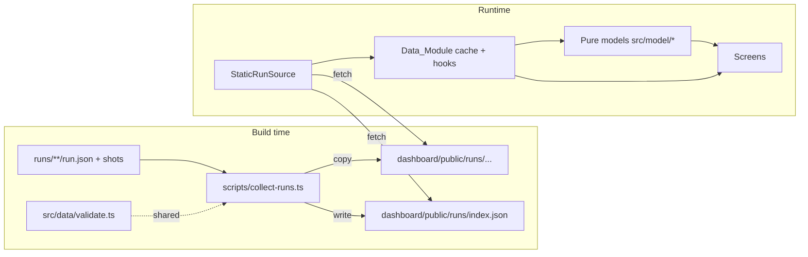

# Design Document: Haunt Dashboard

## Overview

The Haunt dashboard is a static single-page app in `dashboard/` that replays and explains ghost runs. It never runs ghosts. A build-time Collect_Step copies every `run.json` (and its screenshots) from `runs/` into `dashboard/public/runs/` and writes an index. At runtime, one Data_Module loads and validates those files. All screens are pure views over validated `Run` objects and a set of pure model functions.

**Key technologies** (versions aligned with `demo-site/package.json`):

- React 18, TypeScript (strict), Vite, served on port 3001 with `strictPort: true`
- `react-router-dom` with `createHashRouter` for deep links on any static host
- CSS Modules plus one global token file
- `@fontsource/im-fell-english` (headings) and `@fontsource/atkinson-hyperlegible` (body), both SIL Open Font License, bundled by Vite so no font is fetched from a CDN
- `tsx` to run the TypeScript Collect_Step script
- Tests: Vitest, Testing Library, `fast-check` (property tests), `axe-core` (component a11y checks), Playwright (end-to-end keyboard, contrast and network checks against `vite preview`)

**Design principles**

1. **One door for data.** Only `src/data/` touches the network. Screens call hooks; hooks call the selected `RunSource`.
2. **Pure models.** Haunts, rooms, cold spots, séance answers, exorcise results and coverage are pure functions of `Run[]`, so they are easy to test with properties.
3. **Fail per file, not per app.** A bad run file becomes an `InvalidRun` with readable errors; everything else keeps working.
4. **Every spooky element has a job.** Decoration always encodes information (see "Spooky element jobs").
5. **The URL is the state.** Screen, run, step, question, filters and comparison pairs live in the URL.

### Amendment: requirement changes (Req 1.8–1.11, 5.6–5.11, 7.2, 7.10–7.25, 10.4–10.5, 10.12–10.13, 10.15–10.34, 16.7–16.10)

This amendment was written after reading the current code in `dashboard/`. Each change below names what the code does today and what changes. The details are in the sections marked "Amendment" further down.

| Area | Today | Change | Section |
|---|---|---|---|
| `npm run test:properties` | `vitest --run -t "Feature: haunt-dashboard, Property"`. It skips the two `Feature: exorcise-different-ghost-fix, Property N` tests in `models.properties.test.ts` and reports success when nothing matches | A wrapper script with a pattern that matches every spec name, which fails when zero Property_Tests ran | Property test runner |
| Reproduce_Command | `.code` uses `white-space: pre-wrap; word-break: break-all`, so flags and URLs split mid-word. The `dd` grid column is `1fr`, so an unbreakable line would widen the page | `white-space: pre`, horizontal scroll inside the box, `minmax(0, 1fr)` column, focusable only when it overflows | Provenance_Panel |
| Home hero | `ScreenHeading` renders a visible "Haunt" h1 as plain text. Card titles are h3 under a hidden "Haunted sites" h2. The ghost row shows `resultSentence` ("The Listener gave up") | The h1 is the Tagline "Haunt your app before your users do." The Haunt logo appears only in the Top_Navigation, not in the Hero. The Hero shows the three Hero_Ghosts (character plus visible name) on the right; they float up to 8 px and are still under Reduced_Motion. Card titles become h2. The ghost row shows the Outcome_Line from `src/model/outcome.ts` | Home |
| Home at 1280 px and wider | `.cards` uses `repeat(auto-fill, minmax(24rem, 1fr))`. With one haunt this leaves an empty track as wide as the card | Two-column layout: haunt cards on the left (`auto-fit`), a "Recent ghost walks" side panel on the right | Home |
| Ghost Cam panel | Shows only the current step's text | A Transcript of steps 1 to current, built by `src/model/transcript.ts`, with fade levels and internal scrolling | Transcript |
| Ghost Cam layout | Vertical stack: header, stage, step info, callouts, controls, voice, timeline, warnings, provenance. Too tall for 1080 px | One screen at 1536×864, 1440×900 and 1920×1080 (the footer and the Provenance_Panel may sit below the fold): a two-row Run_Summary, screenshot and panel side by side, one Stuck_Notice slot, one Control_Row directly under the two panels, the timeline below it, then the collapsed Provenance_Panel | Ghost Cam layout |
| Ghost Cam Transcript height | The transcript's height follows the layout and can change with the screenshot | Fixed height that does not depend on the step, the number of lines or the Stuck_Notice. Self-scrolling, newest line always visible | Ghost Cam layout |
| Ghost Cam notices | A finding callout and a separate "gave up here" callout | One Stuck_Notice built by `src/model/stuckNotice.ts`, at most 3 lines, in a slot that always keeps its space | Stuck_Notice |
| Provenance_Panel on the Ghost Cam | Always open | A disclosure, collapsed when the Ghost Cam opens, one row while collapsed | Provenance_Panel |
| Nav_Fog | `.layer` is `width: 200%`, but the global rule `img, svg { max-width: 100% }` clamps it to 100%. The drift moves it `translateX(-50%)`, so the right half of the header loses its fog during the animation | `.layer { max-width: none; }` and a layer width test | Nav_Fog |

### Amendment: plain-words wayfinding (Req 20, 10.24, 10.29)

A first-time user could not tell what each screen does from its spooky name. The names stay; every screen also says its job in plain words.

| Area | Today | Change | Section |
|---|---|---|---|
| Top_Navigation | `Layout.tsx` builds its own list of `{ to, label }` items. Each link is one line with the label only | Items come from one table in `src/model/screens.ts`. Each link shows the label and, under it, the Screen_Description as visible text; both are part of the link's accessible name. Narrow screens keep the descriptions in a two-column grid | Wayfinding |
| Home | Hero, haunt cards with the side panel, Restless files | Adds the How_It_Works_Strip and the Screen_Guide after the Hero, a short note under "Start here" about the tour, and a one-sentence tagline paragraph | Wayfinding |
| Guided_Path | None. Screens end with their content | `Layout` renders one `NextStop` link after the screen in `<main>`, chosen by `nextStop()` in `screens.ts` | Wayfinding |
| Screen_Intro | Most screens open with a two- or three-sentence paragraph. The Ghost Cam has none since the fit-mode layout change | Every screen opens with one plain sentence right after its h1 (exact texts below). The Ghost Cam gets one between its two Run_Summary rows | Wayfinding |
| Ghost Cam height budget | `--cam-shot-max: calc(100vh - 26rem)` with a single-row header | The taller header and the Screen_Intro are paid for by a tighter header and summary in fit mode, so the screenshot and panel stay at least 380 px tall at 1536×864 | Wayfinding |

### Amendment: first visit in 60 seconds (Req 21–23, and the "Revised" criteria in Req 6, 7, 8, 9, 10, 12, 20)

A first-time user still saw seven tools but not the story. This amendment was written after reading the current code. Each row names what the code does today and what changes. Details are in "First visit (third amendment)" below, which supersedes the parts of "Wayfinding" that it names.

| Area | Today | Change | Section |
|---|---|---|---|
| Home order | Hero, How_It_Works_Strip, Screen_Guide ("What's in here", six cards), haunt cards and side panel, Restless files | Hero, Results_Sections, How_It_Works_Strip, haunt cards and side panel, Restless files. The Screen_Guide is removed | Results_Section |
| Home story | Each haunt card shows an Outcome_Line such as "Trapped by a keyboard trap at step 9" | A Result_Card per ghost with a Result_Headline built by `src/model/results.ts`, for example "The Listener got trapped in a pop-up and couldn't pay.", and one "Watch it happen" candle link to the Watch_Step | Results_Section |
| Start here | A candle link to the Start_Here_Step, with a note about "Next stop" | "Take the 60-second tour", a candle button that starts the Tour. The Start_Here_Step stays as the Ghost Cam's Screen_Destination | Tour |
| Tour | None | `src/model/tour.ts` lists eight Tour_Stops; `src/components/tour/Tour.tsx` shows each as a modal callout with Back, Next and Skip, moves between screens, highlights the target and manages focus | Tour |
| Séance | Its own screen at `#/seance` and `#/seance/:runKey/:questionId`, with a run picker | The Ask_Panel inside the Ghost Cam, opened by the Ask_Button in the Run_Summary, state in `?ask=`. Old URLs redirect | Ask_Panel |
| Haunted Map | Its own screen at `#/haunt/:siteKey/map?ghost=` | The Graveyard's Map_View at `#/graveyard?view=map`, sharing the Graveyard's site and ghost filters. Old URLs redirect | Map_View |
| Top_Navigation | Seven items, each a name with a description under it; narrow screens show all items with descriptions in a grid | Five items, each a Screen_Icon and a name on one line. Below 900 px a Menu_Button opens the full list, with descriptions | Menu |
| Guided_Path | Home, Ghost Cam, Graveyard, Haunted Map, Exorcise, Spec Coverage, Séance | Home, Ghost Cam, Graveyard, Exorcise, Spec Coverage | Screens table |
| Playwright | Default worker count | `workers: 3` locally, the default on CI | Testing |

### Amendment: equal sizes, active copy and the developer's loop (fourth amendment)

This amendment comes from a read-only layout and copy audit of `dashboard/`. It changes Req 7.7, 7.15, 7.17, 7.19, 8.6, 10.27, 20.7, 20.10, 21.4 and 21.6, and adds Req 7.29, 7.30, 9.10, 9.11, 13.11, 21.9 and 21.10. Details are in "Equal sizes and active copy (fourth amendment)" below. Nothing here changes the Ghost Cam's layout, so its one-screen fit at 1536×864 (Req 10.24) is unchanged.

| Area | Today | Change | Section |
|---|---|---|---|
| Graveyard filters | View and Ghost are fieldsets with the label on the border; Site is a `<label>` above a bare select, so its box is shorter; the row aligns `flex-end` | Site is a fieldset too, its select named by the legend; the row stretches, so the three boxes match | Equal sizes |
| Tombstones | `align-items: end` bottom-aligns stones of different heights | Equal rows (`grid-auto-rows: 1fr`), each stone fills its cell, and the step line and link sit at the bottom | Equal sizes |
| Home cards and side panel | `align-items: start`, so the haunt card and "Recent ghost walks" differ in height | The two columns stretch; the haunt card fills its column and its map link sits at the bottom | Equal sizes |
| Result_Cards | Text column is as tall as its content | Cards share the row height and "Watch it happen" sits at the bottom | Equal sizes |
| Hero_Ghosts | Wrapping flex items (`flex: 1 1 8rem`), so Bebe can wrap alone and names can start at different heights | Three equal columns on a subgrid of shared rows; one column below a 19 rem container | Equal sizes |
| Next_Stop_Link | "Next stop:" in the body font at 1 rem, the name in the heading serif at 1.5 rem | Both in the body font, 1.25 rem, weight 700; only the color differs | Equal sizes |
| Status copy | Passive phrases such as "Stopped by a technical error", "No steps were recorded", "Not visited by", "could not be read" | Active phrases, listed in the copy table below | Active copy |
| Lantern Bills | Never explained | A Site_About sentence and "Try Lantern Bills yourself" link under the Results_Section heading | Active copy |
| Developer's loop | "Coming soon: live ghosts are not connected yet"; three "How Haunt works" steps; Exorcise copy that does not mention fixing code | Honest copy about recorded runs, a fourth step about fixing code and running again, and Exorcise copy that describes fix → re-run → compare | Active copy |

## Architecture



### Folder layout

```
dashboard/
├── index.html                    # CSP meta added in production build
├── package.json
├── vite.config.ts                # port 3001, strictPort, base './', CSP plugin
├── playwright.config.ts
├── tsconfig.json
├── .gitignore                    # public/runs/ (generated)
├── scripts/
│   ├── collect-runs.ts           # Collect_Step
│   ├── propertyTestPattern.ts    # (amendment) the Property_Test name pattern, shared with tests
│   └── test-properties.ts        # (amendment) runs every Property_Test once, fails on zero
├── public/
│   └── runs/                     # generated, never committed
├── src/
│   ├── main.tsx
│   ├── App.tsx                   # router + layout
│   ├── routes.ts                 # URL builders and parsers (single source)
│   ├── data/
│   │   ├── types.ts              # contract types, Run, InvalidRun, RunIndex
│   │   ├── validate.ts           # validateRun(json, path) – shared with Collect_Step
│   │   ├── source.ts             # RunSource interface + selectRunSource()
│   │   ├── staticSource.ts       # reads public/runs
│   │   ├── screenshots.ts        # safe path check + URL resolution
│   │   └── hooks.ts              # useRunIndex, useRun, useAllRuns
│   ├── model/
│   │   ├── ghosts.ts             # ghost metadata (name, color token, icon, copy)
│   │   ├── findingLabels.ts      # type → plain words
│   │   ├── haunts.ts             # group by site, Start here target
│   │   ├── coldSpots.ts          # rooms, cold spots, size scale
│   │   ├── graveyard.ts          # tombstones + filters
│   │   ├── seance.ts             # question answers with citations
│   │   ├── exorcise.ts           # finding comparison
│   │   ├── coverage.ts           # mission coverage
│   │   ├── reproduce.ts          # Reproduce_Command
│   │   ├── outcome.ts            # (amendment) Outcome_Line for Home
│   │   ├── transcript.ts         # (amendment) Transcript lines and fade levels
│   │   ├── stuckNotice.ts        # (amendment) the single merged Stuck_Notice for a step
│   │   ├── screens.ts            # (amendment) screen table: names, Screen_Descriptions, Guided_Path, destinations
│   │   └── waveform.ts           # deterministic bars from text
│   ├── components/
│   │   ├── layout/               # Header, Nav, SkipLink, Footer, Fog, LiveRegion, (amendment) NextStop, ScreenIntro
│   │   ├── ScreenIcon.tsx        # (amendment) one original SVG icon per screen
│   │   ├── ghosts/               # ListenerGhost, PhantomGhost, BebeGhost, GhostBadge
│   │   ├── ProvenancePanel.tsx   # startedAt, commit, url, reproduce + copy; collapsible on the Ghost Cam
│   │   ├── HeroGhosts.tsx        # (amendment) Hero_Ghosts: three characters with visible names
│   │   ├── ResultBadge.tsx
│   │   ├── Screenshot.tsx        # image + Placeholder + FocusGlow
│   │   ├── RunErrorPanel.tsx
│   │   ├── CandleButton.tsx
│   │   └── Tombstone.tsx
│   ├── screens/
│   │   ├── HomeScreen.tsx
│   │   ├── HauntedMapScreen.tsx
│   │   ├── GraveyardScreen.tsx
│   │   ├── GhostCamScreen.tsx    # + SpokenPanel, ThoughtPanel, Transcript, Timeline, Controls, VoiceToggle
│   │   ├── SeanceScreen.tsx
│   │   ├── ExorciseScreen.tsx
│   │   ├── CoverageScreen.tsx
│   │   └── NotFoundScreen.tsx
│   ├── styles/
│   │   ├── tokens.css            # all colors, spacing, fonts
│   │   ├── tokens.ts             # same colors exported for contrast tests
│   │   └── motion.css            # keyframes, all inside prefers-reduced-motion: no-preference
│   └── __tests__/
│       ├── fixtures/             # derived fixtures (see Testing)
│       └── ...
└── e2e/                          # Playwright specs
```

## Components and Interfaces

### Collect_Step (`scripts/collect-runs.ts`)

Runs as `predev` and `prebuild`. Steps:

1. Delete `dashboard/public/runs/`.
2. Walk `../runs/` recursively; collect paths of files named `run.json`, sorted by path for deterministic order.
3. For each: copy its folder to `public/runs/<relative folder>/`; read and `JSON.parse`; call the shared `validateRun`.
4. Compute `key`: `runId` if it is a non-empty string, else folder path with `/` → `--`. On duplicate key, mark later entries invalid with `duplicate runId`.
5. Write `public/runs/index.json`. Print one warning line per invalid file. Exit 0 unless `runs/` itself is unreadable.

It only reads from `runs/`. It never writes there.

### Property test runner (amendment, Req 1.8–1.11)

**Problem in the current code.** `test:properties` is `vitest --run -t "Feature: haunt-dashboard, Property"`. That filter is hard-coded to one spec name, so the `Feature: exorcise-different-ghost-fix, Property 1` and `Property 2` describes in `src/__tests__/models.properties.test.ts` never run. When the filter matches nothing, Vitest marks every test as skipped and can still exit 0, which breaks Req 1.11.

**Pattern.** One exported constant, used by the script and by Property 12:

```ts
// scripts/propertyTestPattern.ts
/** Matches a full test name that starts with "Feature: <spec name>, Property". */
export const PROPERTY_TEST_PATTERN = '^Feature: [a-z0-9]+(-[a-z0-9]+)*, Property';
export function isPropertyTestName(fullName: string): boolean {
  return new RegExp(PROPERTY_TEST_PATTERN).test(fullName);
}
```

Spec folders in `.kiro/specs/` are kebab-case, so `[a-z0-9]+(-[a-z0-9]+)*` covers every current and future spec name without editing the command. Vitest's `-t` matches against the full test name, which is the describe names and the test name joined by spaces. The full name of a test inside a top-level `describe('Feature: x, Property N: …')` therefore starts with the describe name. One rule follows: **a Property_Test describe must be top level.** If it is nested inside another describe, its full name starts with the outer name and the pattern does not match it. All existing Property_Tests (`validate.properties.test.ts`, `models.properties.test.ts`, `routes.test.ts`) are already top level.

**Script.** `package.json`: `"test:properties": "tsx scripts/test-properties.ts"`. The script:

1. Spawns `npx vitest run -t "<PROPERTY_TEST_PATTERN>" --reporter=default --reporter=json --outputFile.json=<os tmpdir>/haunt-properties.json` with inherited stdio. `vitest run` never enters watch mode. The default reporter prints each failing test by its full name (Req 1.10).
2. Reads the JSON report. A pure helper `decideExit(report, vitestExitCode)` returns the exit code and an optional message:
   - `numPassedTests + numFailedTests === 0`: exit 1 with "No Property_Tests ran. Property_Test describe names must start with 'Feature: <spec name>, Property' and be top level." (Req 1.11)
   - `numFailedTests > 0` or a non-zero Vitest exit: exit 1 (Req 1.10)
   - otherwise: exit 0
3. If the report file is missing (Vitest crashed before writing it), exit 1 with "Vitest did not produce a report."

**Scope (Req 1.8, 1.9).** The Vitest `include` in `vite.config.ts` widens from `src/**` and `scripts/**` to `**/*.{test,spec}.{ts,tsx}`, with `exclude: ['node_modules/**', 'dist/**', 'e2e/**', 'test-results/**']`. A Property_Test in any test file under `dashboard/` is then found. `e2e/haunt.spec.ts` stays out, so Playwright never runs. Vitest's root is `dashboard/`, so `demo-site/` is never scanned. `npm test` uses the same config, so it also picks up tests in new folders. That is the intended behaviour.

Tests skipped by `-t` are not executed: Vitest only collects them and reports them as skipped. Collection still imports each test file, so module-level code in test files must not have side effects. The current files only define fixtures and arbitraries at module level.

```ts
// src/data/types.ts
export interface RunIndex {
  formatVersion: 1;
  generatedAt: string;               // ISO
  entries: RunIndexEntry[];
}
export interface RunIndexEntry {
  key: string;                       // Run_Key
  folder: string;                    // e.g. "samples/listener-gave-up"
  origin: 'samples' | 'runs';
  errors: ValidationIssue[];         // empty when valid at collect time
}
```

### Contract types and validation (`src/data/types.ts`, `validate.ts`)

```ts
export type GhostId = 'listener' | 'phantom' | 'bebe';       // exactly the contract values
export type RunResult = 'succeeded' | 'gave_up' | 'error';   // exactly the contract values
export type FindingType =                                    // exactly the contract values
  | 'unlabeled_button' | 'focus_trap' | 'unannounced_error' | 'slow_wait'
  | 'misclick' | 'cut_off_text' | 'untranslated' | 'dark_pattern';

export interface FocusBox { x: number; y: number; w: number; h: number }
export interface Step {
  n: number; page: string; action: string; spoken: string; thought: string;
  screenshot: string | null;         // null when missing or unsafe
  focusBox: FocusBox | null;         // null when absent or w/h <= 0
  waitMs: number;
}
export interface Finding {
  type: FindingType; step: number; title: string; evidence: string;
  screenshot: string | null;
}
export interface Run {
  key: string; folder: string; origin: 'samples' | 'runs';
  formatVersion: 1; runId: string;
  ghost: GhostId;                    // exactly the contract values
  mission: { id: string; goal: string; requirement: string; successCheck: string };
  site: { name: string; url: string; commit: string };
  startedAt: string;                 // validated as parseable ISO 8601
  result: RunResult;
  steps: Step[];                     // sorted by n
  findings: Finding[];
  warnings: ValidationIssue[];
}
export interface ValidationIssue { path: string; message: string }  // path like "steps[3].waitMs"
export type LoadedRun =
  | { ok: true; run: Run }
  | { ok: false; key: string; folder: string; errors: ValidationIssue[] };

export function validateRun(input: unknown, meta: { key: string; folder: string; origin: 'samples' | 'runs' }): LoadedRun;
```

A small hand-written validator is used instead of a schema library: the contract is small, and hand-written checks produce the exact plain-words messages the UI shows (for example `steps[3].waitMs: expected a number, got "fast"`). Validation rules follow Requirement 4:

| Condition | Outcome |
|---|---|
| Not JSON, wrong `formatVersion`, missing/wrong-typed required field, unparseable `startedAt`, duplicate step `n` | Error (invalid) |
| `result` not one of `succeeded`, `gave_up`, `error` | Error naming the allowed values. No aliases |
| Finding `type` not one of the eight contract types | Error naming the allowed values. No aliases |
| `focusBox` absent or `w <= 0` or `h <= 0` | `focusBox: null` (no warning when absent; warning when zero-sized) |
| Finding `step` not in steps | Warning |
| Screenshot absolute, contains `..`, `\`, or a scheme (`:`) | `screenshot: null` + warning |
| `ghost` not one of `listener`, `phantom`, `bebe` | Error naming the allowed values. No aliases |

`validateRun` never throws; a property test enforces this.

### Data_Module (`src/data/source.ts`, `staticSource.ts`, `hooks.ts`)

```ts
export interface RunSource {
  listRuns(): Promise<RunIndex>;
  loadRun(entry: RunIndexEntry): Promise<LoadedRun>;
  screenshotUrl(run: Run, path: string): string;
}
export function selectRunSource(): RunSource;   // the only place a source is chosen
```

`StaticRunSource` fetches `./runs/index.json` and `./runs/<folder>/run.json` relative to `import.meta.env.BASE_URL`. A module-level `Map<key, Promise<LoadedRun>>` caches each file once. Fetch or parse failures become `LoadedRun { ok: false }` with a message such as "Could not read run.json (HTTP 404)".

Hooks: `useRunIndex()`, `useAllRuns()` (loads every entry, returns `{ runs: Run[]; invalid: InvalidRun[]; status }`), `useRun(key)`. A later `LiveRunSource` implements the same interface; no screen changes.

### Routes (`src/routes.ts`)

All URLs are built and parsed here so links in screens, the README and tests agree.

| Screen | Path | Notes |
|---|---|---|
| Home | `#/` | |
| Haunted Map | `#/haunt/:siteKey/map?ghost=` | `siteKey` = slug of `site.name` (lowercase, non-alphanumerics → `-`) |
| Graveyard | `#/graveyard?site=&ghost=` | |
| Ghost Cam | `#/run/:runKey/step/:n` | `#/run/:runKey` redirects to step 1 |
| Séance | `#/seance`, `#/seance/:runKey/:questionId` | `questionId` ∈ `why-give-up`, `where-stuck`, `what-heard`, `what-helped` |
| Exorcise | `#/exorcise`, `#/exorcise/:beforeKey/:afterKey` | |
| Coverage | `#/coverage` | |
| Invalid run | `#/restless/:runKey` | Shows `RunErrorPanel` |

Example deep link for the README: `http://localhost:3001/#/run/2026-11-03-listener-pay-bill/step/9`.

Step changes use `navigate(url, { replace: true })`, so playback does not fill browser history. A `RouteAnnouncer` sets `document.title` (for example "Step 9 of 9 · The Listener · Ghost Cam · Haunt") and focuses the screen's `h1` (with `tabIndex={-1}`) on route changes, but not on step-only changes inside the Ghost Cam, where focus stays on the control the user pressed.

### Model functions (`src/model/`)

All are pure and synchronous.

```ts
// haunts.ts
interface Haunt { siteKey: string; siteName: string; runs: Run[]; ghosts: GhostSummary[];
                  findingCount: number; latestStartedAt: string }
function groupHaunts(runs: Run[]): Haunt[];                   // sorted by latestStartedAt desc
function startHereTarget(runs: Run[]): { runKey: string; step: number } | null;
//  1) most recent listener run with a focus_trap finding → that finding's step
//  2) else most recent listener run with any finding → its first finding's step
//  3) else null (button unavailable, reason shown)

// coldSpots.ts
interface Room { page: string; ghosts: GhostId[]; coldSpots: ColdSpot[] }
interface ColdSpot { runKey: string; ghost: GhostId; step: number; waitMs: number;
                     reason: 'finding' | 'gave_up' | 'error' }
function buildRooms(runs: Run[]): Room[];
function coldSpotSize(waitMs: number): number;   // px, monotonic
//  size = clamp(24 + 16 * log2(1 + waitMs / 100), 24, 96)

// findingLabels.ts
const FINDING_LABELS: Record<FindingType, { label: string; helped: string }>;  // the only table
function plainFindingType(type: FindingType): string;

// FindingType          label                      "What would have helped?" (first person)
// unlabeled_button     Button with no name        "If the button had a name, like 'Pay bill', I'd have known what it does."
// focus_trap           Keyboard trap              "A way out with the keyboard, like Escape or a Close button I could reach."
// unannounced_error    Error nobody announced     "If the page had announced the error, I'd have known what to fix."
// slow_wait            Too long a wait            "A faster page, or a sign that it was still working."
// misclick             Clicked the wrong thing    "A page that stayed still while I was about to click."
// cut_off_text         Text cut off               "Text that wrapped to the next line when I zoomed in, instead of running off the edge."
// untranslated         Text not translated        "This text in my language."
// dark_pattern         Tricky choice              "A plain choice, with nothing extra ticked for me."

// graveyard.ts
interface TombstoneData { run: Run; finding: Finding; label: string }
function buildGraveyard(runs: Run[], filter: { site?: string; ghost?: string }): TombstoneData[];

// seance.ts
type QuestionId = 'why-give-up' | 'where-stuck' | 'what-heard' | 'what-helped';
interface Answer { paragraphs: AnswerPart[][] }       // text pieces + StepCitation pieces
type AnswerPart = { kind: 'text'; text: string } | { kind: 'cite'; step: number };
function answer(run: Run, q: QuestionId): Answer;

// exorcise.ts
type ExorciseStatus = 'exorcised' | 'not_reached' | 'still_haunting' | 'new_haunting';
interface ExorciseRow { status: ExorciseStatus; before?: Finding; after?: Finding; key: string }
function compareRuns(before: Run, after: Run): { rows: ExorciseRow[]; differentGhosts: boolean }
          | { error: 'different_missions' };

// coverage.ts
interface MissionCoverage { missionId: string; goal: string; requirement: string;
  requirementChanged: boolean;
  perGhost: Record<GhostId, { latest: Run | null; runs: Run[] }> }
function buildCoverage(runs: Run[]): MissionCoverage[];

// reproduce.ts – the only place the command template lives
function reproduceCommand(run: Run): string;
// "git checkout <commit> && npx haunt run --ghost <ghost> --mission <mission.id> --url <site.url>"
// Values are shell-quoted with single quotes when they contain anything outside [A-Za-z0-9._:/-].

// waveform.ts
function waveformBars(text: string, count = 32): number[];  // 0..1, deterministic per text

// outcome.ts (amendment, Req 7.14–7.19)
function outcomeLine(run: Run): string;

// transcript.ts (amendment, Req 10.4, 10.5, 10.16–10.19, 10.22, 10.27)
type FadeLevel = 0 | 1 | 2 | 3;               // 0 = Current_Line
interface TranscriptLine { n: number; text: string; empty: boolean; fade: FadeLevel; current: boolean }
function buildTranscript(run: Run, currentN: number): TranscriptLine[];
function fadeLevel(distance: number): FadeLevel; // min(3, distance), distance = steps before the current one

// stuckNotice.ts (amendment, Req 10.12, 10.13, 10.30, 10.31)
interface StuckNotice { lines: string[]; fullText: string }   // 1 to 3 lines
function stuckNotice(run: Run, step: Step): StuckNotice | null;
```

**Outcome_Line (amendment).** `outcomeLine` is the only place the sentence is built. It uses `FINDING_LABELS` from `findingLabels.ts` (the single label table, Req 9.4) and `plural` from `format.ts`. "Last step" means the step with the highest `n`. `Run.steps` is already sorted by `n`, so that is the last element.

| Condition (checked in this order) | Text | Sample |
|---|---|---|
| `steps` is empty | "No steps in this run" | |
| `succeeded` | "Made it through in N steps" with N = `steps.length` and "step" when N is 1 | Bebe: "Made it through in 6 steps" |
| `error` | "Hit a technical error at step N", N = last `n` | |
| `gave_up` and the first finding (array order) with `step === last n` is `focus_trap` | "Hit a " + label with its first letter lowercased + " at step N" | Listener: "Hit a keyboard trap at step 9" |
| `gave_up` and that first finding is another type | "Stuck at step N: " + label as written | |
| `gave_up` with no finding at the last step | "Gave up at step N" | |

Every non-empty case contains a digit, and no badge label (`Completed`, `Gave up`, `Errored`) is a whole Outcome_Line, so Req 7.18 holds by construction. Property 11 checks it.

**Transcript model (amendment).** `buildTranscript(run, currentN)` finds the index of the step with `n === currentN` and returns one line for every step from index 0 to that index, in array order (ascending `n`). It returns `[]` when `currentN` is not in the run, but the screen never calls it then because `StepOutOfRange` renders first. For each line:

- `text` is `step.spoken` for The Listener and `step.thought` for the other ghosts.
- When that text is missing, empty or whitespace only, `empty` is `true` and `text` is `NOTHING_SPOKEN`, "The screen reader said nothing at this step." (Listener), or `nothingThought(ghost)`, "{ghost} noted no thought at this step." (others) (Req 10.27). The live region uses `nothingAnnounced(ghost)` after "Step n: ". Today `validateRun` requires `spoken` and `thought` to be strings (Req 4.1), so "missing" can only reach the model if validation is relaxed later. The model still handles `undefined`.
- `current` is `true` only for the last line.
- `fade = fadeLevel(lastIndex - i)`, so the Current_Line is level 0 and earlier lines step down to level 3, which is the floor. Lines further back than three steps stay at level 3. Contrast therefore never increases toward the top, which satisfies "no line has higher contrast than any line after it" (Req 10.19).

Repeated texts (for example several "Button" lines) are separate lines, because there is one line per step and the React key is the step `n`.

**Stuck_Notice model (amendment).** `stuckNotice(run, step)` is the only place the notice is built, so the Ghost Cam can never show two notices (Req 10.30). Let `F` be the findings whose `step` equals `step.n`, in array order, and let `G` be true when `run.result === 'gave_up'` and `step.n` is the highest `n` in the run.

| `F` | `G` | Result |
|---|---|---|
| empty | false | `null` (no notice; the slot stays empty but keeps its space) |
| empty | true | line 1: "{Ghost} gave up here." |
| non-empty | false | line 1: "{lead}." |
| non-empty | true | line 1: "{lead} and gave up." (for example "The Listener got trapped here and gave up.") |

A third input `E` is true when `run.result === 'error'` and `step.n` is the highest `n` in the run. When `F` is empty and `E` is true, the notice is the single line "This run stopped because of an error, so its findings may be incomplete." with `tone: 'warning'`. When `F` is non-empty, the finding notice wins and `E` adds nothing, because the slot holds one notice of at most 3 lines. Every other notice has `tone: 'stuck'`. `StuckNotice.tsx` draws the `warning` tone with an amber (`--amber`) left border and a ⚠ icon before the text, never the failure red, so the meaning does not rest on color alone.

- `{lead}` is "The Listener got trapped here" when the ghost is the Listener and the first finding in `F` is `focus_trap`, and "{Ghost} hit a problem here" otherwise (the existing copy).
- When `F` is non-empty, line 2 is the first finding's plain-words label (from `FINDING_LABELS`) and title: "Keyboard trap: Dialog has no way out". If `F` has more than one finding, " (+N more at this step)" is added to line 2, and the Graveyard has the rest.
- Line 3 is the first finding's evidence. The CSS clamps each line to one line with an ellipsis, and the full text is in `fullText` and in the element's `title`, so the clamp hides nothing from assistive technology (the DOM text is complete).
- `lines.length` is therefore never more than 3 by construction (Req 10.31).
- The give-up phrase appears in line 1 only, and at most once: "gave up here" in the lone form, "and gave up." in the merged form.

**Séance answer templates** (first person, built only from run fields):

| Question | Template |
|---|---|
| Why did you give up? | `gave_up`: "I gave up at step {last} on {page}." + one sentence per finding at or before last ("At step {n}, {title}.") · `succeeded`: "I didn't give up. I finished at step {last}: {spoken}." · `error`: "Something broke on the technical side at step {last}, so I had to stop." |
| Where did you get stuck? | One line per Cold_Spot: "On {page} at step {n}, I waited {s} s." Or "I never got stuck." |
| What did you hear? | One line per step: "Step {n}: '{spoken}'." |
| What would have helped? | One line per finding: "At step {n}: {helped}", where {helped} comes from `FINDING_LABELS` |

**Exorcise matching.** Findings match by `type + page`, where `page` is the page of the finding's step (or `?` if the step is missing). Matching is a multiset: two `unlabeled_button` findings on `/bill` before and one after give one "Still haunting" and one "Exorcised". "Not reached" applies when the after run has no step on that page.

### Screens

**Home.** A candlelit Hero (the Tagline as the h1, with the three Hero_Ghosts on the right; see the Home amendment), then the two candle buttons: "Start here" (amber, flickering flame) and "Summon a live ghost" (`aria-disabled="true"`, dimmed, unlit candle, visible "Coming soon. For now, this dashboard shows runs the ghosts already recorded."; its click handler is a no-op). Haunt cards follow: site name (h2), most recent date, finding count ("3 findings"), and one row per ghost: character, name, result in words with a ResultBadge, link to its Ghost Cam. Each card links to the Haunted Map. A "Restless files" section lists Invalid_Runs.

**Home (amendment, Req 7.2, 7.10–7.25).**

- *The Tagline is the h1, and the logo is only in the Top_Navigation (Req 7.10, 7.11, 7.20).* The Hero's `ScreenHeading` renders `<h1>` with the text "Haunt your app before your users do." in IM Fell English. The earlier idea of making the logo (mark plus wordmark) the h1 is dropped. `HauntLogo` (the candle mark, `aria-hidden="true"`, plus the wordmark) is rendered only inside the header brand link in `Layout`. That link sits in the banner landmark and is not a heading. The Hero contains no `HauntLogo` and no heading or other large text that reads only "Haunt". The Tagline starts with the word "Haunt" but is a full sentence. Card titles are h2, so the heading order is h1 (Tagline), then h2 for each card and the side panel. The document title for Home stays "Home · Haunt".
- *Hero and Hero_Ghosts (Req 7.20–7.25).* A new `HeroGhosts` component renders a `<ul>` of three `<li>`, in the order The Listener, The Phantom, Bebe. Each item has the ghost's SVG character from `components/ghosts/` (`aria-hidden="true"`, because the name is visible), the ghost's name as visible text in a `<p>` (not a heading), and a one-sentence respectful description taken from `model/ghosts.ts`, which already holds the persona copy: The Listener uses a screen reader's view and the keyboard; The Phantom browses on slow 3G and an old phone; Bebe uses 200% zoom, reads Punjabi or Hindi, and is wary of tricky wording. The DOM order inside the Hero is Tagline, short intro text, then `HeroGhosts`, so under 900 px the ghosts fall below the Tagline in reading order without any CSS reordering:

  ```css
  .hero { display: grid; gap: var(--space-5); align-items: center; }
  @media (min-width: 900px) {
    .hero { grid-template-columns: minmax(0, 1.2fr) minmax(0, 1fr); }   /* ghosts on the right */
  }
  .headline { text-wrap: balance; }   /* the Tagline splits into even lines, never "do." alone */
  /* Fourth amendment (Req 7.30): a size container, three equal columns and a subgrid of shared rows */
  .wrap { container: hero-ghosts / inline-size; min-width: 0; }
  .list { display: grid; grid-template-columns: repeat(3, minmax(0, 1fr)); column-gap: var(--space-4); list-style: none; padding: 0; }
  .item { grid-row: span 3; display: grid; grid-template-rows: subgrid; row-gap: 0; justify-items: center; }
  @container hero-ghosts (width < 19rem) { .list { grid-template-columns: minmax(0, 1fr); row-gap: var(--space-4); } }
  ```

  The columns use `minmax(0, …)`, and below a 19 rem container (three 97.5 px characters and two gaps no longer fit) the list becomes one column, so the Hero causes no horizontal scrolling at 320 px or at 200% zoom (Req 7.25, 18.8). At 900 px the right-hand column is about 354 px, so the three ghosts still share a row. The subgrid rows (character, name, description) are shared by all three items, so a name that wraps to two lines moves all three descriptions down together. The earlier wrapping flex list (`flex: 1 1 8rem`) let Bebe drop onto her own row between about 900 and 1150 px.
- *Floating, and still under Reduced_Motion (Req 7.23, 7.24).* The float is defined only in `motion.css`, inside `@media (prefers-reduced-motion: no-preference)`, on `[data-float='hero']`:

  ```css
  @media (prefers-reduced-motion: no-preference) {
    @keyframes haunt-hero-float { 0%, 100% { transform: translateY(0); } 50% { transform: translateY(-8px); } }
    [data-float='hero'] { animation: haunt-hero-float 6s ease-in-out infinite; animation-delay: var(--float-delay, 0s); }
  }
  ```

  The vertical travel is 8 px, under the 12 px limit. `HeroGhosts` sets `--float-delay` to 0 s, 1.5 s and 3 s so the three ghosts do not move in step. With Reduced_Motion set, the media query does not apply, so there is no animation of any kind on the Hero_Ghosts, and the same rule covers the Hero's other ambient motion. The CSS alone decides this; no script is involved, so there is no flash of motion before a hook runs.
- *Card headings are h2.* `HauntCard` changes its title from `h3` to `h2`. The visually hidden "Haunted sites" `h2` is removed and the section gets `aria-label="Haunted sites"`, so the heading order stays h1 → h2 (Req 7.11, 18.7).
- *Outcome_Line.* In each ghost row, `resultSentence(...)` is replaced by `<p class="outcome">{outcomeLine(summary.latest)}</p>`, next to the `ResultBadge` of the same `summary.latest` run (Req 7.2). The "earlier runs" list keeps `resultSentence`.
- *Wide layout (≥ 1280 px).* The haunt-card section and a new side panel sit in one wrapper:

  ```css
  .body { display: grid; gap: var(--space-5); }
  @media (min-width: 1280px) {
    .body { grid-template-columns: minmax(0, 2fr) minmax(18rem, 1fr); align-items: stretch; }   /* fourth amendment: was start */
  }
  .sites { display: flex; flex-direction: column; }
  .cards { flex: 1; grid-template-columns: repeat(auto-fit, minmax(min(100%, 24rem), 1fr)); }
  .card, .cardInner { display: flex; flex-direction: column; }   /* .cardInner is the article */
  .cardInner > :last-child { margin-top: auto; }                  /* the map link sits at the bottom */
  ```

  The side panel is `<aside aria-labelledby="recent-heading">` with the h2 "Recent ghost walks". It lists the six most recent runs from `recentRuns(runs, 6)` in `haunts.ts`, newest first: ghost icon and name, site name, local date, Outcome_Line, and a link "Watch {ghost} in the Ghost Cam". Below the list it shows run counts per ghost ("The Listener: 1 run"), in ghost order.

  *Why a side panel and not only more card columns.* With the sample data there is one haunt. `auto-fill` leaves an empty track as wide as the card, which is the current bug. `auto-fit` alone would stretch the single card to about 1240 px, with lines too long to read comfortably. The side panel puts run information into that space whatever the number of haunts. When there are several haunts, `auto-fit` inside the left column (about 810 px at 1280, about 1150 px at 1920 with the 72 rem content width) still gives one or two card columns. The rule "no empty column wider than one haunt card" (Req 7.12) holds at every count.
- *Narrow layout (< 1280 px).* `.body` is one column: hero, haunt cards, then the side panel, then Restless files. This is also the DOM order, so reading order and tab order match (Req 7.13, 18.1).

**Haunted Map.** A floor plan grid of rooms (CSS grid, `<ul>` of `<li>` rooms, each with an `h2` of the page path). Each room shows ghost badges for who entered and cold spots as round frosty buttons sized by `coldSpotSize`. Each button has visible text "{s} s" and the accessible name "Bebe waited 1.2 s at step 2 — open in Ghost Cam". A ghost filter (radio group) adds fog over rooms that ghost never entered, plus the text "Bebe never entered this room" (fourth amendment; it was "Not visited by Bebe"). The ghost list is labelled "Ghosts who entered".

**Graveyard.** A grid of bone tombstones (`<article>` with `h2` = plain-words type). Contents: ghost badge, title, evidence, "Step 9 · Lantern Bills demo", and a link "Watch The Listener at step 9". Filters: View, Site and Ghost, each a fieldset with its legend on the border, written to the URL query. Every tombstone has the same width and height, with the step line and link at the bottom (fourth amendment, Req 9.10, 9.11).

**Ghost Cam.** Layout: the two-line Run_Summary, then a two-column grid of screenshot and panel (stacked under 900 px), then the Stuck_Notice slot, the Control_Row, the timeline, run-file notes and the collapsed Provenance_Panel (details in "Ghost Cam layout (amendment)"):

- *Left*: `Screenshot` renders the image at its natural aspect ratio. `FocusGlow` is an absolutely positioned outline scaled by `renderedWidth / naturalWidth` (measured with `ResizeObserver`). The frame fills its column (`width: 100%`, image `height: auto`). For missing images it renders the Placeholder: a 16:10 grey `#55504a` box, which is the focus-box reference area (scaled against 1280×800), with the text "No screenshot for step 9" in a separate caption strip directly under the box, so the label can never overlap the glow. The glow uses a spectral-white 3 px border and a soft box-shadow halo. With reduced motion the halo is static; otherwise it pulses slowly (2.5 s, opacity 0.7–1.0).
- *Right*: `SpokenPanel` (Listener): black panel, large spectral text in quotes, waveform below as an SVG of 32 bars from `waveformBars(spoken)`, `aria-hidden`. The bars animate only while playing and without reduced motion. `ThoughtPanel` (others): surface panel with a thought-bubble shape and the `thought` text.
- *Below, in one Control_Row and then the timeline*: Controls (`Step back`, `Play`/`Pause` as one toggle button with `aria-pressed`, `Step forward`), step info ("Step 9 of 9 · /bill · Tab · waited 0.5 s"), the voice toggle for the Listener, and the Timeline: an ordered list of step buttons, each named "Step n" (plus ", finding: Keyboard trap" where relevant), finding steps drawn as small tombstones, the current one with `aria-current="step"`.
- *Stuck_Notice*: one notice at a time, built by `stuckNotice(run, step)` (see "Stuck_Notice model"). A finding at the step gives "The Listener got trapped here." (Listener + `focus_trap`) or "{Ghost} hit a problem here." The last step of a `gave_up` run gives "{Ghost} gave up here." When both apply, one notice combines them: "The Listener got trapped here and gave up." The last step of an `error` run with no finding gives the amber warning notice "This run stopped because of an error, so its findings may be incomplete." Style: surface fill with a bone left border (amber border and ⚠ icon for the error warning). This replaces the separate finding callout and gave-up callout.
- A visually hidden polite live region announces "Step 9: Button, Confirm".

Keyboard shortcuts are not added beyond normal buttons. That avoids conflicts with screen reader keys.

Playback is a `useEffect` interval of 1500 ms that calls `navigate(stepUrl(n+1), { replace: true })` and stops at the last step. It also stops when the tab is hidden.

**Transcript (amendment, Req 10.4, 10.5, 10.16–10.23, 10.27).** `SpokenPanel` and `ThoughtPanel` both render a `Transcript` component, fed by `buildTranscript(run, step.n)`, in place of the single current-step paragraph. The thought-bubble shape stays around the Thought_Panel's transcript. The waveform stays below the Spoken_Panel's transcript and uses the Current_Line's text (`step.spoken`).

```tsx
<div
  ref={scroller}
  className={styles.transcript}
  role="region"
  aria-label={listener ? 'Spoken transcript' : 'Thought transcript'}
  tabIndex={overflowing ? 0 : undefined}
  onKeyDown={scrollKeys('y')}
>
  <ol className={styles.lines}>
    {lines.map((line) => (
      <li key={line.n} className={styles[`fade${line.fade}`]} aria-current={line.current ? 'step' : undefined}
          data-current={line.current || undefined}>
        <span className={styles.lineStep}>Step {line.n}</span>
        <span className={line.empty ? styles.emptyText : undefined}>{line.text}</span>
      </li>
    ))}
  </ol>
</div>
```

- *Step number in text* in front of each line (Req 10.17).
- *Current_Line marker that does not rely on color* (Req 10.18): a 4 px solid left border in `--spectral`, a `▸` glyph in a `::before` pseudo-element (not read out), and weight 700. Earlier lines have a transparent 4 px left border, so text does not shift when the marker moves. Assistive technology gets `aria-current="step"`. The timeline also uses `aria-current="step"`, in a separate list, which is allowed.
- *Fade levels* (Req 10.19). Each level is a token color, so contrast is exact and testable. Opacity is not used, because blended colors depend on what is behind them. The colors are new tokens in `tokens.css` and `tokens.ts` with new `COLOR_PAIRS` entries:

  | Panel background | Level 0 (current) | Level 1 | Level 2 | Level 3 (floor) |
  |---|---|---|---|---|
  | `--spoken-bg` `#000000` | `--spoken-text` `#f4f8ff` (19.72) | `--spoken-fade-1` `#c8ccd4` (≈13.0) | `--spoken-fade-2` `#a0a4ab` (≈8.4) | `--spoken-fade-3` `#85898f` (≈6.0) |
  | `--surface` `#2a2522` (thought bubble) | `--text` `#ece6dc` (12.21) | `--thought-fade-1` `#cbc5bc` (≈8.8) | `--text-muted` `#b8ae9f` (6.92) | `--thought-fade-3` `#aca69d` (≈6.3) |

  The ratios were computed with the WCAG formula in `tokens.ts`. The contrast test recomputes them and requires each level to be lower than the one before it and at least 4.5:1. Floors of about 6:1 leave a margin above 4.5:1. The steering file's rule "any new color pair must be added to the contrast test" applies. The steering colour table should also get these five tokens. That is a steering-file edit for the House Builder and is outside this spec.
- *Empty text* (Req 10.27) uses the same fade color as its level, in italic, so it is visibly a note and still a full line.
- *Scrolling inside the panel* (Req 10.20). The scroller has `overflow-y: auto; overscroll-behavior: contain` and a height set by the layout (below). A `useLayoutEffect` keyed on `step.n` sets a `pinned` ref and runs `el.scrollTop = el.scrollHeight - el.clientHeight`. A `ResizeObserver` on the scroller and its `ol` repeats that while `pinned` is set, so the newest line stays visible when fonts load or the box resizes (a single scroll at step-change time could land on earlier lines, for example steps 3 to 5 at step 9). An `onScroll` handler clears `pinned` when the user scrolls more than 2 px away from the bottom. It does not use `scrollIntoView`, because that can scroll the page and other ancestors. Setting `scrollTop` touches only the container and never moves focus. The Current_Line is always the last `li`, so scrolling to the bottom shows it fully at the bottom edge. The `ol` has `padding-bottom: var(--space-2)` so the focus ring and marker are not clipped.
- *Focusable only when overflowing* (Req 10.21). The shared hook `useScrollOverflow(ref, axis)` in `src/hooks/useScrollOverflow.ts` returns `overflowing = scrollHeight > clientHeight + 1` (or the width version for `axis: 'x'`). It measures in a `useLayoutEffect` after every render and in a `ResizeObserver` callback on the element. Zoom changes fire the observer because the element's CSS size changes. `scrollKeys('y')` handles ArrowUp and ArrowDown with `el.scrollBy({ top: ∓40 })` and `preventDefault()`, so the page does not scroll as well. It handles ArrowLeft and ArrowRight the same way for `'x'`. The focus ring is the global `:focus-visible` ring. On the black panel the ring is `--spectral` on `#000000` (17.37:1, already in `COLOR_PAIRS`).
- *Live region unchanged* (Req 10.14, 10.23). The announcement effect still sends only `Step {n}: {text}` for the new step. The Transcript `ol` is not a live region, and the scroller has no `aria-live`, so earlier lines are never announced again.

**Ghost Cam layout (amendment, Req 10.1, 10.15, 10.24–10.26).**

The DOM order is the reading order at every size: Run_Summary, screenshot, panel (the Transcript, plus the waveform for the Listener), Stuck_Notice, Control_Row (step info, Controls, voice toggle), Timeline, run-file notes (warnings, a collapsed disclosure), Provenance_Panel (a collapsed disclosure). The Stuck_Notice moves out of the right-hand column and spans the full width under the two panels. The Control_Row follows it directly, and the Timeline follows the Control_Row (Req 10.26, 10.32). Provenance stays after the Timeline (Req 10.25).

*Fit mode* applies under `@media (min-width: 1280px) and (min-height: 800px)`. The height threshold is 800 px, not 900 px, so 1536×864 (a 1920×1080 screen at 125% scaling) is included. In fit mode, at 1536×864, 1440×900 and 1920×1080 and 100% zoom, the site header, Run_Summary, screenshot, panel, Stuck_Notice slot, Control_Row and timeline fit inside the viewport (Req 10.24). The collapsed Provenance_Panel and the footer may sit below the fold, so the page may scroll to reach them. That trade lets the screenshot and the panel be at least 380 px tall at 864 px.

```css
.cam {
  --cam-shot-max: calc(100vh - 26rem);   /* height of the screenshot area and of the panel */
  --cam-caption-h: 2.25rem;              /* Placeholder label strip */
  display: grid;
  /* The screenshot column is exactly as wide as a 16:10 screenshot of the available height, so the
     image fills its column and no gap opens beside it. The panel takes the rest (at least 24rem). */
  grid-template-columns:
    minmax(0, min(calc((var(--cam-shot-max) - var(--cam-caption-h)) * 1.6), calc(100% - 24rem - var(--space-5))))
    minmax(0, 1fr);
  grid-template-areas:
    "summary  summary"
    "shot     panel"
    "notice   notice"
    "controls controls"
    "timeline timeline"
    "rest     rest";        /* run-file notes, then Provenance_Panel: both collapsed disclosures */
  gap: var(--space-2) var(--space-5);
}
.left  { grid-area: shot; height: var(--cam-shot-max); overflow: hidden; }
.right { grid-area: panel; position: relative; height: var(--cam-shot-max); }
.rightInner { position: absolute; inset: 0; }
.spoken, .thought, .bubble { display: flex; flex-direction: column; flex: 1 1 0; min-height: 0; }
.spoken { overflow: hidden; }          /* the waveform can never stick out below the panel */
.transcript { flex: 1 1 0; min-height: 12rem; }   /* at least six single-line lines */
.waveform { flex: none; height: 32px; }
.notice { grid-area: notice; height: 4.5rem; }    /* three lines; the slot keeps its space even when empty */
```

- *Fixed heights (Req 10.28, 10.31).* The screenshot area and the right column both have the height `--cam-shot-max`, which depends only on the viewport, so the two panels always have the same height. Neither depends on the current step's screenshot, the number of Transcript lines, or whether a Stuck_Notice is showing. The notice slot has a fixed height too, so a notice appearing or disappearing moves nothing.
- *Screenshot fills its column.* The column width comes from `--cam-shot-max`, and the frame is `width: 100%` with the image at `height: auto`, so a 16:10 screenshot fills the column exactly with no empty gap, and keeps its natural aspect ratio. The frame has `min-height: var(--cam-shot-max)` and the surface background, so a screenshot slightly shorter than the area still matches the panel's height.
- The right column is absolutely filled, so a long transcript can never make the page taller. The transcript takes the height left after the waveform (Listener only) and scrolls internally. Fit mode uses slightly smaller transcript text (`1.05rem` spoken, `1rem` thought), a 32 px waveform and tighter panel padding to make room.
- *Placeholder.* The grey 16:10 box is the focus-box reference area and `FocusGlow` is positioned over it. The label sits in a `--cam-caption-h` strip under the box, outside the glow's coordinate space, so label and glow cannot overlap. The strip is part of the `--cam-shot-max` budget (the column width subtracts it).
- *Height budget at 864 px* (18 px root, the smallest viewport in the Ghost_Cam_Viewport_Set): `--cam-shot-max: calc(100vh - 26rem)` gives 396 px for the screenshot area and the panel. The remaining 468 px hold the site header, main padding, Run_Summary, row gaps, the 72 px Stuck_Notice slot, the Control_Row and the timeline. The Listener's Control_Row is about 22 px taller than Bebe's because of the Read aloud note, so 26rem is the smallest value that keeps the Listener's timeline on screen at 864 px. The Playwright layout tests check the real numbers for both samples at all three viewports; tune the value there rather than shrinking text further. The footer and the Provenance_Panel then sit below the fold.
- *Two-line Run_Summary (Req 10.29).* In fit mode the Run_Summary is two single-line rows, each with `white-space: nowrap; overflow: hidden; text-overflow: ellipsis`. A 40 px ghost character sits on the left across both rows. Row 1 is the `h1`: the ghost's name and the mission goal ("The Listener: Pay the electricity bill"). Row 2 is a `<p>`: "Requirement: {requirement}", then the result badge and its text, kept to the right of the ellipsised requirement so the result never gets cut off. Both rows carry a `title` with their full text. The full text is also in the DOM, so a screen reader reads all of it; the ellipsis is CSS only. The one-line ghost description and the site name are not in the summary in fit mode (the site is in the Provenance_Panel, and the description is on Home). In stacked mode the rows may wrap and show the description.
- *Control_Row (Req 10.32–10.34).* One flex row directly under the stage and panel row and the Stuck_Notice slot: step info on the left, then the Controls, then, for the Listener, the "Read aloud (approximation)" toggle with its note shortened to a visible sentence that wraps inside the toggle's own cell. The row has `flex-wrap: nowrap` in fit mode and `flex-wrap: wrap` otherwise. The timeline follows it directly.
- The timeline heading is visually hidden in fit mode (still in the DOM), and the marks stay on one row for up to about 20 steps at 1296 px. Longer runs wrap, and the page may then scroll. Req 10.24 only names the two samples (9 and 6 steps).

*Stacked mode* (narrower than 1280 px or shorter than 800 px, which includes 200% zoom on a 1920×1080 screen, a 960×540 CSS viewport). Between 900 and 1279 px wide, the two-column stage stays (screenshot `3fr`, panel `2fr`) and the page scrolls vertically. Below 900 px everything is one column in DOM order: Run_Summary, screenshot, panel, Stuck_Notice, Control_Row, timeline, run-file notes, Provenance_Panel (Req 10.26). The Transcript_Viewport gets a fixed `height: clamp(10rem, 40vh, 18rem)`, which depends on the viewport only, so it stays the same height from step to step (Req 10.28) and never fills the page. The Stuck_Notice slot keeps `min-height` for three lines. The Control_Row wraps (Req 10.34). The screenshot area keeps its own `overflow-x: auto` and is the only element allowed to scroll sideways (Req 10.26, 18.8). The screenshot area keeps its own `overflow-x: auto` and is the only element allowed to scroll sideways (Req 10.26, 18.8).

**Approximate voice.** `useApproximateVoice()` checks `window.speechSynthesis`, waits for `voiceschanged`, and keeps only `voices.filter(v => v.localService)`. It prefers a local voice whose `lang` starts with the document language. It speaks `spoken` on step change while enabled and calls `cancel()` before each utterance, on toggle off and on unmount. When unavailable, the toggle is `aria-disabled` with the reason "Your browser has no built-in offline voice."

**Séance.** A round table of candles. A run picker (select grouped by site) and four question buttons in a radio-like group. The answer appears in a "spirit board" panel (`<section aria-live="polite">`). Citations render as links "step 9" to the Ghost Cam.

**Exorcise.** Two selects (before, after; the after list is filtered to the same `mission.id`, defaulting to the most recent other run of the same mission and ghost if one exists). Two columns show run summary and provenance. Below is a table with columns Finding, Page, Status. Statuses use icon + text: Exorcised (a ghost fading out, spectral), Still haunting (a solid ghost, amber outline), New haunting (a ghost with a "+" mark, red fill + light border), Not reached (fog icon, muted). A warning banner appears when the ghosts differ.

**Coverage.** A table: rows are missions (requirement text in a `th scope="row"`, goal below), columns are the three ghosts, always in the order The Listener, The Phantom, Bebe. Cells hold an icon + "Completed" / "Gave up" / "Errored" / "Not yet haunted", linking to the runs.

### Wayfinding (amendment, Req 20, 10.24, 10.29)

**One screen table (Req 20.6).** `src/model/screens.ts` is the only place that names screens and says what they are for:

```ts
export type ScreenId = 'home' | 'map' | 'graveyard' | 'ghostcam' | 'seance' | 'exorcise' | 'coverage';
export interface ScreenInfo { id: ScreenId; name: string; description: string | null }

export const SCREENS: Record<ScreenId, ScreenInfo>;      // Home's description is null
export const NAV_ORDER: readonly ScreenId[];             // home, map, graveyard, ghostcam, seance, exorcise, coverage
export const GUIDED_PATH: readonly ScreenId[];           // home, ghostcam, graveyard, map, exorcise, coverage, seance (then home again)

/** Screen_Destination of every screen; null for map and ghostcam when there are no runs. */
export function screenDestinations(runs: Run[]): Record<ScreenId, string | null>;
/** The next available stop after `current` on the Guided_Path, wrapping to Home. */
export function nextStop(current: ScreenId, destinations: Record<ScreenId, string | null>): { id: ScreenId; to: string } | null;
/** Which screen a route belongs to: run and step are ghostcam; restless and not_found are null. */
export function screenOfRoute(route: Route): ScreenId | null;
```

| Screen | Name | Screen_Description | Screen_Destination |
|---|---|---|---|
| `home` | Home | (none) | `#/` |
| `map` | Haunted Map | Where ghosts got stuck | Map of `groupHaunts(runs)[0]`, the most recently visited Haunt |
| `graveyard` | Graveyard | Every problem found | `#/graveyard` |
| `ghostcam` | Ghost Cam | Replay a ghost's visit | `startHereTarget(runs)`, else step 1 of the first run |
| `seance` | Séance | Ask a ghost why | `#/seance` |
| `exorcise` | Exorcise | Before and after a fix | `#/exorcise` |
| `coverage` | Spec Coverage | Which requirements people can reach | `#/coverage` |

The Top_Navigation, the Screen_Guide and the Next_Stop_Link all call `screenDestinations`, so a nav link, a guide button and a "Next stop" link to the same screen always open the same URL. These are the same targets the navigation used before, moved out of `Layout.tsx`.

**Top_Navigation (Req 20.1–20.5).** Each item is one link with two lines:

```tsx
<Link to={to} aria-current={current ? 'page' : undefined}>
  <span className={styles.navLabel}>Ghost Cam</span>
  <span className={styles.navHint}>Replay a ghost's visit</span>
</Link>
```

- The accessible name comes from the link's content, so it is "Ghost Cam Replay a ghost's visit": it starts with the screen's name, so voice control ("click Ghost Cam") and the tests that find the link by name keep working, and it contains every word of visible text. An earlier draft used `aria-labelledby` to cut the name down to "Ghost Cam" with the description in `aria-describedby`; axe's `label-content-name-mismatch` rule rejects that, because visible text inside the link is then missing from its name (WCAG 2.5.3). Both spans are inside the link, so clicking the description follows the link. No `title` attribute is used (Req 20.2, 20.3).
- The hint is `--text` at `0.85rem` and `line-height: 1.25`. It uses `--text` rather than `--text-muted` because `--text-muted` on the Nav_Fog at its 0.25 opacity ceiling is only about 3.9:1, while `--text` stays about 6.9:1 (Req 20.4, 16.10). Size and the second line, not color, set it apart from the label. No new color pair is added.
- At 900 px and wider the list is a wrapping flex row. Each hint has `max-width: 9.5rem` and wraps inside its item, so "Which requirements people can reach" takes two short lines rather than widening the row. Under 900 px the list becomes `grid-template-columns: repeat(auto-fill, minmax(min(100%, 7.5rem), 1fr))`, which gives two columns at 320 px, and the hint has no `max-width`. Descriptions are never hidden, truncated or clipped at any width (Req 20.4, 20.5). Text wraps normally, so at 200% zoom the items wrap onto more rows and nothing scrolls sideways.
- The active item keeps its 3 px amber bottom border and bold label. Items align to the top, so Home, which has no description, lines up with the others' labels.

**Screen_Icon (Req 20.15).** `ScreenIcon({ screen })` renders a 24×24 stroked SVG with `aria-hidden="true"` and `focusable="false"`, in `currentColor`. Each icon is drawn for this project from the spooky element it stands for: a house (Home), a floor plan with a frost circle (Haunted Map), a tombstone (Graveyard), a film camera (Ghost Cam), a crystal ball (Séance), a ghost and a check mark (Exorcise) and a checklist (Spec Coverage). The screen's name is always visible next to it.

**Home (Req 20.7–20.9, 20.12, 20.13).** DOM order: Hero (h1 Tagline, Screen_Intro, candle buttons, tour note, Hero_Ghosts), How_It_Works_Strip, Screen_Guide, haunt cards and "Recent ghost walks", Restless files, Next_Stop_Link. The heading order stays h1, then h2 for each section and card, then h3 inside the Screen_Guide.

- *How_It_Works_Strip.* `<section aria-labelledby="how-heading">` with the h2 "How Haunt works" and an `<ol>` of four items (fourth amendment; it had three). Each item has a large step number (`aria-hidden`, because the `<ol>` already conveys the order) and the step text. The fourth step, "You fix your code, and the next run shows if the problem is gone", closes the developer's loop. The items stack below 900 px, sit two by two from 900 px, and share one row from 1280 px.
- *Screen_Guide.* `<section aria-labelledby="guide-heading">` with the h2 "What's in here" and a `<ul>` of six cards in `NAV_ORDER` without Home. Each card: `ScreenIcon`, the name as an h3, the Screen_Description as a `<p>`, and `<Link className="button">Open {name}</Link>`. When the destination is null (no runs), the link is replaced by the muted text "Opens once a ghost has walked here." Cards use `repeat(auto-fit, minmax(min(100%, 15rem), 1fr))`.
- *Tour note.* When "Start here" is available, a `<p>` under the candle buttons reads "Start here opens {ghost} at step {n}. Then follow "Next stop" at the bottom of each screen to see the rest." With the samples: "Start here opens The Listener at step 9. …"

**Guided_Path and Next_Stop_Link (Req 20.10–20.12).** `Layout` renders `<NextStop />` inside `<main>`, after the `<Outlet />`, so it is always the last content of the screen and no screen has to remember to add it. `NextStop` reads the route with `screenOfRoute`, the runs with `useAllRuns`, and asks `nextStop(current, screenDestinations(runs))`. It renders nothing while runs are loading, when the index failed to load, and on routes that are not on the Guided_Path (Restless files, not found).

```tsx
<nav aria-label="Guided path" className={styles.nextStop}>
  <Link to={next.to} className={styles.link}>   {/* name: "Next stop: Graveyard Every problem found" */}
    <ScreenIcon screen={next.id} />
    <span><span className={styles.kicker}>Next stop:</span> {SCREENS[next.id].name}</span>
    <span>{SCREENS[next.id].description ?? 'Back to the start'}</span>
  </Link>
</nav>
```

The order is Home → Ghost Cam → Graveyard → Haunted Map → Exorcise → Spec Coverage → Séance → Home. `nextStop` walks forward from the current screen and skips any screen whose destination is null, so with no runs the Graveyard leads to Exorcise. The Ghost Cam destination is the "Start here" step, so "Start here" on Home and the Home Next_Stop_Link both begin the tour at The Listener's step 9 with the samples. The link is a bordered surface card in the normal link and focus styles. It is not a candle: candles stay for the primary actions on Home.

*Typography (fourth amendment, Req 20.10).* "Next stop:" (`.kicker`) and the screen name (`.name`) share one line in the body font at 1.25 rem, weight 700, line-height 1.3, like the Top_Navigation's names. Only the color differs: `--text` for "Next stop:" (12.21:1 on `--surface`) and `--spectral` for the name (12.53:1). The name used to be the heading serif at 1.5 rem next to 1 rem body text, which looked like two styles on one line. The description under it stays body text at 1 rem.

**Screen_Intro (Req 20.13, 20.14).** `ScreenIntro` renders `<p data-screen-intro>` directly after the screen's `ScreenHeading`. The sentences are:

| Screen | Screen_Intro |
|---|---|
| Home | "Haunt's ghost users try real tasks on your app, and this dashboard shows where each one got stuck." (fourth amendment; the sample data has runs for two ghosts, not three) |
| Haunted Map | "This map shows each page of {site} as a room, with a frost circle wherever a ghost got stuck." It is followed by the legend paragraph "The bigger the circle, the longer the ghost waited there." |
| Graveyard | "Each tombstone is one problem a ghost found, with a link to watch the moment it happened." |
| Ghost Cam | "Ghost Cam replays this visit one step at a time, showing each page next to what The Listener heard." For The Phantom and Bebe, "…next to what {ghost} was thinking." |
| Séance | "Pick a run and a question, and the ghost answers from what it recorded, linking each step it mentions." |
| Exorcise | "After you fix a problem in your code and run the same ghost again, Exorcise compares the two runs to show which problems are gone." (fourth amendment) |
| Spec Coverage | "Each row is one requirement, showing whether each ghost could complete it." It is followed by "If a ghost couldn't complete a requirement, people with the same needs probably can't either." (fourth amendment) |

On the Ghost Cam the Screen_Intro sits inside the Run_Summary area, between the h1 row and the requirement row, and the 40 px ghost spans all three rows. In fit mode it is one line at `0.9rem` in `--text-muted` (8.09:1 on `--bg`). It is not ellipsised; the sentence is short enough (under 100 characters) to fit in one line at the 1296 px content width. In stacked mode it wraps normally.

**Ghost Cam height budget (Req 10.24).** The two-line navigation items and the Screen_Intro add height above the stage, and at 1536×864 the old budget left only 16 px above the 380 px minimum. Fit mode on the Ghost Cam pays for them by tightening the chrome, in the same `:has(.cam)` style already used for `<main>` and the footer: the header's inner padding drops to `var(--space-2)`, and the Run_Summary rows use a tighter line height. `--cam-shot-max` is then tuned against the Playwright layout tests at all three viewports, which check that the six areas fit, that the screenshot and panel are at least 380 px tall, and that nothing moves between steps. The Next_Stop_Link follows the Provenance_Panel, below the fold with the footer.

*Superseded in part by the third amendment below:* the seven-item table, the two-line navigation items, the narrow-screen grid of descriptions, the Screen_Guide and the seven-stop Guided_Path. The Screen_Intro rules, the How_It_Works_Strip and the NextStop component stay.

### First visit (third amendment, Req 21–23 and the revised criteria)

**Screens table (Req 20.6, 20.11).** `src/model/screens.ts` keeps one table, now with five Screens:

```ts
export type ScreenId = 'home' | 'ghostcam' | 'graveyard' | 'exorcise' | 'coverage';
export const NAV_ORDER: readonly ScreenId[];   // home, ghostcam, graveyard, exorcise, coverage
export const GUIDED_PATH: readonly ScreenId[]; // the same order, then back to home
```

| Screen | Name | Screen_Description | Screen_Destination |
|---|---|---|---|
| `home` | Home | What the ghosts found | `#/` |
| `ghostcam` | Ghost Cam | Replay a ghost's visit and ask it why | Start_Here_Step, else step 1 of the first run; null with no runs |
| `graveyard` | Graveyard | Every problem found, as a list or a map | `#/graveyard` |
| `exorcise` | Exorcise | Before and after a fix | `#/exorcise` |
| `coverage` | Spec Coverage | Which requirements people can reach | `#/coverage` |

`screenOfRoute` maps the Old_Link routes too: `map` belongs to `graveyard` and `seance` to `ghostcam`, so the right nav item is current for the instant before the redirect. `NextStop` shows "Back to the start" for Home instead of its description. `ScreenIcon` takes an `IconId = ScreenId | 'map' | 'seance'`, so the floor-plan icon labels the Map view choice and the crystal ball labels the Ask_Button.

**Routes (Req 6.2, 6.10, 6.11).** `routes.ts` gains:

```ts
export type GraveyardView = 'list' | 'map';
graveyardPath({ site?, ghost?, view? }): string   // view 'map' adds ?view=map; 'list' is the default and adds nothing
export type AskParam = QuestionId | 'open';
askPath(runKey, n, ask: AskParam | null): string  // stepPath(...) plus ?ask=<ask> when ask is not null
parseAsk(value: string | null): { open: boolean; question: QuestionId | null }
```

`parseRoute` returns `view` for the Graveyard. The `map`, `seance` and `seanceAnswer` patterns stay in the router for the Old_Links and render small redirect components:

| Old_Link | Component | Replaces the URL with |
|---|---|---|
| `#/haunt/:siteKey/map?ghost=g` | `MapRedirect` (no data needed) | `graveyardPath({ site: siteKey, ghost: g if it is a contract ghost, view: 'map' })` |
| `#/seance` | `SeanceRedirect` | `askPath(featured.runKey, featured.step, 'open')`, where `featured` is the Ghost Cam's Screen_Destination; with no runs, a screen with the h1 "Ask a ghost" and "No ghost has walked here yet, so there is no one to ask." plus a Home link |
| `#/seance/:runKey/:questionId` | `SeanceRedirect` | `askPath(runKey, watchStep(run), isQuestionId(q) ? q : 'open')`; an unknown run renders `UnknownRunScreen` |

All three use `<Navigate replace>`, so the Old_Link leaves no history entry. `Layout.routeIdentity` sees the identity change and moves focus to the new h1, as for any other route change.

**Results_Section (Req 21, 7.28).** `src/model/results.ts` is pure:

```ts
export function siteShortName(siteName: string): string;   // drops one trailing "demo" or "(demo)", any case
export function resultsHeading(siteName: string): string;  // "What the ghosts found on " + siteShortName
export function missionVerb(goal: string): string | null;  // Mission_Verb
export function resultHeadline(run: Run): string;          // Result_Headline, the only place it is built
export function watchStep(run: Run): number | null;        // Watch_Step; null when steps are empty
```

`FINDING_LABELS` (the single finding table, Req 9.4) gains two phrases per type, typed as part of `FindingLabel`, so a missing phrase fails to compile:

| Type | `blocker` (after the ghost's name, gave-up runs) | `thing` (after "but found", succeeded runs) |
|---|---|---|
| `unlabeled_button` | couldn't tell what a button did | a button with no name |
| `focus_trap` | got trapped with no keyboard way out (or "got trapped in a pop-up", see below) | a keyboard trap |
| `unannounced_error` | missed an error nobody announced | an error nobody announced |
| `slow_wait` | waited too long for the page | a page that took too long |
| `misclick` | clicked the wrong thing | something easy to click by mistake |
| `cut_off_text` | couldn't read text that was cut off | text that was cut off |
| `untranslated` | couldn't read text that wasn't translated | text that wasn't translated |
| `dark_pattern` | ran into a tricky choice (fourth amendment; was "was caught by a tricky choice") | a tricky choice |

The pop-up wording applies when the `focus_trap` finding's title or evidence, or the `spoken` text of its step, matches `/\b(dialog|modal|pop-?up)\b/i`. The Listener sample's trap finding is titled "Cannot escape the payment confirmation dialog", so its headline is "The Listener got trapped in a pop-up and couldn't pay." The Mission_Verb for "Pay this month's electricity bill" is "pay". The rules in Req 21.4 are applied in the order they are listed.

`HomeScreen` renders, after the Hero and before the How_It_Works_Strip, one `<section aria-labelledby>` per haunt from `groupHaunts`. The first carries `data-tour="results"` for the Tour. Each holds a `<ul>` of `<li><article aria-labelledby>` cards: the ghost's character (`aria-hidden`, not floating, so the page stays calm), an h3 with the name, `<p>Task: {goal}</p>`, `<p class=headline>{resultHeadline}</p>`, a `ResultBadge`, and a `CandleButton lit to={stepPath(key, watchStep)}` with the text "Watch it happen" plus a visually hidden ": {ghost} at step {n}". Cards are on `--surface` with `--text`, the same pairs as the haunt cards. The grid is `repeat(auto-fit, minmax(min(100%, 22rem), 1fr))`, so two cards share a row from about 900 px and stack at 320 px.

**Tour (Req 22, 7.26, 7.27).** Two parts: a pure model and one component.

```ts
// src/model/tour.ts
export interface TourStop { id: string; path: string; targets: string[]; title: string; body: string }
export function buildTour(runs: Run[]): TourStop[] | null;   // null when there are no runs
export function sentenceCount(text: string): number;
export interface Box { top: number; left: number; width: number; height: number }
export function placeCallout(target: Box | null, size: { width: number; height: number },
  viewport: { width: number; height: number }): { top: number; left: number; side: 'below' | 'above' | 'right' | 'left' | 'center' | 'edge' };
```

| # | Screen (`path`) | Target (first match wins) | Title | Body |
|---|---|---|---|---|
| 1 | `/` | `[data-tour="results"]`, `[data-screen-intro]` | What the ghosts found | "Each card says in plain words what happened to one ghost on {site}. Press Watch it happen on a card to see that moment." |
| 2 | Ghost Cam destination | `[data-cam-area="shot"]` | What the page looked like | "The left side shows the page at this step of the visit. The glowing outline marks where the ghost's focus was." |
| 3 | same | `[data-cam-area="panel"]` | What {ghost} heard / was thinking | Listener: "The right side shows what The Listener's screen reader said at each step, with the newest line at the bottom." Others: "The right side shows what {ghost} was thinking at each step, with the newest line at the bottom." |
| 4 | same | `[data-cam-area="notice"]` | Where it got stuck | "This notice says in plain words where the ghost got stuck and why. Press Ask this ghost to hear it in the ghost's own words." |
| 5 | same | `[data-cam-area="timeline"]` | Every step of the visit | "The timeline has one mark per step, and a tombstone marks each problem. Press any mark to jump to that step." |
| 6 | `/graveyard` | `[data-tour="graveyard-views"]`, `[data-screen-intro]` | Every problem in one place | "The Graveyard has one tombstone for each problem the ghosts found. Choose Map to see each page as a room instead." |
| 7 | `/exorcise` | `[data-tour="exorcise-pickers"]`, `[data-screen-intro]` | Before and after a fix | "When you fix your code and run the same ghost again, Exorcise compares the two runs. It shows which problems are gone and which still haunt the site." (fourth amendment) |
| 8 | `/coverage` | `[data-tour="coverage-table"]`, `[data-screen-intro]` | Which requirements people can reach | "Spec Coverage shows whether each ghost could complete each requirement. That's the tour, so explore on your own from here." |

`{site}` is the Site_Short_Name of the most recent Haunt. The Ghost Cam stop uses the Ghost Cam's Screen_Destination, which with the samples is The Listener at step 9, so stop 4 points at a filled Stuck_Notice. Targets are looked up inside `#main-content`. Eight short stops at a few seconds each keep the tour near one minute.

`placeCallout` keeps the callout 12 px inside the viewport. Below 600 px wide it returns `edge`: full width, at the bottom when the target's centre is in the top half of the viewport, else at the top. Otherwise it tries below, above, right and left of the target with a 12 px gap and takes the first that fits entirely; with no target it returns `center`; if nothing fits, it returns `edge` placement at the viewport's bottom-right, which may overlap a very large target.

`TourProvider` wraps the Layout's content, so the tour survives route changes. It holds the current stop index (null when closed), the invoking element, and the stop list from `buildTour(runs)`. `useTour()` returns `{ available, reason, start(invoker) }` for Home's candle button. While the tour is open:

- A host `div` is appended to `<body>` and the callout and Tour_Highlight are rendered into it with `createPortal`. Every other child of `<body>` gets the `inert` attribute (the ones that already had it are left alone and are not cleared later). This makes the background unreachable by pointer, keyboard and the accessibility tree in browsers, and lets tests check the attribute in jsdom.
- The callout is `<div role="dialog" aria-modal="true" aria-labelledby={title} aria-describedby={body}>` with a progress `<p>` ("2 of 8"), an h2 title, the body `<p>`, and three `.button` buttons: Back (`aria-disabled="true"` on stop 1, a no-op), Next (or Finish) and Skip. It is keyed by stop index, so each stop is a fresh dialog and screen readers announce its name and description when focus enters.
- Moving to a stop whose `path` differs from the current location calls `navigate(path)` (a normal history entry, so Back in the browser also works). Once the location matches, the component looks for the first matching target every 50 ms for up to 3 s. When found, it calls `scrollIntoView({ block: 'nearest', behavior: reduced ? 'auto' : 'smooth' })`, measures the target and the callout, and positions both with `position: fixed`. It re-measures on `scroll` (capture), `resize` and target `ResizeObserver` callbacks. Focus moves to the Next button only after this lookup ends, so the new screen's own h1 focus (from `Layout`) has already happened and cannot take focus back.
- Tab and Shift+Tab are handled on the dialog and wrap between its buttons. A capture-phase `keydown` listener on `document` closes the tour on Escape wherever focus is.
- On close, the host is removed, `inert` is cleared, and focus goes to the invoker if it is still connected, else to `#main-content h1`.
- The Tour_Highlight is a fixed `div` (`aria-hidden`, `pointer-events: none`) drawn 6 px outside the target with a 3 px `--amber` outline. Amber on `--bg` (8.80) and amber on `--surface` (7.53) are existing pairs. Amber is the candle color, and the tour is itself the primary action that drew it. The callout is `--surface` with a 2 px `--amber` border, `--text` body and `--text-muted` progress (both existing pairs). No CSS transition or animation is used, so nothing moves under Reduced_Motion and there is nothing to gate; only the smooth scroll depends on `useReducedMotion()`.

**Ask_Panel (Req 12.1, 12.2, 12.10–12.12, 10.24).** The Ghost Cam reads `ask` from the query with `parseAsk`. `src/screens/ghostcam/AskPanel.tsx` reuses `QUESTIONS` and `answer()` from `model/seance.ts` unchanged.

- The Ask_Button is a `.button` after `.headerText` in the Run_Summary (`flex: none` in fit mode, so it sits at the right end of the summary rows and adds no height; the summary is about 85 px tall and the button 44 px). It has the crystal-ball `ScreenIcon`, `aria-expanded`, and `aria-controls` only while the panel exists.
- The panel is a direct child of `.cam`, right after the summary in DOM order, with `grid-area: panel`, so it sits exactly on top of the right-hand panel area in both fit and stacked mode. `contain: size` stops its content from growing the grid row, `align-self: stretch` gives it the row's height, and it scrolls inside (`overflow-y: auto`). Because it only overlays an existing area and has no `data-cam-area`, the layout tests' boxes and the `body:has([data-cam-area])` rules are unchanged. It looks like the old spirit board: `--bg` with a 3 px double `--bone` border (bone on `--bg` is 13.00).
- Content: `<section id aria-labelledby>` with the h2 "Ask {ghost}" and a "Close" button in one row, one sentence ("{ghost} answers from what it recorded. Each step it mentions is a link."), a `role="group" aria-label="Questions"` of four `aria-pressed` buttons, and the answer `<section aria-live="polite">` with an h3 ("{ghost} answers: {question}" or "{ghost} is listening") and the paragraphs, citations as `<Link replace to={askPath(key, step, question)}>`.
- Open, choose and close all use `navigate(..., { replace: true })` on the same pathname, so `Layout` does not move focus. Opening from the button sets a ref that focuses the first question button after the panel mounts. Escape (handled on the panel) and Close navigate without `ask` and focus the Ask_Button. The Control_Row and timeline call `goTo`, which now keeps the current `ask` value, so the panel stays open while stepping.

**Map_View (Req 8, 9.7–9.9).** `src/screens/graveyard/MapView.tsx` takes the filtered runs and the ghost filter and renders, per site, `<section aria-labelledby>` with an h2 "Map of {site}", then the room `<ul>` with `RoomCard`s (moved from `HauntedMapScreen.tsx`, room titles now h3) and `ColdSpotLink`s. `GraveyardScreen` reads `view` from the query and adds a "View" fieldset (`data-tour="graveyard-views"`) before the site filter, with radios "Tombstones" and "Map" (the Map radio carries the floor-plan icon). The site select and ghost radios are shared by both views. The status line counts tombstones in the list and rooms in the map. `HauntedMapScreen.tsx` and `SeanceScreen.tsx` (and their CSS modules) are removed; their styles move with the components.

**Menu (Req 20.1–20.5).** `Nav` in `Layout.tsx` renders the Menu_Button just before the `<nav>`, inside the header (banner) landmark, so that on narrow screens it shares the brand's row while the open list spans the full header width below:

```tsx
<button type="button" className={styles.menuButton} aria-expanded={open} aria-controls={navId}>Menu</button>
<nav id={navId} aria-label="Main" className={open ? 'nav open' : 'nav'} onKeyDown={closeOnEscape}>
  <ul>
    <li><Link aria-current=…><ScreenIcon screen={id} /><span><span className={styles.navLabel}>{name}</span>
      <span className={styles.navHint}>{description}</span></span></Link></li>
  </ul>
</nav>
```

From 900 px the Menu_Button is `display: none`, the list is a one-line flex row, and `.navHint` is `display: none`, so each accessible name is the Screen's name alone. Below 900 px the `<nav>` is `display: none` until `.open`, then a one-column list under the brand row with the hint shown on its own line (`--text` at 0.85 rem, as before, about 6.9:1 on the fog at its ceiling). The menu closes on every location change and on Escape, which also focuses the button. The header is shorter than before, since each item is one line, which leaves a little more room in the Ghost Cam's fit-mode budget; `--cam-shot-max` stays `calc(100vh - 26rem)`.

**Accessibility notes.** axe's `region` rule counts `[role=dialog]` as a region, so the portalled callout does not need a landmark. The Ask_Panel is a named region inside `<main>`. The Tour's focus containment is deliberate and escapable (Escape, Skip, Finish), as in the modal dialog pattern; the haunt keyboard test, which checks for traps, runs with the tour closed, and the tour has its own keyboard test.

### Equal sizes and active copy (fourth amendment)

**Equal sizes (Req 7.29, 7.30, 9.10, 9.11, 21.10).** Boxes that share a row get the same height from CSS alone. No script measures anything.

| Component | File | Change |
|---|---|---|
| Graveyard filters | `screens/GraveyardScreen.tsx`, `GraveyardScreen.module.css` | Site becomes `<fieldset><legend id>Site</legend><select aria-labelledby={legendId}>`, like View and Ghost, so all three use the global fieldset style. `.filters { align-items: stretch }` and `.filters > fieldset { display: flex; align-items: center }`. The select keeps the accessible name "Site". `.siteFilter` is removed |
| Tombstones | `GraveyardScreen.module.css`, `components/Tombstone.module.css` | `.grid` drops `align-items: end` and adds `grid-auto-rows: 1fr`; `.grid > li { display: flex }` and the article gets `flex: 1`; `.meta { margin-top: auto }` pushes the step line and the link to the bottom. The arched top is a percentage `border-radius`, so equal heights also give equal arches |
| Home haunt cards and side panel | `HomeScreen.tsx`, `HomeScreen.module.css` | See the CSS in "Home (amendment)" above: the columns stretch, `.cards` fills `.sites`, and the article (`.cardInner`) is a flex column whose last paragraph (the map link) has `margin-top: auto` |
| Result_Cards | `HomeScreen.module.css` | `.resultCard { display: flex }`, `.resultInner { flex: 1; align-items: stretch }`, `.resultGhost { align-self: flex-start }`, `.resultText` is a flex column with `align-items: flex-start` (so the candle button keeps its own width), and its last child (the candle) has `margin-top: auto` |
| Hero_Ghosts | `components/HeroGhosts.tsx`, `HeroGhosts.module.css` | A wrapper `div` is the `hero-ghosts` size container; the list is a three-column grid and each item spans three subgrid rows. See "Home (amendment)" above |

The e2e test for the wide Home layout walks up from a card's article to the first ancestor with `display: grid`. The `li` is now `display: flex`, so the walk still stops at `.cards`.

**Active copy (Req 7.7, 7.15, 7.17, 7.19, 8.6, 10.27, 20.7, 21.4, 21.6, 13.11).** Run-file text (finding titles, evidence, spoken and thought lines) is written by the engine and is shown unchanged. The finding-type labels (Req 9.3) are short labels, not sentences, and stay.

| Where | File | Before | After |
|---|---|---|---|
| Outcome_Line | `model/outcome.ts` | Trapped by a keyboard trap at step 9 / Stopped by a technical error at step 3 / No steps were recorded | Hit a keyboard trap at step 9 / Hit a technical error at step 3 / No steps in this run |
| Result_Headline | `model/results.ts` | {ghost} was stopped by a technical error and couldn't {verb}. / No steps were recorded for {ghost}. | {ghost} hit a technical error and couldn't {verb}. / {ghost} recorded no steps. |
| Result_Card unlit reason | `HomeScreen.tsx` | No steps were recorded, so there is nothing to watch. | This run has no steps, so there is nothing to watch. |
| `resultSentence` (Ghost Cam summary, earlier runs) | `model/ghosts.ts` | {ghost} was stopped by a technical error | {ghost} hit a technical error |
| Transcript placeholder and announcement | `model/transcript.ts`, `GhostCamScreen.tsx` | Nothing was spoken / thought at this step. "Step n: nothing was spoken" | The screen reader said nothing at this step. / {ghost} noted no thought at this step. "Step n: the screen reader said nothing" / "Step n: {ghost} noted no thought" |
| "What would have helped?" | `model/findingLabels.ts` | If the error had been read out… / Text that wrapped instead of being cut off… | If the page had announced the error, I'd have known what to fix. / Text that wrapped to the next line when I zoomed in, instead of running off the edge. |
| `dark_pattern` blocker | `model/findingLabels.ts` | was caught by a tricky choice | ran into a tricky choice |
| Map_View | `screens/graveyard/MapView.tsx` | Not visited by {ghost} / Entered by | {ghost} never entered this room / Ghosts who entered |
| Restless files (Home and its screen) | `HomeScreen.tsx`, `RestlessScreen.tsx` | These run files could not be read, so they are left out… | The dashboard can't read these run files, so it leaves them out of every screen. (and the singular form) |
| Missing index | `screens/common.tsx` | No runs were collected | h1 and title "No runs found"; "The dashboard found no collected runs. Run `npm run dev` or `npm run build` in `dashboard/` to collect them." |
| Route error | `RouteErrorScreen.tsx` | This screen could not be shown. The address is unchanged… | Something stopped this screen from loading. The address stays the same, so you can reload the page to try again. |
| Exorcise errors | `ExorciseScreen.tsx` | These runs are different missions, so there is nothing to compare. / …so these runs can't be compared. / …so we can't tell if this is fixed. | These runs follow different missions, so Exorcise can't compare them. / …so Exorcise can't compare these runs. / …so we can't tell whether your fix worked. |
| Spec Coverage | `CoverageScreen.tsx` | …real people like them can't reach. / This is the text from the most recent run. | If a ghost couldn't complete a requirement, people with the same needs probably can't either. / This row shows the text from the most recent run. |

**Lantern Bills (Req 21.9).** `src/model/sites.ts` holds the Site_About table, keyed by the exact `site.name`, and `siteAbout(siteName)` returns the entry or null (it uses `Object.hasOwn`, so a name like "constructor" finds nothing). The table lives in the dashboard, not the contract, so the engine and `contract/` are unchanged. `Results` renders, directly after the h2, a `div.siteAbout` with the sentence in a `<p>` in `--text-muted` on `--bg` (8.09:1) and, below it, a `<p>` with an ordinary `<a href>` in the global link style (`--spectral`, 14.64:1). The link is the only external one in the Dashboard. It points at our own hosted copy of the demo site, it is not fetched or prefetched, and the CSP does not restrict navigation, so Req 19 still holds; the e2e network guard only fails on requests the page makes, and nothing clicks the link. The cards' "exactly one link" check counts links inside each `article`, so the new link, which sits outside the cards, does not affect it.

**The developer's loop (Req 7.7, 20.7, 13.11, 22).** The copy tells a judge how Haunt is used: inspect a recorded ghost visit here, fix the code in your own repository, run the same ghost again, then compare the runs in Exorcise. It does not claim that ghosts can be run from the dashboard today.

- Hero Screen_Intro and the "Summon a live ghost" reason: see the Screen_Intro table and "Home" above.
- How_It_Works_Strip: the fourth step.
- Exorcise Screen_Intro and Tour stop 7: see their tables above.
- Exorcise "No after run yet" notice: "No after run yet for {ghost}." (unchanged, from the bugfix spec) then "Fix the problem in your app's code, then run {ghost} on the same mission again, and the new run shows up here as the after run." While every Run has `origin === 'samples'`, it adds "Re-running ghosts is coming soon. This demo only has sample runs, so there is no after run to show yet." Once real runs from `runs/` exist, that sentence goes away, because re-running then works.

### Provenance_Panel (amendment, Req 5.6–5.11)

**Problems in the current code** (`ProvenancePanel.tsx` and `.module.css`):

- `.code { white-space: pre-wrap; word-break: break-all }` splits flags, quoted values and the URL at any character. `body { overflow-wrap: break-word }` is inherited as well.
- `.list > div { grid-template-columns: minmax(7rem, max-content) 1fr }`. A `1fr` track has an automatic minimum of its content width. Once the command stops wrapping, that minimum would widen the page.

**Changes.**

```tsx
<div
  ref={box}
  className={styles.commandBox}
  role="region"
  aria-label="Reproduce command"
  tabIndex={overflowing ? 0 : undefined}
  onKeyDown={scrollKeys('x')}
>
  <code ref={commandRef} className={styles.code}>{command}</code>
</div>
<button type="button" className="button" onClick={() => void copy()}>Copy command</button>
```

```css
.list > div { grid-template-columns: minmax(7rem, max-content) minmax(0, 1fr); }
.commandBox {
  flex: 1 1 auto; min-width: 0; max-width: 100%;   /* basis = command width; the copy button wraps below when both don't fit */
  overflow-x: auto; overflow-y: hidden;
  background: var(--bg); border-radius: var(--radius);
  padding: var(--space-2) var(--space-3);
}
.code { display: block; width: max-content; white-space: pre; word-break: normal; overflow-wrap: normal; }
```

- `white-space: pre` breaks lines only at `\n` in the command text (Req 5.6). The current template has no newline, so the command is one line.
- The box scrolls horizontally and the page does not (Req 5.7), because every ancestor track uses `minmax(0, …)` or `min-width: 0`.
- `useScrollOverflow(box, 'x')` sets `tabIndex={0}` only while `scrollWidth > clientWidth + 1`. It re-measures through `ResizeObserver` on viewport and zoom changes (Req 5.8, 5.11). The name comes from `aria-label`. The global `:focus-visible` ring (3 px `--spectral` on `--surface`, 12.53:1) shows on the box. ArrowLeft and ArrowRight scroll by 40 px, and Home and End jump to the start and end, so the first and last characters can always be reached.
- *Copy* calls `navigator.clipboard.writeText(command)`. `command` is the value returned by `reproduceCommand(run)` in the same render, never the DOM text, so layout cannot add or remove characters (Req 5.9).
- *Clipboard failure* (Req 5.10): the existing `catch` stays. It selects the command text and announces "Couldn't copy. Select the command and copy it yourself." through the polite live region. "Command copied" is announced only after `writeText` resolves. The button is never disabled.

**Disclosure on the Ghost Cam (amendment, Req 10.15).** `ProvenancePanel` takes a `collapsible` prop. The Ghost Cam passes it; the Exorcise screen, which shows two panels side by side, does not, so it stays open there. When collapsible, the heading "Where this run came from" is an `h2` that contains a button with `aria-expanded` and `aria-controls`, and the body is a `div` with the `hidden` attribute while collapsed. The component's open state starts as `false` and is keyed on the run key, so it is collapsed each time a Ghost Cam opens and stays as the user left it while stepping through the same run. A collapsed panel is one row (heading and button) and its contents, including the Reproduce_Command box, are out of the Tab order and the accessibility tree. When it is opened, the Reproduce_Command box's `ResizeObserver` fires on the size change and the box becomes focusable only if it overflows (Req 5.8, 5.11). The run-file notes ("Notes about this run file") use the same disclosure pattern and are collapsed as well, so a run with warnings does not make the page taller in fit mode.

### Visual design rules

The design rules live in one place: `.kiro/steering/dashboard-design.md`. That file loads automatically for any file in `dashboard/`. It defines:

- **Colors**: the token table with every contrast ratio, the red-as-fill-only rule and the focus ring rules
- **Fonts**: IM Fell English and Atkinson Hyperlegible, bundled through npm
- **Ghost characters**: silhouettes, icons, accent colors and UI descriptions for The Listener, The Phantom and Bebe
- **What each spooky element means**
- **Motion limits**

This design document does not repeat those values, so the two cannot drift apart. Implementation notes:

- Tokens go in `src/styles/tokens.css`, mirrored in `src/styles/tokens.ts` so the contrast test can recompute every pair.
- Keyframes go in `src/styles/motion.css`, and the `useReducedMotion()` hook is in `src/hooks/`.
- Ghost SVG components go in `src/components/ghosts/`. `GhostBadge` always renders the icon plus the name.

### Nav_Fog (amendment, Req 16.7–16.10)

**Root cause.** The header itself is full width: `.header` is a block element with no `max-width`, and only `.headerInner` is limited to `--content-width`. `Fog` is `position: absolute; inset: 0` inside the header, so the fog container already spans the viewport. The gap comes from the layers. `Fog.module.css` gives `.layer` `width: 200%`, but `global.css` has `img, svg { max-width: 100% }`, which clamps each SVG layer to 100% of the header. `haunt-fog-drift` then animates `translateX(0)` to `translateX(-50%)`, and the second layer runs in reverse from `-50%`. For most of the 90 s cycle, part of the right side of the header has no fog, up to half the width. The bug only shows while motion is allowed, which is why it is easy to miss.

**Fix.**

```css
/* Fog.module.css */
.layer { max-width: none; width: 200%; }
```

- Do not use `100vw` anywhere for the fog. `100vw` includes the vertical scrollbar and would cause horizontal scrolling (Req 16.8). The fog's width comes from `inset: 0` on the full-width header, so it equals `document.documentElement.clientWidth`, which excludes the scrollbar.
- `.header { overflow: hidden }` stays. It clips the 200% layers, so the scrollable page width never grows (Req 16.8).
- The fog has no fixed size, so it follows viewport and zoom changes without a reload (Req 16.9).
- `pointer-events: none` and `aria-hidden="true"` on `.fog` stay. `.headerInner` is `position: relative` and comes after the fog in the DOM, so nav items paint above it and receive every click (Req 16.10).
- *Nav text contrast against the fog* (Req 16.10). The fog container's opacity is 0.18, and 0.25 for `dense`, which the header does not use. The layers are composited first and the container opacity is applied once, so the brightest point behind the nav is `--spectral` blended over `--bg` at 0.18 (about `#3d3e40`). Against that, `--text` is about 8.6:1 and `--spectral` (links, focus ring) about 8.9:1. At the 0.25 ceiling, `--text` is still about 6.9:1. The contrast test gets a helper `blend(fg, bg, alpha)` and checks `--text` and `--spectral` against `blend(spectral, bg, 0.25)` at 4.5:1 or more. This guards against a later opacity change.

### Security and privacy

- **CSP**: a Vite plugin injects `<meta http-equiv="Content-Security-Policy" content="default-src 'self'; script-src 'self'; style-src 'self'; img-src 'self' data:; font-src 'self'; connect-src 'self'; object-src 'none'; base-uri 'self'">` only in production builds, because Vite's dev server needs inline scripts for hot reloading. React sets dynamic styles through the DOM style API, which this CSP allows.
- Screenshot paths are checked by `screenshots.ts`, so a run file cannot point the dashboard at an outside URL or outside its folder.
- All run text is rendered through React text nodes. `dangerouslySetInnerHTML` is not used.
- Clipboard access only happens when the user activates the copy button.
- `speechSynthesis` is restricted to `localService` voices.

## Data Models

The contract types are in "Contract types and validation" above. The sample data maps as follows:

| Sample | Key | Ghost | Result | Steps | Findings | Notes |
|---|---|---|---|---|---|---|
| `samples/listener-gave-up` | `2026-11-03-listener-pay-bill` | listener | gave_up | 9 (`/`, `/bill`) | unlabeled_button @7, focus_trap @9 | Start here → step 9 |
| `samples/bebe-succeeded` | `2026-11-03-bebe-pay-bill` | bebe | succeeded | 6 (`/`, `/bill`) | untranslated @3 | step 2 has a zero-sized focusBox → none |

Neither sample has screenshots on disk, so every step shows the Placeholder. That exercises Requirement 4 directly.

With the samples: Home shows one Haunt ("Lantern Bills demo", two ghosts, 3 findings, 3 Nov 2026). The map shows rooms `/` and `/bill`. Cold spots are Listener step 7 (180 ms), Listener step 9 (500 ms, finding and gave_up merged into one spot), and Bebe step 3 (150 ms). The Graveyard shows 3 tombstones. Coverage shows the `pay-bill` mission with Listener "Gave up", Bebe "Completed", and Phantom "Not yet haunted".

**Amendment: expected values for the new models with the samples.**

| Model | Listener sample | Bebe sample |
|---|---|---|
| `outcomeLine` | "Hit a keyboard trap at step 9" (badge "Gave up") | "Made it through in 6 steps" (badge "Completed") |
| `buildTranscript(run, 1)` | 1 line, step 1, `current`, fade 0 | 1 line, step 1, `current`, fade 0 |
| `buildTranscript(run, last)` | 9 lines; fades top to bottom `3,3,3,3,3,3,2,1,0`; spoken text | 6 lines; fades `3,3,3,2,1,0`; thought text |
| `recentRuns(runs, 6)` | Both runs, newest first by `startedAt` | |

The Listener sample's spoken lines include repeated short texts, and each stays a separate line (Req 10.16).

## Correctness Properties

*A property is a characteristic or behavior that should hold true across all valid executions of a system-essentially, a formal statement about what the system should do. Properties serve as the bridge between human-readable specifications and machine-verifiable correctness guarantees.*

Properties 1–8 are the existing properties, already implemented in `validate.properties.test.ts`, `models.properties.test.ts` and `routes.test.ts`. Their numbers stay the same. Properties 9–13 cover the amendment.

### Property 1: validateRun never throws

*For any* JSON value, `validateRun` returns without throwing, and the result is either `ok: true` or `ok: false` with at least one error.

**Validates: Requirements 3.4, 4.1, 4.9**

### Property 2: Contract-shaped runs validate

*For any* run generated from the contract-shaped arbitrary, `validateRun` returns `ok: true`.

**Validates: Requirements 3.4, 4.2, 4.3**

### Property 3: coldSpotSize is monotonic and bounded

*For any* two wait times `a ≤ b`, `coldSpotSize(a) ≤ coldSpotSize(b)`, and every size is within [24, 96].

**Validates: Requirements 8.4**

### Property 4: Séance answers cite only real steps

*For any* run and any Séance_Question, every citation names a step in the run's steps or findings, and every claim about a step has a citation.

**Validates: Requirements 12.3, 12.9**

### Property 5: Exorcise rows partition the findings

*For any* two runs of the same mission, every before finding appears exactly once as exorcised, not reached or still haunting, and every after finding appears exactly once as still haunting or new haunting.

**Validates: Requirements 13.3, 13.4, 13.5, 13.6, 13.7**

### Property 6: Route round trip for step URLs

*For any* run key and positive integer `n`, `parseRoute(stepPath(key, n))` returns `{ key, n }`.

**Validates: Requirements 6.2, 6.5**

### Property 7: Only exact contract values are accepted

*For any* string, `validateRun` accepts it as `ghost`, `result` or finding `type` exactly when it is one of the contract values. Every `FindingType` has a non-empty label and "helped" text in `FINDING_LABELS`.

**Validates: Requirements 4.2, 4.3, 4.4, 4.8, 9.4, 12.7**

### Property 8: reproduceCommand keeps values inside their quotes

*For any* run, `reproduceCommand` contains the run's commit, ghost, mission id and URL as whole shell words, and quoted values never break out of their quotes.

**Validates: Requirements 5.3, 5.4**

### Property 9: Transcript has exactly one line per step up to the current step

*For any* valid run and any step `n` in it, `buildTranscript(run, n)` returns one line per step whose index is at most the index of `n`, in ascending step order and with no repeats dropped. Each line's `n` equals its step's `n`. Exactly one line is `current`, and it is the last line, for step `n`. Each line's text is the step's `spoken` text (Listener) or `thought` text (others). When that text is empty or whitespace only, the line is still present, with `empty: true` and the matching placeholder text ("The screen reader said nothing at this step." or "{ghost} noted no thought at this step."). The generator includes empty, whitespace-only and repeated texts.

**Validates: Requirements 10.4, 10.5, 10.16, 10.17, 10.18, 10.22, 10.27**

### Property 10: Transcript fading is monotonic and stays readable

*For any* valid run, any step `n` in it, and each panel type (spoken on `--spoken-bg`, thought on `--surface`), map each line's `fade` to its token color and compute contrast against the panel background with `contrastRatio` from `tokens.ts`. Then contrast is non-decreasing from the first line to the last, the Current_Line's contrast is higher than every Earlier_Line's, and every line is at least 4.5:1.

**Validates: Requirements 10.19, 18.5**

### Property 11: Outcome_Line follows the rules for every run

*For any* valid run, including runs with empty steps, runs with several findings at the last step and every finding type, `outcomeLine(run)` equals the text given by Req 7.14–7.19, computed by an independent oracle in the test. The text is never equal to the run's badge label (`RESULT_LABELS[result]`). When steps are non-empty, it contains the step count (`succeeded`) or the last step's `n` (other results).

**Validates: Requirements 7.14, 7.15, 7.16, 7.17, 7.18, 7.19**

### Property 12: Property_Test name filter matches exactly the Property_Tests

*For any* kebab-case spec name and any suffix, `isPropertyTestName('Feature: ' + name + ', Property' + suffix)` is true. *For any* string that does not start with `Feature: <kebab-case name>, Property`, it is false. The generator includes near misses: lowercase `feature:`, a missing comma, `Property` later in the name, leading spaces, and a property name behind an outer describe name.

**Validates: Requirements 1.8, 1.9**

### Property 13: One merged Stuck_Notice per step

*For any* valid run and any step in it, let `F` be the findings at that step and `G` be true when the run's result is `gave_up` and the step is the last one. Then `stuckNotice(run, step)` is `null` exactly when `F` is empty and `G` is false. Otherwise it returns one notice with 1 to 3 lines. The give-up wording ("gave up here" when `F` is empty, " and gave up." after a lead) appears in `lines[0]` exactly once when `G` is true and nowhere in the notice when `G` is false. When `F` is empty and the step is the last step of an `error` run, the notice is the single amber-tone error line. The finding lead ("got trapped here" for a Listener `focus_trap`, otherwise "hit a problem here") appears in `lines[0]` exactly once when `F` is non-empty and nowhere when `F` is empty. When both apply, both phrases are in the same `lines[0]`. The generator includes several findings at one step, findings at non-last steps, all three results and all eight finding types.

**Validates: Requirements 10.12, 10.13, 10.30, 10.31**

### Property 14: Result_Headline and Watch_Step follow the rules for every run

*For any* valid run, `resultHeadline(run)` equals the text an independent oracle builds from Req 21.4, starts with the ghost's name (or is the "No steps were recorded" line), and ends with exactly one full stop. `watchStep(run)` is `null` exactly when the run has no steps, and otherwise is the `n` of a step in the run that matches Req 21's Watch_Step rule. The generator includes all three results, all eight finding types, several findings at the last step, findings that point at missing steps, goals with and without a Mission_Verb, and pop-up words in titles.

**Validates: Requirements 21.4, 21.5, 21.6**

### Property 15: The tour callout stays inside the viewport and off its target

*For any* viewport from 320×320 to 2560×1600, any callout size that fits inside it with a 12 px margin, and any target box (including boxes partly or fully off screen), `placeCallout` returns a position whose box lies inside the viewport with the 12 px margin. When the side is `below`, `above`, `right` or `left`, the callout box does not intersect the target box. Below 600 px wide the side is always `edge` and the callout is on the half of the viewport away from the target's centre.

**Validates: Requirements 22.5, 22.10**

## Error Handling

| Situation | Behavior |
|---|---|
| `index.json` missing or unreadable | Full-page error: "No runs were collected. Run `npm run dev` or `npm run build` in dashboard/." |
| One run file invalid | Listed under "Restless files" on Home; `#/restless/:key` shows path and each `path: message`; other screens ignore it |
| Run warnings | Collapsible "Notes about this run file" on the Ghost Cam |
| Unknown run key in URL | "No ghost by that name has walked here" + Home link |
| Step out of range | "This run has steps 1 to 9" + link to step 1 |
| Exorcise across missions | "These runs are different missions, so there is nothing to compare." |
| Image load error | `onError` switches to the Placeholder |
| Clipboard denied | Live region: "Couldn't copy. Select the command and copy it yourself." |
| Unexpected render error | A top-level error boundary shows a calm error panel with a Home link. It does not lose the URL |
| (amendment) `npm run test:properties` finds no Property_Tests | Exit 1: "No Property_Tests ran. Property_Test describe names must start with 'Feature: <spec name>, Property' and be top level." |
| (amendment) A Property_Test fails | Vitest's default reporter names it; the script exits 1 |
| (amendment) Vitest crashes before writing its JSON report | Exit 1: "Vitest did not produce a report." |
| (amendment) Clipboard write rejected or unavailable | Same as "Clipboard denied" above. "Command copied" is not announced, and the button stays enabled |
| (amendment) `ResizeObserver` missing (old browser, jsdom) | `useScrollOverflow` measures once per render. Content still scrolls; only the re-check on resize is lost. Tests install a small `ResizeObserver` stub in `setupTests.ts` |
| (amendment) No runs, so the Haunted Map and Ghost Cam have no Screen_Destination | Their nav items are left out as before. Their Screen_Guide cards say "Opens once a ghost has walked here." with no link, and `nextStop` skips them |
| (amendment) Runs still loading, or the index failed to load | No Next_Stop_Link is rendered, so it never points at a stop that is about to change |
| (amendment) Empty `spoken` or `thought` text | A Transcript line "Nothing was spoken at this step." or "Nothing was thought at this step."; the live region says "Step n: nothing was spoken" |
| (third amendment) No runs | No Results_Section; "Take the 60-second tour" is an unlit candle with "No ghost has walked here yet, so there is nothing to tour." |
| (third amendment) A Result_Card's run has no steps | "Watch it happen" is an unlit candle with "No steps were recorded, so there is nothing to watch." |
| (third amendment) A Tour_Stop's target is missing (for example Exorcise with one run) | The next selector in its `targets` list is tried; after 3 s with none, the callout is centred with no highlight and focus still moves to Next |
| (third amendment) The user navigates away by the browser's Back button during the tour | The tour stays open on its current stop and navigates back to that stop's screen, so the callout always describes the screen behind it |
| (third amendment) `?ask=` holds an unknown value | Treated as `open`: the Ask_Panel opens with no question chosen |
| (third amendment) Old_Link with an unknown site | Redirects to the Map_View with that `site`; the Graveyard ignores an unknown site, so every site's map is shown |

## Testing Strategy

The fixtures are the two sample runs, imported directly from `../runs/samples/*/run.json`. Some cases have no sample: an after run for Exorcise, an invalid file, a Phantom run, a ghost value outside the contract (which must be rejected), unsafe screenshot paths. For those, small fixtures in `src/__tests__/fixtures/` are derived from the samples by targeted edits. `runs/samples/` is not changed.

**Unit tests (Vitest + Testing Library)**

- `validateRun`: each row of the validation table, including both samples (Listener valid with no warnings; Bebe valid, with only the zero-sized focusBox warning). Invalid fixtures cover `success` (no longer accepted), an old type such as `keyboard_trap`, and each other error row.
- Models: expected outputs for the samples, as listed in Data Models.
- Screens: render with the samples. Check headings, links, the Start here target (`#/run/2026-11-03-listener-pay-bill/step/9`), the Summon button's `aria-disabled` and no-op behavior, the Placeholder text, the Spoken vs Thought panel by ghost, playback with fake timers, and the timeline's `aria-current`.
- Voice: mocked `speechSynthesis` with local and remote voices. Only local voices are used, cancel is called on step change and unmount, and the toggle is unavailable without local voices.
- axe-core on each rendered screen: zero violations.
- Contrast: recompute every documented pair from `tokens.ts` against the AA thresholds.

**Property tests (fast-check, tagged `Feature: haunt-dashboard, Property N`)**

1. `validateRun` never throws for any JSON value and always returns `ok: true` or `ok: false` with at least one error.
2. Every run generated from a contract-shaped arbitrary validates with `ok: true`.
3. `coldSpotSize` is non-decreasing in `waitMs` and stays within [24, 96].
4. Every Séance answer cites only step numbers present in the run's steps or findings, and every claim about a step has a citation.
5. Exorcise rows partition findings: every before finding appears exactly once as exorcised, not reached or still haunting, and every after finding exactly once as still haunting or new haunting.
6. Route round trip: `parseRoute(buildStepUrl(key, n))` returns `{ key, n }` for any key and positive integer.
7. `validateRun` accepts a `ghost`, `result` or finding `type` exactly when it is one of the contract values. Any other string, including `success` and `keyboard_trap`, makes the run invalid. Every `FindingType` has a non-empty label and "helped" text in `FINDING_LABELS`.
8. `reproduceCommand` output always contains the run's commit, ghost, mission id and URL, and quoted values never break out of their quotes.

**Amendment: verification rhythm.** After each change, the House Builder runs `npm run build` and `npm test` in `dashboard/`. `npm test` includes the property tests. `npm run test:properties` runs only the Property_Tests and is the quick check that every spec's properties still pass. Playwright (`npm run test:e2e`) runs once at the end of a batch of changes, because it needs `npm run build` and `npm run preview`. Tests are never weakened or deleted to make them pass.

**Amendment: new property tests** (fast-check, at least 100 runs each via `{ numRuns: 100 }` or more, one test per property, top-level `describe('Feature: haunt-dashboard, Property N: …')`):

9. Transcript lines (`src/__tests__/transcript.properties.test.ts`). It reuses `contractRunArb` through `validateRun`, with text arbitraries widened to include `''`, `'   '` and repeated values, and picks `n` from the run's steps.
10. Transcript fading and contrast (same file). It uses `COLORS` and `contrastRatio` from `tokens.ts`.
11. Outcome_Line (`src/__tests__/outcome.properties.test.ts`). It uses an oracle written from the requirement text and a step-count arbitrary that includes 0 and 1.
12. Property_Test name filter (`scripts/__tests__/propertyTestPattern.properties.test.ts`). It is also found by the widened include.
13. Stuck_Notice (`src/__tests__/stuckNotice.properties.test.ts`). It uses the same contract-run arbitrary as Properties 9 and 10, forces several findings onto one step in some cases, and checks the result against an independent oracle written from the requirement text.

**Amendment: new unit tests (Vitest + Testing Library)**

- `decideExit`: a report with 0 tests gives exit 1 and the message; a report with failures gives exit 1; a report with passes only gives exit 0; a missing report gives exit 1.
- Vitest config: `exclude` contains `e2e/**`, so no Playwright file is collected.
- `outcomeLine` with the two samples (values in Data Models), plus one example for each row of the Outcome_Line table.
- Home: exactly one `h1`, with the text "Haunt your app before your users do."; the Hero contains no `HauntLogo` and no heading whose text is only "Haunt", while the header brand link contains the logo (and `HauntLogo` renders nowhere else); haunt card titles are `h2`; `HeroGhosts` renders three items in the order Listener, Phantom, Bebe, each with its name as visible text and an `aria-hidden` SVG; the Hero_Ghosts come after the h1 in DOM order; each ghost row shows the Outcome_Line next to a badge whose text differs; the side panel heading "Recent ghost walks" exists; axe passes.
- Stuck_Notice: with the samples, Listener step 9 gives "The Listener got trapped here and gave up." (finding `focus_trap` at step 9 and `gave_up`); Listener step 7 gives "The Listener hit a problem here."; Bebe step 3 gives "Bebe hit a problem here."; Listener step 1 gives no notice and the slot element still exists. The Ghost Cam never renders more than one element with the notice role.
- Run_Summary: the two rows are single-line (`white-space: nowrap`) in fit mode; each has a `title` equal to its full text; the full requirement text is in the DOM.
- Provenance_Panel on the Ghost Cam: the toggle has `aria-expanded="false"` on first render and its body has `hidden`; the Reproduce_Command is not focusable while collapsed; activating the toggle expands it; changing to another run key collapses it again; the Exorcise screen renders it open without a toggle.
- Transcript_Viewport: its inline or computed height is the same value at step 1 and at the last step, with and without a Stuck_Notice (checked in the Playwright run below, because jsdom has no layout).
- Transcript component: `aria-current="step"` on the last `li` only; the marker element is present; after Step back, only lines 1..n are rendered; `scrollTop` equals `scrollHeight - clientHeight` after a step change (with stubbed sizes); `document.activeElement` is unchanged after playback advances; the live region text contains only the new step; `tabIndex` is 0 only when the stubbed `scrollHeight` is larger than `clientHeight`; ArrowUp and ArrowDown change `scrollTop`.
- Provenance_Panel: `writeText` receives exactly `reproduceCommand(run)`; on a rejected `writeText`, the live region has the failure text, not "Command copied", and the button is not disabled; the command box has `role="region"`, the name "Reproduce command", and `tabIndex` 0 only while overflowing, re-checked when the `ResizeObserver` stub fires.
- Contrast: the eight transcript fade pairs and the fog blend pairs (`--text` and `--spectral` on `blend(spectral, bg, 0.25)`) are added to the contrast test.
- Ghost Cam DOM order: Run_Summary, screenshot, panel, Stuck_Notice, Control_Row, timeline, Provenance_Panel, checked with `compareDocumentPosition`.

**Amendment: new end-to-end checks (Playwright, run once at the end)**

- *Ghost Cam fits on one screen* at 1536×864, 1440×900 and 1920×1080, 100% zoom, for both samples and at every step of each (Req 10.24): `documentElement.scrollHeight ≤ innerHeight`, and the bounding boxes of the Run_Summary, screenshot (or Placeholder), panel, Stuck_Notice slot, Control_Row, timeline and the collapsed Provenance_Panel (and the footer) all have `bottom ≤ innerHeight` with `window.scrollY` at 0. The Provenance_Panel's top is below the timeline's bottom.
- *Ghost Cam layout does not move between steps:* at each of the three viewports, the bounding boxes of the screenshot stage, the Transcript_Viewport, the Stuck_Notice slot, the Control_Row and the timeline are identical (within 1 px) at step 1, at a step with a finding, and at the last step of the Listener sample, which has the merged notice. This covers Req 10.28 and 10.31.
- *Run_Summary is two lines* at the three viewports: the h1 row and the requirement row each have a height of one line box, and `scrollWidth` may exceed `clientWidth` only where the ellipsis applies.
- *Control_Row and timeline position:* the Control_Row's top is at or below the bottom of the screenshot stage and the panel, with nothing between them but the Stuck_Notice slot; the timeline's top is at or below the Control_Row's bottom. For the Listener, the Read aloud toggle is in the same row as the Controls (their vertical centres are within one line height).
- *Provenance disclosure:* the toggle is collapsed on load; the Reproduce_Command is not visible until it is activated; the page needs no vertical scrolling while it is collapsed.
- *Ghost Cam stacked* at 320 px, at 899 px and at 200% zoom (960×540 viewport): the vertical order of the boxes matches Req 10.26, and `documentElement.scrollWidth ≤ clientWidth`. The Transcript_Viewport has the same height at every step.
- *Transcript highlight and newest line visible:* at every step of the Listener sample and of the Bebe sample, the last line has `aria-current="step"`, a visible left border, and the highest computed contrast. Its box is fully inside the scroller's visible box (Req 10.20). `window.scrollY` did not change while stepping. After pressing Step back, the transcript has only lines 1 to the new step.
- *Transcript self-scrolls:* with a long fixture run (for example 30 steps, derived from the Listener sample) at 1536×864, at its last step the scroller's `scrollHeight` is larger than its `clientHeight`, it is focusable, and ArrowUp brings an earlier line into view.
- *Nav_Fog width* at 320, 768, 1280, 1920 and 2560 px wide and at 200% zoom: the `.fog` box has `left` within 1 px of 0 and `right` within 1 px of `documentElement.clientWidth`. Each fog layer's width is at least twice the fog's width, which catches the `max-width` clamp. The check repeats after `page.setViewportSize` without reload. `scrollWidth ≤ clientWidth` throughout. Each nav link is clickable (`elementFromPoint` at its centre returns the link).
- *Reproduce_Command does not wrap mid-word* at 320, 1280 and 2560 px and at 100%, 200% and 400% zoom: the `code` element's height equals one line box (the command has no `\n`), so the line count is newline count + 1. The page does not scroll sideways. At 320 px the box has `tabindex="0"`, and pressing End or ArrowRight repeatedly brings `scrollLeft` to `scrollWidth - clientWidth`. At 2560 px with no overflow, the box has no `tabindex`.
- *Home at 1280 and 1920 px:* the side panel is to the right of the cards, and no empty grid track is wider than a card.
- *Hero at 1280, 1920 and 899 px:* at 900 px and wider, the three Hero_Ghosts' left edges are to the right of the h1's right edge, and each has its name visible. At 899 px they are below the h1. `scrollWidth ≤ clientWidth` at 320 px and at 200% zoom.
- *Hero_Ghosts float, within limits:* with `emulateMedia({ reducedMotion: 'no-preference' })`, `document.getAnimations()` includes an animation on each of the three Hero_Ghosts, and sampling each ghost's `getBoundingClientRect().top` over one cycle gives a range of 12 px or less (the design value is 8 px). With `reducedMotion: 'reduce'`, no animation applies to them, and their positions do not change over 2 seconds.
- *Logo only in the header:* on Home, `HauntLogo`'s mark (`[data-haunt-logo]`) is found once, inside the `header` landmark, and not inside the Hero.

**Third amendment: new and changed tests**

- *Unit, models:* `resultHeadline`, `watchStep`, `siteShortName`, `missionVerb` with the samples and one example per Req 21.4 row; `buildTour` with the samples (eight stops, their paths and targets, the Listener wording at stop 3, one or two sentences per body); `screens.ts` (five-item `NAV_ORDER`, `GUIDED_PATH`, `nextStop` wrapping Spec Coverage to Home and skipping the Ghost Cam with no runs); `graveyardPath`, `askPath`, `parseAsk` and `parseRoute` with `view`.
- *Property tests:* Property 14 in `src/__tests__/results.properties.test.ts` and Property 15 in `src/__tests__/tour.properties.test.ts`, each a top-level `describe('Feature: haunt-dashboard, Property N: …')` with at least 100 runs.
- *Unit, Home:* the Results_Section follows the Hero and precedes "How Haunt works"; its h2 is "What the ghosts found on Lantern Bills"; two Result_Cards in ghost order with the sample headlines; each card has exactly one link, named "Watch it happen: The Listener at step 9" (or Bebe at step 3), going to the Watch_Step; no "What's in here" heading; "Take the 60-second tour" is a button; axe passes.
- *Unit, Tour:* starting the tour shows a dialog named "What the ghosts found" with focus on Next; the app container has `inert`; Next moves to the Ghost Cam URL and the stop 2 dialog; Back on stop 1 is `aria-disabled` and does nothing; Tab from Skip wraps to Back and Shift+Tab from Back wraps to Skip; Escape closes, clears `inert`, keeps the URL and returns focus to the tour button; Skip and Finish close; walking all eight stops visits `/`, the Ghost Cam, `/graveyard`, `/exorcise` and `/coverage`; with reduced motion `scrollIntoView` gets `behavior: 'auto'`; axe passes with the dialog open.
- *Unit, Ask_Panel:* the Ask_Button opens the panel (URL gets `?ask=open`, focus on the first question); choosing a question shows the answer and sets `?ask=why-give-up`; a citation link moves to that step with the panel still open; Step back keeps `ask`; Escape and Close remove `ask` and focus the Ask_Button; axe passes with the panel open.
- *Unit, Map_View:* `#/graveyard?view=map` shows "Map of Lantern Bills demo", rooms `/` and `/bill` as h3, three cold spot links; `&ghost=phantom` fogs both rooms with "Not visited by The Phantom"; choosing the Map radio replaces the URL with `view=map` and keeps focus on the radio.
- *Unit, Old_Links:* `#/haunt/lantern-bills-demo/map?ghost=phantom` ends at `/graveyard?site=lantern-bills-demo&ghost=phantom&view=map`; `#/seance` ends at the Listener's step 9 with `?ask=open`; `#/seance/<Listener>/where-stuck` ends at step 9 with `?ask=where-stuck` and the answer shown; `#/seance/<Bebe>/bogus` ends at Bebe's step 3 with `?ask=open`; `#/seance/nobody/why-give-up` shows the unknown-run message.
- *Unit, Menu:* five links in order with names only; the Menu_Button toggles `aria-expanded` and names the list with `aria-controls`; Escape closes it and focuses the button; following a link closes it.
- *Unit, axe list:* the screen list in `a11y.test.tsx` swaps the two Haunted Map and two Séance entries for the Map_View, the Map_View with fog, the Ask_Panel open and the Ask_Panel with an answer; the Old_Links keep their own redirect tests.
- *End-to-end, new `e2e/first-visit.spec.ts`:* the Results_Section heading and both headlines are visible at 1536×864 without scrolling past the Hero's bottom by more than one screen, and "Watch it happen" opens step 9 with focus on the h1; the whole tour by keyboard only (Enter on Next), checking the URL and that each target and its callout are inside the viewport and do not overlap, then Escape returns focus to the tour button; with reduced motion `document.getAnimations()` is empty while the tour is open; axe has no violations with the tour open on Home and on the Ghost Cam; the Old_Links land on the new URLs; the Ask_Panel at 1536×864 keeps the six Ghost Cam areas in the viewport and in the same place as with it closed; at 375 px the Menu_Button opens the list with descriptions and Escape closes it.
- *End-to-end, updated:* `haunt.spec.ts` and `nav-fog.spec.ts` swap their Haunted Map and Séance entries for the Map_View URL; `nav-fog.spec.ts` opens the Menu_Button below 900 px before checking that every nav link is on top of the fog (and also checks the Menu_Button); the "Start here" deep-link test becomes "the tour's Ghost Cam stop opens the Listener trap", with the same URL and focus checks.
- *Playwright config:* `workers: process.env.CI ? undefined : 3`. Two groups run in order inside one worker with `test.describe.configure({ mode: 'default' })`: the Nav_Fog size loop in `nav-fog.spec.ts` and the full tour walks in `first-visit.spec.ts`. Each of those tests drives several screens with the animated, blurred fog. One Nav_Fog test at 1920 px takes about 7 s alone, but three at once in parallel workers took over 90 s and also slowed the Ghost Cam layout tests. The assertions are unchanged; only the scheduling is.

**End-to-end (Playwright against `npm run preview` on port 3001)**

- Keyboard-only walk through all seven screens: the skip link is first, every control can be reached, there are no traps, and the focus ring is visible.
- Deep link `#/run/2026-11-03-listener-pay-bill/step/9` opens step 9 paused.
- Network guard: fail the test on any request whose origin is not `http://localhost:3001`.
- `emulateMedia({ reducedMotion: 'reduce' })`: no running CSS animations (`document.getAnimations()` is empty).
- 320 px viewport and 200% zoom: no horizontal page scroll.
- axe-core scan of each screen in a real browser, including computed color contrast.

## Assumptions and open points

- **Allowed values.** `ghost`, `result` and finding `type` use exactly the values in `contract/run-format.md`: ghosts `listener`, `phantom`, `bebe`; results `succeeded`, `gave_up`, `error`; and eight finding types. There are no aliases. Both samples use only these values.
- **Reproduce command.** The contract has no command field, and the engine has no CLI yet, so the command is generated from a template in `reproduce.ts`. Adding a field to the contract would be cleaner.
- **"Without a server"** means no backend. The built site needs a static file host (`npm run preview`, GitHub Pages and similar). Opening `dist/index.html` from `file://` will not work, because browsers block module scripts and `fetch` on `file://`.
- **Haunts are grouped by `site.name`.**
- **Visual rules** live in `.kiro/steering/dashboard-design.md`, which takes precedence over this document.
- **(Amendment) New color tokens.** The five transcript fade tokens (`--spoken-fade-1..3`, `--thought-fade-1`, `--thought-fade-3`) are new. The steering file's colour table should list them with their ratios. Until it does, `tokens.css`, `tokens.ts` and the contrast test are the record.
- **(Amendment) Missing `spoken` or `thought`.** Req 10.27 talks about missing text, but `validateRun` treats a missing `spoken` or `thought` as invalid under Req 4.1. This design keeps that rule. The Transcript model handles `undefined` anyway, so relaxing validation later needs no model change.
- **(Amendment) Fit-mode height budget.** The earlier version used `--cam-shot-max: calc(100vh - 40rem)` for 1920×1080 only. The new layout must also fit 1536×864, adds a fixed Stuck_Notice slot and a footer to the budget, and moves the Provenance_Panel into a collapsed row. The `calc(100vh - 31rem)` estimate left only about 250 px at 864 px once measured, so the footer and the Provenance_Panel were allowed below the fold and the value is now `calc(100vh - 26rem)` (396 px at 864 px, checked by the Playwright layout tests). The focus box scales with the screenshot.
- **(Amendment) Stuck_Notice evidence is clamped.** The three-line limit (Req 10.31) means long evidence is cut with an ellipsis in the notice. The full text stays in the DOM and in the `title`, and the Graveyard shows every finding in full. If more than one finding sits on one step, the notice names the first and counts the rest.
- **(Amendment) Ghost description in the Run_Summary.** To keep the summary to two lines in fit mode, the one-line ghost description is shown only in stacked mode. Home's Hero_Ghosts carry the persona descriptions.
- **(Amendment, Req 20) Home has no Screen_Description.** The six descriptions given cover the other screens, and "Home" explains itself. Home is still on the Guided_Path: it is the start ("Start here") and the end (Séance leads back to it), and its own Next_Stop_Link opens the same Ghost Cam step as "Start here".
- **(Amendment, Req 20; superseded by the Menu_Button in the third amendment) No collapsed menu on narrow screens.** The navigation has never had a menu button, and Req 20.5 asks that narrow screens keep the descriptions, so the seven items stay visible in a two-column grid. This makes the header taller on phones; a collapsible menu could be added later as long as it shows the descriptions when open.
- **(Third amendment) Site_Short_Name.** The user's wording is "What the ghosts found on Lantern Bills", while the sample `site.name` is "Lantern Bills demo". Rather than hard-coding the name, one trailing "demo" word is dropped, which keeps the heading built from the run files.
- **(Third amendment) Result_Headline wording.** The headline is built from the finding type, a small pop-up check on the finding's own words, and the first word of the goal. A goal that does not start with a verb ("Bill payment") falls back to "couldn't finish the task". This is a heuristic over free text; the Outcome_Line on the haunt cards keeps the exact step-based wording.
- **(Third amendment) One Result_Card per ghost.** "One card per ghost run" is read as one card for each ghost's most recent run in the Haunt, matching the haunt cards. Earlier runs stay listed on the haunt cards.
- **(Third amendment) Tour state is not in the URL.** The tour is a short, one-off walkthrough, so reloading the page closes it. Each stop's screen is a normal URL.
- **(Third amendment) The tour is modal; the Ask_Panel is not.** The tour floats over many screens and must keep focus on its own controls, so it uses the modal dialog pattern with `inert`. The Ask_Panel is part of the Ghost Cam and should work alongside the controls (stepping while reading an answer), so it is a named region in the reading order with no focus containment.
- **(Amendment) Fit mode needs a viewport at least 800 px tall.** Below that height, or below 1280 px width, or at high zoom, the Ghost Cam uses the stacked layout and the page scrolls. Req 10.24 only covers the three listed viewport sizes.
