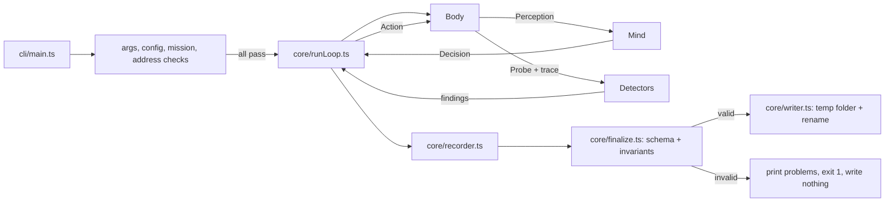

# Design Document: Haunt Engine

## Overview

The engine is a Node.js command-line program in `engine/` that opens Chromium through Playwright, lets one ghost try one mission, runs detectors after every step, and writes a run folder that follows `contract/run-format.md`. Phase 1 builds the shared core and The Listener. Phase 2a adds The Phantom and Bebe on top of the same core.

**Key technologies** (versions aligned with `dashboard/package.json`):

- Node.js 24 LTS or later (the machine has v24.15.0), npm 11
- TypeScript 7 in strict mode, run without a compile step through `tsx`
- `playwright` (library, ^1.65.0), Chromium only
- `ajv` 8 with the draft 2020-12 build (`ajv/dist/2020.js`) for the Run_Schema, the mission schema and the config schema
- `node:util` `parseArgs` for the CLI (no CLI framework)
- Tests: Vitest 5 and `fast-check` 4

**Design principles**

1. **The mind only gets its perception.** A Body returns two separate values: a `Perception` for the Mind and a `Probe` for the Detectors. The Mind's `decide` function takes only the Perception, so the TypeScript types enforce the boundary.
2. **Findings come only from detectors.** Minds return decisions and thoughts. The engine attaches step numbers to findings, so detectors can't point at a step that doesn't exist.
3. **Nothing half-written.** A run is held in memory until it ends. It is validated, then written to a temporary folder and renamed. An invalid run leaves no trace on disk.
4. **Safety before the browser.** Address checks, config checks and mission checks all run before Playwright is imported.
5. **Deterministic where possible.** Scripted minds and detectors are pure functions of their inputs. The only randomness is the visual ghosts' reaction delay, which comes from `--seed`.

## What the ghosts will meet on Lantern Bills

These facts come from reading `demo-site/src` and are the basis of the expected walks below. The engine never changes them.

| Thing | Facts that matter to the engine |
|---|---|
| Routes | `/` (bill page, payment form and modal on the same page), `/autopay`, `/confirmation`. The router basename follows Vite's `BASE_URL` |
| Language | From `?lang=` or `navigator.languages`; `html lang` is set to `en`, `pa` or `hi` |
| Bill page | `header > p` "Lantern Bills" (English in every language), `h1` "Your Electricity Bill" / "ਤੁਹਾਡਾ ਬਿਜਲੀ ਬਿੱਲ", then the banner wrapper, the `button` "Pay this bill" (English in every language), the `dd` "₹2,490.00", and the summary `section` with `p.amount` "₹2,490.00" |
| Late banner | 1500 ms after the bill page mounts, the `img` gets its `src` and `min-height: 120px`, and the "Set up autopay" link appears at `top: 0; left: 0` of the banner wrapper. Pay this bill moves down by 120 to 192 px, and the link now sits where Pay this bill was |
| Summary at ≤640 px | `.summary` is 180 px wide with `overflow: hidden`; `.amount` is 2.5 rem, `nowrap`, `overflow: hidden`. The total is clipped and cannot be scrolled |
| Payment form | Opens after Pay this bill and focuses `#card-number`. Fields `#card-number`, `#card-expiry` (MM/YY), `#card-cvv`, `#cardholder-name`, with visible labels. Card errors are `div` elements with a class containing `errorText`, with no live region and no `aria-describedby` |
| Submit button | `button[type=submit]` holding only an `svg aria-hidden="true"`. Its accessible name is empty |
| Protection modal | `div role="dialog" aria-modal="true" aria-label="Protect your payment"`. Close (`aria-label="Close dialog"`) and Continue are `tabindex="-1"`. A capture-phase `keydown` handler sends every Tab and Shift+Tab to the checkbox or "Learn more". Escape does nothing. The ₹99 checkbox is ticked on every open. Text "Total Amount: ₹2,589.00" (Punjabi "ਕੁੱਲ ਰਕਮ") |
| Confirmation | `section[data-haunt="payment-success"]` on `/confirmation`, with "Total charged" / "ਕੁੱਲ ਲਿਆ ਗਿਆ" and the amount |
| Punjabi gaps | `payBillButton` and the three card error messages fall back to English |

## Architecture



### Folder layout

```
engine/
├── package.json              # name "haunt", bin "haunt" → bin/haunt.mjs
├── tsconfig.json             # strict, moduleResolution bundler, noEmit
├── vitest.config.ts          # unit + property tests (excludes e2e/)
├── vitest.e2e.config.ts      # e2e tests, sequential, long timeouts
├── haunt.config.json         # allowedDomains, sites
├── .gitignore                # node_modules/, test-output/
├── README.md
├── bin/haunt.mjs             # registers tsx, imports src/cli/main.ts
├── missions/pay-bill.json
├── schemas/
│   ├── mission.schema.json
│   └── config.schema.json
├── scripts/demo.ts           # npm run demo / demo:all
├── src/
│   ├── cli/main.ts           # parseArgs, help, exit codes
│   ├── config/               # loadConfig, address.ts (isAllowedAddress), guard.ts (request blocking)
│   ├── missions/             # loadMission, templates ({{futureExpiry}}), patterns
│   ├── contract/             # types.ts, schema.ts (ajv), invariants.ts
│   ├── core/
│   │   ├── types.ts          # Ghost, Body, Mind, Detector, Decision, StepTrace
│   │   ├── runLoop.ts        # the loop, stop rules, success check
│   │   ├── recorder.ts       # steps, screenshots in memory
│   │   ├── detectors.ts      # runDetectors, dedupe, read-only inspection
│   │   ├── finalize.ts       # build run JSON, validate
│   │   ├── writer.ts         # temp folder + rename
│   │   ├── runId.ts          # Run_Id and suffixes
│   │   ├── git.ts            # short commit
│   │   └── rng.ts            # mulberry32 from seed
│   ├── page/                 # scripts injected with addInitScript
│   │   ├── changeClock.ts    # Page_Change_Clock
│   │   ├── liveRegions.ts    # Live_Announcements
│   │   ├── clickLog.ts       # which element got each click
│   │   ├── layoutShifts.ts   # buffered layout-shift entries with sources
│   │   ├── elementKeys.ts    # stable engine-private keys for elements (WeakMap)
│   │   └── sight.ts          # Seen_Items and visible text (Phase 2a)
│   ├── ghosts/
│   │   ├── listener/         # profile.ts, body.ts, ax.ts, speech.ts, mind.ts, thoughts.ts
│   │   ├── visual/           # body.ts, mind.ts, thoughts.ts (shared by Phantom and Bebe)
│   │   ├── phantom/          # profile.ts, index.ts
│   │   └── bebe/             # profile.ts, index.ts
│   └── detectors/
│       ├── unlabeledButton.ts, focusTrap.ts, unannouncedError.ts, errorWords.ts
│       ├── slowWait.ts, misclick.ts
│       └── cutOffText.ts, untranslated.ts, darkPattern.ts, money.ts
├── test/
│   ├── fixtures/*.html       # small pages for detector and body tests
│   ├── fixtureServer.ts      # static server on 127.0.0.1, random port
│   └── *.test.ts, *.properties.test.ts
├── e2e/
│   ├── harness/lanternBills.ts
│   ├── listener.e2e.test.ts
│   ├── phantom.e2e.test.ts
│   └── bebe.e2e.test.ts
└── test-output/              # ignored by git
contract/run.schema.json      # the one file added outside engine/
```

## Core types

```ts
export type GhostId = 'listener' | 'phantom' | 'bebe';
export type FindingType =
  | 'unlabeled_button' | 'focus_trap' | 'unannounced_error'
  | 'slow_wait' | 'misclick' | 'cut_off_text' | 'untranslated' | 'dark_pattern';

export interface Box { x: number; y: number; w: number; h: number } // CSS px, viewport

/** What one action did, as measured by the Body. Never given to a Mind. */
export interface StepTrace {
  pathBefore: string;
  pathAfter: string;
  keys: { key: string; focusKey: string | null; dialogKey: string | null }[]; // one entry per key press
  click?: { aimed: Box; point: { x: number; y: number }; hitKey: string | null; at: number };
  touchedKeys: string[];          // elements the ghost clicked or typed into
  actionEndedAt: number;          // page clock, ms
  readyAt: number;                // page clock, ms
  waits: { from: number; to: number; progress: number[]; loadingUntil: number | null }[];
  announcements: string[];
}

export interface Probe {         // detector-only data captured with the Perception
  at: number;                    // page clock, ms
  itemKeys?: Record<string, string>; // Seen_Item id → element key under its centre (visual ghosts)
}

export type Decision<A> =
  | { kind: 'act'; action: A; thought: string; intentionId: string; recovery?: boolean }
  | { kind: 'give_up'; reason: 'no_match'; thought: string };

export interface Body<P, A> {
  open(url: string): Promise<ActionResult>;
  perceive(): Promise<{ perception: P; probe: Probe }>;
  act(action: A): Promise<ActionResult>;
}

export interface ActionResult {
  actionText: string;             // Step.action
  spoken: string;                 // Step.spoken
  focusBox: Box | null;           // CSS px; converted to screenshot px by the recorder
  trace: StepTrace;
  screenshot: Buffer;             // viewport, after Settle
  seenScreenshot?: Buffer;        // visual click steps: the Sight screenshot the click was based on
}

export interface Mind<P, A> {
  decide(perception: P): Decision<A>;
  giveUpThought(reason: GiveUpReason): string; // built from the Mind's own memory
}

export type GiveUpReason = 'trapped' | 'no_match' | 'step_limit' | 'slow_wait' | 'misclicks';

export interface Detector {
  type: FindingType;
  /** Runs after every Step. Returns new problems; the engine assigns step numbers. */
  observe(ctx: DetectorContext): Promise<DetectedProblem[]>;
  /** Runs once when the Run ends, for problems that are only known at the end. */
  finish?(ctx: DetectorContext): Promise<DetectedProblem[]>;
}

export interface DetectedProblem {
  key: string;                    // identifies the distinct problem, for de-duplication
  stepN: number;                  // must be a Step already recorded; checked by the engine
  title: string;
  evidence: string;
  screenshot: 'step' | 'seen';    // shots/NNN.png or shots/NNN-seen.png of stepN
}

export interface DetectorContext {
  inspect<T>(script: string, arg?: unknown): Promise<T>; // read-only page evaluation
  cdp: ReadOnlyCdp;                // Accessibility.getFullAXTree, DOM.describeNode, DOM.getBoxModel only
  steps: readonly RecordedStep[];  // includes each Step's trace and probe
  current: RecordedStep;
  config: HauntConfig;
  site: SiteConfig;
}

export interface Ghost<P, A> {
  id: GhostId;
  profile: BrowserProfile;         // viewport, scale, locale, mobile, throttling
  createBody(page: Page, cdp: CDPSession, opts: BodyOptions): Body<P, A>;
  createMind(mission: Mission, opts: MindOptions): Mind<P, A>;
  detectors(): Detector[];
  stopRule(state: RunState): GiveUpReason | null; // checked after detectors, before the next decision
}
```

## Run loop

```
runMission(args):
  config  = loadConfig(args.config)            # exit 2 on any problem
  mission = loadMission(args.missions, id)     # exit 2
  siteKey = args.site ?? mission.site          # must be in config.sites, exit 2
  checkAddress(args.url, config)               # exit 2, before Playwright is imported
  checkOutRoot(args.out)                       # exit 2 under the test runner when inside runs/
  ensureChromium()                             # exit 1 with "npx playwright install chromium"

  startedAt = now (UTC, whole seconds); runId = makeRunId(startedAt, ghost, mission, outRoot/siteKey)
  browser = chromium.launch({ headless: !args.headed })
  context = newContext(profile, serviceWorkers: 'block'); installGuard(context, config)
  page.addInitScript(changeClock, liveRegions, clickLog, layoutShifts, elementKeys, sight)
  applyThrottling(cdp, profile)                # Phantom only

  record(body.open(url))                       # Step 1
  loop:
    problems = runDetectors(after the last Step)   # error → result "error"
    if successCheckVisible(page, mission): result = succeeded; break
    reason = ghost.stopRule(state)                 # trapped / slow_wait / misclicks
    if reason: result = gave_up; break
    if steps.length == 60: result = gave_up, reason = step_limit; break
    { perception, probe } = body.perceive()
    decision = mind.decide(perception)
    if decision.kind == give_up: result = gave_up, reason = no_match; break
    record(body.act(decision.action), decision.thought, probe)
  detectors.finish()
  if gave_up: lastStep.thought += " " + mind.giveUpThought(reason)
  run = buildRunJson(...)
  problems = validate(run) + invariants(run, screenshots)
  if problems: print each with its JSON path; exit 1; write nothing
  writeRunFolder(outRoot/siteKey/runId, run, screenshots)   # temp folder, then rename
  print absolute path of run.json as the last line; exit 0 (or 3 for "error")
```

- **Success check.** After each Step, the engine waits up to 300 ms for `page.locator(mission.successCheck.visible).first().isVisible()`. This is the only place success is decided.
- **Errors.** If the browser can't launch, nothing is recorded and the CLI exits 1. If `page.goto` fails, Step 1 is still recorded (the screenshot shows Chromium's error page) and the result is `error`. Any later exception ends the Run with `error`, and the message goes into the last Step's thought, for example "Something went wrong in the engine: Target page, context or browser has been closed."
- **Ctrl+C.** The CLI closes the browser and exits 130 without writing anything.
- **Give_Up_Thought.** The Mind receives only the reason code and writes the sentence from what it remembers. Examples are in each ghost's section.

## Recorder, Run_Id and writer

- **Steps.** `recorder.add()` assigns `n = steps.length + 1`, `page = trace.pathBefore` (Step 1 uses the path after loading), `screenshot = shots/NNN.png`, and `waitMs = round(readyAt - actionEndedAt)`. `focusBox` is converted from CSS px to screenshot px (multiplied by the device scale factor) and left out when it has no area or lies outside the viewport.
- **Screenshots** stay in memory as PNG buffers. Seen screenshots (`NNN-seen.png`) are written only when a finding refers to them.
- **Run_Id.** `YYYY-MM-DDTHHmmZ-<ghost>-<mission>`. If that folder exists under `<Out_Root>/<Site_Key>/`, the suffixes `-2`, `-3`… are tried until one is free. Ten e2e runs in the same minute get `…-pay-bill`, `…-pay-bill-2` … `…-pay-bill-10`.
- **Commit.** `git rev-parse --short HEAD`, run with the repository root as the working folder (found by walking up from `engine/` to the folder that contains `.git`). If it fails, the value is `unknown` and a warning is printed.
- **Writer.** It writes into `<Out_Root>/<Site_Key>/.<runId>.tmp-<pid>/` and then calls `fs.rename` to the final name. If the rename fails, it removes the temp folder and exits 1.

## Run_Schema and invariants

`contract/run.schema.json` (draft 2020-12). The contract-guard hook will ask for confirmation when this file is written.

```json
{
  "$schema": "https://json-schema.org/draft/2020-12/schema",
  "$id": "https://github.com/haunt/contract/run.schema.json",
  "title": "Haunt run file (formatVersion 1)",
  "type": "object",
  "additionalProperties": false,
  "required": ["formatVersion", "runId", "ghost", "mission", "site", "startedAt", "result", "steps", "findings"],
  "properties": {
    "formatVersion": { "const": 1 },
    "runId": { "type": "string", "minLength": 1 },
    "ghost": { "enum": ["listener", "phantom", "bebe"] },
    "mission": {
      "type": "object", "additionalProperties": false,
      "required": ["id", "goal", "requirement", "successCheck"],
      "properties": {
        "id": { "type": "string", "minLength": 1 },
        "goal": { "type": "string" },
        "requirement": { "type": "string" },
        "successCheck": { "type": "string" }
      }
    },
    "site": {
      "type": "object", "additionalProperties": false,
      "required": ["name", "url", "commit"],
      "properties": {
        "name": { "type": "string", "minLength": 1 },
        "url": { "type": "string" },
        "commit": { "type": "string" }
      }
    },
    "startedAt": { "type": "string", "pattern": "^\\d{4}-\\d{2}-\\d{2}T\\d{2}:\\d{2}(:\\d{2}(\\.\\d+)?)?(Z|[+-]\\d{2}:?\\d{2})$" },
    "result": { "enum": ["succeeded", "gave_up", "error"] },
    "steps": { "type": "array", "minItems": 1, "items": { "$ref": "#/$defs/step" } },
    "findings": { "type": "array", "items": { "$ref": "#/$defs/finding" } }
  },
  "$defs": {
    "step": {
      "type": "object", "additionalProperties": false,
      "required": ["n", "page", "action", "spoken", "thought", "screenshot", "waitMs"],
      "properties": {
        "n": { "type": "integer", "minimum": 1 },
        "page": { "type": "string" },
        "action": { "type": "string" },
        "spoken": { "type": "string" },
        "thought": { "type": "string" },
        "screenshot": { "type": "string" },
        "focusBox": { "$ref": "#/$defs/focusBox" },
        "waitMs": { "type": "number", "minimum": 0 }
      }
    },
    "focusBox": {
      "type": "object", "additionalProperties": false,
      "required": ["x", "y", "w", "h"],
      "properties": { "x": { "type": "number" }, "y": { "type": "number" }, "w": { "type": "number" }, "h": { "type": "number" } }
    },
    "finding": {
      "type": "object", "additionalProperties": false,
      "required": ["type", "step", "title", "evidence", "screenshot"],
      "properties": {
        "type": { "enum": ["unlabeled_button", "focus_trap", "unannounced_error", "slow_wait", "misclick", "cut_off_text", "untranslated", "dark_pattern"] },
        "step": { "type": "integer", "minimum": 1 },
        "title": { "type": "string" },
        "evidence": { "type": "string" },
        "screenshot": { "type": "string" }
      }
    }
  }
}
```

The schema follows the contract, so it accepts the hand-written samples (date-only Run_Ids, a zero-sized `focusBox`). The engine's own output must also pass the **Run_Invariants** in `src/contract/invariants.ts`, which are stricter:

| Invariant | Rule |
|---|---|
| Step numbers | `steps[i].n === i + 1` for every `i`; at most 60 Steps |
| Finding steps | Every `finding.step` is an existing `n` |
| Screenshots | Every Step and Finding screenshot matches `^shots/\d{3}(-seen)?\.png$` and is in the set of files about to be written. A Step's screenshot is `shots/<its n>.png` |
| Run_Id | `^\d{4}-\d{2}-\d{2}T\d{4}Z-(listener\|phantom\|bebe)-[a-z0-9]+(-[a-z0-9]+)*$`, its time equals `startedAt` to the minute, and its ghost and mission equal the fields |
| startedAt | `YYYY-MM-DDTHH:mm:ssZ` |
| focusBox | When present: `w > 0`, `h > 0`, and inside the screenshot |
| Thoughts | Non-empty after trimming |

`validate(run)` returns `{ path, message }[]` for both layers, for example `steps[3].n: expected 4, got 5`.

## Configuration and address safety

`engine/haunt.config.json`:

```json
{
  "allowedDomains": [],
  "sites": {
    "lantern-bills": { "name": "Lantern Bills demo", "allowedTerms": ["Lantern Bills"] }
  }
}
```

- `site.name` "Lantern Bills demo" matches the dashboard samples, so the dashboard groups real runs and samples under one Haunt.
- `config.schema.json`: `allowedDomains` items match `^(?!-)[a-z0-9-]{1,63}(?<!-)(\.(?!-)[a-z0-9-]{1,63}(?<!-))+$` and must not be an IPv4 address (checked in code as well). Site keys match `^[a-z0-9]+(-[a-z0-9]+)*$`.
- `isAllowedAddress(raw, config)` is a pure function: `new URL(raw)` must succeed; the protocol must be `http:` or `https:`; `username` and `password` must be empty; `hostname` (already lowercased and punycoded by the parser) must be `localhost`, `127.0.0.1` or exactly an entry of `allowedDomains`. `[::1]`, `0.0.0.0`, `localhost.` and subdomains are refused.
- The CLI message for a refused URL names the host and says: "Ghosts only visit sites we own. To allow a domain you own, add it to allowedDomains in engine/haunt.config.json."
- **Guard during the Run.** `context.route(url => !isAllowedAddress(url), route => route.abort('blockedbyclient'))` covers requests and navigations. `context.routeWebSocket` does the same for WebSockets, and `serviceWorkers: 'block'` covers service workers. `data:`, `blob:` and `about:` URLs are not network requests and pass. Each blocked URL is printed to standard error. The throttling test (Req 20.3) runs with this guard on, so it would catch the guard switching off Chromium's network throttling.

## Missions

`engine/schemas/mission.schema.json` validates the shape below. Patterns are case-insensitive Unicode regular expressions (`iu`), matched against NFC-normalised text with collapsed whitespace.

`doneWhen` is one of:

- `{ "fieldValue": true }`: the target field now shows the typed value. For The Listener this is the AX value of the field; for visual ghosts it is the field's visible text.
- `{ "present": { "kind": "field" | "button" | "link" | "checkbox" | "any", "en": [...], "pa": [...], "hi": [...] } }`: something of that kind with a matching name (The Listener) or visible text (visual ghosts) is in the Perception.
- `"success"`: only the engine's success check ends this Intention.

`engine/missions/pay-bill.json`:

```json
{
  "id": "pay-bill",
  "site": "lantern-bills",
  "goal": "Pay this month's electricity bill",
  "requirement": "WHEN the card number is any valid card number other than 4000000000000002, THE Application SHALL succeed payment processing after 800 milliseconds and display the Confirmation_Element",
  "successCheck": {
    "text": "The confirmation (data-haunt=\"payment-success\") is visible",
    "visible": "[data-haunt=\"payment-success\"]"
  },
  "intentions": [
    {
      "id": "open-form", "do": "activate",
      "thought": "I want to pay this bill, so I'm looking for the button that starts paying.",
      "target": { "kind": "button", "en": ["^pay( this)? bill$", "^pay now$"], "pa": ["ਬਿੱਲ.*ਭਰੋ", "^ਭੁਗਤਾਨ ਕਰੋ$"] },
      "doneWhen": { "present": { "kind": "field", "en": ["card number"], "pa": ["ਕਾਰਡ ਨੰਬਰ"] } }
    },
    {
      "id": "card-number", "do": "type", "value": "4111111111111111",
      "thought": "I'll enter the card number.",
      "target": { "kind": "field", "en": ["card number"], "pa": ["ਕਾਰਡ ਨੰਬਰ"] },
      "doneWhen": { "fieldValue": true }
    },
    {
      "id": "expiry", "do": "type", "value": "{{futureExpiry}}",
      "thought": "Now the expiry date.",
      "target": { "kind": "field", "en": ["expir"], "pa": ["ਮਿਆਦ"] },
      "doneWhen": { "fieldValue": true }
    },
    {
      "id": "cvv", "do": "type", "value": "123",
      "thought": "Now the three-digit security code.",
      "target": { "kind": "field", "en": ["cvv", "security code"], "pa": ["CVV"] },
      "doneWhen": { "fieldValue": true }
    },
    {
      "id": "name", "do": "type", "value": "Asha Kaur",
      "thought": "And the name on the card.",
      "target": { "kind": "field", "en": ["name"], "pa": ["ਨਾਮ"] },
      "doneWhen": { "fieldValue": true }
    },
    {
      "id": "submit", "do": "activate", "lastResort": "unnamedButton",
      "thought": "Everything is filled in. I need the button that sends the payment.",
      "target": { "kind": "button", "en": ["^(submit|pay now|continue|next|send)$"], "pa": ["^ਜਮ੍ਹਾਂ ਕਰੋ$", "^ਭੁਗਤਾਨ ਕਰੋ$"] },
      "doneWhen": { "present": { "kind": "any", "en": ["protect your payment", "payment received"], "pa": ["ਆਪਣੇ ਭੁਗਤਾਨ ਦੀ ਰੱਖਿਆ ਕਰੋ", "ਭੁਗਤਾਨ ਪ੍ਰਾਪਤ ਹੋਇਆ"] } }
    },
    {
      "id": "confirm", "do": "activate",
      "thought": "I need to confirm the payment.",
      "target": { "kind": "button", "en": ["^(continue|confirm|pay|pay now)$"], "pa": ["^ਜਾਰੀ ਰੱਖੋ$"] },
      "doneWhen": "success"
    }
  ]
}
```

- `requirement` is Requirement 2, criterion 9 of the Lantern Bills spec, the criterion that ends with the Confirmation_Element. A unit test reads `.kiro/specs/lantern-bills/requirements.md`, takes the text of that line after `9. `, and compares it character for character.
- `{{futureExpiry}}` becomes the month two years after the Run's start month, as `MM/YY` (November 2026 → `11/28`).
- The submit patterns deliberately don't match "Pay this bill", so every ghost has to deal with the unnamed submit button.

## The Listener (Phase 1)

### Profile

Viewport 1280×800, device scale factor 1, locale `en-IN`, desktop, no throttling. Screenshots are 1280×800 PNGs, so `focusBox` is in CSS px.

### Body: perception

`perceive()` builds a `Heard` value:

```ts
interface Heard {
  title: string; path: string;
  nodes: HeardNode[];             // document order, ignored nodes removed, children kept
  focus: string | null;           // ref of the focused node
  dialog: { ref: string; name: string } | null; // nearest dialog/alertdialog ancestor of focus
  region: { ref: string; role: string; name: string } | null;
  readingPosition: string | null; // ref, moved by heading/landmark jumps
  announcements: string[];        // since the previous Perception
}
interface HeardNode {
  ref: string;                    // "ax-<backendDOMNodeId>": opaque, stable while the element exists
  role: string; name: string; description: string; value: string;
  states: { focused?: true; checked?: boolean | 'mixed'; expanded?: boolean; disabled?: true;
            required?: true; invalid?: true; modal?: true; busy?: true };
  level?: number; depth: number;
}
```

- Source: CDP `Accessibility.getFullAXTree`. Chromium's computed accessible names are used as they are; the engine never computes names itself.
- No boxes, pixels, CSS, HTML or Playwright handles are included. A unit test serialises a `Heard` from a fixture page and checks that its keys match exactly this shape and that its JSON contains no `"x":`, `"width"` or `data:image`.
- **Live_Announcements** come from `page/liveRegions.ts`, a MutationObserver started before any page script. It records text added to or changed inside `[aria-live]:not([aria-live="off"])`, `[role=alert]`, `[role=status]` and `[role=log]`, including a region inserted together with its text (which is how `role="alert"` messages usually appear). The Body drains the buffer after each action's Settle, so it holds announcements made during the action and the Settle.

### Body: actions

```ts
type ListenerAction =
  | { type: 'key'; key: 'Tab' | 'Shift+Tab' | 'ArrowUp' | 'ArrowDown' | 'ArrowLeft' | 'ArrowRight' | 'Enter' | 'Space' | 'Escape' }
  | { type: 'type'; text: string }
  | { type: 'jump'; to: 'heading' | 'landmark' | 'field' | 'button'; dir: 'next' | 'previous' };
```

- The Body gets a `KeyboardOnlyPage` facade with only `keyboard.press`, `keyboard.type` (30 ms between characters), screenshot and read-only CDP calls. It has no `mouse`, `touchscreen`, `click`, `fill`, `focus` or `evaluate`. TypeScript rejects any other use, and a unit test checks the facade's keys.
- **Heading and landmark jumps** move `readingPosition` to the next or previous AX node with role `heading` (or a landmark role: `banner`, `main`, `contentinfo`, `navigation`, `region`, `form`, `search`, `complementary`) and speak it. No key is sent and focus stays where it was. At the end of the list it speaks "No next heading" and stays put.
- **Field and button jumps** press Tab (or Shift+Tab) until the focused node's role is in the kind's role set, for at most (number of focusable AX nodes + 2) presses, capped at 50. Field roles: `textbox`, `searchbox`, `combobox`, `spinbutton`, `checkbox`, `radio`, `listbox`, `slider`, `switch`. Button roles: `button`, `togglebutton`, `menubutton`. Focus on the document (after the last element) counts as a press that found nothing. Each press is logged in `trace.keys` with the element key of the focused element and the enclosing dialog, so the focus_trap Detector sees every press.
- **Settle**: wait until the Page_Change_Clock shows no DOM change and no request has been in flight (from Playwright `request` / `requestfinished` / `requestfailed` events) for 300 ms, checking every 50 ms, for at most 5000 ms. `open()` first waits for the `load` event (timeout 60 s).
- `focusBox`: `DOM.getBoxModel` border box of the focused element; for heading and landmark jumps, the box of the node at the reading position.

### Body: spoken text

`speech.ts` turns the change caused by an action into one string. The parts are joined with ". ":

1. When focus enters a dialog or landmark region it was not in before: `<name>, dialog` or `<name>, region`.
2. The focused node (or, for heading and landmark jumps, the node at the reading position): `<name>, <role words>[, <states>]`. With an empty name it is just `<role words>[, <states>]`.
3. For typing: the typed text.
4. For a key that leaves focus in place but changes a state (Space on a checkbox): the new state, for example `not checked`.
5. Every Live_Announcement, in order.

Role words: `button` → "button", `link` → "link", `textbox` → "edit text", `checkbox` → "checkbox", `heading` → "heading level N", `dialog` → "dialog", `RootWebArea` → "document", landmarks → their role name, and other roles → the role name. States: "checked" / "not checked", "expanded" / "collapsed", "required", "invalid entry", "unavailable", "busy".

Examples: `Pay this bill, button`. `button`. `Payment Information, region. Card Number, edit text, required`. `Protect your payment, dialog. Payment protection for ₹99 Get a refund if your payment fails due to a technical issue., checkbox, checked`.

`action` text examples: `Open http://localhost:3000`, `Next heading`, `Next button (Tab ×2)`, `Next form field (Tab ×1)`, `Enter`, `Type "4111111111111111"`, `Shift+Tab`, `Escape`.

### Mind

The Listener's Mind is a state machine over the Mission's Intentions. It keeps a memory of what it heard: the refs it used, the nodes reached in the current round, the dialog it is in, and the names of buttons it heard in the tree but never reached.

```
decide(heard):
  if path changed since last decision (or first decision): return jump next heading   # orientation
  I = current intention
  if I.doneWhen holds in heard: advance; I = next intention; reset round
  f = focused node
  if f matches I (role fits kind, name matches an en pattern, ref not used before):
      activate → Enter (button/link), Space (checkbox); type → type I.value
  if in last-resort mode: go to the next unnamed candidate (button jump) or Enter on it when focused
  if heard.dialog:
      Tab round until a press lands on a node already reached in this round
      then Shift+Tab round the same way
      then Escape once
      then last resort (unnamed buttons reached in the dialog), else give up
  else:
      jump next <kind> until a jump lands on a node already reached in this round (Full_Pass)
      then last resort if I.lastResort == "unnamedButton" and unnamed buttons were reached
      else give up (no_match)
```

- A type intention is done when the field's AX value equals the typed value. An activate intention is done when its `doneWhen` holds. If it doesn't hold after acting on a match, the Mind marks that ref as used and keeps searching.
- In last-resort mode, each unnamed button gets one Enter. The Mind moves to the next candidate when `doneWhen` still doesn't hold after the Settle.
- Thoughts name what was heard, for example: "I heard 'Pay this bill, button'. That's what I want, so I'll press Enter." or "This button has no name. I've been all the way round and nothing else fits, so I'll try it and hope it submits."
- **Give_Up_Thought** examples:
  - `trapped`: "I'm stuck in the 'Protect your payment' dialog. Tab and Shift+Tab only move between 'Payment protection for ₹99…' and 'Learn more', and Escape does nothing. I can hear 'Continue' and 'Close dialog' buttons, but I can't reach them with the keyboard, so I'm giving up."
  - `no_match`: "I went through every button on this page and none of them sounded like a way to confirm the payment, so I'm giving up."
  - `step_limit`: "I've tried 60 times and still haven't paid, so I'm giving up."

### Detectors

**unlabeled_button.** After each Step, the Detector reads the AX tree through CDP and keeps nodes with role `button` that aren't ignored and have an empty name. The key is the element key. The Finding uses the first Step whose final focus was that element, or else the first Step where it was present. If The Listener focuses it later, the step is moved to that Step; this is allowed because the Finding is only written at `finish`. Evidence comes from `DOM.describeNode` plus a read-only script, for example: "A <button type="submit"> inside the "Payment Information" section contains only an <svg aria-hidden="true">. It has no text, aria-label, aria-labelledby or title, so a screen reader says only "button"." Title: "A button has no name".

**focus_trap.** The Detector walks the Step traces backwards over the current dialog episode: the consecutive key presses during which `dialogKey` stayed the same and not null. It records a Finding when all of these hold:

- (a) some Tab press focused an element already focused earlier in the episode;
- (b) some Shift+Tab press did the same;
- (c) an Escape press left the dialog open (it is still in the DOM and visible) with focus inside it;
- (d) a read-only script finds at least one visible, enabled interactive element in the dialog that was never focused in the episode.

For each unreached control, the script reports the reason: `tabindex="-1"`, `disabled`, `inert`, or "not focusable". Evidence example: "In the dialog "Protect your payment", Tab reached only "Payment protection for ₹99…" and "Learn more"; Shift+Tab reached the same two. "Close dialog" (button, tabindex="-1") and "Continue" (button, tabindex="-1") are visible but were never reached. Escape did not close the dialog." The key is the dialog's element key, and the Finding goes on the Step with the Escape.

**unannounced_error.** A read-only script lists visible elements whose own text matches `errorWords.ts`, or whose class or id contains `error` or `invalid` (case-insensitive) and which have text. The wording list holds anchored phrases such as `^please (enter|provide|check|choose)\b`, `\binvalid\b`, `\bis required\b`, `\bnot valid\b`, `\bfailed\b`, `\btry again\b`, the Punjabi `ਕਿਰਪਾ ਕਰਕੇ`, `ਗਲਤ`, `ਲਾਜ਼ਮੀ`, `ਅਸਫਲ ਹੋਇਆ` and the Hindi `कृपया`, `अमान्य`, `आवश्यक`, `विफल रहा`. Each element and text pair is tracked from the Step where it first appeared, while it is visible. It counts as heard when its normalised text is contained in a Live_Announcement, or in the focused node's AX description, at any Step while it is visible. At `finish`, every unheard pair becomes a Finding at its first Step. Evidence example: "The text "Please enter a valid card number" appeared below the "Card Number" field. It is not in a live region or role="alert", and the field's description doesn't include it, so a screen reader never says it."

**Stop rule.** A `focus_trap` Finding in the latest Step ends the Run with `trapped`.

### Expected walk on Lantern Bills

| n | action | spoken | detectors |
|---|---|---|---|
| 1 | Open http://localhost:3000 | Lantern Bills - Pay Your Electricity Bill, document | |
| 2 | Next heading | Your Electricity Bill, heading level 1 | |
| 3 | Next button (Tab ×1 or ×2) | Pay this bill, button | (×2 when the Autopay link has appeared) |
| 4 | Enter | Payment Information, region. Card Number, edit text, required | |
| 5 | Type "4111111111111111" | Card Number… 4111111111111111 | |
| 6–11 | Next form field / Type, for expiry `11/28`, CVV `123` and name | Expiry Date, edit text, required … | |
| 12 | Next button (Tab ×1) | button | `unlabeled_button` (first focus) |
| 13 | Next button (Tab ×2–3) | Pay this bill, button | already used |
| 14 | Next button (Tab ×5) | button | already reached: Full_Pass |
| 15 | Enter (last resort) | Protect your payment, dialog. Payment protection for ₹99…, checkbox, checked | |
| 16 | Tab | Learn more, button, collapsed | |
| 17 | Tab | Payment protection for ₹99…, checkbox, checked | Tab round complete |
| 18–19 | Shift+Tab ×2 | Learn more…, then the checkbox | Shift+Tab round complete |
| 20 | Escape | Payment protection for ₹99…, checkbox, checked | `focus_trap`, gave up: trapped |

The only timing variation is whether the Autopay link exists before step 3. Both cases lead to the same walk, which is why the e2e test can require 9 out of 10.

## Shared visual body (Phase 2a)

### Sight

```ts
interface Sight {
  path: string;                    // what the address bar shows
  viewport: { w: number; h: number };
  screenshot: Buffer; screenshotHash: string;
  items: SeenItem[];
}
interface SeenItem {
  id: string;                      // "s1", "s2"… valid for this Sight only
  look: 'button' | 'field' | 'link' | 'checkbox' | 'text';
  text: string;                    // only the characters actually visible
  box: Box;                        // CSS px in the viewport
  checked?: boolean;               // visible tick
  placeholder?: boolean;           // text is the field's placeholder
}
```

- `page/sight.ts` runs as one synchronous evaluation, so the items and the probe describe the same moment. It collects:
  - interactive elements (`a[href]`, `button`, `input`, `select`, `textarea`, `summary`);
  - leaf text blocks (elements with their own non-empty text nodes).
- An item is kept only when its box intersects the viewport, it isn't `visibility: hidden` or `opacity: 0`, and `elementFromPoint` at the centre of its visible part returns the element itself or a descendant. Things under a modal backdrop are therefore left out.
- `look` is a stand-in for what a sighted person recognises. `button` and button-type inputs look like `button`; `a` looks like `link` even with `role="button"`; text-like inputs, `select` and `textarea` look like `field`; checkboxes and radios look like `checkbox`. ARIA roles and names are never read.
- **Visible text.** For each text node, the script gets the visible rectangle by intersecting the viewport with every ancestor whose `overflow` is not `visible`. If the node's range lies fully inside, all its text is kept. Otherwise each character's `Range` rect is tested, and only characters fully inside are kept. Inputs show their value, or their placeholder (with `placeholder: true`) when the value is empty.
- The screenshot is taken right after the evaluation. The probe holds `at` (page clock) and `itemKeys` (element key of the interactive element under each item's centre).
- Property 5 checks that a serialised Sight has exactly these keys and never contains ARIA attribute values, roles or accessible names that aren't visible text.

### Actions

```ts
type VisualAction =
  | { type: 'click'; itemId: string }
  | { type: 'type'; text: string }
  | { type: 'scroll'; dir: 'down' | 'up' }   // 80% of the viewport height, wheel over the viewport centre
  | { type: 'wait' }                          // up to 2000 ms or until the Page_Change_Clock moves, then Settle
  | { type: 'back' };                         // browser Back
```

A click waits the Reaction_Delay, counted from the end of the Sight, and then calls `page.mouse.click` at the centre of the item's box from that Sight. It never looks at the page again. `page/clickLog.ts` records, in the capture phase, the element key of the closest interactive ancestor of the `click` event target and the time. Typing uses `page.keyboard.type` with the ghost's delay.

### Visual mind

One `VisualMind` class with parameters `{ languages: ('pa' | 'hi' | 'en')[] }`:

- **Matching.** Patterns are tried language by language in the ghost's order. Buttons, links and checkboxes match on their own text. A field matches on its nearest label: the closest `text` item whose box ends above the field's top (within 48 px, overlapping horizontally) or to its left on the same line. Items with the same look and text as one used for an earlier Intention are skipped.
- **Type intentions take two Steps:** click the field, then type. The Intention is done when the field item shows the value.
- **Last resort:** `button` items with empty text, in reading order (top to bottom, then left to right).
- **No target visible:**
  - If the last action was a click for this Intention, the path changed, and the new page shows no target of this or any later Intention, the page is unexpected. The Mind clicks a link matching `back` / `ਵਾਪਸ` / `वापस`, or uses `back` when there is none. These decisions are marked `recovery: true`.
  - If the Sight has no items, the Mind waits.
  - Otherwise it scrolls down until a scroll leaves `screenshotHash` unchanged (the bottom), then scrolls up to the top, then gives up with `no_match`.
- Thoughts quote what was seen, for example "I can see 'Pay this bill'. I'll tap it." or, for Bebe, "The button says 'Pay this bill' in English, not Punjabi, but I can make it out. I'll press it."

### Page_Change_Clock

`page/changeClock.ts` is a MutationObserver on `document` (child lists, character data and attributes, ignoring changes inside elements with zero size or `display: none`). It also uses a `layout-shift` PerformanceObserver, `load` events on images in the capture phase, and `document.getAnimations()` sampled when asked. It keeps `lastChange` in `performance.now()` time. The engine reads it with a read-only evaluation every 50 ms. It is the basis of the visual ghosts' Settle and of `slow_wait`.

## The Phantom (Phase 2a)

### Profile

- Viewport 360×640, device scale factor 2, `isMobile: true`, `hasTouch: true`, locale `en-IN`.
- User agent `Mozilla/5.0 (Linux; Android 8.1.0; Moto G (5S) Plus) AppleWebKit/537.36 (KHTML, like Gecko) Chrome/80.0.3987.99 Mobile Safari/537.36`.
- Through a CDP session: `Network.enable`, then `Network.emulateNetworkConditions` with `latency: 2000`, `downloadThroughput: 50000`, `uploadThroughput: 50000`, `connectionType: 'cellular3g'` (Chrome DevTools' "Slow 3G" values), and `Emulation.setCPUThrottlingRate({ rate: 4 })`.
- Settle: `load` event fired and 1200 ms with no change on the Page_Change_Clock, for at most 20 s.
- Reaction_Delay: `900 + floor(rng() * 201)` ms. Typing: 120 ms per character.

### Detectors

**misclick.** For a click Step, the Detector compares `probe.itemKeys[aimedItem]` with `trace.click.hitKey`. When they differ, it records a Finding with the key `click-<n>`. Evidence lists:

- the layout-shift entries whose `startTime` falls between `probe.at` and `click.at + 100`, each with its value and, per source, the moved element's visible text or tag and its `previousRect` and `currentRect`;
- the intended and the hit element by visible text;
- both screenshots.

Example: "Aimed at "Pay this bill" (seen at x 16, y 170, 132×48). 1.2 s later the click landed on "Set up autopay". A layout shift of 0.31 happened in between: "Pay this bill" moved from y 170 to y 290. Before: shots/003-seen.png. After: shots/003.png." The Finding's `screenshot` is the seen screenshot.

**slow_wait.** During every Settle and wait action, the Body records the times of Page_Change_Clock changes, the times a loading indicator was visible (`[role=progressbar]`, `[aria-busy=true]`, class or id containing `spinner` or `loading`, visible), and whether `load` had fired. The Detector joins these spans across consecutive waiting Steps. When a span of more than 10 000 ms has none of them, it records a Finding with the key `wait-<start step>` on the Step where the span passed 10 s. Evidence: "Waited 12.4 seconds at step 2 with nothing changing on the screen and no loading sign. The screen showed: "…" (first 80 visible characters)".

**Stop rules.**

- A `slow_wait` Finding in the latest Step ends the Run with `slow_wait`.
- `misclickStreak(steps)`: walk the click Steps of the current Intention in order. A misclick adds 1. A recovery click leaves the count unchanged. A correct click on the Intention's target resets it to 0. When the count reaches 2, the Run ends with `misclicks`.

### Timing on Lantern Bills

Let T0 be the moment the bill page mounts (the last DOM change). The banner timer starts at T0 and moves the layout at about T0 + 1500 ms (plus one React commit).

- The Phantom's Settle ends at T0 + 1200 to 1300 ms, and its Sight is taken right away. With the 4x CPU slowdown the banner timer fires late: measured over several runs, the shift came 310 to 560 ms after the Sight was complete (T0 + about 1550 to 1800 ms). The Sight therefore still sees "Pay this bill" in its first position.
- The click comes at least 900 ms after the Sight is complete. That is at least 340 ms after the shift in every measured run, so it lands on "Set up autopay". (A Reaction_Delay of 550 to 650 ms, used first, often tapped before the shift and hit the button: 4 of 10 runs misclicked.)
- With 2000 ms network latency, the first load takes about 10 to 15 s. The page's load event is pending for most of that, and the translation file arrives about 2 s after it, so `slow_wait` does not fire.

Expected walk:

| n | action | result |
|---|---|---|
| 1 | Open http://localhost:3000 | long load; the bill page appears (sometimes after one `Wait` step) |
| 2 | Click "Pay this bill" | lands on "Set up autopay", goes to `/autopay`: `misclick` |
| 3 | Click "Back to bill" (recovery) | back on `/`, and the banner timer starts again |
| 4 | Click "Pay this bill" | lands on "Set up autopay" again: `misclick`, streak 2, gave up: misclicks |

Give_Up_Thought (`misclicks`): "Twice I tapped 'Pay this bill' and the page jumped just before my finger landed, so I opened 'Set up autopay' instead. I'm giving up." (`slow_wait`): "I've been looking at the same screen for over 10 seconds with no sign that anything is happening, so I'm giving up."

## Bebe (Phase 2a)

### Profile

Viewport 640×400 CSS px, device scale factor 2 (200% zoom on a 1280×800 screen, so screenshots are 1280×800), locale `pa-IN`, `extraHTTPHeaders: { 'Accept-Language': 'pa-IN,pa;q=0.9' }`, desktop, no throttling. Settle: `load` fired and 2000 ms with no change, for at most 20 s. Reaction_Delay `1300 + floor(rng() * 401)` ms. Typing: 300 ms per character. Languages `['pa', 'hi', 'en']`.

At 640 px wide, Lantern Bills' `max-width: 640px` rules apply, so the summary is clipped. Bebe's 2000 ms Settle ends after the banner shift, so she doesn't misclick, and she has no misclick detector.

### Detectors

All three use read-only scripts. Each Finding is reported at the first Step at which the problem was inside the viewport. If it never was, the Finding goes at the first Step where it was present, and the evidence ends with "It was outside the visible part of the screen."

**cut_off_text.** For each rendered text node, the Detector finds the clipping box: the nearest ancestor with `overflow-x` or `overflow-y` of `hidden` or `clip`, or with `text-overflow: ellipsis`. Characters whose rects fall outside that box are clipped. If the clipping element can't be scrolled by the user (`overflow: hidden` or `clip`, or `scrollWidth <= clientWidth` for `auto` and `scroll`), it is a Finding with the key `<element key>`. Evidence: "The text "₹2,490.00" is cut off: only "₹2,49" fits inside its 144 px wide box (Payment Summary), and the box can't be scrolled." Title: "Text is cut off at 200% zoom".

**untranslated.** This runs only when `document.documentElement.lang` starts with `pa`. For each visible leaf text block and each placeholder of an empty field (typed values are left out), the Detector:

1. removes the site's `allowedTerms` (case-insensitive);
2. removes acronyms (`\b[A-Z]{2,4}\b`) and tokens that contain a digit, an `@` (e-mail addresses) or that start like a web address;
3. counts the words matching `\b[A-Za-z]{3,}\b`.

Two or more is a Finding, with the key `<element key>|<text>`. Evidence: "The button text "Pay this bill" is in English on a page shown in Punjabi (lang="pa")." On Lantern Bills, "Lantern Bills" is an allowed term, "CVV" and "MM/YY" are acronyms, and the footer "© 2026 Lantern Bills" is left with nothing.

**dark_pattern.** `money.ts` parses `₹`, `Rs.`, `INR`, `$`, `€` and `£` amounts with Indian or Western grouping. The bill amount is the amount the rendered text of the first page shows most often (the earliest on a tie), read when Step 1 settles: ₹2,490.00. The late banner's "Up to ₹150 a month" comes first on the page but is shown once, so it is not the bill. Two kinds of Finding:

- `pre-ticked|<key>`: a visible checkbox whose label text contains an amount, checked when it first appears, and not in `touchedKeys` of any Step so far. Evidence: "The paid option "₹99 ਲਈ ਭੁਗਤਾਨ ਸੁਰੱਖਿਆ" (₹99) was already ticked when it appeared. Bebe did not tick it."
- `total|<key>`: an element whose text, or whose nearest preceding label (`dt`, `label`, or the preceding text in the same block), contains `total`, `ਕੁੱਲ` or `कुल` (or, for a confirmation page, `amount paid`, `charged`, `ਭਰੀ ਰਕਮ` or `भुगतान राशि`, which are Lantern Bills' labels there), and which shows an amount higher than the bill amount. Evidence: "The total says ₹2,589.00 but the bill was ₹2,490.00 (₹99.00 more)." The modal total and the confirmation total are separate elements, so both are recorded.

Bebe has no stop rule from Findings.

### Expected walk on Lantern Bills

| n | action | detectors |
|---|---|---|
| 1 | Open http://localhost:3000 (Punjabi page) | `untranslated` ("Pay this bill"), `cut_off_text` (summary total; in or out of the viewport) |
| 2 | Click "Pay this bill" (`en` fallback) | form opens and the page scrolls to the card number |
| 3–10 | Click each field by its Punjabi label and type (scrolling when needed) | |
| 11 | Click the button with no text (last resort) | modal: `dark_pattern` ×2 (pre-ticked ₹99, total ₹2,589.00) |
| 12 | Click "ਜਾਰੀ ਰੱਖੋ" (scrolling inside the modal first if it is not visible) | `/confirmation`: `dark_pattern` (ਕੁੱਲ ਲਿਆ ਗਿਆ ₹2,589.00), success |

Result `succeeded`, with all the Findings, which matches the example of paying ₹2,589.00 for a ₹2,490.00 bill.

## Lantern_Bills_Harness

`e2e/harness/lanternBills.ts` exports `startLanternBills(): Promise<{ url: string; stop(): Promise<void> }>`, used by the e2e tests (`beforeAll` / `afterAll`) and by `scripts/demo.ts` (`try` / `finally`).

1. Fail if `demo-site/node_modules/vite/bin/vite.js` is missing ("Run npm install in demo-site/ first.").
2. Save `git status --porcelain -- demo-site`.
3. Probe `127.0.0.1:3000` and `[::1]:3000` with `net.connect`. If either answers, fail with "Port 3000 is already in use. Stop the other server (for example npm run dev in demo-site/) and try again."
4. Build: `spawn(process.execPath, [vite.js, 'build', '--base', '/', '--outDir', <engine>/test-output/.lantern-bills-build, '--emptyOutDir'], { cwd: 'demo-site' })`. Nothing goes through a shell, and the npm `build` script (which runs `tsc` and writes `demo-site/dist`) is not used.
5. Serve: `spawn(process.execPath, [vite.js, 'preview', '--base', '/', '--outDir', <same>, '--port', '3000', '--strictPort'], { cwd: 'demo-site' })`.
6. Poll `http://localhost:3000/` until it answers with 200, for at most 60 s.
7. `stop()` calls `child.kill()` on the Node process directly, which works on Windows because no `cmd.exe` sits in between. It waits for `exit`, and the caller then compares `git status --porcelain -- demo-site` with the saved value.

The production build is used because Slow 3G against Vite's dev server would load dozens of unbundled modules plus the development build of React, and one Phantom run would take minutes. The build is the same app that GitHub Pages serves.

## CLI

```
npx haunt run --ghost <listener|phantom|bebe> --mission <id> --url <url>
              [--out <dir>] [--site <key>] [--seed <int>] [--headed]
              [--config <file>] [--missions <dir>]
npx haunt --help | npx haunt run --help
```

- `bin/haunt.mjs`: `import { register } from 'tsx/esm/api'; register(); const { main } = await import('../src/cli/main.ts'); process.exitCode = await main(process.argv.slice(2));`. npm runs a package's own `bin` from inside that package, so `npx haunt` works in `engine/` after `npm install`.
- Exit codes: 0 succeeded or gave_up; 1 run invalid, Chromium missing, or the browser could not start; 2 bad arguments, config, mission, site, address, or a test run aimed at `runs/`; 3 result `error` (file written); 130 interrupted.
- Standard output: progress lines (`step 3: Next button (Tab ×2) → "Pay this bill, button"`), then the absolute `run.json` path as the last line. Warnings, the generated seed and blocked URLs go to standard error.
- Test guard: `vitest.config.ts` and `vitest.e2e.config.ts` set `env: { HAUNT_UNDER_TEST: '1' }`. With that variable set, an Out_Root inside `<repo>/runs` is refused.

## npm scripts

```json
{
  "build": "tsc --noEmit",
  "test": "vitest run",
  "test:properties": "vitest run -t \"Feature: haunt-engine, Property\"",
  "test:e2e": "vitest run --config vitest.e2e.config.ts",
  "test:e2e:listener": "vitest run --config vitest.e2e.config.ts e2e/listener.e2e.test.ts",
  "test:e2e:phantom": "vitest run --config vitest.e2e.config.ts e2e/phantom.e2e.test.ts",
  "test:e2e:bebe": "vitest run --config vitest.e2e.config.ts e2e/bebe.e2e.test.ts",
  "demo": "tsx scripts/demo.ts",
  "demo:all": "tsx scripts/demo.ts --all"
}
```

None of them uses Unix-only syntax, and npm runs them through `cmd.exe` on Windows, where double quotes work. `vitest.e2e.config.ts`: `include: ['e2e/**/*.e2e.test.ts']`, `fileParallelism: false`, `testTimeout: 1_800_000`, `hookTimeout: 180_000`.

`scripts/demo.ts` empties `engine/test-output/demo-run/` (or `demo-runs/` with `--all`), starts the harness, runs the CLI for each ghost with `--out` pointing there (seed 1 for the visual ghosts), validates each `run.json` against the Run_Schema, prints each absolute path, and stops the server in `finally`.

## Correctness Properties

Each property is one fast-check test with at least 100 runs, in a top-level `describe('Feature: haunt-engine, Property N: …')`.

1. **Saved runs always pass the schema and the invariants.** For any generated run (any ghost, result, step count from 1 to 60, Unicode text, findings that may point at missing steps, any focus boxes), `finalizeRun` either returns a run that passes `run.schema.json` and the Run_Invariants and writes exactly that folder, or returns problems and leaves the output folder byte-for-byte unchanged. *Validates 3.4, 3.5, 3.6, 12.1, 20.1.*
2. **Disallowed addresses are always refused before a browser starts.** For generated URLs (random schemes, user info, ports, IPv4 and IPv6, uppercase hosts, trailing dots, subdomains and look-alikes of allowed domains, IDN hosts, garbage strings), `main(['run', …, '--url', u])` with an injected launcher returns 2 and never calls the launcher exactly when an independent oracle written from Requirement 4 says the URL is not allowed. *Validates 4.1, 4.2, 4.3, 4.5.*
3. **Every finding points to an existing step.** Running `runLoop` with generated fake ghosts (random bodies, minds that act or give up, and detectors that return problems with any `stepN`, including bogus ones) always gives runs where every `finding.step` is an existing `n`. Bogus problems end the Run with `error` instead of being saved. *Validates 7.3, 12.1, 20.1.*
4. **Steps are numbered 1 to N with no gaps.** In the same generated runs, `steps.map(s => s.n)` equals `[1..N]` with `N ≤ 60`, whatever the mix of success, giving up, step limit and thrown errors. *Validates 6.2, 6.9, 12.1, 20.1.*
5. **Visual perceptions carry no accessibility data.** For generated HTML (random elements carrying `role`, `aria-label`, `aria-describedby`, `title` and `alt` values that contain a unique marker, plus visible text), the Sight of The Phantom's and Bebe's bodies has only the allowed keys and contains the marker only where it is visible text. *Validates 13.2, 17.2, 20.2.*
6. **Reaction delays stay in range.** For any 32-bit seed and any number of draws, The Phantom's delays are in [900, 1100] and Bebe's in [1300, 1700]. *Validates 13.4, 17.4, 20.2.*
7. **Two misclicks in a row end the Run exactly then.** For generated sequences of click outcomes (correct, misclick, recovery), `misclickStreak` reaches 2 exactly at the second misclick that has no correct click between it and the previous misclick. A Run built from the sequence ends at that Step and not before. *Validates 16.2, 20.2.*
8. **Run_Ids are well-formed and unique.** For any start time and any set of existing folder names, `makeRunId` returns a value that matches the invariant pattern, encodes the start time to the minute in UTC, and is not in the set. *Validates 2.3, 2.4.*

## Error handling

| Situation | Behaviour |
|---|---|
| Unknown option, ghost, mission or site | Message plus allowed values, exit 2, no browser |
| URL not allowed | Refused host and how to allow a domain the team owns, exit 2, no browser |
| Config missing or invalid | Problem with its JSON path, exit 2 |
| Mission invalid | Problem with its JSON path, exit 2 |
| Chromium not installed | "Run: npx playwright install chromium", exit 1 |
| Page can't be opened | Step 1 recorded, result `error`, exit 3 |
| Detector throws | Result `error`; the last thought names the detector and the message |
| Run fails schema or invariants | Each problem with its path, exit 1, nothing written |
| Out_Root inside `runs/` under the test runner | Refused, exit 2 |
| Request to a host that isn't allowed | Aborted, URL printed to standard error, Run continues |
| Ctrl+C | Browser closed, nothing written, exit 130 |

## Testing strategy

- **Unit tests** (`npm test`):
  - schema against `contract/example-run.json`, `runs/samples/*/run.json` and derived invalid files (`ghost: "poltergeist"`, `result: "success"`, `type: "keyboard_trap"`, an extra field, no steps);
  - invariants, address checks, config and mission loading, `{{futureExpiry}}`, and the requirement text match;
  - CLI argument errors with an injected launcher;
  - writer atomicity (simulated rename failure);
  - Listener speech strings and jumps on fixture pages, the `KeyboardOnlyPage` facade and the purity of `Heard`;
  - the Listener mind on scripted perceptions that copy Lantern Bills' tree, and the visual mind on scripted Sights;
  - each detector against fixture pages, with a page that must give a Finding and one that must not;
  - a check that detectors leave the page unchanged (MutationObserver count, focus and scroll position before and after);
  - a throttling test: a 100 000-byte fixture through The Phantom's profile takes at least 2 s, with the guard on.
- **Fixture pages** in `test/fixtures/` are served by `test/fixtureServer.ts` on `127.0.0.1` with a random port, so they are Allowed_Addresses.
- **Property tests** (`npm run test:properties`): Properties 1 to 8 above.
- **End-to-end tests** (`npm run test:e2e`): one file per ghost, each starting the harness, running the CLI 10 times in sequence with `--out engine/test-output/e2e/<ghost>` (seeds 1 to 10 for the visual ghosts), and checking the thresholds. Each Run_File must pass the Run_Schema, the Run_Invariants and the dashboard's `validateRun` (imported from `../dashboard/src/data/validate.ts`) with no errors. On failure, the test prints a per-run table (result, finding types, last thought). Runs are sequential because parallel browsers would change The Phantom's timing.
- Tests are never weakened or deleted to make them pass. If a ghost doesn't meet a threshold, the fix goes in the engine, never in `demo-site/` and never in the threshold.
