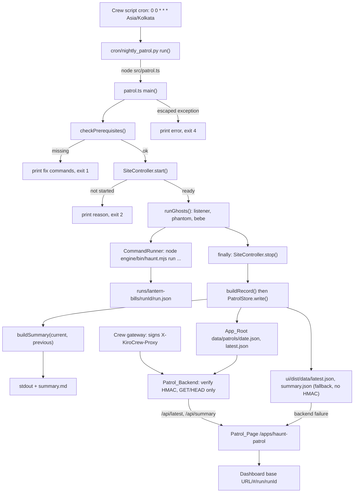

# Design Document

## Overview

Haunt Patrol is a Kiro Crew app in `crew-app/`. Once a night at midnight IST, a model-free script cron job calls a small Python shim (`cron/nightly_patrol.py:run`), which runs one TypeScript script, the Patrol_Runner, with Node.js. The runner checks prerequisites, builds and serves Lantern Bills on port 3000, runs the three ghosts one after another with `haunt run` (scripted mind only), stops the site, writes a Patrol_Record, builds a plain-code Patrol_Summary that compares tonight with the previous patrol, and prints the summary. A single React page, the Patrol_Page, shows the latest record with a link to open each run in the Haunt dashboard.

Design decisions:

- **Functional core, imperative shell.** Everything that decides something is a pure function: seed, command arguments, run-file extraction, exit-code mapping, diffing, summary text, previous-record selection, link building, request routing. Process spawning, file access and the clock sit behind small interfaces (`CommandRunner`, `SiteController`, `PatrolFs`, `Clock`) that tests replace with fakes. No test starts a browser or a server (Requirement 12.3).
- **No AI.** The runner only ever executes `node engine/bin/haunt.mjs run ...`. It never references `haunt-mcp` and the Manifest never links the cron job to an agent.
- **Own copy of the site lifecycle.** The Site_Controller is written for this app. It follows the approach of `dashboard/scripts/liveGhost.ts` (build with Vite, `vite preview --strictPort`, poll the page title, kill the process tree) but imports nothing from `dashboard/` (Requirement 3.10).
- **Read-only data path.** The runner is the only writer of `data/patrols/` in the App_Root (`crew-app/data/patrols/` in the repository, `~/.kiro/crew/apps/haunt-patrol/data/patrols/` in an installed copy). The backend and page only read. Both the runner and the backend find the folder from their own file location.
- **Nothing outside `crew-app/` changes**, except the repository `runs/` folder, which the engine writes into as it always does, and `.gitignore` entries for `crew-app/`. `engine/`, `dashboard/`, `demo-site/` and `demo-site-exorcised/` are untouched.

### Alignment with the Kiro Crew docs (2026-11-23)

Checked against kiro.dev/docs/crew/apps (overview, manifest reference, build your first app, publishing) and, in the kirodotdev/KiroCrew repository, `docs/app-kit/manifest-reference.md`, `api-reference.md`, `getting-started.md`, `publishing-guide.md` and `docs/guides/windows-install.md`. Content was rephrased for compliance with licensing restrictions. Where the two sources differ, the repository docs are newer and more detailed and win. This section supersedes the earlier risk list where they disagree.

| Item | Documented behaviour | Change in Haunt Patrol |
|---|---|---|
| Command crons | Refused on native Windows: the stored command is vetted as POSIX `sh`, and Windows has no matching shell. A manifest command cron is refused up front. | The Patrol_Job is a `script` cron, `cron/nightly_patrol.py:run`, a Python callable run without a model call. The shim uses only the standard library and starts `node src/patrol.ts` without a shell. |
| Cron fields | `name`, `cron_expr`, `timezone`, `strict_schedule`, `script`, `timeout` (subprocess seconds), `timeout_secs` (whole run, at least `timeout` + 5) are documented. A non-empty `crons` needs `permissions.cron: true`. | Kept; `command` replaced by `script`. |
| `setup` | `onInstall` runs only for registry installs, through `/bin/bash`, which native Windows refuses. Local-path installs never run it. `onUpdate` is never executed. | `setup` removed. |
| Installed copy | Install copies the app folder to `~/.kiro/crew/apps/<name>/` and drops `node_modules`, `.git`, `__pycache__`, `.venv`. Runtime artifacts must be committed, including `ui/dist/index.mjs`. `data/` is preserved across updates. | `ui/dist/index.mjs` is committed; the root `.gitignore` re-includes `crew-app/ui/dist/` and keeps `crew-app/ui/dist/data/` ignored. Data moved from `<repoRoot>/crew-app/data/patrols/` to `<App_Root>/data/patrols/`. |
| UI build | React, ReactDOM, lucide-react and `@kirocrew/app-sdk` are external; the dashboard provides them through its import map. `ui.entry` is relative to `ui/`. | Externals are `react`, `react-dom`, `react/jsx-runtime`, `lucide-react` and `/^@kirocrew\/app-sdk/`, so every SDK subpath stays external. |
| `useAppApi` | Refuses any path not matching a `permissions.api` entry. | `permissions.api: ["/apps/haunt-patrol/api"]`. |
| `ui.pages[].icon` | Drawn for built-in apps only; an installed app shows the generic icon. | Kept (harmless). A store icon needs a 512×512 opaque PNG in `iconPath`, which is not part of this change. |
| `platform.os` | Defaults to `["macos", "linux"]`, which tells Windows users the app does not run there. | `["macos", "linux", "windows"]`. |
| Backend | `node` is a documented `backend.type`. The gateway runs `npm install --production` where a `package.json` has no `node_modules`. The backend gets `PORT`, `KIROCREW_APP_NAME`, `KIROCREW_HOME` and `KIROCREW_PROXY_SECRET`, and no app-specific variables. `/health` must answer an unsigned loopback GET with 2xx. The proxy forwards `/apps/<name>/api/<path>` as `/api/<path>`. | Routes are `/api/latest` and `/api/summary`; `/health` unchanged. The server finds `data/patrols/` from its own location (no `HAUNT_REPO_ROOT`). |
| Proxy signing | Header `X-KiroCrew-Proxy: <timestamp>:<hmac-sha256>` (kiro.dev still says `X-Crew-Proxy`). HMAC-SHA-256 keyed with `KIROCREW_PROXY_SECRET` over `timestamp:method:/api/path[?query]:sha256(body)`, lowercase hex, raw request-target, Unix seconds within ±60 s, constant-time compare. An optional replay-proof v2 header pair also exists. | `crewProxyConfig.ts` and `crewProxy.ts` follow v1 exactly. v2 is not used. |
| Trust | Enable refuses a third-party app until the owner trusts it; the App Store asks at enable. | Documented in `INSTALL-WINDOWS.md`. |

The installed copy has no `engine/` or `demo-site/` beside it, so the repository root comes from `HAUNT_REPO_ROOT` (set as a Windows user variable before Crew starts), else from the folder above the App_Root. Still unverified: whether a script cron sees variables the gateway inherited, what a returned value or a raised exception does to the run's status, and whether `useAppApi` reaches the app's own proxy path.

### Verified facts and unverified risks (original)

Verified by reading `engine/src/cli/main.ts` and `dashboard/scripts/liveGhost.ts`:

| Item | Finding |
|---|---|
| Command | `haunt run --ghost <id> --mission <id> --url <url> [--out <dir>] [--seed <int>]`. `--seed` must be a whole number. The ghost ids are `listener`, `phantom`, `bebe`. |
| Exit codes | 0 saved (succeeded or gave up), 1 invalid run / no Chromium / page not opened, 2 bad arguments/config/mission/site/address, 3 result `error` with run saved, 130 interrupted with nothing written. Matches Requirement 4. |
| Run path | The last line on standard output is the absolute path of `run.json`, only on exit 0 or 3. Progress lines go to standard error. `liveGhost.ts` finds the last absolute line ending in `run.json`; the runner does the same, which is safer than blindly trusting the final line. |
| Run folder | `<out>/<siteKey>/<runId>/run.json`. For Lantern Bills the site key is `lantern-bills` (matches the Run_File definition and `dashboard/public/runs/lantern-bills`). |
| Address rule | The engine only opens `localhost`, `127.0.0.1` and allowed domains, so `http://localhost:3000` is accepted. |
| Working directory | `liveGhost.ts` runs the CLI with `cwd` = `engine/` and passes an absolute `--out`. The runner does the same. |
| Test guard | The engine refuses to write into `runs/` when `HAUNT_UNDER_TEST=1`. `liveGhost.ts` deletes that variable from the child environment. The runner does the same. |
| Chromium check | The engine checks `chromium.executablePath()` exists and prints `npx playwright install chromium` otherwise. The runner repeats the check before starting the site. |
| Node version | `engine/package.json` declares `"node": ">=24"`. |
| Dashboard route | `dashboard/src/App.tsx` uses `createHashRouter`, and `#/run/:runKey` redirects to step 1 of the run. The Run_Key equals the run's `runId` unless the id is empty or duplicated (`dashboard/scripts/collect.ts`). So `<base>/#/run/<runId>` is correct for normal runs. |
| Site probe | `liveGhost.ts` identifies Lantern Bills by a `<title>` containing `Lantern Bills` and builds with `vite build --base / --outDir <dir> --emptyOutDir`, then `vite preview --base / --outDir <dir> --host localhost --port 3000 --strictPort`. The runner uses the same arguments with an absolute output folder, `path.resolve(repoRoot, 'crew-app', '.patrol', 'site-build')`. |

From the Kiro Crew docs ([Apps overview](https://kiro.dev/docs/crew/apps/), [Build your first app](https://kiro.dev/docs/crew/apps/build-first-app/)) (content rephrased for compliance with licensing restrictions):

| Item | Finding |
|---|---|
| Manifest | `app.json` at the repo root with `name`, `version`, `displayName`, `description`, `author`, `agents` (list of JSON files), `skills` (list of skill folders), `ui.entry` (`dist/index.mjs`) and `ui.pages[]` (`route`, `label`, `icon`), and `permissions` (`network`, `cron`, `storage`, `api`, `events`). |
| Agent file | JSON with `name`, `model`, `description`, `prompt`, `tools`. |
| Skill | A folder containing `SKILL.md` with front matter (`name`, `description`, `triggers`, `always`). |
| UI | `ui/` is a Vite library build (ES format, externals `react`, `react-dom`, `react/jsx-runtime`, `lucide-react`, `@kirocrew/app-sdk`) that outputs `dist/index.mjs`. The default export is the page component. Hooks come from `@kirocrew/app-sdk` (`useAppApi`) and components from `@kirocrew/app-sdk/ui`. |
| Install | The app is built with `setup.onInstall` and copied to `~/.kiro/crew/apps/<name>`. Build outputs needed at runtime must be in `ui/dist`. |
| Backend | A `backend` block (`entryPoint`, `port`, `healthCheck`, `routes`, `type`) is reverse-proxied at `/apps/<name>/api/*`. The docs at kiro.dev/docs/crew/apps document that the gateway signs each proxied request with the header `X-Crew-Proxy: <timestamp>:<hmac-sha256>`. |
| Cron | A `crons[]` entry with `name`, `cron_expr`, `message`, `agent`. |

**Unverified items, recorded as risks.** Risks 1, 2, 4, 7 and 8 are resolved by the alignment section above, and risk 3 is handled there with `HAUNT_REPO_ROOT` and the App_Root data folder. They are kept here as the original record.

1. **Command-only cron fields.** The docs I could reach show only `name`, `cron_expr`, `message` and `agent` for a cron entry. The manifest reference page was not reachable, so `command`, `timezone`, `strict_schedule`, `timeout` and `timeout_secs` (Requirements 2.1 to 2.4) are taken from the requirements, not from the docs. Mitigation: a manifest test pins these values, and the first implementation task re-checks them against the Manifest reference or a `kirocrew app` install.
2. **Command working directory and environment.** It is unknown what working directory the gateway gives a cron `command`. Mitigation: the command uses a path that does not depend on the working directory (see Manifest), and the runner finds the repository root from the `HAUNT_REPO_ROOT` environment variable first, then from its own file location.
3. **Installed copy has no repository.** Crew copies the app to `~/.kiro/crew/apps/haunt-patrol`, where `../engine` does not exist. Mitigation: the repo root comes from `HAUNT_REPO_ROOT`, and Haunt Patrol is meant to run from a symlinked or dev-mode install (`kirocrew app dev haunt-patrol`). All data is written under `<repoRoot>/crew-app/data/patrols/`, so the backend and runner agree wherever the app files live.
4. **Node backend support.** The docs show `backend.type` only as `python`, and `onInstall` only as a shell script. A Node backend may not be supported. Requirement 10.3 covers this. Mitigation: the design always provides the static-JSON fallback (below), so the page works with or without a backend.
5. **`permissions.network: false` with a backend.** It is unknown whether the proxy path counts as network. The fallback needs no network at all.
6. **Run_Key edge cases.** If two run files share a `runId`, the dashboard changes the key, and the link would open the wrong run. The runner does not look at the dashboard index. This is accepted and documented on the page.
7. **Interpreter for the cron command.** The cron `command` is assumed to be executed with Node 24 or later on `PATH`; the runner checks `process.version` itself and fails with a clear message otherwise.
8. **Crew proxy signature details (unverified).** The header name and the `<timestamp>:<hmac-sha256>` value shape are documented. The following are NOT documented and are explicit assumptions, all held in one file (`src/backend/crewProxyConfig.ts`) so that each can be changed in one place: (a) the source of the signing secret (assumed: the environment variable `HAUNT_CREW_PROXY_SECRET`, supplied by the operator); (b) exactly what is signed (assumed: the string `<timestamp>.<METHOD>.<path-with-query>.<body>`, with HMAC-SHA-256 keyed by the secret and hex-encoded); (c) the timestamp unit and tolerance (assumed: Unix seconds, 300 s either side); (d) the status code the gateway itself returns when its own signature step fails (unknown; not relied on). The 401 the backend returns for a missing or invalid header is a project choice, not a documented value. Mitigation: a fail-closed verifier, one config file, and a pure function with property tests so that changing an assumption is a one-line edit plus a test update. The first implementation task re-checks (a) to (d) against the Crew docs or a real gateway request.
9. **Relative `--outDir` would write into `demo-site/` (protected).** The site build runs with `cwd` = `demo-site/`, and Vite resolves `--outDir` against that project root. A relative path such as `crew-app/.patrol/site-build` would therefore land in `demo-site/crew-app/.patrol/site-build` and break the Protection_Check. Mitigation: the runner always passes an absolute path built with `path.resolve` from `repoRoot`, and a test asserts it (see Testing Strategy).
10. **Dashboard port is owned by another team.** The Dashboard_Base_URL default `http://localhost:3001` assumes `dashboard/vite.config.ts` sets `server.port` and `preview.port` to 3001. Haunt Patrol does not edit `dashboard/`. If the dashboard still serves on another port, the operator sets `HAUNT_DASHBOARD_URL`.

## Architecture



### Directory layout

```
crew-app/
  app.json
  package.json            "type": "module"; scripts: test, typecheck (both tsconfigs), build (UI bundle only), patrol, check:protected
  tsconfig.json           scripts/backend/tests only, excludes ui/src (see "Node 24 type stripping")
  vitest.config.ts
  scripts/
    check-protected.ts    thin runner for the Protection_Check
  agents/patrol-guide.json
  skills/reading-patrols/SKILL.md
  src/
    patrol.ts             entry point: wires real dependencies, calls runPatrol
    runPatrol.ts          orchestration with injected dependencies
    prerequisites.ts      pure check + probe interface
    ghosts.ts             GHOSTS, buildHauntArgs, interpretExit
    runFile.ts            extractRunSummary (pure)
    record.ts             types, schema validation, parse/serialize
    summary.ts            diffRecords, buildSummary, selectPrevious
    exitCode.ts           EXIT constants, mapExitCode (pure)
    protected.ts          findProtectedPaths (pure), runProtectionCheck
    istDate.ts            istDate, seedForDate
    dashboardLink.ts      dashboardRunUrl
    store.ts              PatrolStore (files), static export
    site.ts               SiteController (real) + command specs
    backend/crewProxyConfig.ts  header name, secret env var, signed-string format, tolerance (one place)
    backend/crewProxy.ts  verifyCrewProxy, signCrewProxy (pure)
    backend/handler.ts    pure request routing, verifies the header first
    backend/server.ts     Node http server (reads env, clock; calls handleRequest)
  ui/
    package.json, tsconfig.json, vite.config.ts, src/App.tsx, src/model.ts
  data/.gitkeep
  test/                   vitest tests
```

`.gitignore` additions: `crew-app/data/*`, `!crew-app/data/.gitkeep`, `crew-app/.patrol/`, `crew-app/node_modules/`, `!crew-app/ui/dist/` (re-includes the committed UI_Bundle, which the generic `dist/` rule would exclude) and `crew-app/ui/dist/data/` (the static fallback is runtime output). This edit is to the root `.gitignore`, outside the protected folders. A test runs `git check-ignore` to confirm `crew-app/ui/dist/index.mjs` is not ignored.

The layout above also gains `cron/nightly_patrol.py` (the Cron_Shim), `ui/dist/index.mjs` (committed) and `INSTALL-WINDOWS.md` (installing in the Kiro Crew desktop app on Windows 11).

## Components and Interfaces

### Manifest (`crew-app/app.json`)

```json
{
  "name": "haunt-patrol",
  "version": "0.1.0",
  "displayName": "Haunt Patrol",
  "description": "Nightly accessibility patrol: three ghosts visit Lantern Bills and the page shows what changed.",
  "author": "haunt",
  "agents": ["agents/patrol-guide.json"],
  "skills": ["skills/reading-patrols"],
  "ui": {
    "entry": "dist/index.mjs",
    "pages": [{ "route": "/apps/haunt-patrol", "label": "Haunt Patrol", "icon": "Ghost" }]
  },
  "backend": {
    "entryPoint": "src/backend/server.ts",
    "port": "auto",
    "healthCheck": "/health",
    "routes": "/api/apps/haunt-patrol",
    "type": "node"
  },
  "permissions": {
    "api": ["/apps/haunt-patrol/api"],
    "network": false,
    "cron": true,
    "storage": false
  },
  "platform": { "os": ["macos", "linux", "windows"] },
  "crons": [
    {
      "name": "nightly-patrol",
      "cron_expr": "0 0 * * *",
      "timezone": "Asia/Kolkata",
      "strict_schedule": true,
      "script": "cron/nightly_patrol.py:run",
      "timeout": 900,
      "timeout_secs": 905
    }
  ]
}
```

There is no `setup` block (see the alignment section): the committed UI_Bundle means an install needs no build.

Notes:

- `backend.routes` is not a typo. The Crew manifest reference (kiro.dev/docs/crew/apps/manifest/) describes it as the base route path for the backend and shows the form `/api/apps/<name>` (its example is `/api/apps/oncall-watchtower`), so `/api/apps/haunt-patrol` follows the documented form. The gateway path `/apps/haunt-patrol/api/*` is where the proxy exposes the backend; it is a different thing and is not the value of `routes`. The gateway forwards `/apps/haunt-patrol/api/<path>` to the backend as `/api/<path>` (the signed target is `/api/path[?query]`, and the reference Node verifier signs `req.url`). The handler therefore serves `/api/latest` and `/api/summary`, the health probe calls `/health` directly, and the page calls `/apps/haunt-patrol/api/latest` and `/apps/haunt-patrol/api/summary`.
- The cron entry has `script` and no `command`, `message` or `agent` (Requirement 2.3). `timeout` is 900 and `timeout_secs` is 905, which is at least 905 (Requirement 2.4). The Patrol_Runner's own internal deadline totals less than 900 seconds (build 120 + ready 60 + 3 × run 180 = 720 s, plus prerequisites).
- The `backend` block follows the documented shape; `type: "node"` is a documented runtime. The static fallback stays, so the page still works when the backend is down.
- The agent and skill are not referenced by the cron entry (Requirement 11.2).
- The Cron_Shim resolves the App_Root from its own file, finds the repository root (`HAUNT_REPO_ROOT`, else the folder above the App_Root when it holds `engine/bin/haunt.mjs`), finds `node` on `PATH`, and runs `node <App_Root>/src/patrol.ts` with `cwd` set to the repository root, `HAUNT_REPO_ROOT` set in the child environment, no shell, no console window and an 890 s limit. It prints the runner's standard output, raises `RuntimeError` with the tail of standard error on a non-zero exit, and otherwise returns the standard output. Node 24 runs `.ts` files with built-in type stripping, so no flag is needed. The source therefore uses only erasable TypeScript syntax (no enums, no parameter properties), as the engine does when it imports `.ts` files directly.
- The runner itself never relies on the working directory. It computes `appRoot` from `import.meta.url` (`src/` to the App_Root) and writes data there, and computes `repoRoot` from `HAUNT_REPO_ROOT` or the folder above the App_Root.

### Node 24 type stripping (Requirements 1.8, 1.9, 1.10, 1.11)

The scripts (`patrol.ts`, `scripts/check-protected.ts`, `backend/server.ts`) run directly under Node 24 type stripping. There is no emit build for them.

- Every relative import carries an explicit `.ts` extension, for example `import { istDate } from './istDate.ts'`. Type-only imports use `import type`, so stripping removes them cleanly (`verbatimModuleSyntax: true`).
- Source uses only erasable syntax: no enums, namespaces or parameter properties (`erasableSyntaxOnly: true`).
- `crew-app/tsconfig.json`:

```json
{
  "compilerOptions": {
    "target": "ES2023",
    "module": "NodeNext",
    "moduleResolution": "NodeNext",
    "strict": true,
    "allowImportingTsExtensions": true,
    "noEmit": true,
    "erasableSyntaxOnly": true,
    "verbatimModuleSyntax": true,
    "skipLibCheck": true,
    "types": ["node"]
  },
  "include": ["src", "scripts", "test"],
  "exclude": ["ui", "node_modules"]
}
```

- The root config covers only scripts, backend and tests, and excludes the UI sources because they need different settings (JSX, DOM types, bundler resolution, no `.ts` import extensions).
- `crew-app/ui/tsconfig.json` covers `ui/src`:

```json
{
  "compilerOptions": {
    "target": "ES2022",
    "lib": ["ES2023", "DOM", "DOM.Iterable"],
    "jsx": "react-jsx",
    "module": "ESNext",
    "moduleResolution": "bundler",
    "strict": true,
    "noEmit": true,
    "isolatedModules": true,
    "skipLibCheck": true,
    "types": []
  },
  "include": ["src"]
}
```

- `crew-app/package.json` has `"type": "module"`, so `.ts` files and `vite.config.ts` load as ES modules under Node 24.
- `typecheck` is `tsc -p tsconfig.json && tsc -p ui/tsconfig.json` and emits nothing. A tsconfig test checks both files for these settings and that the root config excludes `ui`. The only build step is `build`, which bundles the UI with Vite into `ui/dist`. The Manifest `backend.entryPoint` points at the `.ts` file. The gateway runs a `node` backend on the first `node` it finds; with Node 24 the `.ts` entry runs through type stripping. The static fallback covers a backend that does not start.
- A test scans `crew-app/src` and `crew-app/scripts` and fails on any relative import specifier that does not end in `.ts`.

### Dates and seed (`istDate.ts`)

```ts
/** "YYYY-MM-DD" for the given instant in Asia/Kolkata. */
export function istDate(now: Date): string;

/** 20261103 for "2026-11-03". The same seed is passed to all three ghosts. */
export function seedForDate(date: string): number;
```

`istDate` uses `Intl.DateTimeFormat('en-CA', { timeZone: 'Asia/Kolkata', year: 'numeric', month: '2-digit', day: '2-digit' })`. `seedForDate` removes the hyphens and converts to an integer. The result is at most 8 digits, so it is a safe integer that satisfies the engine's `--seed` check.

### Ghosts and exit-code interpretation (`ghosts.ts`)

```ts
export const GHOSTS = ['listener', 'phantom', 'bebe'] as const;
export type GhostId = (typeof GHOSTS)[number];

export const LANTERN_URL = 'http://localhost:3000';
export const MISSION = 'pay-bill';

export function buildHauntArgs(ghost: GhostId, seed: number, runsDir: string, cliPath: string): string[];
// -> [cliPath, 'run', '--ghost', ghost, '--mission', 'pay-bill', '--url', LANTERN_URL, '--out', runsDir, '--seed', String(seed)]

export type GhostExit =
  | { kind: 'saved'; withError: boolean }   // exit 0 or 3
  | { kind: 'no_run' }                      // exit 1, 2, or anything unexpected, including null
  | { kind: 'interrupted' };                // exit 130

export function interpretExit(code: number | null): GhostExit;
```

Any code other than 0, 3 and 130 (including `null` for a spawn failure or timeout) counts as `no_run`, so an unexpected code never counts as a saved run.

### Run-file extraction (`runFile.ts`)

```ts
export type RunResult = 'succeeded' | 'gave_up' | 'error';
export interface FindingRef { type: string; step: number; title: string }

export type RunExtract =
  | { ok: true; runId: string; result: RunResult; findings: FindingRef[] }
  | { ok: false; error: string };

/** Pure: takes the text of run.json. */
export function extractRunSummary(jsonText: string, folderName: string): RunExtract;

/**
 * The last stdout line (trimmed) that is an absolute path ending in run.json, or null.
 * Absolute means path.isAbsolute on the running platform. Other lines are ignored, so a trailing
 * non-path line does not hide the path. null means "no saved run", whatever the exit code was.
 */
export function savedRunPath(stdout: string): string | null;
```

`extractRunSummary` parses the JSON and requires `result` to be one of the three values. `findings` must be an array, and each entry needs a string `type`, a string `title` and an integer `step`. Its `runId` is the file's `runId` string, or the run folder name when the file has none. A parse failure or an invalid result returns `{ ok: false, error }` with readable text (Requirement 5.5). It never throws.

### Patrol record (`record.ts`)

```ts
export interface GhostEntry {
  ghost: GhostId;
  result: RunResult | 'no_run';
  exitCode: number | null;
  runId: string | null;
  findingCounts: Record<string, number>;    // by finding type
  findingTitles: string[];
  findings: FindingRef[];                   // type, step, title; the input for Finding_Key
  error: string | null;
}

export interface PatrolRecord {
  version: 1;
  date: string;          // IST, YYYY-MM-DD
  seed: number;
  interrupted: boolean;  // true when a ghost exited 130
  ghosts: GhostEntry[];  // always three entries in GHOSTS order; ghosts not run have result 'no_run'
}

export function serializeRecord(record: PatrolRecord): string;   // JSON.stringify(record, null, 2) + "\n"
export function parseRecord(text: string): { ok: true; record: PatrolRecord } | { ok: false; error: string };
export function validateRecord(value: unknown): { ok: true; record: PatrolRecord } | { ok: false; error: string };
```

`findingCounts` and `findingTitles` are derived from `findings`. `validateRecord` checks that the counts equal the counts computed from `findings`, so a record cannot disagree with itself. The record always has exactly one entry per ghost, so `ghosts.length === 3` and each ghost appears once.

A ghost that is not run because an earlier ghost was interrupted gets `result: 'no_run'`, `exitCode: null`, and `error: 'Not run: patrol interrupted.'`.

### Summary builder (`summary.ts`)

```ts
export type FindingStatus = 'new' | 'fixed' | 'unchanged';
export interface FindingDiff { ghost: GhostId; type: string; title: string; status: FindingStatus }
export interface ResultChange { ghost: GhostId; from: GhostEntry['result']; to: GhostEntry['result'] }

export interface RecordDiff {
  findings: FindingDiff[];
  resultChanges: ResultChange[];   // only ghosts whose result differs
}

/** Finding_Key = ghost + "\u0000" + type + "\u0000" + title. */
export function findingKey(ghost: GhostId, f: { type: string; title: string }): string;

export function diffRecords(current: PatrolRecord, previous: PatrolRecord): RecordDiff;

/** Newest record whose date is strictly earlier than currentDate, or null. Dates are YYYY-MM-DD strings. */
export function selectPrevious(currentDate: string, availableDates: readonly string[]): string | null;

export type PreviousState =
  | { kind: 'none' }
  | { kind: 'unreadable'; date: string }
  | { kind: 'record'; record: PatrolRecord };

export function buildSummary(current: PatrolRecord, previous: PreviousState): string;
```

The Finding_Key ignores `step`, as the requirements define it (Ghost, type, title). The diff compares sets of keys per ghost. A key present only in the current record is `new`, only in the previous is `fixed`, and in both is `unchanged`. Duplicate keys within one ghost collapse to one key. `diffRecords` is a plain set diff with no knowledge of saved runs. A ghost with no saved run tonight has no findings, so the plain diff would list all of its earlier findings as `fixed`. `buildSummary` therefore applies the rule of Requirement 6.4 and 6.10 on top of the diff: for each ghost whose current entry has `result: 'no_run'`, the ghost's previous findings are removed from the `fixed` list and reported in a separate "Not checked tonight" line, for example `Not checked tonight (The Phantom had no saved run): "Pay button cannot be reached" (keyboard-trap).` A Finding_Key counts as `fixed` in the summary only when its ghost has a Saved_Run in the current record. `new` and `unchanged` are unaffected (a ghost with no saved run has no current findings, so it has neither).

`buildSummary` layout (Markdown, ordered, plain text):

```
# Haunt Patrol, 2026-11-03 (IST)
Seed 20261103.

## Ghosts
- The Listener: gave up. 2 findings.
    - [keyboard-trap] Step 4: Pay button cannot be reached
- The Phantom: succeeded. 0 findings.
- Bebe: error (exit code 3). 1 finding.

## Compared with 2026-11-02
Run results: The Listener changed from succeeded to gave up.
New findings (1): The Listener, keyboard-trap, "Pay button cannot be reached".
Fixed findings (0).
Not checked tonight (The Phantom had no saved run): "Text is too small" (zoom).
Unchanged findings (1): ...
```

Without a previous record it prints `There is no previous patrol, so there is nothing to compare.` With an unreadable previous it prints `The previous patrol (2026-11-02) was unreadable, so the comparison was left out.` Results are always words ("succeeded", "gave up", "error", "no saved run"), not symbols or colours.

### Exit code mapping (`exitCode.ts`)

```ts
export type PatrolOutcome =
  | { kind: 'prerequisite_missing' }
  | { kind: 'site_not_started' }
  | { kind: 'ran'; savedRuns: number }
  | { kind: 'crashed' };

export const EXIT = { ok: 0, prerequisite: 1, siteNotStarted: 2, noRuns: 3, crashed: 4 } as const;
export function mapExitCode(outcome: PatrolOutcome): number;
```

| Code | Meaning |
|---|---|
| 0 | At least one ghost has a Saved_Run, including when a ghost gave up |
| 1 | A prerequisite is missing |
| 2 | The site did not start |
| 3 | The site started and no ghost saved a run |
| 4 | The patrol crashed: an exception escaped, or writing the Patrol_Record failed |

Each of 1, 2, 3 and 4 has exactly one cause. Patrol exit code 3 means "no ghost saved a run". It is not the engine's exit code 3 (a ghost's run saved with result `error`). The two meanings never mix, because the engine's code is only ever read by `interpretExit` and stored in the record, and the patrol's own code is only the process exit status. The README states this.

### Prerequisites (`prerequisites.ts`)

```ts
export interface Probe {
  nodeVersion(): string;                   // e.g. "v24.1.0"
  dirExists(p: string): boolean;           // for node_modules folders
  chromiumInstalled(): Promise<boolean>;
}
export interface Missing { item: string; fix: string }

export function checkPrerequisites(repoRoot: string, probe: Probe): Promise<Missing[]>;
```

Checks, in order:

| Item | Fix text |
|---|---|
| Node.js 24 or later | `Install Node.js 24 or later from https://nodejs.org` |
| `engine/node_modules` | `npm install` in `engine/` |
| `demo-site/node_modules` | `npm install` in `demo-site/` |
| `crew-app/node_modules` | `npm install` in `crew-app/` |
| Playwright Chromium | `npx playwright install chromium` in `engine/` |

The runner reports every missing item at once and exits with code 1 before it starts the site. It never installs or downloads anything (Requirement 8.3). The real Chromium probe runs a short child process `node --input-type=module -e "..."` with `cwd` set to `engine/`, which imports `playwright` and checks that `chromium.executablePath()` exists, so the check matches the engine's own check. If Playwright cannot be imported, the probe returns false.

### Site controller (`site.ts`)

```ts
export type SiteStart =
  | { ok: true; stop(): Promise<void> }
  | { ok: false; reason: string };

export interface SiteController { start(): Promise<SiteStart> }
```

Real implementation, `createSiteController(options)`:

1. **Port check.** If anything accepts a connection on `127.0.0.1:3000` or `::1:3000`, return `{ ok: false, reason: 'Port 3000 is already in use. Stop whatever is using it and try again.' }` before building (Requirement 3.6). The patrol never reuses a running site: the patrol's build must be the one that is tested.
2. **Build.** Compute `buildDir = path.resolve(repoRoot, 'crew-app', '.patrol', 'site-build')`. Spawn Node on Vite's entry file: `node <repoRoot>/demo-site/node_modules/vite/bin/vite.js build --base / --outDir <buildDir> --emptyOutDir`, with `cwd` = `demo-site/` (Vite needs it to find the project's config and sources). `--outDir` is always the absolute `buildDir`. Vite resolves a relative `--outDir` against the project root, which here is `demo-site/`, so a relative value would write the build into the protected `demo-site/` folder. Time limit 120 s. A non-zero exit or timeout returns `ok: false` with the last lines of output (Requirements 3.1, 3.11).
3. **Serve.** Spawn `vite.js preview --base / --outDir <buildDir> --host localhost --port 3000 --strictPort` (Requirement 3.2). Register a `process.once('exit')` handler that kills the tree synchronously, so a killed patrol does not leave the preview running.
4. **Wait for ready.** Fetch `http://localhost:3000/` every 250 ms with a 2 s timeout until the `<title>` contains `Lantern Bills`. The deadline is 60 s. If the preview exits early or the deadline passes, stop the process and return `ok: false` (Requirement 3.4, 3.5).
5. **Stop.** On Windows run `taskkill /pid <pid> /T /F`, falling back to `child.kill()`. Elsewhere send `SIGKILL` (Requirement 3.7, 3.8). Wait up to 10 s for the process to exit.

All processes are spawned with `shell: false`, `stdio: ['ignore', 'pipe', 'pipe']`, `windowsHide: true` (Requirement 3.3). The environment removes `HAUNT_UNDER_TEST` and sets `NO_COLOR=1`. The build writes only into the absolute `buildDir` under `crew-app/.patrol/`, so nothing inside `demo-site/` changes, even though the build process runs with `cwd` = `demo-site/`. Both the build and the preview commands are produced by one pure function, `buildSiteCommands(repoRoot)`, which returns the argument lists, so a test can check them without spawning anything.

The platform is an injected value (`'win32' | other`), so both stop paths can be tested with a fake spawner.

### Command runner

```ts
export interface CommandResult { code: number | null; stdout: string; stderr: string; timedOut: boolean }
export interface CommandRunner {
  run(args: string[], options: { cwd: string; timeoutMs: number }): Promise<CommandResult>;
}
```

The real runner spawns `process.execPath` with the given arguments (no shell), `cwd` = `engine/`, and a 180 s timeout per ghost, after which it kills the process tree and returns `code: null, timedOut: true`. Standard output and error are collected in memory (bounded to the last 8 000 characters of each).

### Orchestration (`runPatrol.ts`)

```ts
export interface PatrolDeps {
  repoRoot: string;
  clock: () => Date;
  probe: Probe;
  site: SiteController;
  commands: CommandRunner;
  store: PatrolStore;
  dashboardBaseUrl: string;                    // for the static fallback only
  readFile(path: string): Promise<string>;     // for run.json
  stdout(text: string): void;
  stderr(text: string): void;
}

export async function runPatrol(deps: PatrolDeps): Promise<number>;
```

Flow:

1. `date = istDate(clock())`, `seed = seedForDate(date)`.
2. `missing = await checkPrerequisites(...)`. If not empty, print each item with its fix command and return `mapExitCode({ kind: 'prerequisite_missing' })`.
3. `started = await site.start()`. If not ok, print the reason, return `mapExitCode({ kind: 'site_not_started' })`.
4. In a `try` block run the ghosts in order. For each ghost: `commands.run(buildHauntArgs(...))`, then `interpretExit(code)`:
   - `saved`: take `savedRunPath(stdout)`, the last stdout line that is an absolute path ending in `run.json`. If none is found, record `no_run` with the error text `No run.json path was printed.` If the file is unreadable or `extractRunSummary` fails, record `no_run` with the error text. Otherwise record the result, runId and findings. The exit code (0 or 3) is stored either way.
   - `no_run`: record `no_run` with the exit code and the last lines of standard error as the error text.
   - `interrupted`: record the ghost as `no_run` with error `Interrupted (exit code 130).`, mark the patrol `interrupted`, and stop the loop. The remaining ghosts get the "Not run" entry.
   - A thrown error from the command runner is caught per ghost, recorded as `no_run` with the message, and the loop continues.
5. In `finally`, `await started.stop()`. A failure to stop is written to standard error, and does not change the exit code.
6. Build the record, `previous = await store.loadPrevious(date)`, `summary = buildSummary(record, previous)`. `store.writeRecord(record)` writes `<date>.json` and `latest.json` with identical text, then `store.writeSummary(summary)` writes `summary.md`, and `store.exportStatic(record, summary, dashboardBaseUrl)` writes the fallback files. Print the summary to standard output. If `writeRecord` throws, the error is not swallowed: it propagates as a crash (exit 4).
7. `savedRuns = ghosts where result !== 'no_run'`. Return `mapExitCode({ kind: 'ran', savedRuns })`.

If an unexpected exception escapes step 4 or any later step (not a per-ghost failure), `finally` still stops the site, and the exception propagates to `patrol.ts`. `patrol.ts` wraps `runPatrol` in a top-level `try`/`catch`, prints the error text to standard error, and exits with `mapExitCode({ kind: 'crashed' })`, which is 4. `runPatrol` also takes `dashboardBaseUrl` from its dependencies (read once from `HAUNT_DASHBOARD_URL` in `patrol.ts`).

The runner never runs `npm`, `npx`, `collect-runs` or any install (Requirement 8.3, 9.7). The only commands it executes are `node <vite> build`, `node <vite> preview`, `node <haunt.mjs> run ...`, `taskkill` and the Chromium probe.

### Store (`store.ts`)

```ts
export interface PatrolStore {
  loadPrevious(currentDate: string): Promise<PreviousState>;
  writeRecord(record: PatrolRecord): Promise<void>;
  writeSummary(summary: string): Promise<void>;
  exportStatic(record: PatrolRecord, summary: string, dashboardBaseUrl: string): Promise<void>;
}
```

- Files live in `<App_Root>/data/patrols/` (`createPatrolStore(appRoot)`), and the static fallback in `<App_Root>/ui/dist/data/`: `YYYY-MM-DD.json`, `latest.json`, `summary.md`. Dated names match `^\d{4}-\d{2}-\d{2}\.json$`, so `latest.json` is never mistaken for a dated record.
- `loadPrevious` lists the dated files, calls `selectPrevious`, and reads that file. A missing previous gives `none`. A parse or validation failure gives `unreadable`.
- Writes go to a temporary file in the same folder followed by a rename, so a reader never sees a half-written file. Writing the same date again replaces the earlier file (Requirement 5.6).
- `exportStatic` writes `crew-app/ui/dist/data/latest.json` and `crew-app/ui/dist/data/summary.json`, the fallback for Requirement 10.3. Each file holds exactly the body the matching backend route returns: `latest.json` is `{ "record": PatrolRecord, "dashboardBaseUrl": string }` and `summary.json` is `{ "summary": "<text>" }`. A shared pure function builds both bodies (`latestBody`, `summaryBody`) and both the handler and `exportStatic` call it, so the two cannot drift apart. If `ui/dist` does not exist yet, it is created. The page reads the same shapes from either source. The static files are served as plain static assets and carry no HMAC.

**Fallback survival (decision, Requirement 10.4).** The fallback stays in `ui/dist/data/`, and two things keep it alive:

1. `ui/vite.config.ts` sets `build.emptyOutDir: false`. A developer rebuild (`npm run build`) overwrites `index.mjs` and leaves `ui/dist/data/` alone. (Crew itself never rebuilds: there is no `setup` block, and `setup.onUpdate` is never executed.)
2. The runner calls `exportStatic` at the end of every patrol, so the files are rewritten from the newest record each night, and a first patrol recreates them even if `ui/dist` was deleted.

Rationale: the page loads the static files relative to the built bundle, so `ui/dist/data/` is the location the installed app already serves, and it needs no extra manifest entry or second copy. The alternative, writing the fallback outside `dist` (for example `crew-app/data/static/`), would only work if Crew serves that folder, which is unverified, and `onInstall` copies only build outputs. With the chosen design, the one remaining gap is the time between a fresh install (or deleted `dist`) and the first patrol, when the page shows "No patrol has run yet", which is correct because no patrol exists. After an update rebuild the previous night's data is still shown. A test builds the fallback with `exportStatic`, simulates a rebuild (writes a new `index.mjs` into the same folder without clearing it), and checks both data files remain, and a config test checks `emptyOutDir` is `false`.

### Backend (`backend/handler.ts`, `backend/server.ts`)

```ts
export interface BackendFiles {
  read(name: 'latest.json' | 'summary.md'): Promise<string | null>;  // null when missing
}
export interface BackendResponse { status: number; headers: Record<string, string>; body: string }

export interface BackendRequest {
  method: string;
  path: string;                       // raw request-target as received, e.g. /api/latest
  body: string;                       // raw request body ('' for GET and HEAD)
  crewProxyHeader: string | undefined; // value of X-KiroCrew-Proxy
}
export const ROUTES = { health: '/health', latest: '/api/latest', summary: '/api/summary' };
export interface BackendOptions {
  dashboardBaseUrl: string;           // from HAUNT_DASHBOARD_URL, read by server.ts
  secret: string | undefined;         // from the env var named in crewProxyConfig.ts
  nowMs: number;                      // from the clock, read by server.ts
}

/** Pure: no clock, environment or file access of its own. Everything arrives as an input. */
export function handleRequest(req: BackendRequest, files: BackendFiles, options: BackendOptions): Promise<BackendResponse>;

export function latestBody(record: PatrolRecord, dashboardBaseUrl: string): { record: PatrolRecord; dashboardBaseUrl: string };
export function summaryBody(summary: string): { summary: string };
```

`handleRequest` runs three steps in this order. (1) Method check: any method other than `GET` and `HEAD` gets 405 with `Allow: GET, HEAD`, for every path including `/health`, before anything else. (2) `/health` check: for `GET` and `HEAD`, a path that is exactly `/health` skips HMAC verification (Requirement 10.10) and returns 200 with the body exactly `{"ok":true}` (no space, no data, no version, no paths, no file read), ignoring the header. (3) HMAC: every other `GET` and `HEAD` request must carry a valid Crew_Proxy_Header, which is verified before any file is read (Requirement 10.8); a missing or invalid header gets 401 (Requirement 10.9). The static fallback files are not behind `handleRequest`, so they have no HMAC.

Routes, as the backend receives them. The gateway forwards `/apps/haunt-patrol/api/<path>` as `/api/<path>`, and polls `/health` directly on loopback. These are the only routes, and the page and the static fallback use exactly the two data routes:

| Order | Condition | Result |
|---|---|---|
| 1 | Method is not `GET` or `HEAD` (any path, including `/health`) | 405 with `Allow: GET, HEAD`, no verification, no file read |
| 2 | Method is `GET` or `HEAD` and path is exactly `/health` | 200 `{"ok":true}` exactly, no HMAC verification, no file read |
| 3 | Any other path and header missing or invalid | 401 `{"error":"unauthorized"}`, no file read |
| 4 | `/api/latest` | 200 `latestBody(record, options.dashboardBaseUrl)` as JSON, or 404 `{"error":"no_patrol"}` when `latest.json` is missing, or 500 `{"error":"unreadable","file":"latest.json"}` when it does not parse as a valid record |
| 4 | `/api/summary` | 200 `summaryBody(text of summary.md)` as JSON, or 404 `{"error":"no_patrol"}` |
| 4 | any other path | 404 (only after a valid header) |

The handler maps request paths to a fixed set of two file names through the `read` function. It never builds a file path from request text, so no request can read anything outside `<App_Root>/data/patrols/` (Requirement 10.5). HEAD returns the same status and headers and an empty body.

`server.ts` is the thin shell. It creates a `node:http` server on `127.0.0.1:$PORT` (the gateway sets `PORT`), finds `data/patrols/` two folders above its own file (the gateway passes no app-specific variables), reads the request body, reads the signing secret from the environment variable named in `crewProxyConfig.ts` (`KIROCREW_PROXY_SECRET`), reads `HAUNT_DASHBOARD_URL` through `dashboardBaseUrl(process.env)`, reads the clock, implements `files.read` with `fs.readFile` on the two fixed paths under the data directory, and calls `handleRequest`.

#### Crew proxy verification (`backend/crewProxyConfig.ts`, `backend/crewProxy.ts`)

Documented in `docs/app-kit/api-reference.md` (kirodotdev/KiroCrew), "Reverse Proxy Authentication" and "Backend Environment Variables", and held in `crewProxyConfig.ts` and nowhere else (risk 8 resolved):

```ts
export const CREW_PROXY = {
  headerName: 'x-kirocrew-proxy',        // X-KiroCrew-Proxy (kiro.dev still says X-Crew-Proxy)
  secretEnvVar: 'KIROCREW_PROXY_SECRET', // set by the gateway for the backend process
  toleranceSeconds: 60,                  // either side of now
  timestampUnit: 'seconds',              // Unix seconds
  signedString(timestamp: string, method: string, target: string, body: string): string {
    return `${timestamp}:${method}:${target}:${sha256Hex(body)}`; // target is the raw request-target
  },
} as const;
// Not relied on: the status code the gateway itself returns when its own signing fails.
// Not used: the optional replay-proof v2 headers X-KiroCrew-Proxy-V2 and X-KiroCrew-Proxy-Nonce.
```

```ts
export interface VerifyInput {
  header: string | undefined;
  secret: string | undefined;
  nowMs: number;
  method: string;
  path: string;   // as signed
  body: string;   // as signed
}
export type VerifyResult = { ok: true } | { ok: false; reason: 'missing_header' | 'missing_secret' | 'malformed' | 'stale' | 'bad_signature' };

export function verifyCrewProxy(input: VerifyInput): VerifyResult;
export function signCrewProxy(secret: string, timestamp: string, method: string, path: string, body: string): string; // returns "<timestamp>:<hex hmac>"
```

`verifyCrewProxy` is deterministic. It is fail-closed:

1. A missing or empty header gives `missing_header`. A missing or empty secret gives `missing_secret` (the backend never serves data without a secret).
2. The header must match `^([0-9]{1,12}):([0-9a-f]{64})$` (lowercase hex, as the reference verifier expects), else `malformed`.
3. `|nowMs/1000 - timestamp| > toleranceSeconds` gives `stale`.
4. The expected signature is `HMAC-SHA-256(secret, CREW_PROXY.signedString(...))` in hex. It is compared with `crypto.timingSafeEqual` on equal-length buffers. A mismatch gives `bad_signature`.

Any `ok: false` makes `handleRequest` return 401 and read no file (Requirements 10.8, 10.9). Nothing about the reason is sent to the client; it is logged to standard error without the secret or the header value. To change a parameter, edit `crewProxyConfig.ts` and the example in the verifier test; no other file changes.

The health probe is unsigned, so `GET /health` and `HEAD /health` are exempt from verification (other methods get 405 first). Exempting it exposes nothing, because its body is the constant `{"ok":true}`. Any other route, including paths that merely start with `/health` such as `/health/x` or `/healthz`, stays protected.

### Dashboard link (`dashboardLink.ts`)

```ts
export function dashboardBaseUrl(env: Record<string, string | undefined>): string;
// HAUNT_DASHBOARD_URL when set and non-empty, else "http://localhost:3001"

export function dashboardRunUrl(base: string, runId: string): string;
// `${base without trailing slashes}/#/run/${encodeURIComponent(runId)}`
```

The page runs in the browser, where `process.env` does not exist. `server.ts` reads `HAUNT_DASHBOARD_URL` and passes the value to `handleRequest` as `options.dashboardBaseUrl`, and `/api/latest` returns `{ record, dashboardBaseUrl }`. In the static fallback, the runner writes the same `{ record, dashboardBaseUrl }` body into `ui/dist/data/latest.json`, with the value read from the environment at patrol time. The `latest.json` in `data/patrols/` holds the plain record only, so it stays an exact copy of the dated record (Requirement 5.4).

The default port 3001 relies on `dashboard/vite.config.ts` setting `server.port` and `preview.port` to 3001. That file belongs to the dashboard owner. This spec does not change it, and the Protection_Check would fail if the patrol work did (risk 10).

### Patrol page (`ui/src/App.tsx`)

A React component with a default export, built with `@kirocrew/app-sdk` (`useAppApi`) and `@kirocrew/app-sdk/ui` (`PageHeader`, `Card`, `CardTitle`, `Badge`, `EmptyState`, `MarkdownRenderer`). Data loading:

1. Fetch both `/apps/haunt-patrol/api/latest` (body `{ record, dashboardBaseUrl }`) and `/apps/haunt-patrol/api/summary` (body `{ summary }`) through `api.get`. These are the only two data sources and the page reads no file or environment value directly (Requirement 9.11).
2. On a 404 from `/api/latest`, show the "no patrol has run yet" state.
3. On any other failure of either call (backend not running, not supported, or 401 because the gateway did not sign), fetch both static files `data/latest.json` and `data/summary.json` from the app's `ui/dist`. They have the same bodies as the two routes. A 404 on the static `latest.json` also means "no patrol yet". The static files have no HMAC.
4. A `record` that fails `validateRecord` shows an error naming the file (`latest.json`).

Layout:

- `PageHeader` title "Haunt Patrol", subtitle "Latest patrol: 2026-11-03 (IST)".
- A summary card with the Patrol_Summary text.
- One row per ghost, inside a `<ul>`: ghost name as text, a text badge (`Succeeded`, `Gave up`, `Error`, `No run`) with a leading symbol (✓, ⚠, ✕, –) so colour is never the only signal, the finding counts by type (for example "keyboard-trap 2, missing-label 1", or "No findings"), and for a row with a runId a link.
- Link text: `Open Bebe's run in dashboard` (the visible text and the `aria-label` both name the ghost; the link is an ordinary `<a>`, so it is keyboard operable). It points to `dashboardRunUrl(base, runId)`, and opens in a new tab with `rel="noopener noreferrer"`.
- A note: "A run that does not appear in the dashboard needs its run list refreshed. Run `npm run collect-runs` in `dashboard/`." The app never runs that command.
- The error and empty states use `EmptyState` with plain text, for example "No patrol has run yet. The first patrol runs at midnight IST."

`badgeLabel(result)` and `countsText(counts)` are small pure functions in `ui/src/model.ts` so the page logic is testable without rendering. The page follows the Kiro Crew theme because it is rendered in the Crew dashboard, not in the Haunt dashboard, so the Haunt dashboard design rules (colour tokens, fonts, ghost drawings) do not apply to it.

### Agent and skill

`agents/patrol-guide.json`:

```json
{
  "name": "patrol-guide",
  "model": "auto",
  "description": "Explains Haunt Patrol results. Explains only; never runs anything.",
  "prompt": "You explain the results of the nightly Haunt Patrol. Read the patrol records and summary you are given, and say in plain language what each ghost found, what changed since the previous night, and what a finding means for a real person. Do not run commands, change files, or start patrols. If asked to, say you can only explain.",
  "tools": []
}
```

`skills/reading-patrols/SKILL.md` has front matter (`name: reading-patrols`, `description`, `triggers: [patrol, haunt patrol, ghost results]`, `always: false`) and a body that says: where records live (`crew-app/data/patrols/<date>.json`, `latest.json`, `summary.md`), the record fields, how to read the Finding_Key and the new/fixed/unchanged words, and a rule that only read operations are allowed (read, list, search; never write, delete or run). The persona text describes the three ghosts respectfully, as people with real needs.

### Protection check (`protected.ts`, `scripts/check-protected.ts`)

The npm script `check:protected` in `crew-app/package.json` is `node scripts/check-protected.ts`. It is a pure function plus a thin runner.

```ts
export const PROTECTED_FOLDERS = ['engine', 'dashboard', 'demo-site', 'demo-site-exorcised'] as const;

/** Pure. Each line is a path from `git diff --name-only`. Returns the lines under a protected folder, in input order. */
export function findProtectedPaths(lines: readonly string[]): string[];

export type GitResult = { ok: true; stdout: string } | { ok: false; error: string };
export interface ProtectionDeps { git(args: string[]): GitResult; out(text: string): void; err(text: string): void }

/** Returns the process exit code. */
export function runProtectionCheck(deps: ProtectionDeps): number;
```

- `findProtectedPaths` normalises `\` to `/`, strips a leading `./`, and matches a path when its first segment equals a protected folder name. `engine/src/x.ts` matches. `engine-notes/x.md`, `demo-site-exorcised-copy/x` and `crew-app/engine/x.ts` do not match, because each folder is compared with the whole first path segment.
- `runProtectionCheck` calls `git(['diff', '--name-only'])`. If git fails (non-zero exit, spawn error, not a repository), it prints the error text and returns 1 (Requirement 13.5). Otherwise it splits the output into non-empty lines, and if `findProtectedPaths` returns any path it prints each one and returns 1. With none it returns 0.
- The thin runner spawns `git` without a shell with `cwd` set to the repository root and calls `process.exit(runProtectionCheck(...))`.
- `git diff --name-only` lists unstaged changes to tracked files only, as the requirement specifies. It does not list staged or untracked files. This limit is accepted and noted in the README.

### Patrol README content (`crew-app/README.md`)

The README includes these statements, and a test scans it for them:

- **Skipped nights.** If the Crew gateway is not running, or the machine is off or asleep at midnight IST, that night is skipped. There is no catch-up run.
- **Exit codes.** 0 at least one ghost saved a run (a ghost that gave up is a finding, not a failure). 1 a prerequisite is missing. 2 the site did not start. 3 the site started but no ghost saved a run. 4 the patrol crashed (an exception escaped, or the record could not be written). Patrol exit code 3 is not the engine's exit code 3 (a ghost's run saved with result `error`).
- Setup commands, the `HAUNT_REPO_ROOT`, `HAUNT_DASHBOARD_URL` and `HAUNT_CREW_PROXY_SECRET` environment variables, the collect-runs note, and the unverified Crew facts from risk 8.

## Data Models

`PatrolRecord` (version 1) example:

```json
{
  "version": 1,
  "date": "2026-11-03",
  "seed": 20261103,
  "interrupted": false,
  "ghosts": [
    {
      "ghost": "listener",
      "result": "gave_up",
      "exitCode": 0,
      "runId": "2026-11-03T00-00-05-listener-pay-bill",
      "findingCounts": { "keyboard-trap": 1 },
      "findingTitles": ["Pay button cannot be reached"],
      "findings": [{ "type": "keyboard-trap", "step": 4, "title": "Pay button cannot be reached" }],
      "error": null
    },
    {
      "ghost": "phantom",
      "result": "no_run",
      "exitCode": 1,
      "runId": null,
      "findingCounts": {},
      "findingTitles": [],
      "findings": [],
      "error": "The page could not be opened and no Step was recorded"
    },
    { "ghost": "bebe", "result": "succeeded", "exitCode": 0, "runId": "2026-11-03T00-03-40-bebe-pay-bill", "findingCounts": {}, "findingTitles": [], "findings": [], "error": null }
  ]
}
```

Validation rules: `version` is 1; `date` matches `YYYY-MM-DD`; `seed` is a safe integer; `ghosts` has exactly the three ghost ids, each once; `result` is one of `succeeded`, `gave_up`, `error`, `no_run`; `result === 'no_run'` implies `runId === null` and no findings; `findingCounts` and `findingTitles` agree with `findings`. The runId examples above are illustrative; the real value comes from `run.json`.

Backend and static fallback bodies (identical): `/api/latest` and `ui/dist/data/latest.json` are `{ "record": PatrolRecord, "dashboardBaseUrl": string }`. `/api/summary` and `ui/dist/data/summary.json` are `{ "summary": string }`.

## Error Handling

| Situation | Behaviour |
|---|---|
| Node older than 24, or a `node_modules` folder or Chromium missing | Print every missing item with its fix, exit 1, site not started |
| Port 3000 busy | Site not started, reason printed, exit 2 |
| Vite build fails or times out | Site not started, last output lines printed, exit 2 |
| Page title does not contain `Lantern Bills` before the deadline | Preview process stopped, exit 2 |
| Ghost exits 1 or 2, times out, or the spawn fails | Entry `no_run` with exit code and error text, continue with other ghosts |
| Ghost exits 3 (the engine's code, not the patrol's) | Entry saved with `result: error`, exit code 3 recorded, continue |
| Ghost exits 130 | Entry `no_run`, patrol marked interrupted, later ghosts not run, record and summary still written |
| `run.json` unreadable, not JSON, or `result` invalid | Entry `no_run` with the read error text |
| Previous record missing / unparseable | Summary says "no previous patrol" / "previous patrol was unreadable" |
| Writing the record fails | Error printed, exit 4; the site was already stopped in `finally` |
| Any exception escapes the patrol | Error printed by `patrol.ts`, exit 4; the site was already stopped in `finally` |
| Ghost exits 0 or 3 but prints no absolute path ending in `run.json` | Entry `no_run` with error `No run.json path was printed.`, continue |
| `X-KiroCrew-Proxy` missing, malformed, stale or wrong, or the secret is not set | Backend returns 401 and reads no file |
| Script cron cannot find the repository or `node` | The Cron_Shim raises `RuntimeError` naming `HAUNT_REPO_ROOT` or Node.js 24; no patrol runs |
| Patrol_Runner exits non-zero under the Cron_Shim | The Cron_Shim raises `RuntimeError` with the exit code and the tail of standard error |
| Page: backend returns 401 or is unreachable | Falls back to the static JSON, which has no HMAC |
| `git diff --name-only` fails in the Protection_Check | Error printed, exit 1 |
| `git diff --name-only` lists a protected path | Each path printed, exit 1 |
| Site will not stop | Message on standard error, exit code unchanged |
| `GET` or `HEAD /health` without a header | 200 `{"ok":true}` (unsigned probe is exempt) |
| Backend asked for anything but GET/HEAD (any path including `/health`, with or without a header) | 405, checked first |
| Page: backend unreachable | Falls back to the static JSON |
| Page: no record anywhere | "No patrol has run yet." |
| Page: record invalid | Error message naming `latest.json` |

All error text is plain sentences. Nothing swallows an error silently: every caught error ends up in the record, on standard error, or on the page.

## Testing Strategy

vitest, TypeScript strict, in `crew-app/test/`. Property tests use `fast-check`, at least 100 runs each, each tagged `Feature: haunt-patrol, Property N: <text>`. No test starts a browser or server: the orchestrator tests use a fake `CommandRunner`, a fake `SiteController`, a fake `Probe` and an in-memory `PatrolStore` or a temporary directory. No test is weakened or deleted to make the suite pass (Requirement 12.4); a failing ghost behaviour in a test is a finding to investigate, not something to hide.

**Property tests** (generators produce records with arbitrary titles including Unicode and the `\u0000` separator, arbitrary dates, exit codes):

- Properties 1 to 19 below.
- Properties 3, 4, 5, 6, 11 and 12 each have a pure half and an integration half, written as separate tests. The pure half tests only the pure function named in it (`buildHauntArgs`/`seedForDate`, `interpretExit`, `serializeRecord`/`parseRecord`, `extractRunSummary`, `buildSummary`, `mapExitCode`) with no fakes and no file access. The integration half tests the orchestration or storage component: `runPatrol` with the fake `CommandRunner`, `SiteController`, `Probe` and file reader (Properties 3, 4, 6, 12), and `PatrolStore` on a temporary directory (Properties 5 and 11). A failure in the pure half points at the function, a failure in the integration half points at the wiring.

**Example and edge tests:**

- Manifest: fields and cron values from Requirements 1 and 2 (name, version, displayName, `network: false`, `cron: true`, `0 0 * * *`, `Asia/Kolkata`, `strict_schedule: true`, `command` present, no `message` or `agent`, `timeout` 900, `timeout_secs >= 905`), directories exist, agent `tools` empty, cron entry does not mention the agent.
- Site build output folder: `buildSiteCommands(repoRoot)` returns a build command whose `--outDir` value satisfies `path.isAbsolute`, equals `path.resolve(repoRoot, 'crew-app', '.patrol', 'site-build')`, and lies under `<repoRoot>/crew-app/.patrol`, and a preview command with the same absolute `--outDir`. The build's `cwd` is `demo-site/` and no argument names a path inside `demo-site/` as output.
- Site controller with a fake spawner: build arguments, preview arguments with `--strictPort`, `shell: false`, ready polling, title mismatch gives not started, port conflict refuses to start, `taskkill /T /F` on `win32`, `SIGKILL` elsewhere.
- No import of `liveGhost` anywhere under `crew-app/src` (a text scan test).
- `runPatrol`: summary printed and saved, `summary.md` and `latest.json` written, the same-date overwrite, `npm`/`collect-runs` never called.
- Patrol_Page with Testing Library: four badge texts, link text names the ghost, no-patrol state, invalid-record error naming the file, the collect-runs note, backend failure falls back to static data.
- Static fallback: `exportStatic` writes the two files under `ui/dist/data/`; they survive a simulated rebuild; `ui/vite.config.ts` has `emptyOutDir: false`; running the patrol again rewrites them.
- Schema test with a handful of valid and invalid records.
- Exit codes: `EXIT` is `{0,1,2,3,4}`; an escaped exception in `patrol.ts` (fake `runPatrol` that throws) and a failing `writeRecord` both give 4 with the site stopped.
- Run-file path: stdout with no absolute `run.json` line after exit 0 or 3 gives a `no_run` entry with the "No run.json path was printed." text.
- Summary: a ghost with no saved run tonight and findings last night gives a "Not checked tonight" line and no `fixed` entry for that ghost.
- Backend health: `GET /health` and `HEAD /health` with no header return 200 and a body that is exactly `{"ok":true}` (HEAD: empty body, same headers) and read no file; with an invalid header they still return the same; `POST /health` (with and without a valid header) returns 405 with `Allow: GET, HEAD`; `/api/latest`, `/api/summary`, `/health/x`, `/healthz` and an unknown path without a header return 401.
- Backend with fake files: `/api/latest` returns `{ record, dashboardBaseUrl }` using the option passed in; `/api/summary` returns `{ summary }`; a request without a valid header gets 401 and reads no file; `exportStatic` bodies equal the backend bodies.
- Crew proxy verifier examples: a header made by `signCrewProxy` verifies; a missing header, a missing secret, a header with a wrong secret, a stale timestamp (more than 60 s), an uppercase digest, a timestamp over 12 digits and a malformed value are each rejected; a fixed example HMAC computed independently with `node:crypto` over the documented string matches.
- Manifest, Cron_Shim and bundle (`manifest.test.ts`, `cronScript.test.ts`, `uiConfig.test.ts`): the documented manifest values, the script cron pointing at an existing `.py` callable, the shim's stdlib-only, shell-free text, the host externals, a committed `ui/dist/index.mjs` that imports only host packages, and `git check-ignore` reporting the bundle as not ignored.
- Dashboard port: a test only reads `HAUNT_DASHBOARD_URL` handling in `dashboardBaseUrl` (default `http://localhost:3001`). It does not read `dashboard/`.
- Protection check with a fake git: no output gives 0; a path under each of the four folders gives non-zero and is printed; a git failure gives non-zero and prints the error; `engine-notes/x.md` and `crew-app/engine/x.ts` are not flagged.
- Type stripping: a scan test fails on a relative import without `.ts`; a tsconfig test checks `allowImportingTsExtensions`, `noEmit` and `strict` are `true`.
- README: a scan test checks the skipped-night/no-catch-up statement and the exit-code statement (including "not the engine's exit code 3").

**Non-automated checks:** `git diff --stat` shows no change under `engine/`, `dashboard/`, `demo-site/` and `demo-site-exorcised/`. A manual night-time dry run with the real site is out of the automated suite because it needs a browser.

## Correctness Properties

*A property is a characteristic or behavior that should hold true across all valid executions of a system-essentially, a formal statement about what the system should do. Properties serve as the bridge between human-readable specifications and machine-verifiable correctness guarantees.*

### Property 1: Site is always stopped

For any sequence of per-ghost outcomes, including exit codes 0, 1, 2, 3, 130, timeouts and thrown errors from the command runner, if the site started then `runPatrol` calls the site's `stop` exactly once, and if the site did not start it never calls `stop`.

**Validates: Requirements 3.9**

### Property 2: Ghosts run in fixed order and stop on interruption

For any assignment of exit codes to the three ghosts, the ghosts the command runner is called for are exactly the prefix of `listener, phantom, bebe` that ends at the first ghost with exit code 130 (or the whole list when there is none), each invoked at most once and in that order, and a ghost failing with any other code never prevents the next ghost from running.

**Validates: Requirements 4.1, 4.8, 4.9**

### Property 3: Command arguments and shared seed

*Pure half (`buildHauntArgs`, `seedForDate`).* For any IST date and any ghost, `buildHauntArgs` returns arguments that contain `run`, `--ghost <ghost>`, `--mission pay-bill`, `--url http://localhost:3000`, `--out <runsDir>` and `--seed <seed>`, contain no `haunt-mcp`, and `seedForDate(date)` is a safe integer.

*Integration half (`runPatrol` with fake dependencies).* For any clock instant, every command that `runPatrol` sends to the fake command runner carries the same `--seed` value, equal to `seedForDate(istDate(instant))`, and that value is the `seed` in the Patrol_Record written to the store.

**Validates: Requirements 4.2, 4.3, 4.4**

### Property 4: Exit code interpretation

*Pure half (`interpretExit`).* For any process exit code (including `null`), `interpretExit` returns `saved` exactly for 0 and 3 (with `withError` true only for 3), `interrupted` exactly for 130, and `no_run` for every other value.

*Integration half (`runPatrol` with a fake command runner).* For any exit code the fake returns for a ghost, the Patrol_Record entry for that ghost carries that exit code, and its `result` is `no_run` whenever `interpretExit` gives `no_run` or `interrupted`.

**Validates: Requirements 4.5, 4.6, 4.7**

### Property 5: Patrol record round trip

*Pure half (`serializeRecord`, `parseRecord`).* For any valid Patrol_Record, `parseRecord(serializeRecord(record))` succeeds and returns a record equal to the original.

*Integration half (`PatrolStore` on a temporary directory).* For any valid Patrol_Record, after `writeRecord` the dated file and `latest.json` are byte-identical, equal to `serializeRecord(record)`, and writing a second record with the same date replaces the first.

**Validates: Requirements 5.1, 5.2, 5.3, 5.4, 5.6**

### Property 6: Invalid run files never count as saved runs

*Pure half (`extractRunSummary`).* For any text that is not a JSON run file with a valid `result` (`succeeded`, `gave_up` or `error`), `extractRunSummary` returns `ok: false` with non-empty error text and does not throw.

*Integration half (`runPatrol` with a fake file reader).* For any such text returned as the content of a ghost's `run.json`, the resulting Patrol_Record entry has `result: no_run`, `runId: null` and non-empty error text.

**Validates: Requirements 5.5**

### Property 7: Summary covers every ghost and finding

For any Patrol_Record and any previous state, the Patrol_Summary contains each ghost's name, the plain-words result for that ghost ("succeeded", "gave up", "error" or "no saved run"), and the title of every finding in the record.

**Validates: Requirements 6.2**

### Property 8: Findings are classified as new, fixed or unchanged

For any two Patrol_Records, `diffRecords` (a plain set diff) classifies each Finding_Key as `new` when it appears only in the current record, `fixed` when it appears only in the previous record, and `unchanged` when it appears in both, so that the three classes are disjoint and together cover the union of the keys of both records, and the reported `resultChanges` are exactly the ghosts whose `result` differs. For any two Patrol_Records, the Patrol_Summary lists a Finding_Key as fixed only when the key's ghost has a saved run in the current record, and lists every previous finding of a ghost with `result: no_run` in the current record under "not checked tonight" and never as fixed.

**Validates: Requirements 6.3, 6.4, 6.10**

### Property 9: Comparing a record with itself shows no change

For any Patrol_Record, `diffRecords(record, record)` yields zero `new` findings, zero `fixed` findings and zero result changes, and every finding is `unchanged`.

**Validates: Requirements 6.7**

### Property 10: Previous record selection

For any current date and any set of available record dates, `selectPrevious` returns the greatest date strictly earlier than the current date, and returns `null` when no such date exists, and the summary built with `PreviousState` `none` states that there is no previous patrol.

**Validates: Requirements 6.5, 6.6**

### Property 11: Unreadable previous record

*Pure half (`buildSummary`).* For any Patrol_Record and any `unreadable` previous state, the Patrol_Summary states that the previous patrol was unreadable and contains no new/fixed/unchanged comparison section.

*Integration half (`PatrolStore.loadPrevious` on a temporary directory).* For any text that does not parse as a valid Patrol_Record, placed in the file of the newest earlier date, `loadPrevious` returns the `unreadable` state with that date, and `runPatrol` still completes and prints a summary built from that state.

**Validates: Requirements 6.9**

### Property 12: Exit code mapping

For any patrol outcome, `mapExitCode` returns 0 exactly when the site started and at least one ghost has a saved run (including runs whose result is `gave_up`), returns 1 for a missing prerequisite, 2 for a site that did not start, 3 for a started site where no ghost produced a saved run, and 4 for a crash, so the four failure outcomes map to four distinct non-zero codes and each of 1, 2, 3 and 4 is returned for exactly one kind of outcome (pure half, `mapExitCode`). Integration half (`patrol.ts` with a fake `runPatrol`): for any exception thrown inside `runPatrol` after the site started, the site is stopped and the process code from `patrol.ts` is 4.

**Validates: Requirements 7.1, 7.2, 7.3, 7.4, 7.5, 7.6, 7.7**

### Property 13: Prerequisite report is exact and stops the patrol

For any subset of missing prerequisites (Node version, three `node_modules` folders, Chromium), `checkPrerequisites` returns exactly that subset, each with a non-empty fix text, and when the subset is non-empty `runPatrol` exits non-zero without calling the site controller or the command runner.

**Validates: Requirements 8.1, 8.2**

### Property 14: Dashboard link construction

For any non-empty run id and any base URL (with or without trailing slashes), `dashboardRunUrl` returns the base without trailing slashes followed by `/#/run/` and the URI-encoded run id, and `dashboardBaseUrl` returns `http://localhost:3001` when `HAUNT_DASHBOARD_URL` is unset or empty and the variable's value otherwise.

**Validates: Requirements 9.5**

### Property 15: Backend serves only GET and HEAD, only fixed files

For any HTTP method string and any request path (including paths with `..`, encoded separators, absolute paths and Unicode), `handleRequest` returns 405 for every method other than GET and HEAD, whatever the path (including `/health`) and whatever the header; and when the method is GET or HEAD, the path is not `/health` and the request carries a valid Crew_Proxy_Header, it only reads the two fixed file names `latest.json` and `summary.md`, never any other name, and returns 404 for every path that is not one of `/latest` and `/summary`. For any record and any `dashboardBaseUrl` option, the `/latest` body equals `{ record, dashboardBaseUrl }` with the option value, and equals the static fallback body written by `exportStatic`.

**Validates: Requirements 10.1, 10.2, 10.3, 10.5, 10.6, 10.7**

### Property 16: Crew proxy verifier

For any secret, timestamp, method, path and body, a header produced by `signCrewProxy` over exactly those inputs is accepted by `verifyCrewProxy` when the timestamp is within the tolerance of `nowMs`; and for any such valid header, changing the secret, the method, the path, the body or the signature, moving the timestamp outside the tolerance, or replacing the header with a missing, empty or malformed value, or using a missing secret, is rejected. For any GET or HEAD request whose path is not exactly `/health` and that `verifyCrewProxy` rejects, `handleRequest` returns 401 and reads no file.

**Validates: Requirements 10.8, 10.9, 10.11**

### Property 17: Protection check path matching

For any list of paths, `findProtectedPaths` returns exactly the paths whose first segment (after normalising `\` to `/` and removing a leading `./`) is `engine`, `dashboard`, `demo-site` or `demo-site-exorcised`, in input order, and `runProtectionCheck` returns 0 exactly when git succeeds and that result is empty, and a non-zero code when git fails or any protected path is listed.

**Validates: Requirements 1.7, 13.2, 13.3, 13.4, 13.5**

### Property 18: Run file path extraction

For any standard output text, `savedRunPath` returns the last line that is an absolute path ending in `run.json`, ignoring all other lines, and returns `null` when no line qualifies, and for any exit code 0 or 3 with a `null` path the patrol entry is `no_run` with an error text saying no Run_File path was printed.

**Validates: Requirements 4.5, 4.6, 4.11**

### Property 19: Health is exempt and exact, everything else stays protected

For any method, header value (missing, valid or invalid) and secret: if the method is not GET or HEAD, a request to `/health` returns 405 (the method check comes first); if the method is GET or HEAD, a request to the path `/health` returns status 200 with a body that is exactly `{"ok":true}` and reads no file. For any path other than exactly `/health` (including `/health/x` and `/healthz`), a GET or HEAD request with a missing or invalid header returns 401.

**Validates: Requirements 10.6, 10.8, 10.9, 10.10**
