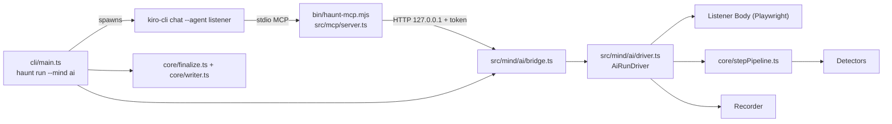
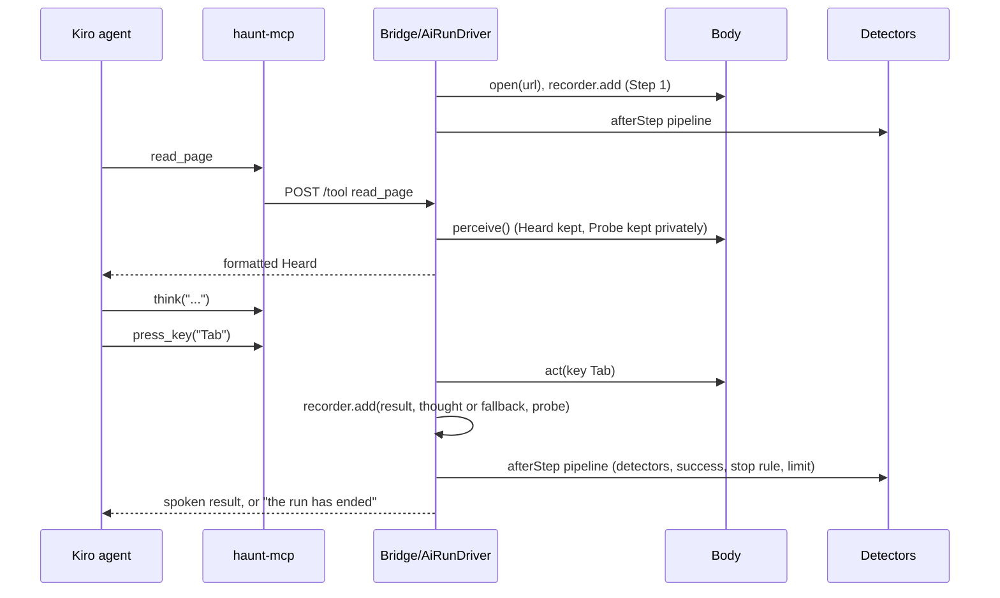

# Design Document

## Overview

`haunt run --ghost listener --mind ai` lets a Kiro custom agent choose The Listener's keyboard actions. The engine's `Mind.decide` is synchronous and sees only a `Heard` perception, so an AI cannot be plugged in as a `Mind`. The design inverts control instead:

1. The CLI opens the real browser Body as it does today, then starts a **Bridge**: an HTTP server on `127.0.0.1`, random port, with a one-time token.
2. The CLI starts `kiro-cli chat --agent listener --no-interactive ...` as a child process, with the mission goal as the prompt.
3. Kiro starts **haunt-mcp**, a stdio MCP server. Every tool call it receives is forwarded to the Bridge.
4. The Bridge executes the call against the real Body, recorder and detectors through an **AiRunDriver**, and runs the same per-step pipeline as `runLoop`.
5. The run ends when the pipeline ends it, when the agent calls `finish`, when Kiro exits, or on timeout. The CLI then validates and writes the run through the existing `finalize` and writer code.

Language: TypeScript in strict mode, Node.js 24 or later. All paths below are inside `engine/` unless stated.

### Design decisions

| Decision | Choice | Reason |
| --- | --- | --- |
| Where the AI plugs in | Tool calls into a Bridge that owns Body, recorder, detectors | `decide` is synchronous and must not see Probe or StepTrace |
| Pipeline reuse | Extract `core/stepPipeline.ts` from `runLoop`; `runLoop` calls it | One implementation of detector, success, stop-rule and limit order |
| Findings | Only detectors; no tool reads or writes findings | Keeps the AI from inventing or hiding problems |
| Transport MCP to engine | HTTP on loopback with bearer token | MCP server is a separate process started by Kiro |
| Kiro tool restriction | Agent JSON allows only `@haunt-mcp/*`, no built-ins | Agent can only act as a keyboard and screen-reader user |
| `finish` tool | Included, flagged for review | A stuck agent needs a way to end the run |

## Architecture



### Control flow of one AI run



## Components and Interfaces

### 1. Step pipeline (`core/stepPipeline.ts`, extracted)

Moves the per-step logic out of `runLoop` without changing behaviour. `runLoop` is rewritten to call it; its tests are untouched.

```ts
export interface StepPipelineOptions {
  mission: Mission;
  detectors: RunLoopDetectors;
  recorder: RunLoopRecorder;
  stopRule(state: RunState): GiveUpReason | null;
  checkSuccess(): Promise<boolean>;
  maxSteps?: number; // default MAX_STEPS (60)
}

/** Order: detectors, success, stop rule, step limit. Returns null when the run goes on. */
export function afterStep(o: StepPipelineOptions): Promise<RunLoopOutcome | null>;

/** Detectors' finish() unless the outcome is an error, then the closing sentence on the last Step. */
export function closeRun(
  o: StepPipelineOptions,
  outcome: RunLoopOutcome,
  giveUpThought: (reason: GiveUpReason) => string,
): Promise<RunLoopOutcome>;
```

### 2. Tool contract (`mind/ai/tools.ts`)

Pure definitions and validation, shared by the MCP server and the Bridge.

```ts
export const LISTENER_KEYS = ['Tab','Shift+Tab','ArrowUp','ArrowDown','ArrowLeft','ArrowRight','Enter','Space','Escape'] as const;
export const JUMP_TARGETS = ['heading','landmark','field','button'] as const;
export const JUMP_DIRS = ['next','previous'] as const;

export type ToolCall =
  | { name: 'read_page' }
  | { name: 'read_announcements' }
  | { name: 'press_key'; key: ListenerKey }
  | { name: 'type_text'; text: string }
  | { name: 'jump'; to: JumpTarget; dir: JumpDirection }
  | { name: 'think'; text: string }
  | { name: 'finish' };

export type ToolResult = { ok: true; text: string } | { ok: false; error: string };

/** Unknown tool, key, target or direction gives an error that names the bad value. */
export function parseToolCall(name: string, args: unknown): { ok: true; call: ToolCall } | { ok: false; error: string };

/** Heard to plain text for the agent: title, path, focus, dialog, region, nodes with ref, role, name, states. */
export function formatHeard(heard: Heard): string;
```

`type_text` text is limited to 500 characters and `think` text to 1000, and both are trimmed. Action tools map to `ListenerAction` (`key`, `type`, `jump`).

### 3. AiRunDriver (`mind/ai/driver.ts`)

Owns the loop that `runLoop` owns in the scripted path. It receives the same injected pieces.

```ts
export interface AiRunDriverOptions extends StepPipelineOptions {
  body: Body<Heard, ListenerAction>;
  url: string;
  onOpenFailure?: RunLoopOptions<Heard, ListenerAction>['onOpenFailure'];
}

export class AiRunDriver {
  constructor(options: AiRunDriverOptions);
  /** body.open, Step 1, first afterStep. Never throws; failure becomes an outcome. */
  start(): Promise<void>;
  /** Serialised: one tool call at a time. */
  handle(call: ToolCall): Promise<ToolResult>;
  /** The outcome once ended, else null. */
  readonly outcome: RunLoopOutcome | null;
  /** Resolves when the outcome is set. */
  readonly ended: Promise<RunLoopOutcome>;
  /** Kiro exited or timed out. Ends the run through the give-up or error path. */
  endExternally(cause: { kind: 'exit'; code: number | null } | { kind: 'timeout'; ms: number }): Promise<RunLoopOutcome>;
}
```

State held by the driver: `latest: { heard, probe } | null` (the Probe never leaves the driver), `announcementQueue: string[]`, `pendingThought: string | null`, `actions: number`.

Behaviour per tool:

- `read_page`: `body.perceive()`, keep `{heard, probe}`, push `heard.announcements` onto the queue, return `formatHeard(heard)`.
- `read_announcements`: return and clear the queue.
- `think`: set `pendingThought` (last call wins). Returns a short acknowledgement.
- `press_key`, `type_text`, `jump`: if `latest` is null, perceive implicitly so a Probe exists. Call `body.act`. Record with `recorder.add(result, thought, probe, { intentionId: 'ai-mind', recovery: false })`, where `thought` is `pendingThought` or the Fallback_Thought. Clear `latest` and `pendingThought`. Run `afterStep`. Return the Step's `spoken` text, or a notice that the run ended.
- `finish`: end with `{ result: 'gave_up', reason: 'no_match' }` and close the run.
- Any tool after the outcome is set: `{ ok: false, error: 'The run has ended. Stop now.' }`.

If `body.act` or `body.perceive` throws, the outcome is `error` with the first non-empty message line (same rule as `runLoop`), `closeRun` appends the engine error sentence, and the tool returns `{ ok: false, error: <message> }`.

The Fallback_Thought is a plain sentence such as "I press Tab and listen." built from the action only. The closing give-up sentence comes from a small `AiMindMemory` that counts actions and reads nothing from findings: "I tried N things with the keyboard and could not finish what I came to do."

### 4. Bridge (`mind/ai/bridge.ts`)

```ts
export interface Bridge {
  readonly url: string;   // http://127.0.0.1:<port>
  readonly token: string; // 32 random bytes, hex
  close(): Promise<void>;
}
export function startBridge(driver: AiRunDriver, opts?: { token?: string }): Promise<Bridge>;
```

- Listens on `127.0.0.1`, port `0`.
- `POST /tool` with `Authorization: Bearer <token>`. The token is compared in constant time. A missing or wrong token gets 401 and no driver call.
- Body is JSON `{ name, args }`, limited to 64 KB. `parseToolCall` validates it. The response is `ToolResult` as JSON.
- Any other method or path gets 404.

### 5. haunt-mcp (`mcp/server.ts`, `bin/haunt-mcp.mjs`)

`McpServer` from `@modelcontextprotocol/sdk` over `StdioServerTransport`. It registers the seven tools with input schemas that mirror `tools.ts`. Each handler POSTs to `HAUNT_BRIDGE_URL` with `HAUNT_BRIDGE_TOKEN` and returns the `ToolResult` as MCP content (`isError: true` for errors). If either variable is missing, the server exits with a clear message on stderr. `bin/haunt-mcp.mjs` is a thin launcher that imports the TypeScript entry the same way the existing `bin` file does. `package.json` gets `"bin": { "haunt-mcp": "bin/haunt-mcp.mjs" }` and the SDK dependency.

### 6. Listener agent (`.kiro/agents/listener.json`)

```json
{
  "name": "listener",
  "description": "The Listener: a keyboard and screen-reader user working through a bill payment.",
  "prompt": "You are The Listener. You use a screen reader's view and the keyboard, and you never use a mouse. ...",
  "mcpServers": {
    "haunt-mcp": {
      "command": "node",
      "args": ["engine/bin/haunt-mcp.mjs"],
      "env": { "HAUNT_BRIDGE_URL": "${HAUNT_BRIDGE_URL}", "HAUNT_BRIDGE_TOKEN": "${HAUNT_BRIDGE_TOKEN}" }
    }
  },
  "tools": ["@haunt-mcp"],
  "allowedTools": ["@haunt-mcp/*"],
  "permissions": { "rules": [{ "capability": "mcp", "match": ["haunt-mcp/*"], "effect": "allow" }] },
  "includeMcpJson": false
}
```

The keys and the environment wiring are the ones verified in "Verified Kiro CLI facts" below. The agent file is read from the working directory's `.kiro/agents/`, so Kiro runs with the repository root as its working directory and `args` is relative to it. There are no `fs_read`, `fs_write` or `execute_bash` entries. The prompt describes The Listener respectfully, tells the agent to call `read_page` before acting, to call `think` with one plain sentence on every step, not to give up early, and to leave the judgement of what is wrong to the engine.

### 7. Kiro launcher (`mind/ai/kiro.ts`)

```ts
export interface KiroProcess {
  readonly exited: Promise<{ code: number | null; output: string }>;
  kill(): void;
}
export type KiroLauncher = (spec: { command: string; args: string[]; env: Record<string, string>; cwd: string }) => KiroProcess;

export function resolveKiroCli(env: NodeJS.ProcessEnv, exists: (p: string) => boolean): { ok: true; path: string } | { ok: false; help: string };
export function parseTimeoutMs(raw: string | undefined): number;          // default 600000
export function buildKiroArgs(goal: string): string[];                    // chat --agent listener --no-interactive --trust-tools=...
export function parseCredits(output: string): { known: true; credits: number } | { known: false; reason: string };
```

`resolveKiroCli` checks `KIRO_CLI_PATH` first (it must exist), then each PATH entry for `kiro-cli` (with `.exe` and `.cmd` on Windows). The default launcher uses `child_process.spawn` without a shell and merges stdout and stderr into `output`. `buildKiroArgs(goal)` returns `['chat', '--agent', 'listener', '--no-interactive', '--trust-workspace', '--trust-tools=@haunt-mcp', goal]` (verified in task 1). The spawn `cwd` is the repository root. `parseTimeoutMs` accepts a positive integer string and otherwise returns the 10 minute default.

### 8. CLI changes (`cli/main.ts`)

- `parseArgs` accepts `--mind <scripted|ai>`, default `scripted`. A bad value gives `invalid` with the accepted values. `ai` with a ghost other than `listener` gives `invalid` ("The AI mind supports only the listener ghost."). Both return exit 2 through the existing path.
- `USAGE` gets one line for `--mind`.
- `CliDeps` gets an optional `kiroLauncher` and `kiroExists`, so tests never start Kiro.
- After the address guard, mission and site checks, the AI path resolves Kiro. Not found prints install help (a link to the Kiro CLI install page and the `KIRO_CLI_PATH` hint) and returns `EXIT.usage`. The check runs before any browser starts.
- The AI run branch replaces only the `runLoop` call: it builds the driver, starts the Bridge, spawns Kiro, and races `driver.ended`, Kiro's exit and the timeout. Afterwards it kills the child, closes the Bridge, and continues into the existing `finalize`, write and exit-code code unchanged.
- Ctrl+C reuses `runWithInterrupt`. Its cleanup also kills the Kiro child and closes the Bridge. Nothing is written and the exit code is 130.
- After the run, `parseCredits(output)` is printed: either "Kiro credits used: N" or "Kiro credits used: unknown (reason)". The credits line goes to the status stream, not to the stdout line that carries the run path.

## Verified Kiro CLI facts

Checked in task 1 on this machine.

- **Version and path:** `kiro-cli 3.5.0`. `kiro-cli` is not on PATH. The executable is `C:\Users\Lenovo\AppData\Local\Kiro-Cli\kiro-cli.exe`, so tests and the self-check use `KIRO_CLI_PATH`.
- **`buildKiroArgs(goal)`:** `['chat', '--agent', 'listener', '--no-interactive', '--trust-workspace', '--trust-tools=@haunt-mcp', goal]`. `--trust-tools` accepts `@server` or `@server/tool` for MCP tools. `--trust-workspace` skips the "Trust this workspace?" prompt for this launch only, so agents and MCP servers from the folder load without asking. `--no-interactive` exits when the answer is done (exit code 0 seen). The goal is the positional `[INPUT]`.
- **Agent JSON keys (CLI V3 reference):** `name`, `description`, `prompt`, `mcpServers`, `tools`, `permissions`, `includeMcpJson` are current. `allowedTools` is a CLI 2.x legacy key. V3 skips a profile that has `allowedTools` and no `permissions` block, so the agent file carries both. MCP tools are referenced as `@server` or `@server/tool`; the permission rule is `{ "capability": "mcp", "match": ["haunt-mcp/*"], "effect": "allow" }`. A throwaway agent with this shape loaded and ran its tool with no prompt.
- **Environment wiring:** the child's own environment reaches the MCP process (a variable set only in the parent was visible). The `env` key of the `mcpServers` entry also works, and `${VAR}` is expanded from the parent environment (verified). The agent file therefore names `${HAUNT_BRIDGE_URL}` and `${HAUNT_BRIDGE_TOKEN}`, and the CLI sets both in the child's environment. No per-run agent file is needed, and the token is never written to disk.
- **Working directory:** the agent is found in `<cwd>/.kiro/agents/`, and a relative `args` path is resolved from `cwd`. Kiro is therefore spawned with the repository root as `cwd`.
- **`intentionId`:** it is internal. `contract/run.schema.json` and `finalize.ts` never see it (only `recorder.ts`, `runLoop.ts` and `types.ts` mention it), so `'ai-mind'` passes the schema and the invariants.
- **Credits line:** not seen. The probe printed only `[tool] Running: ...`, `[tool] status: Completed` and the answer, on stderr. `parseCredits` therefore matches a line such as `Credits: 0.25` or `credits used: 0.25` case-insensitively and otherwise returns `known: false`. The self-check (task 11) will show the real format.
- **Existing CLI:** a missing Chromium is reported by `launcher.isInstalled()` (exit 1, "npx playwright install chromium"). `runWithInterrupt(ctx, onInterrupt)` races `doRun` against Ctrl+C, closes the browser in `finally`, returns 130 and writes nothing. The AI path reuses both.

## Data Models

No contract changes. The Run_File format, `contract/run.schema.json` and the dashboard are untouched. AI runs differ from scripted runs only in step thoughts and in the action sequence.

Internal types: `ToolCall`, `ToolResult`, `AiRunDriverOptions` (above), and `KiroSpec`:

```ts
interface KiroSpec { command: string; args: string[]; env: Record<string, string>; cwd: string; }
// env = { ...process.env, HAUNT_BRIDGE_URL, HAUNT_BRIDGE_TOKEN }
```

## Error Handling

| Situation | Result |
| --- | --- |
| `--mind` value invalid, or `ai` with another ghost | Message, exit 2 |
| Kiro CLI not found | Install help, exit 2, no browser started |
| Tool call with unsupported key, target, direction or tool name | Tool error naming the value, no action |
| Request to Bridge without the right token | 401, no driver call |
| Browser failure during a tool call | Tool error with the message, run ends with `error` (exit 3 when a run can be written) |
| Agent calls `finish` | `gave_up` with reason `no_match` |
| Kiro exits code 0 before the run ended | `gave_up` with reason `no_match` |
| Kiro exits non-zero before the run ended | `error`, message names the exit code |
| Kiro timeout (default 10 min, `HAUNT_AI_TIMEOUT_MS`) | Child killed, `error`, message names the limit |
| Ctrl+C | Child and Bridge killed, nothing written, exit 130 |
| Run fails validation | Problems printed, nothing written, exit 1 |
| Credits not parseable | Report says "unknown" with the reason |
| Tool call after the run ended | Tool error "The run has ended" |

## Testing Strategy

Dual approach, with no browser, no real Kiro, and no `test:e2e*` task:

- **Unit tests** (vitest, the engine's existing runner): exact tool list, agent JSON shape (only `@haunt-mcp/*`, no built-ins), argument builder, `finish` flow, early Kiro exit, timeout and Ctrl+C with a fake launcher, env vars passed to the launcher, address guard in AI mode, install-help exit 2, and the unchanged scripted path.
- **Property tests** (fast-check, at least 100 runs each): the properties below. Each test carries the tag `Feature: listener-ai-mind, Property N: <title>`.
- **Test doubles:** a fake Body (scripted `Heard` values, records `act` calls, can throw), fake detectors, and a fake Kiro launcher. The driver, Bridge and tool validation are tested with these.
- Existing tests are not edited, loosened or deleted. `runLoop` tests must pass unchanged after the extraction.
- The final manual Self_Check_Task covers the real Kiro CLI and the real page. It is not an automated test.

## Correctness Properties

*A property is a characteristic or behavior that should hold true across all valid executions of a system, a formal statement about what the system should do. Properties serve as the bridge between human-readable specifications and machine-verifiable correctness guarantees.*

### Property 1: Tool input validation

For any tool name and any argument value, `parseToolCall` accepts the call only when the name is one of the seven tools and every argument is in its allowed set (key in the ListenerKey set, `to` in the four jump targets, `dir` in next or previous, text a string within its limit). For any rejected call, the error text contains the offending value and the fake Body records no `act` call.

**Validates: Requirements 1.2, 1.3, 1.4, 1.5**

### Property 2: Page view keeps what the Listener hears

For any `Heard` value, the text from `formatHeard` contains the ref, role and name of every node and the title and path of the page.

**Validates: Requirements 1.6**

### Property 3: Announcements are delivered exactly once, in order

For any sequence of perceptions with announcement lists and any interleaving of `read_page` and `read_announcements` calls, the concatenation of all `read_announcements` results plus the final queue equals the concatenation of the perceptions' announcements, with no repeats and no reordering.

**Validates: Requirements 1.7**

### Property 4: Browser failures surface and end the run

For any failure message thrown by the fake Body during `perceive` or `act`, the tool result is an error containing the first non-empty line of the message, and the driver's outcome is `error` with that message.

**Validates: Requirements 1.9**

### Property 5: The Bridge accepts only the right token

For any token string other than the Bridge's token, including the empty string and a missing header, a request is rejected with 401 and the driver receives no call. The Bridge's address is always `127.0.0.1`.

**Validates: Requirements 1.10**

### Property 6: Mind option parsing

For any `--mind` value, `parseArgs` accepts it only when it is `scripted` or `ai`, and an invalid value names the accepted values. For any ghost other than `listener`, `--mind ai` is invalid. When `--mind` is omitted, the parsed mind is `scripted`.

**Validates: Requirements 3.1, 3.2, 3.4, 3.5**

### Property 7: Detectors alone decide findings

For any sequence of tool calls, including any `think` text and any `type_text` text, the findings recorded equal the findings the fake detectors report for the same sequence of recorded steps, and changing the `think` and `type_text` text (without changing the actions) does not change the findings.

**Validates: Requirements 4.1, 4.3, 4.4, 4.5**

### Property 8: The AI driver and `runLoop` share one pipeline

For any scripted sequence of detector, success-check and stop-rule results and any step limit, the driver fed the same sequence of actions ends with the same outcome (`result`, `reason`) and the same number of recorded steps as `runLoop` driven by a Mind that yields those actions.

**Validates: Requirements 4.2**

### Property 9: Thoughts come from `think` or the fallback

For any sequence of action steps, each with zero or more `think` calls before it, the recorded thought of a step equals the last `think` text of that step when there is one, and otherwise a non-empty Fallback_Thought. A `think` call never changes the thought of an earlier step.

**Validates: Requirements 4.5, 4.6**

### Property 10: Kiro CLI resolution order

For any environment, PATH and set of existing files, `resolveKiroCli` returns the `KIRO_CLI_PATH` file when it exists, otherwise the first `kiro-cli` found on PATH, otherwise a not-found result with install help.

**Validates: Requirements 5.2, 5.3**

### Property 11: Timeout parsing

For any string or undefined value of `HAUNT_AI_TIMEOUT_MS`, `parseTimeoutMs` returns the integer when the value is a positive integer, and 600000 otherwise.

**Validates: Requirements 5.4**

### Property 12: Credits parsing

For any Kiro output that contains a credits line with a number, `parseCredits` returns that number. For any output without such a line, it returns `known: false` with a reason.

**Validates: Requirements 5.8, 5.9**
