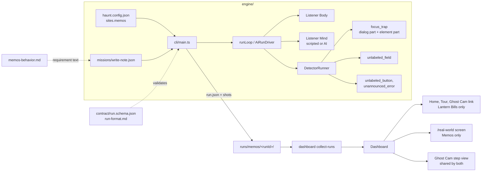

# Design Document

## Overview

This feature sends The Listener into Memos, an open-source note-taking app that runs on the user's own machine at `http://localhost:5230`. The Listener signs in with a throwaway account, writes a note and saves it. The run is expected to find a keyboard trap that the engine cannot see today: the Memos editor is a `div` with `role="textbox"`, and Tab and Shift+Tab leave focus where it is.

Five parts change:

1. **Memos site and mission.** A `memos` site entry, a `write-note` mission, and `memos-behavior.md`, the short EARS requirement the mission is tied to.
2. **Generalised `focus_trap`.** The detector keeps its dialog logic unchanged and gains an element path for a textbox that focus cannot leave.
3. **`unlabeled_field`.** A new finding type in the contract, the engine and the dashboard, with its own detector.
4. **Real-world haunt in the dashboard.** A separate screen for Memos. Home results, the tour and the Ghost Cam link keep using only Lantern Bills runs.
5. **Tests, then two runs.** Unit tests and fast-check property tests, followed by one scripted-mind run and one AI-mind run on Memos, written to `runs/memos/`.

### Design decisions

These choices follow from reading the existing code. Each one is the smallest change that meets the requirements.

| # | Decision | Why |
|---|---|---|
| D1 | The existing dialog code in `engine/src/detectors/focusTrap.ts` is not edited. Its factory is renamed `createDialogTrapDetector`. A new `createFocusTrapDetector` runs the dialog part and a new element part, and returns both parts' problems. | Requirement 4 says Lantern findings must not change. A frozen dialog part is also the oracle for the Lantern property test (Property 7). |
| D2 | The element part is a pure analysis of key and focus events (`elementTrap.ts`), plus read-only reads of the trapped element: one page script (is it a visible Textbox_Element, does the page say Escape works) and the Chromium accessibility tree (its role and Computed_Name). In the pure analysis, only a Tab or Shift+Tab press that moves focus off the element clears a trap candidate. Escape never clears one, whether or not Escape pressed twice frees focus. | A pure function can be tested with fast-check, with no browser. Requirement 3.8 says a way out by another key is not a reason to drop the finding. |
| D3 | A qualified element trap is always reported. It is reported once a double Escape has resolved it (focus left, or it did not), and a trap with no double Escape is reported from `finish()`. A double Escape that frees focus does not cancel, delay or suppress the report: it only changes what the evidence says. | The evidence in 3.4 needs the Escape result and the Undocumented_Exit statement. The stop rule reads the finding count in the same loop iteration, so `observe()` must report as soon as the double Escape is done (as the dialog part does), and the run then ends with `trapped` (3.9). |
| D4 | The scripted Listener Mind gets two additive behaviours, both opt-in: `lastResort: "unnamedField"`, and a "stuck in a field I typed into" routine (Shift+Tab, Escape, Escape). The routine only runs for a field the Mind itself typed into through `unnamedField`. | A detector only reads, so the key presses that make a trap visible must be in the history. Without Shift+Tab and Escape presses, the Mind would give up after Tab and no trap could be recorded. Gating on `unnamedField` keeps every Lantern decision identical. The existing test "gives up with no_match when the button jump finds no button at all" would fail with an ungated routine. |
| D5 | Template `{{runStamp}}` (UTC start time, `YYYYMMDD-HHmmss`) is expanded in intention values, `goal`, `successCheck.text` and `successCheck.visible`. | The success check selector is static, and Memos keeps old notes. Without a unique text, the second run would see the first run's note and succeed at once. A text with no template is returned unchanged, so Lantern runs are byte-identical. |
| D6 | The `unlabeled_field` detector decides on the Computed_Name that Chromium reports in the accessibility tree (`Accessibility.getFullAXTree`), the way `unlabeledButton.ts` does. It computes no name of its own, and there is no in-page name script. It maps each empty-name field node back to its DOM element with the same read-only `DOM.describeNode` and `DOM.getBoxModel` box-matching method as `unlabeledButton.ts`. This supersedes the earlier in-page name computation. | Chromium is the authority on what a screen reader announces, and it knows every naming source (including the native `placeholder` on `input` and `textarea`, and not `aria-placeholder`). One method for both detectors keeps the engine simple and removes a second implementation that could disagree with Chromium. |
| D7 | The detector has no placeholder exemption. A field is flagged when its Computed_Name is empty or only whitespace, even when it has an `aria-placeholder`. A native `input` or `textarea` whose only name source is a `placeholder` is not flagged, because Chromium gives it a non-empty name, not because of any special case in the detector. | Requirements 6.2 and 6.4 decide on the Computed_Name only. A `div role="textbox"` with an `aria-placeholder` and no name is announced as "edit text, blank", so the Memos editor must be flagged. See "Decisions on open points". |
| D8 | The real-world flag lives in the dashboard only, in one table keyed by `siteKey(run.site.name)`. There is no contract field. | `siteKey()` already keys haunts. The run format stays unchanged, so existing run files stay valid. |
| D9 | Memos has its own screen at `/real-world`. Navigation order, guided path and tour are not changed. | Requirement 8.6 to 8.8 and the unchanged Playwright suite. |
| D10 | `site.baseUrl` is an optional string in the config schema. `loadConfig` checks it with `isAllowedAddress`. The run command still takes `--url`. | Requirement 1.1 needs a base URL in `haunt.config.json`. Making `--url` optional would change the CLI usage that existing tests check. |

## Architecture



The data flow is the one in `structure.md`: the engine writes `runs/<siteKey>/<runId>/run.json`, and the dashboard reads it. The Memos runs go to `runs/memos/` because the site key is `memos`.

## Components and Interfaces

### 1. Site, mission and behavior spec

**`engine/haunt.config.json`** gets the entry:

```json
"memos": { "name": "Memos", "allowedTerms": ["Memos"], "baseUrl": "http://localhost:5230" }
```

**`engine/schemas/config.schema.json`**: `site.properties.baseUrl` is added as `{ "type": "string", "minLength": 1 }`. It is optional, so older config files stay valid. `SiteConfig` gets `baseUrl?: string`. After schema validation, `loadConfig` rejects a site whose `baseUrl` fails `isAllowedAddress(baseUrl, config)` with a `ConfigError('schema', ...)` that names the site and the address (1.7, 11.1). `localhost` is always allowed, so no `allowedDomains` entry is needed.

**`engine/schemas/mission.schema.json`**: `intention.properties.lastResort` changes from `{ "enum": ["unnamedButton"] }` to `{ "enum": ["unnamedButton", "unnamedField"] }`. `loadMission.ts` changes the type to `lastResort?: 'unnamedButton' | 'unnamedField'`. `pay-bill.json` stays valid.

**`.kiro/specs/memos-real-world-haunt/memos-behavior.md`** holds the expected behavior:

```markdown
# Memos expected behavior

**MEMOS-1** WHEN a signed-in user types a note in the editor and activates Save, THE Memos app SHALL add a new memo with that text at the top of the memo list.

**MEMOS-2** WHILE focus is in the note editor, WHEN a keyboard user presses Tab or Shift+Tab, THE Memos app SHALL move focus to the next or the previous control.

**MEMOS-3** THE note editor SHALL have an accessible name that a screen reader announces.
```

Each requirement is at most three sentences and carries a `MEMOS-n` identifier. The text describes The Listener as a person who uses a screen reader's view and the keyboard (11.4).

**`engine/missions/write-note.json`** (`id` equals the file name, `site` is `memos`):

```json
{
  "id": "write-note",
  "site": "memos",
  "goal": "Sign in to Memos with the username ghost-test and the password HauntTest123!, write the note \"Haunt was here {{runStamp}}\" and save it",
  "requirement": "MEMOS-1: WHEN a signed-in user types a note in the editor and activates Save, THE Memos app SHALL add a new memo with that text at the top of the memo list.",
  "successCheck": {
    "text": "A memo with the text \"Haunt was here {{runStamp}}\" is visible in the memo list",
    "visible": "<selector for one saved memo card with exactly that text, not the editor>"
  },
  "intentions": [ "username (type), password (type), sign-in (activate),
                   note (type, lastResort unnamedField), save (activate, doneWhen success)" ]
}
```

The `requirement` field is `<id>: <EARS text>`, so it cites the identifier (2.5) and carries the text that `finalizeRun` copies into the run's `mission` block (2.6). The credentials appear only here (1.8, 11.2). The note intention is `do: "type"`, `value: "Haunt was here {{runStamp}}"`, `lastResort: "unnamedField"`, with `doneWhen: { present: { kind: "any", en: ["^haunt was here"] } }`. It uses `present` because the editor is a `div`, and its AX `value` may be empty, so `fieldValue` would not become true.

The exact name patterns and the `successCheck.visible` selector depend on the Memos version the user runs. The implementation task inspects the local Memos page and writes them. The selector must match one saved memo card and not the editor, because the typed text is also inside the editor before the save. It may only be changed in the mission file, never by editing a detector (10.7).

### 2. CLI changes (`engine/src/cli/main.ts`, `engine/src/missions/templates.ts`)

`applyTemplates(value, start)` also replaces `{{runStamp}}` with `runStamp(start)`:

```ts
export function runStamp(start: Date): string {
  // 2026-11-22T11:16:05Z -> "20261122-111605"
  return start.toISOString().slice(0, 19).replace(/[-:]/g, '').replace('T', '-');
}
```

`expandMission` expands `goal`, `successCheck.text`, `successCheck.visible` and intention values. `requirement` is left alone. Three call sites use the expanded mission instead of the original: `checkSuccess` (selector), the Kiro prompt (`buildKiroArgs(goal)`), and `finalizeRun` (so the run file shows the real text). A mission with no `{{...}}` in those fields expands to equal values, so Lantern runs are unchanged.

### 3. Element trap analysis (`engine/src/detectors/elementTrap.ts`, new)

```ts
/** One thing in the history: a key press, or the focus read after a Step. */
export interface TrapEvent {
  step: number;
  kind: 'key' | 'focus';
  key: string;                 // 'Tab', 'Shift+Tab', 'Escape', ... for key events, '' for focus reads
  focusKey: string | null;     // element key of the focused element after the event
  dialogKey: string | null;    // element key of its dialog, or null
}

export type TrapResolution = 'freed_by_double_escape' | 'not_freed_by_double_escape' | 'open';

export interface TrapCandidate {
  elementKey: string;
  firstStayStep: number;       // first Step with a press that left focus on the element
  qualifiedStep: number;       // Step of the press that completed the Tab + Shift+Tab pair
  stayKeys: Record<string, number>;   // presses that left focus on it, by key name
  resolution: TrapResolution;  // what pressing Escape twice in a row did; 'open' when it was not pressed twice
  resolutionStep: number;      // Step of the second Escape; equals qualifiedStep for 'open'
}

export function findElementTraps(events: readonly TrapEvent[]): TrapCandidate[];
```

`findElementTraps` is a single pass over the events. A press is a *stay press* for `E` when the focus before it (the previous event's `focusKey`) is `E`, its own `focusKey` is `E`, and its `dialogKey` is `null`.

- A **streak** on `E` is an unbroken run of events whose `focusKey` is `E`. A focus read of another element, or `null`, ends it. This is the "no other control received focus between those presses" condition (3.2).
- The streak **qualifies** when it holds at least one stay press of `Tab` and at least one of `Shift+Tab`.
- Escape presses are counted in a row. A non-Escape press resets the count. On the second Escape of a row: if focus moved, the resolution is `freed_by_double_escape`. If it stayed, it is `not_freed_by_double_escape`. The resolution only describes how the trap ended. It never removes the candidate (3.1, 3.4, 3.8).
- **Cleared:** if any `Tab` or `Shift+Tab` press whose previous focus was `E` lands on a different element, `E` is cleared for the whole history and never becomes a candidate (3.8). This is the only way a candidate is cleared. An Escape press, or two in a row, that moves focus off `E` does not clear it, and neither does any other key.
- Events with a non-null `dialogKey` never belong to a streak. A trap inside a dialog belongs to the dialog part (3.7).
- A candidate that qualified but saw no double Escape has `resolution: 'open'`.

At most one candidate is returned per `elementKey` (3.6).

```ts
export interface TrapElementInfo {
  /** false when the element is gone from the page. */
  present: boolean;
  textbox: boolean;       // role textbox, searchbox or combobox, and not a native input, select or textarea, and visible
  role: string;           // Chromium's role for the element, else its role attribute
  /** The Computed_Name last read from Chromium's accessibility tree while the element had focus. '' when it has none, null when it could not be read. */
  name: string | null;
  /** true when visible page text, the element's title or description, or an announcement says that Escape (or Esc) works. */
  escapeDocumented: boolean;
}

export function describeElementTrap(c: TrapCandidate, info: TrapElementInfo, announcements: readonly string[]): { title: string; evidence: string };
```

`describeElementTrap` is pure. The title is `Keyboard focus is trapped in a text box`. The evidence contains, in this order, with no dialog, modal or pop-up wording (the dashboard reads those words as a pop-up trap):

1. `Keyboard focus could not leave the text box "<name>" (role <role>).`, or `Keyboard focus could not leave a text box with no name (role <role>).`, or, when the name could not be read, `Keyboard focus could not leave a text box (role <role>); its accessible name could not be read.`
2. The keys that left focus on it, with counts: `Tab (3 presses) and Shift+Tab (1 press) left focus on it, and Escape pressed once did too.`
3. The keys that moved focus, by resolution:
   - `freed_by_double_escape`: `Tab and Shift+Tab never moved focus away. Escape pressed twice did free focus: it moved focus to another control.` followed by the exit statement below.
   - `not_freed_by_double_escape`: `Escape pressed twice did not move focus either.`
   - `open`: `No key moved focus before the run ended.`
4. For `freed_by_double_escape` only, the exit statement. When `escapeDocumented` is false: `This exit is undocumented: no text on the page and no announcement says that Escape works.` When it is true: `The page does mention that Escape works, but Tab and Shift+Tab still cannot leave the text box.` The finding is recorded in both cases (3.4).
5. `Nothing was announced while focus was stuck.` when no announcement was heard in the Steps from `firstStayStep` to `resolutionStep` (3.5). Otherwise `The screen reader announced "<first announcement>".`

The element is read in two ways, both read-only:

- **Page script.** It takes the element key, looks the element up with `window.__haunt.keys.element(key)`, and reports whether it is connected, visible, and a Textbox_Element (a non-native element with role `textbox`, `searchbox` or `combobox`). It also reports `escapeDocumented` from the visible page text (`document.body.innerText`), the element's `title`, `aria-description` and `aria-describedby` text, looking for the whole word `Esc` or `Escape`, case-insensitive. `observe()` combines this with the announcements heard in the window above.
- **Accessibility tree.** While focus is on a non-native element with a textbox-like role (known from the focus snapshot), `observe()` reads `Accessibility.getFullAXTree`, builds a `Heard` with `buildHeard`, takes `focusedNode(heard)`, and remembers its role and Computed_Name by element key. This is the name that the evidence shows. It is read while the element has focus, because after a double Escape focus has already left it. The element part adds no name computation of its own.

### 4. Focus trap detector composition (`engine/src/detectors/focusTrap.ts`)

```ts
export function createDialogTrapDetector(): Detector { /* the existing code, moved verbatim */ }

export function createFocusTrapDetector(): Detector {
  const dialog = createDialogTrapDetector();
  const element = createElementTrapPart();   // owns its snapshots and a `reported` set
  return {
    type: 'focus_trap',
    async observe(ctx) { return [...(await dialog.observe(ctx)), ...(await element.observe(ctx))]; },
    async finish(ctx)  { return element.finish(ctx); },
  };
}
```

`createElementTrapPart().observe`:

1. Reads the focus snapshot with the same `READ_FOCUS_SCRIPT` as the dialog part and stores it by Step. When focus is on a non-native element with a textbox-like role, it also reads the accessibility tree and remembers the focused node's role and Computed_Name by element key (section 3).
2. Builds `TrapEvent[]` from `ctx.steps` and the snapshots, and calls `findElementTraps`.
3. For each candidate with resolution `freed_by_double_escape` or `not_freed_by_double_escape` that is not in `reported` and not in `rejected`: reads the element with the page script. If `info.textbox` is false, the candidate is added to `rejected`, and nothing is recorded. Otherwise it records a `DetectedProblem` with `key: "focus-trap-element:<doc>:<elementKey>"`, `stepN: resolutionStep`, the title and evidence from `describeElementTrap`, and `screenshot: 'step'`. A candidate whose double Escape freed focus is recorded exactly like one whose double Escape did not. Only the evidence differs (3.1, 3.4).

`finish()` does the same for candidates with `resolution: 'open'`, with `stepN: qualifiedStep`. A candidate whose element is gone from the page is still recorded from what was remembered while it had focus, as long as that read showed a textbox-like role on a non-native element. Without such a read the Detector cannot confirm it was a textbox, and records nothing.

**Stop rule.** The Listener's stop rule is unchanged: it ends the run with `trapped` when `findingCounts.focus_trap > 0` (3.9). It reads the count after `observe()`, so the finding recorded at the second Escape ends the run even when that Escape moved focus away. Nothing in the stop rule or the detector checks where focus is after the double Escape. In a Memos run the double Escape ends the run with `gave_up` and reason `trapped`, and the note is not saved. This follows from 3.9 and is the expected outcome.

### 5. `unlabeled_field`

The detector decides on the Computed_Name from Chromium's accessibility tree and nothing else (6.4). There is no in-page name computation, no shared name source, and no check of `placeholder` or `aria-placeholder` when deciding. Those attributes are read only to write the evidence.

**`engine/src/detectors/unlabeledField.ts`** exports `createUnlabeledFieldDetector()` with `type: 'unlabeled_field'`. It follows the method of `unlabeledButton.ts`.

1. **Select by name (pure).** `selectUnnamedFields(nodes: RawAxNode[])` reads `Accessibility.getFullAXTree` output with `buildHeard`, which already leaves out the nodes Chromium ignores (`aria-hidden`, `hidden`, `display: none`, `inert`). It returns the nodes whose role is in `FIELD_AX_ROLES` and whose `name.trim()` is empty, in tree order (6.1, 6.2, 6.3). `FIELD_AX_ROLES` is `textbox`, `searchbox`, `combobox`, `listbox`, `spinbutton`, `checkbox`, `radio`, `switch` and `slider`: the roles Chromium gives native Form_Fields and Textbox_Elements. The fixture test (below) checks the list against every native input type, and the list is adjusted there if Chromium uses another role. Attributes play no part in this step, so a `div role="textbox"` with an `aria-placeholder` and an empty Computed_Name is selected (6.2, 6.10), and a native `input` with a `placeholder` and no other name is not, because Chromium reports its placeholder as its name (6.4).
2. **Find the element.** For each selected node, `DOM.describeNode` and `DOM.getBoxModel` give the tag, the attributes and the border box. One read-only `ctx.inspect` call picks the page element with the same tag, attributes and box, the same matching as `unlabeledButton.ts`. Identical twins are told apart by document order.
3. **Filter and describe (page script).** For each matched element the script returns `key` (from `__haunt.keys.key`), `tag`, `role` (Chromium's role from step 1), `type`, `selector`, container text, `placeholder`, `ariaPlaceholder`, and `ignored`, a reason or `null`. The script marks an element `ignored` when it is not a Form_Field (`input`, `select`, `textarea`) or a Textbox_Element (a non-native element with `role` `textbox`, `searchbox` or `combobox`), is not visible, is `inert`, has an `aria-hidden` ancestor, or is an input of type `hidden`, `submit`, `button`, `reset` or `image` (6.5). It does not look at any naming attribute to decide.
4. `observe()` stores each unignored item in a `Map` keyed by `<doc>:<elementKey>`, with the first Step and page path it was seen on, and returns `[]`. It calls only the three read-only CDP methods and `ctx.inspect`, and never touches focus or the page (6.8).
5. `finish()` returns one `DetectedProblem` for each stored element (6.7). Its `stepN` is the first Step at which The Listener focused it (read from the trace key `focusKey`), else the Step where it was first seen. This is the same convention as `unlabeled_button`.

- Title: `Form field has no accessible name`.
- Evidence (6.6): `On page <path>, the <tag type="…" role="…"> at <selector> (<container text>) has no accessible name: the name that Chromium computes for it is empty, so a screen reader says only the kind of field, for example "edit text". <placeholder sentence> The Listener first focused it at Step <n>.` or `…was first present at Step <n> and never focused.` The placeholder sentence is present only when the element has a non-empty `aria-placeholder` or `placeholder` attribute, for example `A placeholder is present (aria-placeholder "Any thoughts…") and is not providing a name.` When neither attribute is present, the sentence is left out.

`engine/src/ghosts/listener/index.ts` appends `createUnlabeledFieldDetector()` at the end of the list: `[unlabeledButton, focusTrap, unannouncedError, unlabeledField]`. It is last, so the order of existing findings in a step does not change. Phantom and Bebe lists are not changed (6.9).

### 6. Listener Mind changes (`engine/src/ghosts/listener/mind.ts`, `thoughts.ts`)

**Last resort for a field.** When a Full_Pass of field jumps finds no match and the intention has `lastResort: "unnamedField"`:

- Candidates are the controls reached in the search with a role in `TARGET_ROLES.field`, an empty name, and not used before, in the order reached.
- The Mind jumps to the next field until the candidate has focus. It then types the intention's `value` (for `do: "type"`) or presses Enter (for `activate`), marks the control used, and remembers it as `unnamedTyped`.
- `Search` gets `lastResortKind: 'button' | 'field'`. The `unnamedButton` path is not changed. New thoughts are added in `thoughts.ts` in the existing first-person style, for example "I can't find a field with a name for my note. This one has no name, so I'll try it, and I'll type my note."

**Stuck in a typed field.** Only when `unnamedTyped` is set. The Mind remembers the focus ref before each jump or Tab press. At the next decision, if focus is still on `unnamedTyped.ref` after a jump or Tab press, the Mind runs: Shift+Tab, then Escape, then Escape. If focus has moved after any of these presses, it resumes the normal search. After the second Escape it clears `unnamedTyped` and drops the search state. The thoughts say what it heard and why, in plain words. `ListenerMemory` gets `elementTrap` (the control and the keys tried) so that `trappedThought` can say "I'm stuck in a text box with no name. Tab and Shift+Tab don't move me." when `scope` is `page`. The existing dialog sentences are unchanged.

The AI mind does not use the Mind. It chooses keys through the existing tools, so the same detector reads its key presses.

### 7. Contract

- `contract/run.schema.json`: `findings[].type` enum gets `"unlabeled_field"` appended.
- `contract/run-format.md`: a new bullet after `unlabeled_button`: `unlabeled_field` - A form field or textbox with no accessible name.
- `engine/src/contract/types.ts`: `FindingType` gets `| 'unlabeled_field'`.
- `dashboard/src/data/types.ts`: `FINDING_TYPES` gets `'unlabeled_field'` appended.

The engine has no table that maps finding types to words. The detector's title is its only wording (7.3).

### 8. Dashboard

**Labels (`model/findingLabels.ts`).** `FINDING_LABELS` is typed `Record<FindingType, FindingLabel>`, so it fails to compile until `unlabeled_field` is added:

```ts
unlabeled_field: {
  label: 'Field with no name',
  helped: "If the field had a name, like 'Note', I'd have known what to type.",
  blocker: "couldn't tell what a field was for",
  thing: 'a field with no name',
  stuck: 'found a field with no name',
  summary: 'This field has no name, so a screen reader says only the kind of field, like "edit text", and not what it is for.',
},
```

**Element trap words (`model/findingWords.ts`, `model/results.ts`).**

- A new `ELEMENT_TRAP` pattern reads the first sentence of an element-trap evidence: `Keyboard focus could not leave (the text box "<name>"|a text box with no name)`.
- `trapPlace(run, finding)` checks `ELEMENT_TRAP` first. A named element gives `the 'Search' text box`. An unnamed one gives `siteAbout(run.site.name)?.unnamedTextbox ?? 'a text box with no name'`. The dialog patterns run after, so dialog findings are unchanged (7.5).
- `results.ts` `blocker()` returns `got trapped in <place>` for an element trap, so the headline says "The Listener got trapped in the note editor and couldn't write." It does not say pop-up (7.4). `blockingFindings` already treats every `focus_trap` as blocking (7.7), so it needs no change.

**Site table (`model/sites.ts`).** `SiteAbout` gets an optional `unnamedTextbox?: string`. The entry for `'Memos'`:

```ts
Memos: {
  description: 'Memos is an open-source note-taking app that Haunt did not build. We run our own copy on this computer, and The Listener tries to write and save a note in it.',
  pageNames: { '/': 'the notes page', '/auth': 'the sign-in page' },
  unnamedTextbox: 'the note editor',
},
```

There is no `tryLink`, because the copy is local.

**Real-world flag (`model/realWorld.ts`, new).**

```ts
const REAL_WORLD_SITE_KEYS: ReadonlySet<string> = new Set(['memos']);

export const isRealWorldRun = (run: Run): boolean => REAL_WORLD_SITE_KEYS.has(siteKey(run.site.name));
export const realWorldRuns = (runs: readonly Run[]): Run[] => runs.filter(isRealWorldRun);

/** The newest real-world Listener run for each mind. Absent minds are undefined. */
export function latestPerMind(runs: readonly Run[]): Partial<Record<MindKind, Run>>;
```

`realWorld.ts` imports only `routes.ts` and the data types, so it creates no import cycle with `fixedCopy.ts` or `sites.ts`.

**Keeping Lantern results unchanged.**

- `fixedCopy.originalSiteRuns` also drops real-world runs. Home results, the tour (`buildTour`), the Ghost Cam link (`screenDestinations`) and the Séance redirect all call it already, so one change covers all four. Its comment is updated.
- `origin.ghostsWithRealRuns` ignores real-world runs, so a real Memos Listener run cannot hide the Lantern Listener sample.
- `HomeScreen` builds `haunts` and `RecentWalks` from the runs without real-world runs. When at least one real-world run exists, Home shows one link to `/real-world` below the haunted sites. With none, Home is unchanged.
- Graveyard, Exorcise and Spec Coverage keep reading all runs, so Memos findings appear in the Graveyard under the site filter, and `write-note` appears as its own row in Spec Coverage.

**Screen (`screens/RealWorldScreen.tsx`, `RealWorldScreen.module.css`, route `/real-world`).**

- `routes.ts`: `PATTERNS.realWorld = '/real-world'`, `realWorldPath()`, `Route` gets `{ screen: 'real_world' }`, `parseRoute` handles it. `screens.ts` `screenOfRoute` returns `null` for it, so it is not on the guided path and the navigation order stays the same. `App.tsx` registers the route.
- Layout: `ScreenHeading` "A real-world haunt", then a `panel` that names Memos as an open-source site that Haunt did not build (from `siteAbout('Memos')`), then up to two result cards, one for the scripted mind and one for the AI mind.
- Each card shows: The Listener (`GhostCharacter`, `moodFor(result)`), the mind (`MindTag`), `ResultBadge`, `resultHeadline(run)`, the step count (`plural(run.steps.length, 'step')`), one line per finding (`plainFindingType`, title, step), and a `CandleButton` "Watch it happen" that goes to `stepPath(run.key, watchStep(run))`. The Ghost Cam shows the step view (8.9).
- With no real-world run it shows "No Memos run exists yet." and what to do (start Memos, then run the Listener). Other screens keep working (8.5).
- Styling uses the existing tokens only. A finding is shown with text and an icon, never by color alone. Text about The Listener says "uses a screen reader's view and the keyboard" (11.4).
- Runs are read through `useAllRuns`, so Memos files follow the same validation and "restless file" rules as Lantern files (8.10).

## Data Models

**Run file.** No field is added. For a Memos run: `site.name` is `Memos`, `site.url` is `http://localhost:5230`, `mission.id` is `write-note`, `mission.requirement` is `MEMOS-1: …`, `mind` is `scripted` or `ai`, `ghost` is `listener`. Findings of type `unlabeled_field` and `focus_trap` follow the existing finding shape.

**Folder.** `runs/memos/<runId>/run.json` and `shots/`, written by the existing `writeRunFolder` with `siteKey = memos`.

**Config site.** `{ name, allowedTerms, baseUrl? }`.

**Mission intention.** `lastResort?: 'unnamedButton' | 'unnamedField'`.

## Error Handling

| Situation | Behavior |
|---|---|
| Memos is not running | `body.open` fails. The existing path records the browser error page as Step 1 and ends the run with `error`, or writes nothing (exit 1). The final run tasks check `http://localhost:5230` first and stop with a message that the user must start Memos. They never start it (10.6). |
| `baseUrl` is not an allowed address | `loadConfig` throws a `ConfigError` that names the site and address. The CLI exits 2, as it does for other config errors. |
| Mission patterns do not match the Memos page | The Mind gives up with `no_match`. The run is written as `gave_up`. The pattern is fixed in `write-note.json` only. |
| A memo from an earlier run exists | The success text has the run stamp, so it does not match an earlier memo. |
| Trapped element is gone, or the page read of it fails | If the element is gone, the element part records the finding from the role and name it remembered while the element had focus, and records nothing when it never saw a textbox-like role. A failing page read inside a detector is still an engine error and ends the run with `error`, as for other detectors. |
| Trapped element's accessible name could not be read from the accessibility tree | The finding is still recorded. The evidence says that the accessible name could not be read. |
| Escape pressed twice frees focus from a trapped element | The finding is recorded as for any other trap, the evidence says Escape pressed twice freed focus and whether the exit is undocumented, and the run ends with `trapped`. |
| `unlabeled_field` page script finds no key script | `key` is `null`. The id falls back to the selector and ordinal, as `unlabeledButton` falls back to the AX id. |
| `unlabeled_field` cannot match an unnamed AX node to a page element | As in `unlabeledButton.ts`, the evidence uses only what `DOM.describeNode` said (tag, type, role), and the placeholder sentence is left out. The finding is still recorded. |
| A Memos run file is invalid | It appears under "Restless files" through the existing path. The real-world screen shows the no-run message if no valid Memos run exists. |
| AI run credits | The CLI prints the credits line. If Kiro printed none, the report says the credits are unknown (10.9). |
| Memos run without a `focus_trap` or an `unlabeled_field` finding for the editor | The run task reports the difference and changes no detector or test (10.7, 11.5). |

## Correctness Properties

*A property is a characteristic or behavior that should hold true across all valid executions of a system-essentially, a formal statement about what the system should do. Properties serve as the bridge between human-readable specifications and machine-verifiable correctness guarantees.*

### Property 1: Mission schema accepts exactly the two last-resort values

For any string `s`, a mission whose intention has `lastResort: s` passes mission validation if and only if `s` is `unnamedButton` or `unnamedField`.

**Validates: Requirements 1.2**

### Property 2: Template expansion is the identity without placeholders and total with them

For any string with no `{{runStamp}}` or `{{futureExpiry}}`, expansion returns the same string. For any string with one or more `{{runStamp}}`, and any start time, every placeholder is replaced by the stamp of that time and none remains. For any mission with no placeholders, `expandMission` returns an equal mission.

**Validates: Requirements 1.4, 4.1**

### Property 3: The address guard decides whether a site base URL loads

For any URL string, `loadConfig` accepts a site whose `baseUrl` is that string if and only if `isAllowedAddress` accepts it for the config's `allowedDomains`.

**Validates: Requirements 1.7, 11.1**

### Property 4: One qualified trap per stuck element

For any event history and any set of elements `E` that each have, with no dialog key, an unbroken streak holding a Tab press and a Shift+Tab press that both left focus on `E` (and no Tab or Shift+Tab press made on `E` that landed elsewhere), `findElementTraps` returns exactly one candidate for each `E` in the set, and no candidate for any element that has no such streak. This holds whether the history has no Escape presses, Escape pressed twice that frees focus, or Escape pressed twice that does not.

**Validates: Requirements 3.1, 3.2, 3.4, 3.6**

### Property 5: Only a Tab or Shift+Tab that moves focus away clears the element

For any event history and any element `E` that has a qualifying streak: `findElementTraps` returns no candidate for `E` if and only if some Tab or Shift+Tab press made while focus was on `E` lands on a different element. Inserting any number of Escape presses, in a row or not, with any resulting focus (including Escape pressed twice moving focus to another element), neither adds nor removes the candidate for `E`.

**Validates: Requirements 3.1, 3.4, 3.8**

### Property 6: Element trap evidence states what was tried and what happened

For any trap candidate, any element description (named, unnamed, or with an unreadable name; Escape documented or not) and any list of announcements: the evidence contains the role; contains the name, or the statement that there is no name, or the statement that the name could not be read; contains every key that left focus on the element; says that Escape pressed twice freed focus if and only if the resolution is `freed_by_double_escape`; says that the exit is undocumented if and only if the resolution is `freed_by_double_escape` and Escape is not documented; says that nothing was announced if and only if the announcements are all empty; and contains none of the words dialog, modal or pop-up.

**Validates: Requirements 3.3, 3.4, 3.5, 7.4**


### Property 7: Dialog histories give the same findings as before

For any generated history of key presses and focus reads that follows the shape of the Lantern dialog trap cases (a dialog with controls, controls outside it that are not text boxes), the generalised `focus_trap` detector returns the same findings, at the same steps, as the dialog-only detector, which is the pre-feature code. This includes histories where the focus stays on an element inside the dialog.

**Validates: Requirements 3.7, 4.1, 9.5**

### Property 8: Only the Computed_Name decides which nodes are unlabeled

For any list of raw accessibility nodes (with any roles, ignored flags and names, including names of only whitespace), `selectUnnamedFields` returns exactly the nodes that are not ignored, have a role in `FIELD_AX_ROLES`, and have a name that is empty after trimming. The result does not depend on any `placeholder` or `aria-placeholder` data that the page reports for the nodes.

**Validates: Requirements 6.1, 6.2, 6.3, 6.4**

### Property 9: One finding per unlabeled element

For any sequence of observations in which each element has a key, an ignore reason (or none) and a Computed_Name from the accessibility tree, the `unlabeled_field` detector returns exactly one finding for each distinct key that was not ignored and had an empty Computed_Name in at least one observation, however many times it was observed, whether or not it has a `placeholder` or `aria-placeholder` attribute, and no finding for any other key.

**Validates: Requirements 6.1, 6.2, 6.4, 6.5, 6.7, 9.4**

### Property 10: Unlabeled field evidence identifies the element and the missing name

For any unlabeled element description, the evidence contains its tag, its role, its `type` attribute when it has one, its selector, and the statement that the computed name is empty. It contains the statement that a placeholder is present and is not providing a name if and only if the element has a non-empty `placeholder` or `aria-placeholder` attribute.

**Validates: Requirements 6.6**

### Property 11: The run schema accepts a finding type if and only if it is one of the nine

For any string `t`, a run that is valid in every other way and has a finding of type `t` passes the Schema_Check if and only if `t` is one of the eight earlier types or `unlabeled_field`. The dashboard's `FINDING_TYPES` equals the schema's list.

**Validates: Requirements 5.2, 5.4, 5.5, 5.6, 5.7, 9.6**

### Property 12: Every finding type has complete plain words

For any value in `FINDING_TYPES`, `FINDING_LABELS` has an entry with a non-empty `label`, `helped`, `blocker`, `thing`, `stuck` and `summary`.

**Validates: Requirements 7.1, 7.2, 7.6, 9.7**

### Property 13: An element trap is named as the element, and is blocking

For any run whose result is `gave_up` and that has a `focus_trap` finding with element-trap evidence at a step of the run, `trapPlace` returns a place that names the element (the note editor for an unnamed Memos textbox) and not a pop-up, `resultHeadline` contains that place, and `blockingFindings` contains the finding.

**Validates: Requirements 7.4, 7.7**

### Property 14: Home, the tour and the Ghost Cam link ignore real-world runs

For any list of runs that mixes Lantern Bills runs, fixed-copy runs and real-world runs: `originalSiteRuns` contains no real-world run and every run of the non-real-world list; `buildTour(runs)` equals `buildTour(runs without real-world runs)`; and `screenDestinations(runs)` equals `screenDestinations(runs without real-world runs)`.

**Validates: Requirements 8.6, 8.7, 8.8, 9.8**

### Property 15: The real-world screen shows the newest run for each mind

For any list of runs, `latestPerMind` returns, for each mind, the real-world Listener run with the latest `startedAt` and that mind, or nothing for a mind with no such run. It never returns a run of another site.

**Validates: Requirements 8.3, 8.4**

### Property 16: A double Escape exit still gives the finding and the stop

For any history in which an element qualifies as a trap and Escape pressed twice in a row then moves focus away, the element part of the detector, driven by a fake context, returns one `focus_trap` problem for that element at the Step of the second Escape, with evidence that says Escape pressed twice freed focus. The Listener's stop rule, applied to the finding counts after that Step, returns the reason `trapped`.

**Validates: Requirements 3.1, 3.4, 3.9**

## Testing Strategy

Both kinds of test are used. Unit tests cover examples, fixtures and integration points. Property tests cover the universal rules above with fast-check. Each property is one test with at least 100 runs (`{ numRuns: 100 }`, as in the existing `*.properties.test.ts` files). Each test carries the tag **Feature: memos-real-world-haunt, Property N: <property text>** in its `describe` name. No existing test is weakened, skipped or deleted (9.9).

### Engine (`vitest`, `engine/test/`)

| File | Content |
|---|---|
| `elementTrap.properties.test.ts` | Properties 4, 5, 6 with arbitrary event histories (including Escape presses that free focus) and element descriptions. Pure, no browser. Property 16 with a fake `DetectorContext` and the Listener's stop rule. |
| `focusTrap.dialogParity.properties.test.ts` | Property 7. A fake `DetectorContext` whose `inspect` answers the focus read and the dialog read from the generated history. Runs `createFocusTrapDetector()` and `createDialogTrapDetector()` side by side. |
| `unlabeledField.properties.test.ts` | Properties 8, 9 and 10 with canned raw AX nodes, a fake `cdp` that answers `Accessibility.getFullAXTree`, `DOM.describeNode` and `DOM.getBoxModel`, and a fake `inspect`. |
| `missions.properties.test.ts` (new file) | Properties 1 and 2. |
| `loadConfig.properties.test.ts` (new file) | Property 3, using temporary config files. |
| `contract.properties.test.ts` (new file) | Property 11, using `validateSchema` on a valid run built from `contract/example-run.json`. |
| `focusTrap.element.test.ts` | Chromium fixture `element-trap.html` (a `div role="textbox"` that stops Tab and Shift+Tab and needs Escape twice): a trapped textbox, a textbox where Tab moves away (no finding), Escape twice freeing focus (the `focus_trap` finding is still recorded, its evidence says Escape pressed twice freed focus and that the exit is undocumented, and the stop rule returns `trapped`), the same fixture with a visible "Press Esc to leave" text (finding still recorded, evidence says the page mentions Escape), the nothing-announced statement, an open trap reported from `finish()`, and a trap inside a dialog giving only the dialog finding (9.1, 3.4, 3.9). |
| `unlabeledField.test.ts` | Chromium fixture `unlabeled-field.html`: a labelled field, a native `input` with only a `placeholder` (no finding, because Chromium gives it a non-empty name), a native field with no name, a `div role="textbox"` with no name, a `div role="textbox"` with only an `aria-placeholder` (a finding, with evidence that the computed name is empty and that the placeholder is not providing a name; this is the Memos editor shape), a hidden input and an `aria-hidden` field. A cross-check reads `Accessibility.getFullAXTree` independently in the test and asserts that the set of flagged elements equals the unignored Form_Field and Textbox_Element nodes with an empty AX name, and that `FIELD_AX_ROLES` covers every native input type in the fixture. Also a purity check (no DOM mutation, same focus) (9.2, 6.4, 6.8, 6.10). |
| `listenerMind.unnamedField.test.ts` | Fake `Heard` walk of `write-note`: the last resort types into the unnamed field, then Shift+Tab, Escape, Escape when focus does not move, and the normal search when it does. Also: a Mind without `unnamedField` decides as before. |
| `memosMission.test.ts` | `write-note` loads. Its `requirement` is `<id>: <text>` for an id and text in `memos-behavior.md`. The spec has `MEMOS-n` ids, at most three sentences each, and a Tab and Shift+Tab requirement for the editor. The credentials appear only in the mission. `haunt.config.json` has `memos` with `baseUrl` `http://localhost:5230`. `listenerGhost.detectors()` includes `focus_trap` and `unlabeled_field`. |

New fixtures go in `engine/test/fixtures/`. They use the existing `startFixtureServer`.

### Dashboard (`vitest`, `dashboard/src/__tests__/`)

| File | Content |
|---|---|
| `realWorld.properties.test.ts` | Properties 14 and 15, using the Run arbitraries in `arbitraries.ts` with a site name override. |
| `findingWords.element.test.ts` | Properties 12 and 13, the dialog wording staying the same, and `FINDING_TYPES` equal to the `findings[].type` enumeration in `contract/run.schema.json` (the second half of Property 11). |
| `RealWorldScreen.test.tsx` | Shows a Memos run with outcome, step count, findings and the mind tag. Shows the no-run message. Shows that Home with Lantern runs only has no real-world link. Opens a Memos run in the Ghost Cam. |
| `models.test.ts` | The existing label test lists the eight types with `toEqual`. It gets one added line for `unlabeled_field`. This is the only edit to an existing test, and it is an addition. |

The existing Playwright suite in `dashboard/e2e/` builds from `dashboard/fixtures/runs` and is run unchanged.

### Run tasks (last two tasks)

After all code and tests pass, and only if `http://localhost:5230` answers: run the Listener once with the scripted mind and once with `--mind ai`, each with `--out` left at its default so the files go to `runs/memos/`. Check each file with the Schema_Check (`validateSchema`). Report result, step count, findings by type and step, and for the AI run the credits or that they are unknown. If a run has no `focus_trap` finding for the editor, report the difference and change no detector or test.

## Decisions on open points

1. **Placeholder exemption (D6, D7), reversed.** An earlier version of this design exempted a placeholder-only field and computed the name in the page. That is dropped. The detector now decides only on the Computed_Name from Chromium's accessibility tree and flags an empty one, even when the element has an `aria-placeholder`. The Memos editor (a `div role="textbox"` with an `aria-placeholder` and no name) is therefore flagged (6.10). A native `input` or `textarea` whose only name source is a `placeholder` is not flagged, because Chromium reports a non-empty name for it, and the detector has no code for that case. The in-page name script, `pickName` and the shared accessible-name source are removed. Requirements 6.2, 6.4 and 6.6 state this. When an element has a placeholder that gives no name, the evidence says the placeholder is present and not providing a name.
2. **Escape pressed twice frees focus (D2, D3), reversed.** An earlier version could treat a way out by Escape as the end of the story. Now only a Tab or Shift+Tab that moves focus off the element clears a trap candidate. A trap that Escape pressed twice frees is still recorded, its evidence says Escape pressed twice freed focus and that the exit is undocumented (no on-page text and no announcement says Escape works), and the stop rule ends the run with `trapped` (3.1, 3.4, 3.8, 3.9). If the page does mention Escape, the finding is still recorded and the evidence says so.
3. **Scripted run outcome.** Because requirement 3.9 ends the run with `trapped` as soon as the double Escape is done, whether or not it frees focus, the scripted Memos run is expected to end `gave_up` and the note is not saved. Requirement 1.6 allows this. The AI run follows the same pipeline.
4. **Field roles covered by `unlabeled_field`.** Because the detector starts from AX nodes, it covers the roles in `FIELD_AX_ROLES`. A native input type whose AX role is outside that list (for example a file or date input, depending on Chromium's version) would not be seen. The Chromium fixture lists the native input types and fails if one has an empty name and a role outside the list, so the list is corrected there and not by loosening the detector.
5. **Memos page details.** The name patterns and `successCheck.visible` selector are written against the user's local Memos during the mission task and are not known until then.
6. **Existing screens that read all runs.** The Graveyard, Exorcise and Spec Coverage show Memos data next to Lantern data. This is intended, and only Home, the tour and the Ghost Cam link are limited to Lantern.
7. **One edit to an existing test, decided.** `dashboard/src/__tests__/models.test.ts` compares every `FINDING_TYPES` value against an exact label object, so it fails as soon as the ninth type exists. The one-line addition `unlabeled_field: 'Field with no name'` is the only change. Requirement 9.9 names this exception.
