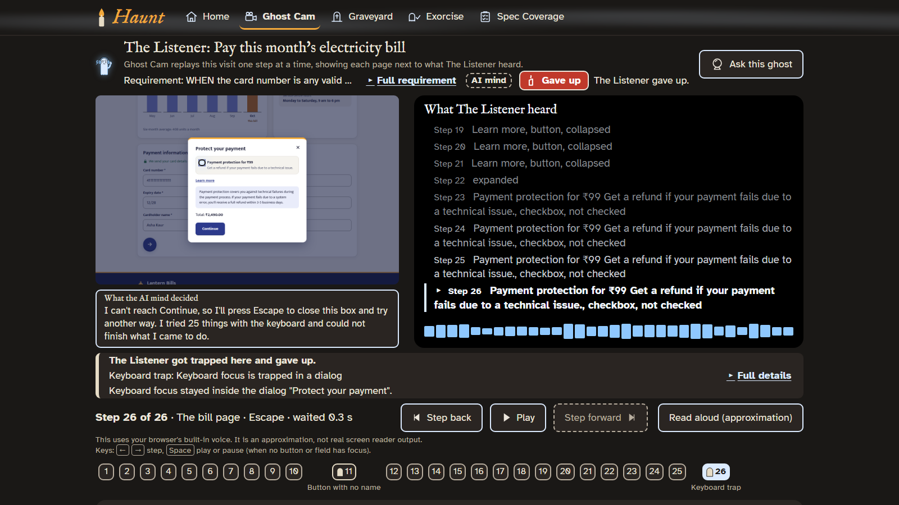
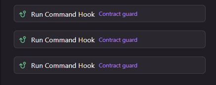
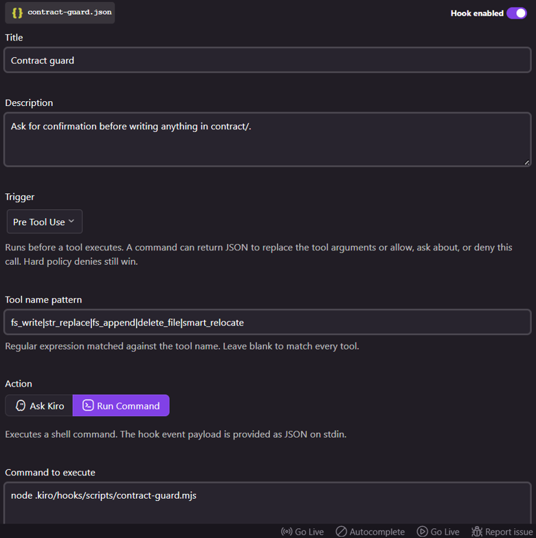

# Haunt

**Haunt your app before your users do.**

Haunt sends three ghost users into your website, each standing for people with a real access need, and shows you on a candlelit dashboard exactly where each one got stuck: the step, the screenshot, what it heard, and why.

It is for web developers and small teams who want to find keyboard traps, unnamed buttons, slow-network misclicks and missing translations before real people do, without an accessibility lab.

**[▶ Open the live dashboard](https://xan-antx.github.io/haunt/)** · **[Try the haunted demo site](https://xan-antx.github.io/haunt/lantern-bills/)** · **[See the fixed copy](https://xan-antx.github.io/haunt/lantern-bills-exorcised/)** · No account, no install.



*The Ghost Cam at the step where The Listener, driven by a Kiro custom agent (the "AI mind"), is trapped in the "Protect your payment" dialog.*

Built with **Kiro** (specs, steering, hooks, a custom agent, an MCP server, the Kiro CLI and Kiro Crew) for Kiroween 2026, Costume Contest category. [See how we built it with Kiro ↓](#how-we-built-this-with-kiro)

## Meet the ghosts

| Ghost | Stands for people who… | What it catches on our demo site |
|---|---|---|
| **The Listener** | use a screen reader and only the keyboard | a pay button with no name, a dialog that traps keyboard focus |
| **The Phantom** | browse on slow 3G and an old phone | a late banner that pushes the page down, so a tap lands on the wrong thing |
| **Bebe** | read at 200% zoom, prefer Punjabi or Hindi, and are wary of tricky wording | text cut off at large zoom, an English button on a Punjabi page, a paid add-on ticked by default |

Each ghost stands for real people with real needs. A ghost that gets stuck points to a real barrier, so we never weaken a test to make a ghost pass.

## Try it in 60 seconds

1. Open the [dashboard](https://xan-antx.github.io/haunt/) and press **Take the 60-second tour**. Escape or Skip leaves it.
2. Watch [The Listener's AI-mind run](https://xan-antx.github.io/haunt/#/run/2026-11-23T1020Z-listener-pay-bill/step/1) in the **Ghost Cam**. A Kiro custom agent chose every key press, and the strip "What the AI mind decided" shows its thought at each step. It is trapped at step 26.
3. Open **Exorcise** to compare a run on the haunted site with the same ghost's run on the fixed copy.
4. Then try to get stuck yourself. On [Lantern Bills](https://xan-antx.github.io/haunt/lantern-bills/), pay with only the keyboard (card `4111111111111111`, any future expiry, CVV `123`, any name), press Escape in the "Protect your payment" dialog, and try to Tab out. Add `?lang=pa` or `?lang=hi` to the address for the untranslated text. Do the same on the [fixed copy](https://xan-antx.github.io/haunt/lantern-bills-exorcised/).

## How it works

1. **A ghost tries a real task on your site.** The engine drives a real Chromium browser with Playwright, as that ghost: keyboard only and listening to what a screen reader would announce, or slow 3G on a small slow phone, or 200% zoom in Punjabi or Hindi.
2. **It records everything it sees and hears.** Each step saves a screenshot, what a screen reader would announce, and the ghost's one-line thought, into a `run.json` checked against a shared [schema](contract/run.schema.json).
3. **Detectors decide the findings, not the AI.** Rules in the engine report nine kinds of barrier, such as Keyboard trap (`focus_trap`) or Text not translated (`untranslated`), each tied to a step and a screenshot.
4. **You fix your code, and the next run shows if the problem is gone.** Exorcise pairs a before run and an after run by the same ghost and marks each finding Exorcised, Still haunting, New haunting or Not reached.

The nine finding types, the detectors and the missions are in [docs/how-it-works.md](docs/how-it-works.md).

## What we found

**On Lantern Bills**, our demo bill-payment site with six problems planted on purpose:

| # | Planted problem | Found by | Fixed copy |
|---|---|---|---|
| 1 | Icon-only pay button: Button with no name (`unlabeled_button`) | The Listener | Exorcised |
| 2 | "Protect your payment" dialog: Keyboard trap (`focus_trap`), ignores Escape, paid add-on ticked | The Listener (trap), Bebe (Tricky choice, `dark_pattern`) | Exorcised |
| 3 | Card errors that are visible but never announced: Error nobody announced (`unannounced_error`) | **No ghost.** The mission pays with a valid card, so no error appears | Fixed; proven by the fixed copy's tests |
| 4 | A banner that loads late and pushes the page down: Clicked the wrong thing (`misclick`) | The Phantom (two misclicks) | Exorcised |
| 5 | A payment total cut off at narrow widths and large zoom: Text cut off (`cut_off_text`) | Bebe | Exorcised |
| 6 | Missing Punjabi and Hindi text: Text not translated (`untranslated`) | Bebe | Exorcised |

**6 planted, 5 found, 5 exorcised.** On the fixed copy, all three ghosts finished the task with no findings. These are single recorded runs, listed in [Recorded runs](#recorded-runs). The end-to-end tests run each ghost 10 times with different seeds and require its findings in at least 9 of the 10 runs. They pass.

**On a site we did not build.** We ran [Memos](https://github.com/usememos/memos), an open-source notes app, on our own computer, with a throwaway account, and sent The Listener to write a note. Both its scripted mind and its AI mind got trapped in the note editor: Tab and Shift+Tab cannot leave it. The scripted run found that pressing Escape twice gets out, and that nothing on the page says so. The AI run pressed Escape once, but the exit needs two presses. Neither run saved a note. [See the real-world haunt](https://xan-antx.github.io/haunt/#/real-world) and [the details](docs/how-it-works.md#real-world-haunt-memos).

## The dashboard

| Screen | What it shows |
|---|---|
| **Home** | The latest result for each ghost with **Watch it happen**, the planted-problem count, a **Haunt your own site** card and the tour |
| **Ghost Cam** | A step-by-step replay: screenshot, what The Listener heard, what the ghost was thinking, and the **Ask this ghost** panel |
| **Graveyard** | One tombstone per problem found, with a **Map** view of rooms and cold spots |
| **Exorcise** | Before and after runs by the same ghost, each finding marked Exorcised, Still haunting, New haunting or Not reached |
| **Spec Coverage** | Each mission as a Kiro spec requirement, and whether each ghost's latest run completed it |
| **A real-world haunt** | The Memos runs, linked from the bottom of Home |

Details of each screen are in [docs/how-it-works.md](docs/how-it-works.md#the-dashboard-in-detail).

### Accessibility of Haunt itself

Haunt is built to be used by the people its ghosts stand for.

- The colors have measured contrast ratios, written down in the [design steering](.kiro/steering/dashboard-design.md) and checked by a test.
- axe-core reports no violations on 64 recorded dashboard states, at 1536 px and at 320 px (`dashboard/e2e/ghostcam-recorded-axe.spec.ts`).
- A forced-colors test (`dashboard/e2e/forced-colors.spec.ts`) marks only the current page in the menu.
- Animation runs only when your system allows motion.
- On the five menu screens, the `keyboard` test in [`dashboard/e2e/haunt.spec.ts`](dashboard/e2e/haunt.spec.ts) tabs through every stop. It checks that each has a visible focus ring and that Tab never gets stuck.

## How we built this with Kiro

We did not use Kiro on the side. Every part started as a Kiro spec, steering kept the ghosts honest, hooks guarded the planted problems, and The Listener's AI mind *is* a Kiro custom agent talking to our own MCP server through the Kiro CLI.

**Our approach.** We wrote a requirements-first spec for each part (requirements, design, tasks) and let Kiro run the tasks, with property-based tests named after the spec they prove. Bug fixes went through bugfix specs, which first wrote a test that failed on the unfixed code. Steering files loaded only in the folder they govern, so the haunted demo site was never "helpfully" fixed. Hooks ran the build after each task and re-ran the planted-problem tests whenever the demo site changed.

### Specs

All 10 live in [`.kiro/specs/`](.kiro/specs). Each has its own folder of requirements (or `bugfix.md`), design and tasks.

| Spec | Kind | What it covers |
|---|---|---|
| [`lantern-bills`](.kiro/specs/lantern-bills/) | Feature | The demo site and its six planted problems |
| [`haunt-engine`](.kiro/specs/haunt-engine/) | Feature | The engine and the three ghosts |
| [`haunt-dashboard`](.kiro/specs/haunt-dashboard/) | Feature | The dashboard and its screens |
| [`listener-ai-mind`](.kiro/specs/listener-ai-mind/) | Feature, fast-task | The AI mind: haunt-mcp, the bridge, the custom agent, `--mind ai` |
| [`haunt-patrol`](.kiro/specs/haunt-patrol/) | Feature, fast-task | The Haunt Patrol Crew app |
| [`memos-real-world-haunt`](.kiro/specs/memos-real-world-haunt/) | Feature, fast-task | The `write-note` mission, element-trap detection, Field with no name, the real-world page |
| [`exorcised-payment-a11y-fix`](.kiro/specs/exorcised-payment-a11y-fix/) | Bugfix | Fixed copy: the pay button's name and the dialog's keyboard trap |
| [`exorcised-remaining-fixes`](.kiro/specs/exorcised-remaining-fixes/) | Bugfix | Fixed copy: card errors, banner, total, pre-ticked add-on, translations |
| [`exorcise-different-ghost-fix`](.kiro/specs/exorcise-different-ghost-fix/) | Bugfix | Exorcise must not compare runs by different ghosts |
| [`pre-recording-polish`](.kiro/specs/pre-recording-polish/) | Feature, from an outside review | 32 findings from an independent review, fixed in phases; some items are deferred |

`pre-recording-polish` did not start from our own idea. An independent review of the dashboard produced a list of problems, which became its [brief](.kiro/specs/pre-recording-polish/brief.md) and spec. Its [tasks](.kiro/specs/pre-recording-polish/tasks.md) say which items are deferred until after the hackathon.

### Steering, hooks, agent, MCP, CLI and Crew

| Feature | Where | How we used it |
|---|---|---|
| **Steering, always included** | [product.md](.kiro/steering/product.md), [structure.md](.kiro/steering/structure.md), [tech.md](.kiro/steering/tech.md) | The ghosts, the ethics rules, who owns each folder, the stack |
| **Steering, `fileMatch`** | [demo-site.md](.kiro/steering/demo-site.md) (`demo-site/**/*`) | Never fix the planted problems unless a bugfix spec names them |
| **Steering, `fileMatch`** | [demo-site-exorcised.md](.kiro/steering/demo-site-exorcised.md) (`demo-site-exorcised/**`) | Fix only what a bugfix spec names; update tests, never weaken them |
| **Steering, `fileMatch`** | [dashboard-design.md](.kiro/steering/dashboard-design.md) (`dashboard/**/*`) | Colors with contrast ratios, fonts, ghost designs, motion limits |
| **Hook, `PostTaskExec`, command** | [Build check](.kiro/hooks/build-check.json) | Builds each project folder a finished spec task changed |
| **Hook, `PreToolUse`, command** | [Contract guard](.kiro/hooks/contract-guard.json) | Asks before any file write, move or delete in `contract/` |
| **Hook, `Stop`, command** | [Planted problems guard](.kiro/hooks/planted-problems-guard.json) | If `demo-site/src/` changed, proves the six problems remain; failures go back to the agent |
| **Hook, `Manual`, agent action** | [Translation keeper](.kiro/hooks/translation-keeper.json) | Adds missing Punjabi and Hindi keys, except the four that must stay untranslated |
| **Custom agent** | [`.kiro/agents/listener.json`](.kiro/agents/listener.json) | The Listener's AI mind. Its only tools are haunt-mcp's seven |
| **MCP server** | [`engine/src/mcp/server.ts`](engine/src/mcp/server.ts) | `read_page`, `read_announcements`, `press_key`, `type_text`, `jump`, `think`, `finish`. No tool creates a finding |
| **Kiro CLI** | [`engine/src/mind/ai/kiro.ts`](engine/src/mind/ai/kiro.ts) | `--mind ai` runs `kiro-cli chat --agent listener --no-interactive` and prints the credits used |
| **Kiro Crew** | [`crew-app/`](crew-app) ([own repo](https://github.com/xan-antx/haunt-crew)) | Haunt Patrol: a nightly script cron, a page, a read-only `patrol-guide` agent, a `reading-patrols` skill |

### Proof Kiro ran the tasks

Kiro keeps a `tasks.meta.json` next to a spec's tasks. Four of them hold **629 task-execution records**. A task can log several records in one run.

| Spec | Task-execution records | Kiro chat sessions |
|---|---|---|
| [`haunt-engine`](.kiro/specs/haunt-engine/tasks.meta.json) | 328 | 8 |
| [`haunt-dashboard`](.kiro/specs/haunt-dashboard/tasks.meta.json) | 185 | 2 |
| [`lantern-bills`](.kiro/specs/lantern-bills/tasks.meta.json) | 66 | 1 |
| [`exorcise-different-ghost-fix`](.kiro/specs/exorcise-different-ghost-fix/tasks.meta.json) | 50 | 1 |

The fast-task specs and the later bugfix specs keep no such file. MCP is wired through the custom agent: `listener.json` registers haunt-mcp and allows only its tools.



*The contract guard hook firing on each file write in a real Kiro session.*



*How the contract guard is configured.*

### Where Kiro surprised us

- **Our own AI ghost caught our detector lying.** On its first run, the Kiro agent opened a "Learn more" disclosure, and our Error nobody announced detector (`unannounced_error`) called the explanation an error at step 22. We fixed it in [`22844b7`](https://github.com/xan-antx/haunt/commit/22844b7) with regression tests that use the exact text from that run.
- **A real site exposed two engine weaknesses.** The first Memos run missed a trap because the editor had a name, and read screen-reader-only text as an error. They became tasks 6.4 and 6.5 of the [Memos spec](.kiro/specs/memos-real-world-haunt/tasks.md), fixed in [`7f267b2`](https://github.com/xan-antx/haunt/commit/7f267b2). The Lantern Bills findings did not change.
- **A bugfix spec overrode one of our requirements.** The [`exorcise-different-ghost-fix` bugfix](.kiro/specs/exorcise-different-ghost-fix/bugfix.md) replaces criterion 13.8 of the dashboard requirements. Exorcise used to warn when two runs were by different ghosts. Now it refuses to compare them.
- **Kiro Crew refused command crons on Windows.** [`haunt-patrol` task 10](.kiro/specs/haunt-patrol/tasks.md) moved the nightly patrol to a script cron, `cron/nightly_patrol.py`.
- **The bugfix workflow proved the bug before fixing it.** For `exorcise-different-ghost-fix`, Kiro first wrote tests that failed on the unfixed dashboard. Its [`tasks.meta.json`](.kiro/specs/exorcise-different-ghost-fix/tasks.meta.json) records "Exploration tests failed on unfixed code as expected, confirming the bug."

### What was not Kiro

We used Claude Code for the media capture script ([`tools/media/`](tools/media)), for copying the Crew app into its own repository, for a one-off accessibility pre-check of Memos, and for two independent read-only reviews before recording (a product review and a review of this README). Claude also helped draft the brief that became the `pre-recording-polish` spec. Kiro made every fix through that spec.

## Built with

Kiro (specs, steering, hooks, custom agent, Kiro CLI, Kiro Crew) · Model Context Protocol (`@modelcontextprotocol/sdk`) · TypeScript · Node.js 24 · Playwright and Chromium · React 18 · Vite · React Router · i18next · Vitest · fast-check · axe-core · Zod and Ajv · Python (the Crew cron script) · GitHub Pages and GitHub Actions

## Run it locally

You need Node.js 24 or newer and Git. Each app installs and runs in its own folder; there is no root `package.json`. Ports are fixed, and a server stops with an error if its port is taken. Stop a server with Ctrl+C in the terminal that started it.

| Part | Commands (from the repo root) | Address |
|---|---|---|
| Lantern Bills | `cd demo-site`, `npm install`, `npm run dev` | http://localhost:3000 |
| Dashboard | `cd dashboard`, `npm install`, `npm run dev` | http://localhost:3001 |
| Fixed copy | `cd demo-site-exorcised`, `npm install`, `npm run dev` | http://localhost:3002 |

The dashboard's `npm run dev` prints a long Vite warning about `configLoader`. It is harmless. With the dashboard running, **Summon a live ghost** on Home runs The Listener through Lantern Bills on your computer and adds the run. It needs `npm install` in `demo-site/` and `engine/`, and `npx playwright install chromium` in `engine/`.

### Run a ghost

Serve Lantern Bills as a production build, because The Phantom gives up at step 1 on the slower dev server. Then run a ghost in a second terminal:

```powershell
cd demo-site
npm install
npm run serve:ghosts
```

```powershell
cd engine
npm install
npx playwright install chromium
npm run haunt -- run --ghost listener --mission pay-bill --url http://localhost:3000 --out ../../haunt-trials
```

`--ghost` is `listener`, `phantom` or `bebe`. The last line printed is the path of the saved `run.json`. Use `npm run haunt --` inside `engine/`, never `npx haunt`, which can download an unrelated npm package.

**Use `--out` for trial runs.** Without it, runs are saved in `runs/`, the recorded evidence. The dashboard's data tests read `runs/`, so an extra run there can make some of them fail. To see a trial run on the dashboard, copy its folder into `runs/<site>/` and remove it before running `npm test` in `dashboard/`.

To record a run on the fixed copy that Exorcise pairs with the original, serve it with `npm run serve:ghosts` in `demo-site-exorcised/` (port 3002) and add the site name:

```powershell
npm run haunt -- run --ghost phantom --mission pay-bill --url http://localhost:3002 --site-name "Lantern Bills demo (exorcised)" --out ../../haunt-trials
```

Every option and exit code is in [engine/README.md](engine/README.md).

## Haunt your own site

Only send ghosts to sites you own, or to local copies of open-source sites. The engine refuses any address other than `localhost`, `127.0.0.1` and domains you list.

1. Make a folder next to `engine/`, for example `my-haunt/`, with `my-haunt/haunt.config.json`:

   ```json
   {
     "allowedDomains": [],
     "sites": {
       "my-site": { "name": "My site", "allowedTerms": ["My site"] }
     }
   }
   ```

   `allowedTerms` are words Bebe should not report as untranslated, such as your brand name.

2. Write one task as `my-haunt/missions/my-mission.json`, starting from the template in [engine/missions/README.md](engine/missions/README.md). Name buttons and fields by their accessible names.
3. Start your site, then run a ghost. This example expects your site on `http://localhost:3000`:

   ```powershell
   cd engine
   npm install
   npx playwright install chromium
   npm run haunt -- run --ghost listener --mission my-mission --url http://localhost:3000 --site my-site --config ../my-haunt/haunt.config.json --missions ../my-haunt/missions --out ../my-haunt/runs
   ```

A ghost that cannot find a button or field gives up at that step, and the run says where. To see the run in the dashboard, copy its folder (`my-haunt/runs/my-site/<run id>`) into `runs/my-site/`. We ran every command above against a local copy of Lantern Bills.

## What needs a Kiro account

Only two things: the **AI mind** (`--mind ai`, which needs the [Kiro CLI](https://kiro.dev/docs/cli/) signed in and uses Kiro credits) and **Haunt Patrol** (which runs inside the [Kiro Crew](https://kiro.dev/docs/crew/installation/) desktop app). The live dashboard, both sites, scripted ghosts, live mode and every test work without one. The two saved AI runs stay viewable in the dashboard.

## Recorded runs

Single runs, not statistics. The Lantern Bills runs are in [`runs/lantern-bills/`](runs/lantern-bills), the Memos runs in [`runs/memos/`](runs/memos).

| Run | Site | Mind | Result | Findings |
|---|---|---|---|---|
| [Listener, 10 Nov](https://xan-antx.github.io/haunt/#/run/2026-11-10T1822Z-listener-pay-bill/step/1) | Lantern Bills | Scripted | Gave up (step 20) | Keyboard trap, Button with no name |
| [Phantom, 11 Nov](https://xan-antx.github.io/haunt/#/run/2026-11-11T1744Z-phantom-pay-bill/step/1) | Lantern Bills | Scripted | Gave up (step 5) | 2 × Clicked the wrong thing |
| [Bebe, 11 Nov](https://xan-antx.github.io/haunt/#/run/2026-11-11T1744Z-bebe-pay-bill/step/1) | Lantern Bills | Scripted | Completed | Text cut off, Text not translated, 3 × Tricky choice |
| [Listener, 23 Nov](https://xan-antx.github.io/haunt/#/run/2026-11-23T1020Z-listener-pay-bill/step/1) | Lantern Bills | **AI** | Gave up (step 26) | Keyboard trap, Button with no name |
| [Listener, 22 Nov](https://xan-antx.github.io/haunt/#/run/2026-11-22T1148Z-listener-pay-bill/step/1) | Fixed copy | Scripted | Completed | none |
| [Phantom, 22 Nov](https://xan-antx.github.io/haunt/#/run/2026-11-22T1153Z-phantom-pay-bill/step/1) | Fixed copy | Scripted | Completed | none |
| [Bebe, 22 Nov](https://xan-antx.github.io/haunt/#/run/2026-11-22T1149Z-bebe-pay-bill/step/1) | Fixed copy | Scripted | Completed | none |
| [Listener, 24 Nov](https://xan-antx.github.io/haunt/#/run/2026-11-24T2141Z-listener-write-note/step/29) | Memos | Scripted | Gave up (29 steps) | Keyboard trap in the note editor (step 29) |
| [Listener, 26 Nov](https://xan-antx.github.io/haunt/#/run/2026-11-26T2026Z-listener-write-note/step/19) | Memos | **AI** | Gave up (28 steps) | Keyboard trap in the note editor (step 19) |

To repeat the Memos run, start your own Memos at `http://localhost:5230`, create the account named in [`engine/missions/write-note.json`](engine/missions/write-note.json), and run `npm run haunt -- run --ghost listener --mission write-note --url http://localhost:5230` in `engine/`. Haunt never starts Memos itself.

## Tests

Each folder runs `npm test` (Vitest). Counts are from our latest run on this branch, and all pass. Run one suite at a time.

| Folder | Unit and property tests |
|---|---|
| `engine/` | 1,071 |
| `dashboard/` | 561 |
| `demo-site/` | 123 |
| `demo-site-exorcised/` | 158 |
| `crew-app/` | 169 |

They also pass on a fresh clone on Windows with Git's default line-ending setting; a `.gitattributes` keeps every file on LF. The dashboard's data tests read the recorded runs in `runs/`, so record your own runs with `--out`.

Property tests use [fast-check](https://fast-check.dev) and are named `Feature: <spec name>, Property …` after the Kiro spec they prove. The end-to-end suites are `npm run test:e2e` in `engine/` (all three ghosts, 10 runs each, slow) and in `dashboard/` (Playwright). Per-suite counts, commands and timing notes are in [docs/testing.md](docs/testing.md).

## Honest limitations

- **Ghosts do not replace people.** They find barriers a script or an agent can reach. A clean run does not mean a site is accessible, and it is no substitute for testing with disabled people.
- **The Listener is not a real screen reader.** It moves by keyboard and listens to the accessibility tree; it cannot use browse mode, so it can be stricter than a real user. The read-aloud voice in the Ghost Cam is the browser's built-in voice, an approximation.
- **The detectors are heuristics** and can be wrong both ways. Our AI ghost exposed one false positive, which we fixed; others may remain.
- **Small evidence base.** Two sites and two missions so far. No ghost reached problem 3. Only The Listener has an AI mind, only two AI runs are saved, and AI runs vary.
- **Some Phantom pictures are blank.** On the 22 Nov fixed-copy run, steps 3 to 13 have blank screenshots because capture under slow 3G does not wait for paint. The steps and findings do not depend on them, and the Ghost Cam says so.
- **Haunt Patrol is small.** Scripted minds only, Lantern Bills only, and no catch-up if the machine is asleep at midnight IST.

## What's next

These items are deferred in the [`pre-recording-polish` tasks](.kiro/specs/pre-recording-polish/tasks.md) until after the hackathon:

- Point the dashboard's data tests at a frozen copy of the recorded runs.
- Fix The Phantom's screenshot capture and re-record the 22 Nov fixed-copy run.
- Find out why two engine tests need to be skipped on the Linux CI runner.
- Map legend and dimming, WebP screenshots, and a before-and-after slider on Exorcise.

## Related work

[UXAgent](https://arxiv.org/abs/2504.09407) and [AgentA/B](https://arxiv.org/html/2504.09723) use many LLM personas for UX research and A/B tests. [persona-lab](https://github.com/gobika21/persona-lab) has AI agents test sites the way disabled people use them. Haunt differs: three fixed personas each built around one access need, missions tied to spec requirements, detectors (not the AI) deciding every finding, and before and after runs by the same ghost.

## Contributing

Issues and pull requests are welcome. The three rules are in [CONTRIBUTING.md](CONTRIBUTING.md): keep the planted problems in `demo-site/` planted, never weaken a test to make a ghost pass, and only point ghosts at sites you own. The specs in [`.kiro/specs/`](.kiro/specs) explain every decision.

## Credits and licence

Made by Anant Agrawal for Kiroween 2026. Fonts: IM Fell English and Atkinson Hyperlegible (dashboard), Mukta and Mukta Mahee (Lantern Bills), all under the SIL Open Font License. Memos is by its own authors under the MIT licence; we ran it only as a local copy.

[MIT](LICENSE). Copyright (c) 2026 Anant Agrawal.
